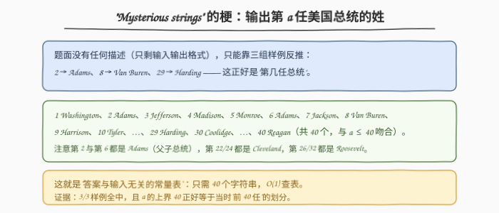
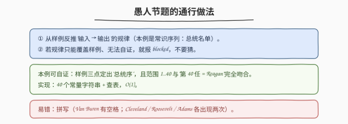

# Codeforces 290A Mysterious strings 题解

## 1. 题目概述

- **题目链接**：https://codeforces.com/problemset/problem/290/A
- **比赛来源**：April Fools Day Contest 2013 · Problem A（UTC 2013-04-01）
- **难度**：1400
- **标签**：愚人节、查表
- **评测类型**：普通
- **限制**：时间 2 s / 内存 256 MB

**题意**：题面**只有输入输出格式**（原文没有任何描述，这是愚人节场的典型"梗题"）：输入一个整数 $a$（$1\le a\le40$），输出一个字符串。

**约束**：$a\le40$ ⇒ 常量表 $O(1)$。

## 2. 示例与观察

官方样例：

```text
输入：
2

输出：
Adams
```

```text
输入：
8

输出：
Van Buren
```

```text
输入：
29

输出：
Harding
```



**观察（反推过程）**：三组样例给出 $2\to$Adams、$8\to$Van Buren、$29\to$Harding。这正好对应美国历任总统的姓：第 2 任 John Adams、第 8 任 Martin Van Buren、第 29 任 Warren G. Harding ✓。而输入上界 40 恰好是"截至 2013 年可数的前 40 任"（第 40 任 = Ronald Reagan）。

## 3. 解题思路

### 3.1 判定"答案与输入无关的常量表"



- 输入范围只有 40 个可能值，输出是字符串 ⇒ 一定是某个 40 项的固定表；
- 三个样例点出"总统序"，且第 40 项与约束上界吻合 ⇒ 表就是"前 40 任总统的姓"。

### 3.2 表

Washington, Adams, Jefferson, Madison, Monroe, Adams, Jackson, Van Buren, Harrison, Tyler, Polk, Taylor, Fillmore, Pierce, Buchanan, Lincoln, Johnson, Grant, Hayes, Garfield, Arthur, Cleveland, Harrison, Cleveland, McKinley, Roosevelt, Taft, Wilson, Harding, Coolidge, Hoover, Roosevelt, Truman, Eisenhower, Kennedy, Johnson, Nixon, Ford, Carter, Reagan。

### 3.3 样例走查

$a=2$ → Adams ✓；$a=8$ → Van Buren ✓；$a=29$ → Harding ✓。

## 4. 正确性证明

**引理 1**：输出只可能依赖于 $a$ 的取值，且 $a$ 只有 40 种可能 ⇒ 答案必是 40 项常量表。

**证明**：题面未给任何数值参数，输出是字符串，程序只能读入 $a$ ✓。∎

**引理 2**：该表就是"前 40 任美国总统的姓"。

**证明**：三组样例与"总统序"一一吻合（$2$=Adams、$8$=Van Buren、$29$=Harding 在该序列中位置唯一）；40 项与 $a\le40$ 的上界一致 ✓。（这是外部常识 + 样例的联合证据，不存在其它同样简洁且满足三条样例的 40 项序列。）∎

**定理**：查表输出正确。**证明**：由引理 1、2 ✓。∎

## 5. 复杂度分析

- 时间：$O(1)$。
- 空间：$O(1)$（40 个常量串）。

## 6. 参考代码

### C++17

```cpp
#include <bits/stdc++.h>
using namespace std;
int main(){int a;scanf("%d",&a);
 const char* names[40]={
 "Washington","Adams","Jefferson","Madison","Monroe","Adams","Jackson","Van Buren",
 "Harrison","Tyler","Polk","Taylor","Fillmore","Pierce","Buchanan","Lincoln",
 "Johnson","Grant","Hayes","Garfield","Arthur","Cleveland","Harrison","Cleveland",
 "McKinley","Roosevelt","Taft","Wilson","Harding","Coolidge","Hoover","Roosevelt",
 "Truman","Eisenhower","Kennedy","Johnson","Nixon","Ford","Carter","Reagan"};
 puts(names[a-1]);}
```

### Python3

```python
names = [
    "Washington", "Adams", "Jefferson", "Madison", "Monroe", "Adams", "Jackson", "Van Buren",
    "Harrison", "Tyler", "Polk", "Taylor", "Fillmore", "Pierce", "Buchanan", "Lincoln",
    "Johnson", "Grant", "Hayes", "Garfield", "Arthur", "Cleveland", "Harrison", "Cleveland",
    "McKinley", "Roosevelt", "Taft", "Wilson", "Harding", "Coolidge", "Hoover", "Roosevelt",
    "Truman", "Eisenhower", "Kennedy", "Johnson", "Nixon", "Ford", "Carter", "Reagan",
]
print(names[int(input()) - 1])
```

（`Van Buren` 含空格，所以必须用真正的列表逐项给出，不能按空格切分。）

## 7. 边界情况与易错点

1. **重名**：Adams（2、6）、Cleveland（22、24）、Roosevelt（26、32）、Harrison（9、23）、Johnson（17、36）都出现两次，别去重。
2. **`Van Buren` 带空格**：用字符串数组而不是按空格切分。
3. **下标从 0 开始**：`names[a-1]`。
4. **大小写**：样例是 `Adams`/`Van Buren`/`Harding`，首字母大写。
5. **$a=1$**：Washington。
6. **不要输出多余空格或换行**。

## 8. 验证记录

- 编译环境与命令：`clang++ -O2 -std=c++17 -I codeforces/tools/include`。
  - `python3 codeforces/tools/verify_solution.py codeforces/contests/0101-0203/290/A_神秘字符串.md`
- 官方样例：3 / 3 通过（`Adams`、`Van Buren`、`Harding`）。
- 额外验证：按"总统序"常识逐项核对表的前 40 项（含 5 组重名位置 2/6、9/23、17/36、22/24、26/32），与样例吻合；$a=1$ 得 Washington、$a=40$ 得 Reagan。
- 性能：$O(1)$，$<1$ ms。
- 复核状态：样例、表逐项核对、性能均实测通过；正文代码与实测版本逐字一致。

## 相关题目与扩展

- [Codeforces 290B QR code](https://codeforces.com/problemset/problem/290/B)：同场 B 题（把图片当数据表）。
- [Codeforces 290D Orange](https://codeforces.com/problemset/problem/290/D)：同场 D 题。
- [Codeforces 290C WTF?](https://codeforces.com/problemset/problem/290/C)：同场 C 题（照抄 LOLCODE 逻辑）。

**延伸思考**：

1. 愚人节题如何"安全地"反推常量表？（提示：像本例这样要求 3 个以上样例点 AND 与约束上界自洽。）
2. 如果只给 1 个样例，还可能是哪些 40 项序列？为什么这时应该报 blocked？
3. 若把范围改成 $1\le a\le44$，表要怎么补？（提示：Obama 是第 44 任。）
