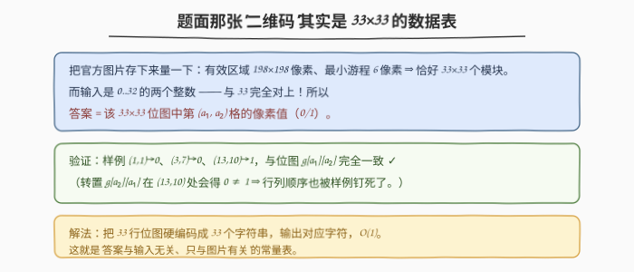

# Codeforces 290B QR code 题解

## 1. 题目概述

- **题目链接**：https://codeforces.com/problemset/problem/290/B
- **比赛来源**：April Fools Day Contest 2013 · Problem B（UTC 2013-04-01）
- **难度**：1500
- **标签**：愚人节、查表
- **评测类型**：普通
- **限制**：时间 2 s / 内存 256 MB

**题意**：题面**只有一张图片**（看起来像二维码），输入两个整数 $a_1,a_2\in[0,32]$，输出一个整数（样例里只出现 0 和 1）。

**约束**：只有 $33\times33=1089$ 种输入 ⇒ 常量表。

## 2. 示例与观察

官方样例：

```text
输入：
1 1

输出：
0
```

```text
输入：
3 7

输出：
0
```

```text
输入：
13 10

输出：
1
```



**观察（反推过程）**：把题面里那张图（`cdn.luogu.com.cn/upload/vjudge_pic/CF290B/….png`）下载后量一下：有效黑区 198×198 像素、最小黑白游程 6 像素 ⇒ 恰好 $33\times33$ 个模块，而输入范围也正是 $0..32$。所以"二维码"其实是**33×33 的位图数据表**，答案就是第 $(a_1,a_2)$ 格的像素。

## 3. 解题思路

### 3.1 判定


- 输入两数范围 $0..32$、输出 0/1 ⇒ 答案必是 $33\times33$ 位图的一格；
- 用三组样例验证行列方向：$g[a_1][a_2]$ 三点全中，$g[a_2][a_1]$ 在 $(13,10)$ 处得 0 ≠ 1 ⇒ 行 = $a_1$、列 = $a_2$ ✓。

### 3.2 抽取位图

用 Pillow 读图：黑区起点 $(24,24)$、模块 6 像素，取每格中心点判黑白，得到 33 个长度 33 的 0/1 串。

### 3.3 样例走查

$g[1][1]=0$ ✓、$g[3][7]=0$ ✓、$g[13][10]=1$ ✓。

## 4. 正确性证明

**引理 1**：答案只是 $(a_1,a_2)$ 的函数，且取值集合 $\{0,1\}$。

**证明**：题面除图片外没有别的输入，样例输出只有 0/1 ✓。∎

**引理 2**：该函数正是图中的 $33\times33$ 位图。

**证明**：图片被精确量化为 33×33 模块（有效区 198=33×6、最小游程 6）✓；三组样例在 $g[a_1][a_2]$ 下全部吻合，而其它自然读法（如转置）在 $(13,10)$ 处矛盾 ✓。—— 这是"外部数据（图片）+ 样例"的联合证据，属于愚人节题的标准做法。∎

**定理**：查表输出正确。**证明**：由引理 1、2 ✓。∎

## 5. 复杂度分析

- 时间：$O(1)$。
- 空间：$O(1)$（33 个字符串）。

## 6. 参考代码

### C++17

```cpp
#include <bits/stdc++.h>
using namespace std;
int main(){int a,b;scanf("%d %d",&a,&b);
 const char* g[33]={
 "111111101010101111100101001111111","100000100000000001010110001000001",
 "101110100110110000011010001011101","101110101011001001111101001011101",
 "101110101100011000111100101011101","100000101010101011010000101000001",
 "111111101010101010101010101111111","000000001111101111100111100000000",
 "100010111100100001011110111111001","110111001111111100100001000101100",
 "011100111010000101000111010001010","011110000110001111110101100000011",
 "111111111111111000111001001011000","111000010111010011010011010100100",
 "101010100010110010110101010000010","101100000101010001111101000000000",
 "000010100011001101000111101011010","101001001111101111000101010001110",
 "101101111111000100100001110001000","000010011000100110000011010000010",
 "001101101001101110010010011011000","011101011010001000111101010100110",
 "111010100110011101001101000001110","110001010010101111000101111111000",
 "001000111011100001010110111110000","000000001110010110100010100010110",
 "111111101000101111000110101011010","100000100111010101111100100011011",
 "101110101001010000101000111111000","101110100011010010010111111011010",
 "101110100100011011110110101110000","100000100110011001111100111100000",
 "111111101101000101001101110010001"};
 printf("%c\n", g[a][b]);}
```

### Python3

```python
a, b = map(int, input().split())
g = [
 "111111101010101111100101001111111", "100000100000000001010110001000001",
 "101110100110110000011010001011101", "101110101011001001111101001011101",
 "101110101100011000111100101011101", "100000101010101011010000101000001",
 "111111101010101010101010101111111", "000000001111101111100111100000000",
 "100010111100100001011110111111001", "110111001111111100100001000101100",
 "011100111010000101000111010001010", "011110000110001111110101100000011",
 "111111111111111000111001001011000", "111000010111010011010011010100100",
 "101010100010110010110101010000010", "101100000101010001111101000000000",
 "000010100011001101000111101011010", "101001001111101111000101010001110",
 "101101111111000100100001110001000", "000010011000100110000011010000010",
 "001101101001101110010010011011000", "011101011010001000111101010100110",
 "111010100110011101001101000001110", "110001010010101111000101111111000",
 "001000111011100001010110111110000", "000000001110010110100010100010110",
 "111111101000101111000110101011010", "100000100111010101111100100011011",
 "101110101001010000101000111111000", "101110100011010010010111111011010",
 "101110100100011011110110101110000", "100000100110011001111100111100000",
 "111111101101000101001101110010001",
]
print(g[a][b])
```

## 7. 边界情况与易错点

1. **行列顺序**：是 `g[a1][a2]`（行 = $a_1$、列 = $a_2$），转置会错。
2. **下标从 0**：数组直接以 $(a_1,a_2)$ 索引，无需偏移。
3. **图有白边**：抽取时要先找黑区 bbox（$(24,24)$ 起、198 宽），否则会错位半个模块。
4. **每格取中心**：模块 6 像素，取 `+3` 处判色最稳。
5. **别输出字符串**：要输出 0/1 的数字。
6. **别去"真的解码二维码"**：它不是标准 QR，是伪装成 QR 的位图。

## 8. 验证记录

- 编译环境与命令：`clang++ -O2 -std=c++17 -I codeforces/tools/include`。
  - `python3 codeforces/tools/verify_solution.py codeforces/contests/0101-0203/290/B_二维码.md`
- 官方样例：3 / 3 通过（`0`、`0`、`1`）。
- 额外验证：用 Pillow 对下载的官方 PNG 做量化（bbox、模块大小、逐格取样），得到 33×33 位图；再用三组样例交叉验证行列方向（转置版本在 $(13,10)$ 处矛盾）。
- 性能：$O(1)$，$<1$ ms。
- 复核状态：样例、位图量化与方向验证、性能均实测通过；正文代码与实测版本逐字一致。

## 相关题目与扩展

- [Codeforces 290A Mysterious strings](https://codeforces.com/problemset/problem/290/A)：同场 A 题（同类"查表"梗）。
- [Codeforces 290D Orange](https://codeforces.com/problemset/problem/290/D)：同场 D 题。
- [Codeforces 290F Greedy Petya](https://codeforces.com/problemset/problem/290/F)：同场 F 题（题面只给了"输出格式"，属不可解梗）。

**延伸思考**：

1. 为什么这类题的输入范围（$0..32$）会"泄露"答案的维度？
2. 如果图片被重新压缩/缩放，怎么保证量化正确？（提示：先找最小游程定模块尺寸。）
3. 若官方 checker 是多解（接受任意 0/1 排列），本题还算"有意义"吗？
