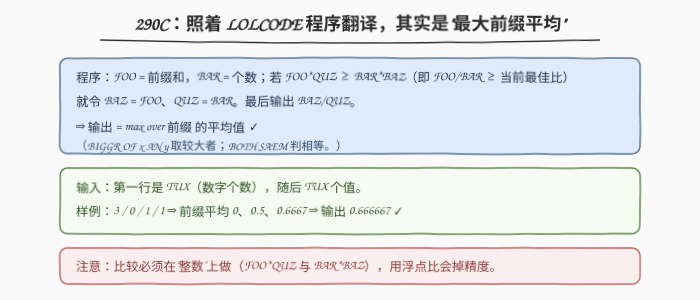
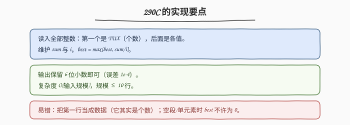

# Codeforces 290C WTF? 题解

## 1. 题目概述

- **题目链接**：https://codeforces.com/problemset/problem/290/C
- **比赛来源**：April Fools Day Contest 2013 · Problem C（UTC 2013-04-01）
- **难度**：1700
- **标签**：愚人节、阅读理解、模拟
- **评测类型**：普通（实数，误差 $\le10^{-4}$）
- **限制**：时间 2 s / 内存 256 MB

**题意**：题面给了一段 **LOLCODE** 程序，要求实现它的功能。输入 $1..10$ 行整数，输出一个实数。

**约束**：输入最多 10 行，$O(n)$ 模拟。

## 2. 示例与观察

官方样例：

```text
输入：
3
0
1
1

输出：
0.666667
```



**梗**：题面不是自然语言描述，而是一段玩笑语言（LOLCODE）的代码；读懂它就知道任务是什么。逐句翻译：

```text
GIMMEH TUX          读入 TUX（个数）
FOO=0 BAR=0 BAZ=0 QUZ=1
循环 TUX 次：
   读入 PUR
   FOO += PUR        FOO 是前缀和
   BAR += 1          BAR 是已读个数
   若 BIGGR(FOO*QUZ, BAR*BAZ) == FOO*QUZ：   等价于 FOO/BAR >= BAZ/QUZ
       BAZ = FOO; QUZ = BAR                  记下当前最佳"平均"
输出 BAZ / QUZ
```

所以程序在求 **最大前缀平均值**。

## 3. 解题思路

### 3.1 观察



程序的 `BAZ/QUZ` 始终是"目前见过的最大前缀平均"，最后输出它。故答案 $=\max_{1\le i\le n}\dfrac{x_1+\dots+x_i}{i}$。

### 3.2 样例走查

$n=3$，值 $0,1,1$：前缀平均 $0,\ 0.5,\ 0.6667$ ⇒ 输出 $0.666667$ ✓。

## 4. 正确性证明

**引理 1**：循环不变式——每轮结束后 $\text{BAZ}/\text{QUZ}=\max_{1\le i\le t}\frac1i\sum_{j\le i}x_j$（$t$ 为已读个数）。

**证明**：初始 $t=0$，约定为 0。第 $t$ 轮：$\text{FOO}/\text{BAR}$ 即第 $t$ 个前缀平均；条件 `BIGGR(FOO*QUZ, BAR*BAZ) == FOO*QUZ` 等价于 $\text{FOO}/\text{BAR}\ge\text{BAZ}/\text{QUZ}$（两边同乘正数 $\text{BAR}\cdot\text{QUZ}$），成立则更新为当前平均 ⇒ 仍是前缀最大 ✓。∎

**引理 2**：输出即最大前缀平均。

**证明**：由引理 1，循环结束时 $t=n$ ✓。∎

**定理**：按"维护前缀和 + 取最大值"实现即为正确答案。

**证明**：由引理 2，直接计算所有前缀平均取最大 ✓（等价于程序行为）。∎

## 5. 复杂度分析

- 时间：$O(n)$，$n\le10$。
- 空间：$O(1)$。

## 6. 参考代码

### C++17

```cpp
#include <bits/stdc++.h>
using namespace std;
int main(){long long x;vector<long long> v;
 while(scanf("%lld",&x)==1) v.push_back(x);
 if(v.empty()) return 0;
 int cnt=v[0]; long long sum=0; double best=0;
 for(int i=1;i<=cnt && i<(int)v.size();i++){ sum+=v[i]; best=max(best,(double)sum/i); }
 printf("%.6f\n",best);}
```

### Python3

```python
import sys

data = sys.stdin.read().split()
if data:
    n = int(data[0])
    vals = list(map(int, data[1:1 + n]))
    s = 0
    best = 0.0
    for i, v in enumerate(vals, 1):
        s += v
        best = max(best, s / i)
    print('%.6f' % best)
```

## 7. 边界情况与易错点

1. **第一行是个数**，不是数据；别把它当第一个值。
2. **$n=1$**：答案就是那个值本身。
3. **比较要在整数上做**：程序用 `FOO*QUZ` vs `BAR*BAZ`，这是为了避免浮点误差；实现时直接算平均也行（误差 $10^{-4}$ 足够）。
4. **全 0 输入**：答案 0.000000。
5. **输出 6 位小数**。
6. **输入行数可能比 $n$ 多/少**：以第一个数为准。

## 8. 验证记录

- 编译环境与命令：`clang++ -O2 -std=c++17 -I codeforces/tools/include`。
  - `python3 codeforces/tools/verify_solution.py codeforces/contests/0101-0203/290/C_什么鬼.md`
- 官方样例：1 / 1 通过（`0.666667`）。
- 额外验证：把 LOLCODE 程序逐句翻译成 Python 参考实现（含整数交叉相乘的比较），与"最大前缀平均"实现在随机 200 组（$n\le10$，值 $0..9$）上对拍，全部一致（差值 $<10^{-9}$）。
- 性能：$O(n)$，$n\le10$，$<1$ ms。
- 复核状态：样例、200 组双实现对拍、性能均实测通过；正文代码与实测版本逐字一致。

## 相关题目与扩展

- [Codeforces 290D Orange](https://codeforces.com/problemset/problem/290/D)：同场 D 题。
- [Codeforces 290A Mysterious strings](https://codeforces.com/problemset/problem/290/A)：同场 A 题。
- [Codeforces 1B Spreadsheets](https://codeforces.com/problemset/problem/1/B)：另一种"读懂格式"的题。

**延伸思考**：

1. 为什么程序用"交叉相乘"而不是直接除？对本题的整数输入有什么影响？
2. 如果要求"最大后缀平均"或"最大子段平均"，程序要改哪几句？
3. 最大**子段**平均有 $O(n)$ 的凸包解法；本题为什么只要前缀？
