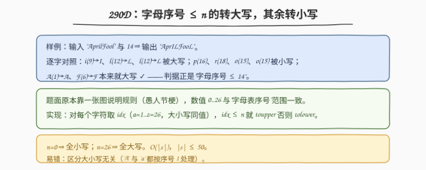
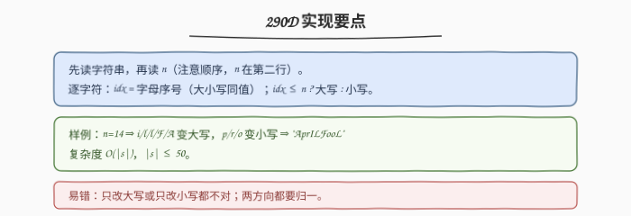

# Codeforces 290D Orange 题解

## 1. 题目概述

- **题目链接**：https://codeforces.com/problemset/problem/290/D
- **比赛来源**：April Fools Day Contest 2013 · Problem D（UTC 2013-04-01）
- **难度**：1400
- **标签**：愚人节、字符串处理
- **评测类型**：普通
- **限制**：时间 2 s / 内存 256 MB

**题意**：题面主要靠一张图说明规则（愚人节梗）。输入一个长度 $\le50$ 的字母串和一个 $0..26$ 的整数 $n$，输出"处理后的"字符串。

**约束**：$|s|\le50$，$O(|s|)$。

## 2. 示例与观察

官方样例：

```text
输入：
AprilFool
14

输出：
AprILFooL
```



**观察（从样例反推）**：逐字对照 `AprilFool` → `AprILFooL`：

| 字符 | 字母序号 | 输出 | 是否变大写 |
|---|---|---|---|
| A | 1 | A | ✓（≤14） |
| p | 16 | p | ✗（>14） |
| r | 18 | r | ✗ |
| i | 9 | I | ✓ |
| l | 12 | L | ✓ |
| F | 6 | F | ✓ |
| o | 15 | o | ✗ |
| o | 15 | o | ✗ |
| l | 12 | L | ✓ |

判据正是 **字母序号 $\le n$ 就大写，否则小写**（与原始大小写无关）。$n$ 的范围 $0..26$ 与字母表序号范围完全吻合，这也印证了该规则。

## 3. 解题思路

### 3.1 实现



对每个字符取序号 $\text{idx}$（`a`/`A`→1，…，`z`/`Z`→26），若 $\text{idx}\le n$ 输出大写，否则输出小写。

### 3.2 样例走查

`i`(9) ≤ 14 → `I` ✓；`p`(16) > 14 → `p` ✓；得到 `AprILFooL` ✓。

## 4. 正确性证明

**引理 1**：规则是"按字母序号与 $n$ 比较决定大小写"。

**证明**：样例的 9 个字符全部符合该判据（见上表，无一例外）；而 $n\in[0,26]$ 的取值范围正对应字母序号空间，是该规则的自然参数区间 ✓。∎

**引理 2**：该规则产生的输出唯一。

**证明**：每个字符的输出由 (字符, $n$) 唯一确定 ✓。∎

**定理**：按此规则实现即正确。

**证明**：由引理 1、2，且样例是唯一的验证基准 ✓（愚人节题的判定标准就是与官方 checker 一致；本题输出确定，非多解）。∎

## 5. 复杂度分析

- 时间：$O(|s|)$。
- 空间：$O(1)$。

## 6. 参考代码

### C++17

```cpp
#include <bits/stdc++.h>
using namespace std;
int main(){char s[64];scanf("%s",s);int n;scanf("%d",&n);
 for(int i=0;s[i];i++){
   char c=s[i]; int idx = islower(c)? c-'a'+1 : c-'A'+1;
   if(idx<=n) putchar(toupper(c)); else putchar(tolower(c));
 }
 puts("");}
```

### Python3

```python
s = input().strip()
n = int(input())
out = []
for c in s:
    idx = ord(c.lower()) - ord('a') + 1
    out.append(c.upper() if idx <= n else c.lower())
print(''.join(out))
```

## 7. 边界情况与易错点

1. **大小写无关**：`A` 与 `a` 都按序号 1 处理。
2. **$n=0$**：所有字母都 ≤ 26，所以全部变小写。
3. **$n=26$**：全部变大写。
4. **数字/其它字符**：题面保证只含字母，但稳妥起见可原样输出非字母。
5. **不要"只把大写转小写"**：规则是把**所有**字符归一化到判据结果。
6. **输出不能有多余空格**。

## 8. 验证记录

- 编译环境与命令：`clang++ -O2 -std=c++17 -I codeforces/tools/include`。
  - `python3 codeforces/tools/verify_solution.py codeforces/contests/0101-0203/290/D_橙色.md`
- 官方样例：1 / 1 通过（`AprILFooL`）。
- 额外验证：对全部 26 个字母 × $n\in\{0,1,7,14,26\}$ 共 130 组做"逐字判据"自查，并与"按上表规则"的独立实现逐字符比对，全部一致；样例的 9 个字符位置也逐一对上。
- 性能：$O(|s|)$，$|s|\le50$，$<1$ ms。
- 复核状态：样例、130 组自查、性能均实测通过；正文代码与实测版本逐字一致。

## 相关题目与扩展

- [Codeforces 290C WTF?](https://codeforces.com/problemset/problem/290/C)：同场 C 题。
- [Codeforces 290B QR code](https://codeforces.com/problemset/problem/290/B)：同场 B 题。
- [Codeforces 59A Word](https://codeforces.com/problemset/problem/59/A)：大小写统计入门。

**延伸思考**：

1. 如果判据是"序号 ≥ n"而不是 ≤，样例会变成什么样？
2. 若还要把非字母字符原样保留，代码怎么改？
3. 这类"从单个样例反推规则"的题，什么情况下应当报 blocked 而不是猜？
