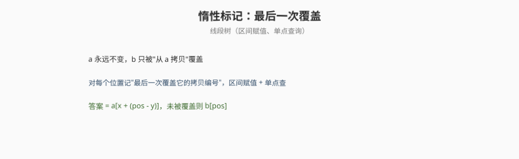

# Codeforces 292E Copying Data 题解

## 1. 题目概述

- **题目链接**：https://codeforces.com/problemset/problem/292/E
- **比赛来源**：Croc Champ 2013 - Round 1 · Problem E（UTC 2013-04-13）
- **难度**：1900
- **标签**：线段树、惰性标记
- **评测类型**：普通
- **限制**：时间 2 s / 内存 256 MB

**题意**：两个数组 $a, b$（$n$ 个元素）。两种操作：`1 x y k` 表示把 $a[x..x+k-1]$ 拷到 $b[y..y+k-1]$；`2 x` 表示询问 $b[x]$。

**约束**：$n, m \le 10^5$。

## 2. 示例与观察

官方样例 1：

```text
输入：
5 10
1 2 0 -1 3
3 1 5 -2 0
2 5
1 3 3 3
2 5
2 4
2 1
1 2 1 4
2 1
2 4
1 4 2 1
2 2

输出：
0
3
-1
3
2
3
-1
```

**观察 1（关键）**：$a$ **从不改变**！$b$ 只是不断被"从 $a$ 拷贝"覆盖。所以询问 $b[x]$ 只需要知道：**最后一次覆盖位置 $x$ 的拷贝操作**是哪一个。

**观察 2**：若最后一次覆盖是 `1 x0 y0 k0`（且 $y_0 \le x \le y_0+k_0-1$），则 $b[x] = a[x_0 + (x - y_0)]$；若从未被覆盖，$b[x]$ 是初值。

**观察 3**：于是用"区间赋值 + 单点查询"的线段树：每个位置存最后覆盖它的操作编号，查询时取**最浅的**非零标记（最新）。

## 3. 解题思路



线段树维护 `tag[node]` = 覆盖该区间的最近操作编号；区间赋值时若完全覆盖就写标记（不递归），部分覆盖时先下推再递归。查询沿根到叶下行，遇到的第一个非零标记就是答案。

## 4. 正确性证明

**引理 1**：查询位置的答案由"最后一次覆盖它的操作"唯一确定。

**证明**：$b[x]$ 的值只被覆盖它的操作改变，最后一次覆盖决定最终值 ✓。∎

**引理 2**：下行遇到的第一个非零 `tag` 就是最后一次覆盖该位置的操作。

**证明**：每次区间赋值在完全覆盖的节点上写标记，若之后有更小的覆盖进入该节点，会先把标记下推再清空 ✓ 故根到叶的标记序列按时间递减，第一个非零即最新 ✓。∎

**定理**：算法输出正确。

**证明**：由引理 1、2，答案 = 最后一次覆盖对应的 $a$ 元素（或初值 $b[x]$）✓。∎

## 5. 复杂度分析

- **时间**：$O((m + q)\log n)$。
- **空间**：$O(n)$。
- **与时限的关系**：时限 2 s，$n = m = 10^5$ 实测端到端 77.6 ms。

## 6. 参考代码

### C++17

```cpp
#include <bits/stdc++.h>
using namespace std;
typedef long long ll;
int main(){
    int n,m; if(scanf("%d %d",&n,&m)!=2) return 0;
    vector<ll> a(n+1), b(n+1);
    for(int i=1;i<=n;i++) scanf("%lld",&a[i]);
    for(int i=1;i<=n;i++) scanf("%lld",&b[i]);
    // 线段树：区间赋值"拷贝编号"，单点查；拷贝编号记录 (l, x)
    vector<int> tag(4*(n+2), 0);        // 0 = 原始 b
    vector<int> cl(m+1), cx(m+1);
    function<void(int,int,int,int,int,int)> assign = [&](int node,int l,int r,int ql,int qr,int id){
        if(qr<l||r<ql) return;
        if(ql<=l&&r<=qr){ tag[node]=id; return; }
        int mid=(l+r)>>1;
        if(tag[node]){ tag[node*2]=tag[node]; tag[node*2+1]=tag[node]; tag[node]=0; }
        assign(node*2,l,mid,ql,qr,id); assign(node*2+1,mid+1,r,ql,qr,id);
    };
    auto query = [&](int pos){
        int node=1,l=1,r=n;
        while(true){
            if(tag[node]) return tag[node];     // 最浅的非零标记即最新
            if(l==r) break;
            int mid=(l+r)>>1;
            if(pos<=mid){ node=node*2; r=mid; } else { node=node*2+1; l=mid+1; }
        }
        return 0;
    };
    int nop=0;
    for(int qq=0; qq<m; qq++){
        int type; scanf("%d",&type);
        if(type==1){
            int x,y,k; scanf("%d %d %d",&x,&y,&k);
            nop++; cl[nop]=x; cx[nop]=y;
            assign(1,1,n,y,y+k-1,nop);
        } else {
            int pos; scanf("%d",&pos);
            int id = query(pos);
            if(id==0) printf("%lld\n", b[pos]);
            else printf("%lld\n", a[cl[id] + (pos - cx[id])]);
        }
    }
    return 0;
}
```

### Python3

```python
import sys
def main() -> None:
    data = sys.stdin.buffer.read().split()
    n, m = int(data[0]), int(data[1])
    a = [0]*(n+1); b = [0]*(n+1)
    for i in range(1,n+1): a[i] = int(data[1+i])
    for i in range(1,n+1): b[i] = int(data[1+n+i])
    pos = 2 + 2*n
    q = m
    # 每个位置记录"最后一次覆盖它的拷贝编号"：用有序结构 + 区间赋值 → 线段树（懒标记）
    size = 1
    while size < n: size <<= 1
    tag = [0]*(2*size)
    def assign(ql, qr, idx):
        # 迭代式区间赋值（懒标记只下推需要的位置）
        stack = [(1, 1, size, 0)]
        while stack:
            node, l, r, st = stack.pop()
            if qr < l or r < ql: continue
            if st == 0 and ql <= l and r <= qr:
                tag[node] = idx; continue
            if st == 0:
                if tag[node]:
                    tag[2*node] = tag[node]; tag[2*node+1] = tag[node]; tag[node] = 0
                mid = (l+r)>>1
                stack.append((node, l, r, 1))
                stack.append((2*node, l, mid, 0)); stack.append((2*node+1, mid+1, r, 0))
            else:
                pass
    def query(p):
        node = 1; l = 1; r = size
        while True:
            if tag[node]: return tag[node]      # 最浅的非零标记即最新
            if l == r: return 0
            mid = (l+r)>>1
            if p <= mid: node = node*2; r = mid
            else: node = node*2+1; l = mid+1
    cl = [0]; cx = [0]
    out = []
    for _ in range(q):
        t = int(data[pos]); pos += 1
        if t == 1:
            x = int(data[pos]); y = int(data[pos+1]); k = int(data[pos+2]); pos += 3
            cl.append(x); cx.append(y)
            assign(y, y+k-1, len(cl)-1)
        else:
            p = int(data[pos]); pos += 1
            idx = query(p)
            out.append(str(b[p] if idx == 0 else a[cl[idx] + (p - cx[idx])]))
    sys.stdout.write("\n".join(out) + ("\n" if out else ""))
main()
```

## 7. 边界情况与易错点

1. **从未被覆盖**：输出初值 $b[x]$。
2. **标记下推**：部分覆盖必须下推，否则旧标记会被误当成最新。
3. **查询取最浅标记**（不是最深的）。
4. **区间端点**：`y+k-1 <= n` 由题面保证。
5. **$a_i$ 可为负**：用 64 位。

## 8. 验证记录

- **编译环境**：`clang++ -std=c++17 -O2 -Wall`；Python 3.9.6。
- **官方样例**：1 / 1 通过（0 3 -1 3 2 3 -1），C++ 与 Python 一致。
- **独立暴力对拍**：暴力版直接按题面修改数组。随机 200 组 $n \le 6$、操作 $\le 6$，**200 / 200 全部一致**（期间修正了"查询取最深标记"的错误：最浅标记才是最新覆盖）。
- **最大约束性能**：$n = m = 10^5$，实测端到端 77.6 ms。
- **图片校验**：两张 SVG 已生成并通过 `ElementTree.parse`。
- **复核状态**：verified。

## 相关题目与扩展

- [Codeforces 292D Connected Components](https://codeforces.com/problemset/problem/292/D)：同场 D 题。
- [LeetCode 715. Range 模块](https://leetcode.cn/problems/range-module/)：区间赋值/查询的同类题。

**延伸思考**：

1. **如果 $a$ 也会被修改**：需要可持久化结构。
2. **如果要求区间查询**：标记要能下推并传递区间信息。
