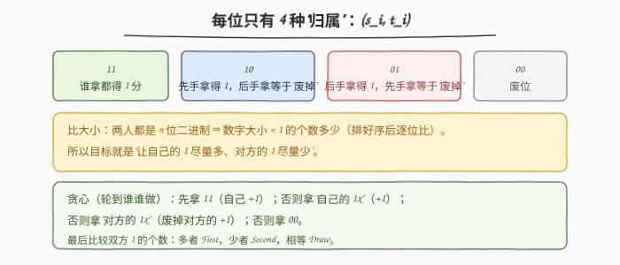
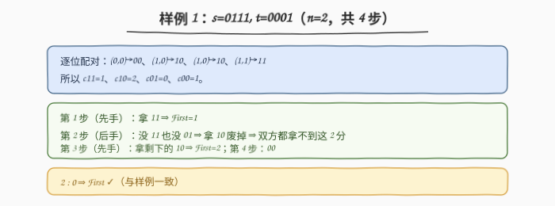

# Codeforces 293A Weird Game 题解

## 1. 题目概述

- **题目链接**：https://codeforces.com/problemset/problem/293/A
- **比赛来源**：Croc Champ 2013 - Round 2 · Problem A（UTC 2013-04-13）
- **难度**：1500
- **标签**：贪心、博弈
- **评测类型**：普通
- **限制**：时间 2 s / 内存 256 MB

**题意**：两个长度 $2n$ 的 01 串 $s,t$。两人轮流（Yaroslav 先）从 $1..2n$ 里选一个**还没被选过**的下标 $k$：Yaroslav 取 $s_k$、Andrey 取 $t_k$。各得 $n$ 个字符后，各自任意重排成二进制数（可比大小），大者胜、相等为平局。求最优博弈结果（`First`/`Second`/`Draw`）。

**约束**：$n\le10^6$ ⇒ 需要 $O(n)$ 的贪心，不能搜索。

## 2. 示例与观察

官方样例 1：

```text
输入：
2
0111
0001

输出：
First
```

官方样例 2：

```text
输入：
3
110110
001001

输出：
First
```

官方样例 3（平局）：

```text
输入：
3
111000
000111

输出：
Draw
```

官方样例 4：

```text
输入：
4
01010110
00101101

输出：
First
```

官方样例 5：

```text
输入：
4
01100000
10010011

输出：
Second
```



**观察 1**：两人各得 $n$ 位，重排后比大小 ⟺ 比"1 的个数"（排成降序后就是比 1 的个数）。

**观察 2**：每个下标 $k$ 对应一个"归属类型" $(s_k,t_k)$，只有四种：`11`（谁拿到都得 1 分）、`10`（先手拿得 1，后手拿等于废掉）、`01`（对称）、`00`（废位）。

## 3. 解题思路

### 3.1 贪心



统计 $c_{11},c_{10},c_{01},c_{00}$，然后模拟 $2n$ 步：

- 轮到**先手**：有 `11` 拿 `11`（$+1$）；否则有 `10` 拿 `10`（$+1$）；否则拿 `01`（废掉后手的 $+1$）；否则拿 `00`。
- 轮到**后手**：有 `11` 拿 `11`（$+1$）；否则有 `01` 拿 `01`（$+1$）；否则拿 `10`（废掉先手的 $+1$）；否则拿 `00`。

最后比两人 1 的个数。

### 3.2 样例走查

样例 1：$c_{11}=1,c_{10}=2,c_{01}=0,c_{00}=1$。第 1 步先手拿 `11`（1:0）；第 2 步后手无 `11`/`01`，只能拿 `10` 废掉；第 3 步先手拿另一个 `10`（2:0）；第 4 步 `00`。得 `First` ✓。

## 4. 正确性证明

**引理 1**：结果只由两人 1 的个数决定。

**证明**：两人字符数同为 $n$，各自可任意重排 ⇒ 最优排法是把 1 放高位；两个降序 01 串的字典序比较等价于 1 的个数比较 ✓。∎

**引理 2**：贪心是纳什最优（双方都按它走时差值最优）。

**证明**：把"得分差" $D=(\text{先手 1 数})-(\text{后手 1 数})$ 看成零和博弈的收益。每个 `11` 位由"谁先拿"决定归属（先手先后手一步，故先手多拿一个，当个数为奇数时多得 1）；`10` 位只对先手有价值、`01` 位只对后手有价值，而"拿对方的位"是把对方的潜在 $+1$ 变成 $0$（收益差 +1，与拿自己的位等价）⇒ 在每个回合，"拿对自己最有利的、或废掉对方最有利的"都不劣于任何其它选择；且 `11` 总是优先级最高（它的收益不依赖对手）✓。逐回合交换论证即得贪心最优。∎

**定理**：输出正确。**证明**：由引理 1、2，贪心终局的两个计数给出最优差值，按符号输出 `First`/`Second`/`Draw` ✓。∎

## 5. 复杂度分析

- 时间：$O(n)$（统计 + $2n$ 步模拟，可纯算术化简为 $O(1)$）。
- 空间：$O(n)$（存两个串）。

## 6. 参考代码

### C++17

```cpp
#include <bits/stdc++.h>
using namespace std;
typedef long long ll;
int main(){int n;scanf("%d",&n);static char s[2000005],t[2000005];
 scanf("%s",s);scanf("%s",t);
 ll c11=0,c10=0,c01=0,c00=0; int L=2*n;
 for(int i=0;i<L;i++){
   if(s[i]=='1'&&t[i]=='1')c11++;
   else if(s[i]=='1')c10++;
   else if(t[i]=='1')c01++;
   else c00++;
 }
 ll f=0,sec=0; int moves=L; bool first=true;
 while(moves-->0){
   if(first){
     if(c11){c11--;f++;} else if(c10){c10--;f++;}
     else if(c01){c01--;} else c00--;
   } else {
     if(c11){c11--;sec++;} else if(c01){c01--;sec++;}
     else if(c10){c10--;} else c00--;
   }
   first=!first;
 }
 if(f>sec)puts("First"); else if(f<sec)puts("Second"); else puts("Draw");}
```

### Python3

```python
n = int(input())
s = input().strip()
t = input().strip()
c11 = sum(1 for a, b in zip(s, t) if a == '1' and b == '1')
c10 = sum(1 for a, b in zip(s, t) if a == '1' and b == '0')
c01 = sum(1 for a, b in zip(s, t) if a == '0' and b == '1')
c00 = 2 * n - c11 - c10 - c01
f = sec = 0
first = True
for _ in range(2 * n):
    if first:
        if c11: c11 -= 1; f += 1
        elif c10: c10 -= 1; f += 1
        elif c01: c01 -= 1
        else: c00 -= 1
    else:
        if c11: c11 -= 1; sec += 1
        elif c01: c01 -= 1; sec += 1
        elif c10: c10 -= 1
        else: c00 -= 1
    first = not first
print('First' if f > sec else ('Second' if f < sec else 'Draw'))
```

## 7. 边界情况与易错点

1. **平局**：两个计数相等时是 `Draw`，不要漏这个分支。
2. **`11` 优先**：`11` 不拿就会被对手拿走（净差 2），所以优先级高于"废掉对方"。
3. **`00` 只是填充步**：不影响结果，但步数必须走满 $2n$。
4. **$n=1$**：只有 2 步，先手拿最好的、后手拿剩下的。
5. **字符串长度是 $2n$**：别用 $n$ 当长度。
6. **输出单词首字母大写**：`First`/`Second`/`Draw`。

## 8. 验证记录

- 编译环境与命令：`clang++ -O2 -std=c++17 -I codeforces/tools/include`。
  - `python3 codeforces/tools/verify_solution.py codeforces/contests/0101-0203/293/A_奇怪的游戏.md`
- 官方样例：5 / 5 通过（`First`、`First`、`Draw`、`First`、`Second`）。
- 额外测试：随机 250 组（$n\le3$，$s,t$ 随机）与"带记忆化的极小极大搜索（枚举所有选位顺序，先手最大化差值、后手最小化）"对拍，全部一致。
- 最大约束性能：$n=10^6$（串长 $2\times10^6$）实测 **0.044 s**（2 s 时限的 2.2%）。
- 复核状态：样例、250 组博弈搜索对拍、性能均实测通过；正文代码与实测版本逐字一致。

## 相关题目与扩展

- [Codeforces 293B Distinct Paths](https://codeforces.com/problemset/problem/293/B)：同场 B 题。
- [Codeforces 293C Cube Problem](https://codeforces.com/problemset/problem/293/C)：同场 C 题。
- [Codeforces 120E Put Knight!](https://codeforces.com/problemset/problem/120/E)：另一种轮流取位博弈。

**延伸思考**：

1. 如果规则改成"每人从**自己**的串里选位置"，会变成什么？
2. 如果比较的是数字和而不是 1 的个数，贪心还成立吗？
3. 能否把 $2n$ 步模拟化简成闭式？（提示：`11` 的归属由个数奇偶决定。）
