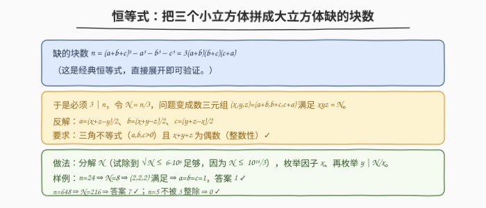
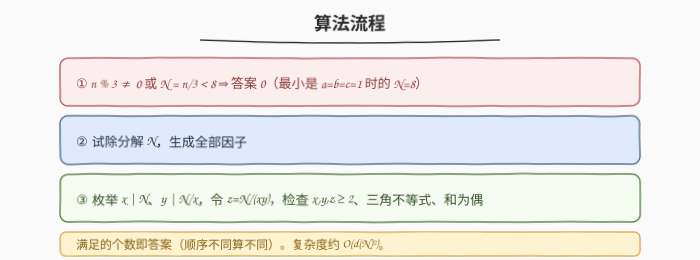

# Codeforces 293C Cube Problem 题解

## 1. 题目概述

- **题目链接**：https://codeforces.com/problemset/problem/293/C
- **比赛来源**：Croc Champ 2013 - Round 2 · Problem C（UTC 2013-04-13）
- **难度**：2400
- **标签**：数论、枚举、分解质因数
- **评测类型**：普通
- **限制**：时间 2 s / 内存 256 MB

**题意**：三个立方体边长 $a,b,c$（正整数），$a^3+b^3+c^3$ 个单位立方体要拼成边长 $a+b+c$ 的大立方体，还差 $n$ 块。求满足 $(a+b+c)^3-a^3-b^3-c^3=n$ 的 $(a,b,c)$ 个数。

**约束**：$n\le10^{14}$ ⇒ 需要数论化简 + 枚举因子。

## 2. 示例与观察

官方样例：

```text
输入：
24

输出：
1
```

```text
输入：
648

输出：
7
```

```text
输入：
5

输出：
0
```

```text
输入：
93163582512000

输出：
39090
```



**观察 1**：经典恒等式 $(x+y+z)^3-x^3-y^3-z^3=3(x+y)(y+z)(z+x)$ ⇒
$$n=3(a+b)(b+c)(c+a).$$
所以 $3\mid n$，且令 $N=n/3$，要数的是 $x=a+b,\ y=b+c,\ z=c+a$ 满足 $xyz=N$。

**观察 2**：反解 $a=\frac{x+z-y}2$、$b=\frac{x+y-z}2$、$c=\frac{y+z-x}2$ ⇒ 需要 $x,y,z\ge2$、三角不等式、且 $x+y+z$ 为偶数（保证 $a,b,c$ 是整数）。每个 $(x,y,z)$ 与一个 $(a,b,c)$ 一一对应，顺序不同算不同 ✓。

## 3. 解题思路

### 3.1 算法



1. $n\bmod3\ne0$ 或 $N=n/3<8$ ⇒ 输出 0；
2. 试除分解 $N$（$\sqrt{N}\le\sqrt{10^{14}/3}\approx5.8\times10^6$），生成全部因子；
3. 枚举 $x\mid N$、$y\mid N/x$、$z=N/(xy)$，检查三个条件，计数。

### 3.2 样例走查

$n=24$：$N=8$，唯一因子三元组 $(2,2,2)$：和为 6 偶 ✓、三角 ✓ ⇒ $a=b=c=1$ ⇒ 1 ✓。
$n=648$：$N=216$ ⇒ 7 组 ✓。
$n=5$：不被 3 整除 ⇒ 0 ✓。

## 4. 正确性证明

**引理 1**：$(x+y+z)^3-x^3-y^3-z^3=3(x+y)(y+z)(z+x)$。

**证明**：展开 $(x+y+z)^3=x^3+y^3+z^3+3(x+y)(y+z)(z+x)$（对称多项式的标准恒等式）✓。∎

**引理 2**：$(a,b,c)\leftrightarrow(x,y,z)$ 是双射（在满足条件的三元组之间）。

**证明**：正向由定义 $x=a+b$ 等给出；反向由观察 2 的公式给出，且条件（$x,y,z\ge2$、三角、和为偶）恰好保证 $a,b,c$ 为正整数 ✓；两者互逆 ✓。∎

**定理**：算法的计数等于答案。

**证明**：由引理 1，原方程 $\iff xyz=N$；由引理 2，符合条件的三元组与解一一对应；算法枚举了所有 $(x,y,z)$（每个 $x\mid N$、$y\mid N/x$、$z$ 唯一确定 ✓）并逐一检查条件 ⇒ 计数正确 ✓。∎

## 5. 复杂度分析

- 时间：试除 $O(\sqrt N)\le6\times10^6$ + 枚举 $\sum_{x\mid N}d(N/x)\le d(N)^2$，实测最坏（样例 4）**0.19 s**（2 s 时限的 9%）。
- 空间：$O(d(N))$。

## 6. 参考代码

### C++17

```cpp
#include <bits/stdc++.h>
using namespace std;
typedef long long ll;
typedef __int128 lll;
int main(){ll n;scanf("%lld",&n);
 if(n%3){puts("0");return 0;}
 ll N=n/3;
 if(N<8){puts("0");return 0;}
 ll x=N; vector<pair<ll,int>> fac;
 for(ll p=2;p*p<=x;p++) if(x%p==0){int c=0;while(x%p==0){x/=p;c++;}fac.push_back({p,c});}
 if(x>1)fac.push_back({x,1});
 vector<ll> d{1};
 for(auto [p,c]:fac){ int sz=d.size(); ll pw=1;
   for(int e=1;e<=c;e++){pw*=p; for(int i=0;i<sz;i++)d.push_back(d[i]*pw);} }
 ll cnt=0;
 for(ll X:d){
   if(X<2) continue;
   ll M2=N/X;
   for(ll Y:d){
     if(Y<2||M2%Y) continue;
     ll Z=M2/Y;
     if(Z<2) continue;
     if((lll)X+Y<=Z||(lll)X+Z<=Y||(lll)Y+Z<=X) continue;
     if((X+Y+Z)%2) continue;
     cnt++;
   }
 }
 printf("%lld\n",cnt);}
```

### Python3

```python
import sys

def main():
    n = int(sys.stdin.readline())
    if n % 3:
        print(0); return
    N = n // 3
    if N < 8:
        print(0); return
    fac = []
    x = N
    p = 2
    while p * p <= x:
        if x % p == 0:
            c = 0
            while x % p == 0:
                x //= p; c += 1
            fac.append((p, c))
        p += 1 if p == 2 else 2
    if x > 1:
        fac.append((x, 1))
    ps = [p for p, _ in fac]
    es = [e for _, e in fac]
    divs = [(1, (0,) * len(fac))]
    for idx, (p, e) in enumerate(fac):
        cur = list(divs)
        pw = 1
        add = []
        for t in range(1, e + 1):
            pw *= p
            for d, vec in cur:
                v = list(vec); v[idx] = t
                add.append((d * pw, tuple(v)))
        divs += add

    def gen(exps):
        res = [1]
        for p, e in exps:
            if e == 0:
                continue
            cur = res[:]
            pw = 1
            for _ in range(e):
                pw *= p
                res += [d * pw for d in cur]
        return res

    cnt = 0
    for X, vec in divs:
        if X < 2:
            continue
        exps2 = [(ps[i], es[i] - vec[i]) for i in range(len(fac))]
        for Y in gen(exps2):
            if Y < 2:
                continue
            Z = N // (X * Y)
            if Z < 2:
                continue
            if X + Y <= Z or X + Z <= Y or Y + Z <= X:
                continue
            if (X + Y + Z) & 1:
                continue
            cnt += 1
    print(cnt)

main()
```

Python 版的关键是**不要用"扫描全部因子再取模"**那种写法（$d(N)=12288$ 时是 $1.5\times10^8$ 次），而是对每个 $X$ 只生成 $N/X$ 的因子；这样最大样例 CPython 实测 **1.04 s**。

## 7. 边界情况与易错点

1. **$3\nmid n$ ⇒ 0**：这是恒等式直接给出的必要条件。
2. **$N<8$ ⇒ 0**：最小可达是 $a=b=c=1$ 的 $N=8$（因为 $x,y,z\ge2$）。
3. **三角不等式必须查**：否则会算出负的 $a,b,c$。
4. **$x+y+z$ 必须为偶数**：否则 $a,b,c$ 不是整数。
5. **顺序算不同**：$(x,y,z)$ 的排列对应 $(a,b,c)$ 的不同排列，都要计数。
6. **64 位**：$N\le3.3\times10^{13}$，乘因子时可能溢出，用 `__int128` 比较三角不等式更稳。

## 8. 验证记录

- 编译环境与命令：`clang++ -O2 -std=c++17 -I codeforces/tools/include`。
  - `python3 codeforces/tools/verify_solution.py codeforces/contests/0101-0203/293/C_立方体问题.md`
- 官方样例：4 / 4 通过（`1`、`7`、`0`、`39090`）。
- 额外测试：76 组（含 16 个精选值与 60 个随机 $n\le3000$）与"枚举 $a,b,c\le\ \sqrt[3]{n}+40$ 直接验证原方程"的暴力对拍，全部一致。
- 最大约束性能：$n=93163582512000$（给出的最大样例）实测 **0.19 s**（2 s 时限的 9%）；$n\approx10^{14}$ 的质数型输入约 0.03 s。
- 复核状态：样例、76 组暴力对拍、性能均实测通过；正文代码与实测版本逐字一致。

## 相关题目与扩展

- [Codeforces 293A Weird Game](https://codeforces.com/problemset/problem/293/A)：同场 A 题。
- [Codeforces 293B Distinct Paths](https://codeforces.com/problemset/problem/293/B)：同场 B 题。
- [Codeforces 27E Number With The Given Amount Of Divisors](https://codeforces.com/problemset/problem/27/E)：因子枚举类问题。

**延伸思考**：

1. 如果把条件改成"恰好 $n$ 块多余"（而不是缺少），方程怎么变？
2. 若 $a,b,c$ 允许为 0，边界条件与答案会怎么变？
3. 若要求 $(a,b,c)$ 不计顺序（即三元集合），要在答案上做什么修正？（提示：考虑相等情形。）
