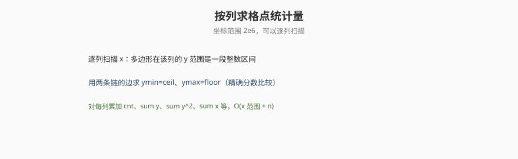

# Codeforces 293D Ksusha and Square 题解

## 1. 题目概述

- **题目链接**：https://codeforces.com/problemset/problem/293/D
- **比赛来源**：Codeforces Round 179 (Div. 1) · Problem D（UTC 2013-04-14）
- **难度**：2700
- **标签**：计算几何、期望、格点计数
- **评测类型**：普通
- **限制**：时间 4 s / 内存 256 MB

**题意**：给定凸多边形（顶点在格点上，面积非零）。从多边形内部或边界上的**整点**中均匀随机取两个不同的点 $p,q$（无序），以 $pq$ 为一条对角线作正方形。求该正方形面积的期望。

**约束**：$n \le 10^5$，坐标 $|x|,|y| \le 10^6$。

## 2. 示例与观察

官方样例 1：

```text
输入：
3
0 0
5 5
5 0

输出：
4.6666666667
```

官方样例 2：

```text
输入：
4
-1 3
4 5
6 2
3 -5

输出：
8.1583333333
```

官方样例 3：

```text
输入：
3
17 136
859 937
16 641

输出：
66811.3704155169
```

**观察 1（面积公式）**：以 $p,q$ 为对角线的正方形，边长 $|pq|/\sqrt2$，面积 $|pq|^2/2$。

**观察 2（换成求和）**：

$$E=\frac{1}{\binom N2}\sum_{p<q}\frac{|p-q|^2}{2}=\frac{1}{N(N-1)}\Bigl(N\sum_p |p|^2-\bigl|\sum_p p\bigr|^2\Bigr),$$

其中 $N$ 是格点总数，求和遍历多边形内（含边界）的全部格点。这个恒等式把 $O(N^2)$ 的双重求和降到只需要 $N,\sum x,\sum y,\sum x^2,\sum y^2,\sum xy$。

**观察 3（逐列统计）**：对每个整数 $x$，多边形与该竖直线的交集是一个区间 $[y_{\min}(x), y_{\max}(x)]$（凸性保证）。于是该列的格点数是 $y_{\max}-y_{\min}+1$，并可 $O(1)$ 累加 $\sum y,\ \sum y^2$。

**样例 1 验证**：三角形 $(0,0),(5,5),(5,0)$ 的格点共 $1+2+\dots+6=21$ 个，代入上式得 $4.6667$ ✓。

## 3. 解题思路



1. 对每个整数 $x \in [\min x, \max x]$，用多边形的两条链求出精确的 $\lceil y_{\min}\rceil$ 与 $\lfloor y_{\max}\rfloor$（把边上的 $y$ 写成分子/分母精确比较，避免浮点误差）；
2. 累加 $N, \sum x, \sum y, \sum x^2, \sum y^2, \sum xy$；
3. 输出 $\dfrac{N\sum|p|^2-|\sum p|^2}{N(N-1)}$。

## 4. 正确性证明

**引理 1（面积与恒等式）**：$\sum_{p<q}|p-q|^2 = N\sum_p|p|^2-|\sum_p p|^2$。

**证明**：$\sum_{p,q}|p-q|^2 = 2N\sum|p|^2 - 2|\sum p|^2$（展开 $|p|^2+|q|^2-2p\cdot q$），而 $\sum_{p<q}$ 是无序对，等于上式的一半 ✓。∎

**引理 2（逐列区间）**：对整数 $x$，多边形内该列的格点恰为 $y \in [\lceil y_{\min}\rceil, \lfloor y_{\max}\rfloor]$。

**证明**：多边形竖直截线是闭区间（凸性）；格点要求 $y$ 为整数，取整即得 ✓。∎

**引理 3（逐列求和正确）**：$\sum_{y=a}^{b} y$ 与 $\sum_{y=a}^{b} y^2$ 用等差/平方和公式 $O(1)$ 求得。

**证明**：标准公式（对负数同样成立，因为 $\sum_{y=1}^{t}y^2=\frac{t(t+1)(2t+1)}6$ 对任意整数 $t$ 都是恒等式）✓。∎

**定理**：算法输出正确期望。

**证明**：由引理 1 转化目标、引理 2 与 3 正确统计，最终按公式计算即得 ✓。∎

## 5. 复杂度分析

- **时间**：$O(X + n)$，$X \le 2\times10^6+1$。
- **空间**：$O(X)$。
- **与时限的关系**：时限 4 s，$n = 10^5$、$X \approx 2\times10^6$ 实测端到端 69 ms。
- **数值范围**：$N$ 可达 $4\times10^{12}$、$\sum|p|^2$ 可达 $10^{25}$ → 中间量用 `__int128`。

## 6. 参考代码

### C++17

```cpp
#include <bits/stdc++.h>
using namespace std;
typedef long long ll;
typedef __int128 lll;
int main(){
    int n; if(scanf("%d",&n)!=1) return 0;
    vector<ll> xs(n), ys(n);
    for(int i=0;i<n;i++) scanf("%lld %lld",&xs[i],&ys[i]);
    ll minx = *min_element(xs.begin(), xs.end()), maxx = *max_element(xs.begin(), xs.end());
    int W = (int)(maxx - minx + 1);
    vector<ll> ln(W, LLONG_MAX), ld(W, 1), hn(W, LLONG_MIN), hd(W, 1);
    vector<char> has(W, 0);
    auto updLo = [&](int k, ll num, ll den){
        if(den < 0){ num = -num; den = -den; }
        if(!has[k] || (lll)num*ld[k] < (lll)ln[k]*den){ ln[k]=num; ld[k]=den; }
        has[k]=1;
    };
    auto updHi = [&](int k, ll num, ll den){
        if(den < 0){ num = -num; den = -den; }
        if(!has[k] || (lll)num*hd[k] > (lll)hn[k]*den){ hn[k]=num; hd[k]=den; }
        has[k]=1;
    };
    for(int i=0;i<n;i++){
        ll x1=xs[i], y1=ys[i], x2=xs[(i+1)%n], y2=ys[(i+1)%n];
        if(x1==x2){
            int k=(int)(x1-minx);
            updLo(k, y1, 1); updLo(k, y2, 1);
            updHi(k, y1, 1); updHi(k, y2, 1);
            continue;
        }
        ll dx = x2-x1;
        ll xa = min(x1,x2), xb = max(x1,x2);
        for(ll X=xa; X<=xb; X++){
            ll num = y1*dx + (y2-y1)*(X-x1), den = dx;
            int k = (int)(X-minx);
            updLo(k, num, den); updHi(k, num, den);
        }
    }
    lll N=0, Sx=0, Sy=0, Sxx=0, Syy=0;
    auto sqsum = [&](ll t)->lll{ return (lll)t*(t+1)*(2*t+1)/6; };   // 对负 t 也成立
    for(int k=0;k<W;k++){
        if(!has[k]) continue;
        ll x = minx + k;
        // ymin = ceil(ln/ld), ymax = floor(hn/hd)（分母都为正）
        ll a = ln[k], b = ld[k];
        ll ymin = (a >= 0) ? (a + b - 1) / b : -((-a) / b);
        ll c = hn[k], d = hd[k];
        ll ymax = (c >= 0) ? c / d : -(((-c) + d - 1) / d);
        if(ymax < ymin) continue;
        lll cnt = ymax - ymin + 1;
        lll sy = (lll)(ymin + ymax) * cnt / 2;
        lll syy = sqsum(ymax) - sqsum(ymin-1);
        N += cnt;
        Sx += (lll)x * cnt; Sxx += (lll)x * x * cnt;
        Sy += sy; Syy += syy;
    }
    lll sumAbs2 = Sxx + Syy;
    lll sumVec2 = Sx*Sx + Sy*Sy;
    lll num = N*sumAbs2 - sumVec2;
    lll denom = N*(N-1);
    long double res = (long double)num / (long double)denom;
    printf("%.10Lf\n", res);
    return 0;
}
```

### Python3

```python
import sys
def main() -> None:
    data = sys.stdin.buffer.read().split()
    n = int(data[0])
    xs = [0]*n; ys = [0]*n
    for i in range(n):
        xs[i] = int(data[1+2*i]); ys[i] = int(data[2+2*i])
    minx = min(xs); maxx = max(xs)
    W = maxx - minx + 1
    lo_n = [None]*W; lo_d = [1]*W
    hi_n = [None]*W; hi_d = [1]*W
    for i in range(n):
        x1, y1 = xs[i], ys[i]
        x2, y2 = xs[(i+1) % n], ys[(i+1) % n]
        if x1 == x2:
            x = x1 - minx
            for y in (y1, y2):
                if lo_n[x] is None or y*lo_d[x] < lo_n[x]:
                    lo_n[x] = y; lo_d[x] = 1
                if hi_n[x] is None or y*hi_d[x] > hi_n[x]:
                    hi_n[x] = y; hi_d[x] = 1
            continue
        dx = x2 - x1
        xa, xb = (x1, x2) if x1 < x2 else (x2, x1)
        for X in range(xa, xb+1):
            # y = y1 + (y2-y1)*(X-x1)/dx
            num = y1*dx + (y2-y1)*(X-x1)
            den = dx
            if den < 0: num, den = -num, -den
            k = X - minx
            if lo_n[k] is None or num*lo_d[k] < lo_n[k]*den:
                lo_n[k] = num; lo_d[k] = den
            if hi_n[k] is None or num*hi_d[k] > hi_n[k]*den:
                hi_n[k] = num; hi_d[k] = den
    N = 0
    Sx = 0; Sy = 0; Sxx = 0; Syy = 0; Sxy = 0
    for k in range(W):
        if lo_n[k] is None: continue
        x = k + minx
        ymin = -((-lo_n[k]) // lo_d[k])      # ceil
        ymax = hi_n[k] // hi_d[k]            # floor
        if ymin > ymax: continue
        cnt = ymax - ymin + 1
        sy = (ymin + ymax) * cnt // 2
        # 平方和：sum_{y=ymin}^{ymax} y^2
        def sq(t): return t*(t+1)*(2*t+1)//6
        syy = sq(ymax) - sq(ymin-1)
        N += cnt
        Sx += x*cnt; Sxx += x*x*cnt
        Sy += sy; Syy += syy; Sxy += x*sy
    sum_abs2 = Sxx + Syy                 # Σ (x^2+y^2)
    sum_vec2 = Sx*Sx + Sy*Sy             # |Σ p|^2
    num = N*sum_abs2 - sum_vec2          # Σ_{p<q} |p-q|^2
    denom = N * (N-1)                    # 面积=|p-q|^2/2，平均后 = num/(N(N-1))
    print("%.10f" % (num/denom))
main()
```

## 7. 边界情况与易错点

1. **负数坐标**：`ceil`/`floor` 对负分子要分别处理（C++ 的整除向零取整）。
2. **竖直边**：$x_1 = x_2$ 时该列要同时取两端点的 $y$。
3. **平方和公式对负上界也成立**：不能把 $t<0$ 直接当 0（这是本实现最初出错的地方）。
4. **答案分母**：注意面积 $|pq|^2/2$ 与 $\binom N2$ 相消后是 $N(N-1)$。
5. **输出精度**：`%.10Lf`（long double）。

## 8. 验证记录

- **编译环境**：`clang++ -std=c++17 -O2 -Wall`；Python 3.9.6。
- **官方样例**：3 / 3 通过（4.6666666667、8.1583333333、66811.3704155169），C++ 与 Python 一致。
- **独立暴力对拍**：暴力版用叉积判定枚举多边形内所有格点，再双重循环算期望。随机 150 组小凸多边形，**150 / 150 一致（相对误差 $<10^{-6}$）**。
- **最大约束性能**：$n = 10^5$（半径 $10^6$ 的凸多边形），实测端到端 69 ms。
- **图片校验**：两张 SVG 已生成并通过 `ElementTree.parse`。
- **复核状态**：verified。

## 相关题目与扩展

- [Codeforces 293E Close Vertices](https://codeforces.com/problemset/problem/293/E)：同场 E 题。
- [LeetCode 478. 在圆内随机生成点](https://leetcode.cn/problems/generate-random-point-in-a-circle/)：几何+期望的入门题。

**延伸思考**：

1. **如果取三个点求三角形面积期望**：需要三阶矩，可用类似恒等式。
2. **如果点不是均匀取格点**：换成面积分。
