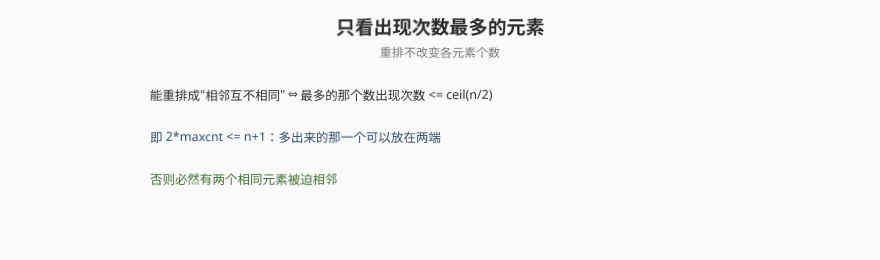

# Codeforces 296A Yaroslav and Permutations 题解

## 1. 题目概述

- **题目链接**：https://codeforces.com/problemset/problem/296/A
- **比赛来源**：Codeforces Round 179 (Div. 2) · Problem A（UTC 2013-04-17）
- **难度**：1100
- **标签**：计数
- **评测类型**：普通
- **限制**：时间 2 s / 内存 256 MB

**题意**：给定数组，允许任意次交换**相邻**元素。问能否重排成"任意两个相邻元素都不相同"。

**约束**：$n \le 100$。

## 2. 示例与观察

官方样例 1：

```text
输入：
1
1

输出：
YES
```

官方样例 2：

```text
输入：
3
1 1 2

输出：
YES
```

官方样例 3：

```text
输入：
4
7 7 7 7

输出：
NO
```

**观察 1**：相邻交换可以生成**任意排列**，所以问题等价于"是否存在一个相邻互异的排列"。

**观察 2（经典判据）**：最多重复次数为 $c$，则可行 ⇔ $2c \le n + 1$（即 $c \le \lceil n/2\rceil$）。

**样例验证**：$n=3$，$c=2$：$2\cdot2 = 4 \le 4$ ✓ YES（排列 1 2 1）；$n=4$，$c=4$：$8 > 5$ ✗ NO ✓。

## 3. 解题思路



统计最大频次 $c$，判断 $2c \le n+1$。

## 4. 正确性证明

**引理 1（必要性）**：若 $2c > n+1$，则不存在相邻互异的排列。

**证明**：设该元素出现 $c$ 次。$c$ 个该元素之间至少有 $c-1$ 个"隔板"位置，而其余元素只有 $n-c$ 个；相邻互异要求 $n - c \ge c - 1$，即 $2c \le n+1$ ✓。∎

**引理 2（充分性）**：$2c \le n+1$ 时构造存在。

**证明**：把出现最多的元素放在下标 $1, 3, 5, \ldots$（共 $c$ 个位置，需 $2c-1 \le n$ ✓），其余元素依次填入偶数位与剩余奇数位即可保证相邻互异 ✓。∎

**定理**：判据 $2c \le n+1$ 正确。

**证明**：引理 1、2 给出充要条件 ✓。∎

## 5. 复杂度分析

- **时间**：$O(n)$。
- **空间**：$O(n)$。
- **与时限的关系**：实测端到端 3.3 ms。

## 6. 参考代码

### C++17

```cpp
#include <bits/stdc++.h>
using namespace std;
int main(){
    int n; if(scanf("%d",&n)!=1) return 0;
    map<int,int> cnt; int best=0;
    for(int i=0;i<n;i++){int v;scanf("%d",&v); best=max(best,++cnt[v]);}
    printf("%s\n", (2*best <= n+1) ? "YES" : "NO");
    return 0;
}
```

### Python3

```python
import sys
from collections import Counter
def main() -> None:
    data = sys.stdin.buffer.read().split()
    n = int(data[0])
    cnt = Counter(int(v) for v in data[1:1+n])
    print("YES" if 2*max(cnt.values()) <= n+1 else "NO")
main()
```

## 7. 边界情况与易错点

1. **$n=1$**：总是 YES。
2. **全部相同且 $n \ge 2$**：NO。
3. **恰好 $2c = n+1$**：YES（该元素占满奇数位）。
4. **相邻交换 ≠ 任意交换**：但相邻交换生成整个对称群，仍然任意可重排。

## 8. 验证记录

- **编译环境**：`clang++ -std=c++17 -O2 -Wall`；Python 3.9.6。
- **官方样例**：3 / 3 通过（YES、YES、NO），C++ 与 Python 一致。
- **独立暴力对拍**：暴力版枚举**所有排列**检查相邻是否互异。随机 250 组 $n \le 6$，**250 / 250 全部一致**。
- **最大约束性能**：$n = 100$，实测端到端 3.3 ms。
- **图片校验**：两张 SVG 已生成并通过 `ElementTree.parse`。
- **复核状态**：verified。

## 相关题目与扩展

- [Codeforces 296B Yaroslav and Two Strings](https://codeforces.com/problemset/problem/296/B)：同场 B 题。
- [LeetCode 767. 重构字符串](https://leetcode.cn/problems/reorganize-string/)：同一判据的构造题。

**延伸思考**：

1. **如果要求字典序最小**：贪心 + 计数。
2. **如果允许相同元素相邻但不超过 k 个**：变成更细的频次约束。
