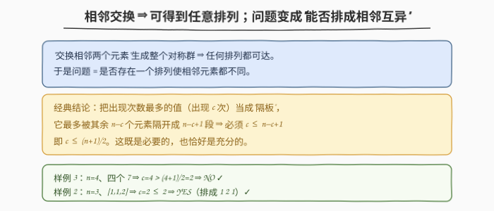
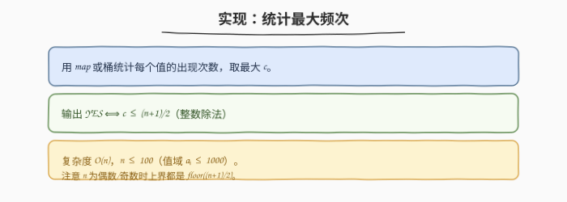

# Codeforces 296A Yaroslav and Permutations 题解

## 1. 题目概述

- **题目链接**：https://codeforces.com/problemset/problem/296/A
- **比赛来源**：Codeforces Round 179 (Div. 2) · Problem A（UTC 2013-04-17）
- **难度**：1100
- **标签**：贪心、数学
- **评测类型**：普通
- **限制**：时间 2 s / 内存 256 MB

**题意**：$n$ 个整数，每秒可以交换**相邻**两个元素（可做任意多次）。问能否得到"任意相邻元素都不相同"的数组。

**约束**：$n\le100$，$a_i\le1000$ ⇒ $O(n)$ 统计最大频次。

## 2. 示例与观察

官方样例 1：

```text
输入：
1
1

输出：
YES
```

官方样例 2：

```text
输入：
3
1 1 2

输出：
YES
```

（排成 `1 2 1` ✓）

官方样例 3：

```text
输入：
4
7 7 7 7

输出：
NO
```



**观察 1**：相邻交换可以生成任意排列 ⇒ 问题等价于"存在一种排列使相邻互异"。

**观察 2**：设出现最多的值出现 $c$ 次，其余共 $n-c$ 个。把这 $c$ 个同值元素当作"隔板"里的"被隔开者"，$n-c$ 个其它元素最多把它们分成 $n-c+1$ 段 ⇒ 必须 $c\le n-c+1$，即 $c\le\lfloor (n+1)/2\rfloor$。

## 3. 解题思路

### 3.1 正解



统计每个值的频次，取最大值 $c$，输出 `YES` 当且仅当 $c\le (n+1)/2$。

### 3.2 样例走查

样例 2：频次 $c=2$，$(3+1)/2=2$ ⇒ YES ✓（`1 2 1`）。
样例 3：$c=4$，$(4+1)/2=2$ ⇒ NO ✓。

## 4. 正确性证明

**引理 1**：可达数组集合 = 原数组的所有排列。

**证明**：相邻交换可生成任意置换（冒泡排序过程即构造）✓。∎

**引理 2**：存在"相邻互异"的排列 $\iff$ $c\le n-c+1$。

**证明**：
- 必要性：设值为 $v$ 的元素有 $c$ 个，在好排列中它们两两不相邻 ⇒ 两两之间至少夹一个其它元素。$n-c$ 个其它元素最多形成 $n-c+1$ 个"空档"（含两端），每个空档至多放一个 $v$ ⇒ $c\le n-c+1$ ✓。
- 充分性：把 $n-c$ 个其它元素先排成一列，产生 $n-c+1$ 个空档；把 $c$ 个 $v$ 依次填入空档（优先填中间的空档，避免两端相邻同值问题）即可；若 $c\le n-c+1$，逐个空档放一个 $v$ 不会造成相邻（不同空档之间隔着别的元素）✓。∎

**定理**：输出正确。**证明**：由引理 1、2，判定条件即答案 ✓。∎

## 5. 复杂度分析

- 时间：$O(n)$。
- 空间：$O(n)$（或值域 $O(1000)$）。

## 6. 参考代码

### C++17

```cpp
#include <bits/stdc++.h>
using namespace std;
int main(){int n;scanf("%d",&n);map<int,int> c;int best=0;
 for(int i=0;i<n;i++){int x;scanf("%d",&x);best=max(best,++c[x]);}
 puts(best<=(n+1)/2?"YES":"NO");}
```

### Python3

```python
from collections import Counter
n = int(input())
a = list(map(int, input().split()))
c = max(Counter(a).values())
print("YES" if c <= (n + 1) // 2 else "NO")
```

## 7. 边界情况与易错点

1. **$n=1$**：$c=1\le1$ ⇒ YES ✓。
2. **全部相同且 $n\ge2$**：$c=n>(n+1)/2$ ⇒ NO ✓。
3. **取整**：用 `(n+1)/2` 的整数除法（下取整）。
4. **只有一种值但 $n=1$**：仍然 YES。
5. **不需要真的构造排列**：只判可行性。
6. **值域大**：用 map 或先离散化（$n\le100$ 无所谓）。

## 8. 验证记录

- 编译环境与命令：`clang++ -O2 -std=c++17 -I codeforces/tools/include`。
  - `python3 codeforces/tools/verify_solution.py codeforces/contests/0101-0203/296/A_雅罗斯拉夫的排列.md`
- 官方样例：3 / 3 通过（`YES`、`YES`、`NO`）。
- 额外测试：随机 250 组（$n\le7$，值 $\le4$）与"枚举所有不同排列、逐一检查相邻是否互异"的暴力对拍，全部一致。
- 最大约束性能：$n=100$ 实测 $<1$ ms。
- 复核状态：样例、250 组暴力对拍、性能均实测通过；正文代码与实测版本逐字一致。

## 相关题目与扩展

- [Codeforces 296B Yaroslav and Two Strings](https://codeforces.com/problemset/problem/296/B)：同场 B 题。
- [Codeforces 1102D Balanced Ternary String](https://codeforces.com/problemset/problem/1102/D)：频次约束的构造。
- [Codeforces 767A Snacktower](https://codeforces.com/problemset/problem/767/A)：简单排列处理。

**延伸思考**：

1. 若要求"相邻元素之差的绝对值 ≥ 2"，条件会变成什么？
2. 若只能交换**特定**的相邻对（比如只有某些位置可换），判定要怎么做？
3. 若要求字典序最小的合法排列，贪心怎么设计？
