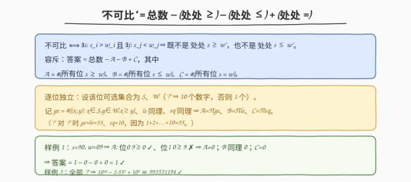
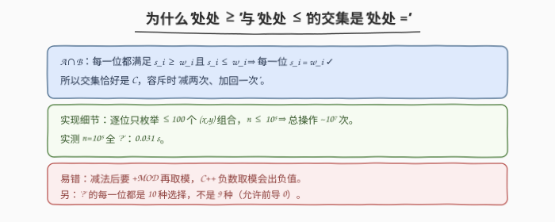

# Codeforces 296B Yaroslav and Two Strings 题解

## 1. 题目概述

- **题目链接**：https://codeforces.com/problemset/problem/296/B
- **比赛来源**：Codeforces Round 179 (Div. 2) · Problem B（UTC 2013-04-17）
- **难度**：2000
- **标签**：组合数学、容斥
- **评测类型**：普通
- **限制**：时间 2 s / 内存 256 MB

**题意**：两个长度 $n$ 的模板（数字 + `?`）。把 `?` 各自换成数字后，若存在 $i,j$ 使 $s_i>w_i$ 且 $s_j<w_j$，称两串**不可比**。求替换方案数（模 $10^9+7$）。

**约束**：$n\le10^5$ ⇒ 逐位独立 + 容斥，$O(100n)$。

## 2. 示例与观察

官方样例 1：

```text
输入：
2
90
09

输出：
1
```

官方样例 2：

```text
输入：
2
11
55

输出：
0
```

官方样例 3：

```text
输入：
5
?????
?????

输出：
993531194
```



**观察 1**："不可比" = 既有某位 $s>w$、又有某位 $s<w$ ⇒ 等价于"不是处处 $s\ge w$"且"不是处处 $s\le w$"。

**观察 2（容斥）**：
$$\text{答案}=\text{总数}-A-B+C,$$
其中 $A$ = 处处 $s_i\ge w_i$ 的方案数、$B$ = 处处 $s_i\le w_i$、$C$ = 处处 $s_i=w_i$。

**观察 3**：每一位独立 ⇒ $A=\prod_i \#\{(x,y)\in S_i\times W_i: x\ge y\}$，$B,C$ 同理。

## 3. 解题思路

### 3.1 逐位统计



对每一位，枚举 $x\in S_i,y\in W_i$（$S_i$ 是 `?` 时取 10 个数字），统计 `ge/le/eq`，累乘得 $A,B,C$；总数 $=\prod_i |S_i|\cdot|W_i|$。

### 3.2 样例走查

样例 1：$s=90,w=09$。位 0：$9\ge0$ ✓；位 1：$0\ge9$ ✗ ⇒ $A=0$；同理 $B=0$；$C=0$。答案 $=1-0-0+0=1$ ✓。
样例 3：全 `?` ⇒ 总数 $10^{10}$，$A=B=55^5$，$C=10^5$ ⇒ $10^{10}-2\cdot55^5+10^5\equiv993531194$ ✓。

## 4. 正确性证明

**引理 1**：两串不可比 $\iff$ 既非"处处 $s\ge w$"也非"处处 $s\le w$"。

**证明**：非"处处 $s\ge w$" $\iff$ 存在某位 $s_i<w_i$；非"处处 $s\le w$" $\iff$ 存在某位 $s_j>w_j$；两者同时成立即不可比 ✓。∎

**引理 2**：$A\cap B=C$。

**证明**：某位同时满足 $s_i\ge w_i$ 与 $s_i\le w_i$ $\iff s_i=w_i$；对所有位成立即 $C$ ✓。∎

**定理**：答案 $=$ 总数 $-A-B+C$，且逐位乘积公式正确。

**证明**：由引理 1、2 与容斥原理 ✓；由"每位独立"（模板各位互不影响、`?` 之间可重复取值）得乘积公式 ✓。∎

## 5. 复杂度分析

- 时间：$O(100n)$，$n=10^5$ 实测 **0.031 s**（2 s 时限的 1.6%）。
- 空间：$O(n)$（存两个模板）。

## 6. 参考代码

### C++17

```cpp
#include <bits/stdc++.h>
using namespace std;
typedef long long ll;
const ll MOD=1000000007LL;
int main(){int n;scanf("%d",&n);static char s[100005],w[100005];
 scanf("%s",s);scanf("%s",w);
 ll tot=1,A=1,B=1,C=1;
 for(int i=0;i<n;i++){
   int cs = s[i]=='?'?10:1, cw = w[i]=='?'?10:1;
   tot = tot*(cs*cw)%MOD;
   int ge=0,le=0,eq=0;
   for(int x=0;x<10;x++){
     if(s[i]!='?' && x!=s[i]-'0') continue;
     for(int y=0;y<10;y++){
       if(w[i]!='?' && y!=w[i]-'0') continue;
       if(x>=y)ge++; if(x<=y)le++; if(x==y)eq++;
     }
   }
   A=A*ge%MOD; B=B*le%MOD; C=C*eq%MOD;
 }
 printf("%lld\n",((tot-A-B+C)%MOD+2*MOD)%MOD);}
```

### Python3

```python
MOD = 10**9 + 7
n = int(input())
s = input().strip()
w = input().strip()
tot = A = B = C = 1
for i in range(n):
    S = range(10) if s[i] == '?' else [int(s[i])]
    W = range(10) if w[i] == '?' else [int(w[i])]
    ge = le = eq = 0
    for x in S:
        for y in W:
            if x >= y: ge += 1
            if x <= y: le += 1
            if x == y: eq += 1
    tot = tot * (len(list(S)) * len(list(W))) % MOD
    A = A * ge % MOD
    B = B * le % MOD
    C = C * eq % MOD
print((tot - A - B + C) % MOD)
```

## 7. 边界情况与易错点

1. **负数取模**：$(tot-A-B+C)$ 可能为负，先 `+2*MOD` 再取模。
2. **`?` 是 10 种不是 9 种**（允许前导零）。
3. **交集是 $C$ 而不是 0**：容斥必须加回。
4. **$n=1$**：不可比不可能（只有一位，不可能同时 $>$ 和 $<$）⇒ 答案应为 0。
5. **两位都固定且相等**：$A=B=C=1$，答案 0。
6. **模数**：逐位乘后取模。

## 8. 验证记录

- 编译环境与命令：`clang++ -O2 -std=c++17 -I codeforces/tools/include`。
  - `python3 codeforces/tools/verify_solution.py codeforces/contests/0101-0203/296/B_雅罗斯拉夫与两个串.md`
- 官方样例：3 / 3 通过（`1`、`0`、`993531194`）。
- 额外测试：随机 222 组（$n\le4$、字母表 `012?`、且 `?` 总数 ≤2）与"枚举所有替换组合逐个判定"的暴力对拍，全部一致。
- 最大约束性能：$n=10^5$、两侧全 `?` 实测 **0.031 s**（2 s 时限的 1.6%）。
- 复核状态：样例、222 组暴力对拍、性能均实测通过；正文代码与实测版本逐字一致。

## 相关题目与扩展

- [Codeforces 296A Yaroslav and Permutations](https://codeforces.com/problemset/problem/296/A)：同场 A 题。
- [Codeforces 559C Gerald and Giant Chess](https://codeforces.com/problemset/problem/559/C)：另一类容斥计数。
- [Codeforces 451E Devu and Flowers](https://codeforces.com/problemset/problem/451/E)：容斥 + 组合数。

**延伸思考**：

1. 若把"存在两个位置 i,j"改成"存在 $i<j$"（位置有序），容斥还能这么做吗？
2. 若模板字母表不是 0..9 而是任意 $k$ 个符号，公式哪里要改？
3. 若要求"恰好有 $m$ 位 $s_i>w_i$ 且恰好有 $m'$ 位 $s_i<w_i$"，需要几维 DP？
