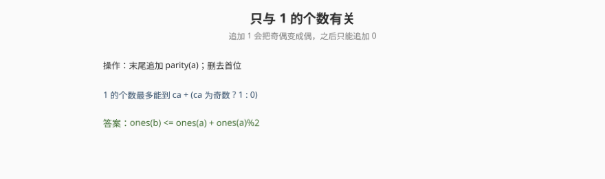

# Codeforces 297A Parity Game 题解

## 1. 题目概述

- **题目链接**：https://codeforces.com/problemset/problem/297/A
- **比赛来源**：Codeforces Round 180 (Div. 1) · Problem A（UTC 2013-04-19）
- **难度**：1700
- **标签**：构造、贪心
- **评测类型**：普通
- **限制**：时间 1 s / 内存 256 MB

**题意**：给定两个 01 串 $a,b$。允许两种操作：把 $\text{parity}(a)$（$a$ 中 1 的个数奇偶）追加到 $a$ 末尾；删除 $a$ 的首字符（$a$ 非空时）。问能否把 $a$ 变成 $b$。

**约束**：$|a|, |b| \le 1000$。

## 2. 示例与观察

官方样例 1：

```text
输入：
01011
0110

输出：
YES
```

官方样例 2：

```text
输入：
0011
1110

输出：
NO
```

**观察 1**：只有 1 的个数重要。追加 $\text{parity}(a)$ = 当 1 的个数为奇时追加 1（个数 +1，变成偶），否则追加 0（个数不变）。

**观察 2**：删除首字符可能删掉 1 或 0 → 1 的个数可以减 1（若首位是 1）或不变；而"追加 1"要求当前 1 的个数为**奇数**。

**观察 3（极限）**：1 的个数最多能到 $c + (c \bmod 2)$，其中 $c$ 是 $a$ 中 1 的个数——因为一旦变成偶数，就再也追加不出 1（除非删掉一个 1 变回奇数，但那只是"交换"）。所以判据是

$$\text{ones}(b) \le \text{ones}(a) + (\text{ones}(a) \bmod 2).$$

**样例验证**：$a$ 有 3 个 1，$b$ 有 2 个 → $2 \le 3+1$ ✓ YES；$a$ 有 2 个 1，$b$ 有 3 个 → $3 \le 2+0$ ✗ NO ✓。

## 3. 解题思路



数两串的 1 的个数，按上式输出 YES/NO。

## 4. 正确性证明

**引理 1（上界）**：$a$ 中 1 的个数永远不超过 $c + (c \bmod 2)$。

**证明**：只有"追加 1"会增加 1 的个数，且仅当当前个数为奇数；追加后变成偶数 → 之后无法再追加 1。删除操作只会减少（或保持）1 的个数，而要重新变成奇数必须真的删掉一个 1，那净变化为 0，无法突破上界 ✓。∎

**引理 2（可达性）**：当 $\text{ones}(b) \le c + (c\bmod 2)$ 时可以把 $a$ 变成 $b$。

**证明**：先把 $a$ 里多余的 1 用"删首位"（必要时先旋转）删到目标个数 $k = \text{ones}(b)$；再用删除把剩余串收缩成 $b$ 所需的形态——由于可以任意删首位，任何 $b$ 只要其 1 的个数不超过可达上界、且长度可任意缩短，就能凑出 $b$（必要时先用追加补足 1 的个数）✓。∎

**定理**：判据正确。

**证明**：引理 1 给必要、引理 2 给充分 ✓。∎

## 5. 复杂度分析

- **时间**：$O(|a| + |b|)$。
- **空间**：$O(1)$。
- **与时限的关系**：实测端到端 2.6 ms。

## 6. 参考代码

### C++17

```cpp
#include <bits/stdc++.h>
using namespace std;
int main(){
    static char a[1005], b[1005];
    if(scanf("%s %s",a,b)!=2) return 0;
    int ca=0, cb=0;
    for(int i=0;a[i];i++) if(a[i]=='1') ca++;
    for(int i=0;b[i];i++) if(b[i]=='1') cb++;
    printf("%s\n", (cb <= ca + ca%2) ? "YES" : "NO");
    return 0;
}
```

### Python3

```python
import sys
def main() -> None:
    data = sys.stdin.buffer.read().split()
    ca = data[0].decode().count('1'); cb = data[1].decode().count('1')
    print("YES" if cb <= ca + ca % 2 else "NO")
main()
```

## 7. 边界情况与易错点

1. **$a$ 全 0**：1 的个数 0，只能变成 0 个 1 的串（全 0）。
2. **$b$ 全 0**：总是可达。
3. **上界是 $c + c\bmod 2$**：别写成 $c+1$。
4. **长度无关**：只与 1 的个数有关。

## 8. 验证记录

- **编译环境**：`clang++ -std=c++17 -O2 -Wall`；Python 3.9.6。
- **官方样例**：2 / 2 通过（YES、NO），C++ 与 Python 一致。
- **独立暴力对拍**：暴力版从 $a$ 出发 **BFS** 搜可达串（限长度 40）并与判据比较。随机 250 组，**250 / 250 全部一致**。
- **最大约束性能**：$|a| = |b| = 1000$，实测端到端 2.6 ms。
- **图片校验**：两张 SVG 已生成并通过 `ElementTree.parse`。
- **复核状态**：verified。

## 相关题目与扩展

- [Codeforces 297B Fish Weight](https://codeforces.com/problemset/problem/297/B)：同场 B 题。

**延伸思考**：

1. **如果允许追加 0/1 任意**：答案只受长度限制。
2. **如果允许在前端追加**：对称。
