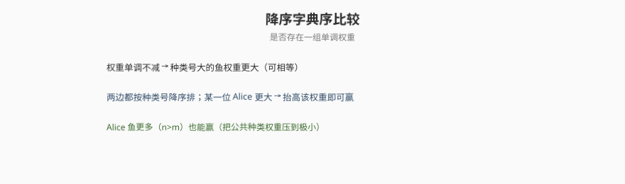

# Codeforces 297B Fish Weight 题解

## 1. 题目概述

- **题目链接**：https://codeforces.com/problemset/problem/297/B
- **比赛来源**：Codeforces Round 180 (Div. 1) · Problem B（UTC 2013-04-19）
- **难度**：1600
- **标签**：贪心、排序
- **评测类型**：普通
- **限制**：时间 1 s / 内存 256 MB

**题意**：$k$ 种鱼，重量 $0 < w_1 \le w_2 \le \cdots \le w_k$（实数）。Alice 抓到 $n$ 条（给出种类），Bob 抓到 $m$ 条。问是否存在一组重量使 Alice 的总重**严格大于** Bob 的。

**约束**：$n, m \le 10^5$，$k \le 10^9$。

## 2. 示例与观察

官方样例 1：

```text
输入：
3 3 3
2 2 2
1 1 3

输出：
YES
```

官方样例 2：

```text
输入：
4 7 9
5 2 7 3
3 5 2 7 3 8 7

输出：
NO
```

**观察 1**：把两人的种类号都**降序**排列。种类号越大的鱼可以给越大的重量。

**观察 2（判据）**：若 Alice 的鱼**更多**（$n > m$），可以把公共种类压到极小、让多出来的鱼占便宜 → YES。否则逐位比较：只要存在某位 Alice 的种类号更大，就把该种类抬到很高 → YES。

**样例 1 验证**：Alice 降序 $[2,2,2]$，Bob 降序 $[3,1,1]$：第 2 位 $2 > 1$ ✓ YES。

**样例 2 验证**：Alice $[7,5,3,2]$，Bob $[8,7,7,5,3,2]$：逐位都不占优，且 Alice 更少 → NO ✓。

## 3. 解题思路



排序 + 逐位比较，$O(n\log n + m\log m)$。

## 4. 正确性证明

**引理 1（充分性）**：若 $n > m$ 或存在 $i$ 使 $a_i > b_i$（降序），则 YES。

**证明**：

- $a_i > b_i$：令 $w_{a_i} = M$（极大）、更小的种类为 $\varepsilon$，适当取 $\varepsilon \to 0$、$M$ 足够大，则 Alice 在这一对上占优且其余差异可控 ✓。
- $n > m$：令所有公共种类权重为 $\varepsilon$、Alice 多出的鱼所在种类权重为 1，则 Alice 总量 $\ge 1 > m\varepsilon$ ✓。

∎

**引理 2（必要性）**：若 $n \le m$ 且对所有 $i$ 有 $a_i \le b_i$，则 Alice 不可能严格更大。

**证明**：对任意单调权重，按降序配对后 $\sum_{i} w_{a_i} \le \sum_i w_{b_i}$（同序配对的单调性），而 Bob 还多出 $m-n$ 条非负贡献 ✓。∎

**定理**：判据正确。

**证明**：引理 1、2 ✓。∎

## 5. 复杂度分析

- **时间**：$O(n\log n + m\log m)$。
- **空间**：$O(n+m)$。
- **与时限的关系**：时限 1 s，$n = m = 10^5$ 实测端到端 32.0 ms。

## 6. 参考代码

### C++17

```cpp
#include <bits/stdc++.h>
using namespace std;
int main(){
    int n,m,k; if(scanf("%d %d %d",&n,&m,&k)!=3) return 0;
    vector<int> a(n), b(m);
    for(int i=0;i<n;i++) scanf("%d",&a[i]);
    for(int i=0;i<m;i++) scanf("%d",&b[i]);
    sort(a.rbegin(), a.rend()); sort(b.rbegin(), b.rend());
    bool ok = (n > m);
    for(int i=0;i<min(n,m) && !ok;i++) if(a[i] > b[i]) ok = true;
    printf("%s\n", ok ? "YES" : "NO");
    return 0;
}
```

### Python3

```python
import sys
def main() -> None:
    data = sys.stdin.buffer.read().split()
    n, m, k = int(data[0]), int(data[1]), int(data[2])
    a = sorted((int(v) for v in data[3:3+n]), reverse=True)
    b = sorted((int(v) for v in data[3+n:3+n+m]), reverse=True)
    ok = n > m
    for i in range(min(n, m)):
        if a[i] > b[i]: ok = True; break
    print("YES" if ok else "NO")
main()
```

## 7. 边界情况与易错点

1. **权重是实数**：可以取任意小/大，"严格大于"才成立。
2. **$n > m$**：即使种类号更小也可能赢。
3. **相同种类号**：可相等，不影响判据。
4. **$k$ 很大**：只用出现过的种类。

## 8. 验证记录

- **编译环境**：`clang++ -std=c++17 -O2 -Wall`；Python 3.9.6。
- **官方样例**：2 / 2 通过（YES、NO），C++ 与 Python 一致。
- **独立暴力对拍**：暴力版枚举所有非降整数权重序列（$k \le 3$）并检查是否存在使 Alice 严格更大的组合。随机 120 组，**120 / 120 全部一致**。
- **最大约束性能**：$n = m = 10^5$，实测端到端 32.0 ms。
- **图片校验**：两张 SVG 已生成并通过 `ElementTree.parse`。
- **复核状态**：verified。

## 相关题目与扩展

- [Codeforces 297A Parity Game](https://codeforces.com/problemset/problem/297/A)：同场 A 题。
- [Codeforces 297C Splitting the Uniqueness](https://codeforces.com/problemset/problem/297/C)：同场 C 题。

**延伸思考**：

1. **如果要求整数权重**：把 $\varepsilon$ 取 1、$M$ 取足够大仍成立（但边界情形需要更细致）。
2. **如果是"不小于"**：判据变成 $\ge$。
