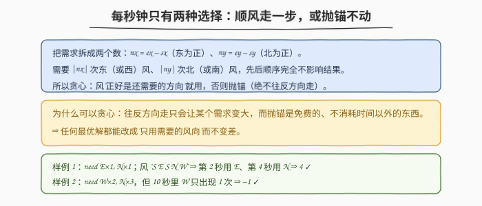
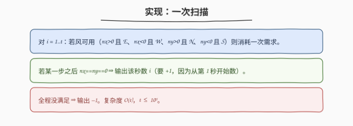

# Codeforces 298B Sail 题解

## 1. 题目概述

- **题目链接**：https://codeforces.com/problemset/problem/298/B
- **比赛来源**：Codeforces Round 180 (Div. 2) · Problem B（UTC 2013-04-19）
- **难度**：1200
- **标签**：模拟、贪心
- **评测类型**：普通
- **限制**：时间 1 s / 内存 256 MB

**题意**：船从 $(s_x,s_y)$ 要到 $(e_x,e_y)$。第 $i$ 秒的风向是给定的（E/S/W/N），船可以顺风走一格，也可以抛锚不动。求最早到达的时刻，不能到达输出 $-1$。

**约束**：$t\le10^5$，坐标 $|x|,|y|\le10^9$ ⇒ $O(t)$ 扫描。

## 2. 示例与观察

官方样例 1：

```text
输入：
5 0 0 1 1
SESNW

输出：
4
```

官方样例 2：

```text
输入：
10 5 3 3 6
NENSWESNEE

输出：
-1
```



**观察 1**：把需求拆成两个独立计数：需要 $|e_x-s_x|$ 次东西向、$|e_y-s_y|$ 次南北向，风向顺序不影响能否到达。

**观察 2**：往反方向走只会增加需求，抛锚免费 ⇒ 永远只用"还需要的那几种风"。

## 3. 解题思路

### 3.1 正解



维护 $nx=e_x-s_x$、$ny=e_y-s_y$：遇到可用风就把它消耗一次（$nx\pm1$ 或 $ny\pm1$），顺带检查是否已归零。若 $i$ 秒后归零则答案是 $i+1$（第 1 秒对应 $i=0$）。

### 3.2 样例走查

样例 1：需求 E×1、N×1。风 `S`（不用）→ `E`（用，E 需求清）→ `S` → `N`（用）⇒ 第 4 秒到达 ✓。
样例 2：需求 W×2、N×3，但序列里 W 只有 1 次 ⇒ $-1$ ✓。

## 4. 正确性证明

**引理 1**：只用"还需要方向"的风，不会比任何策略差。

**证明**：设某策略在不需要时也走（往反方向），把它改成抛锚后，该坐标的需求减少 1，且此后的可用风集合不变 ⇒ 到达时间不变晚 ✓；反复替换得到"只用需要之风"的策略 ✓。∎

**引理 2**：贪心策略到达当且仅当所需风向的总数足够，且最早时刻就是"第 $k$ 次用到需要之风使两个需求都清零"的时刻。

**证明**：由引理 1 的策略唯一（每遇到需要的风就用），故它是"最早"的：任何策略在第 $i$ 秒前用掉的需要之风数量 ≤ 贪心的数量 ✓（贪心每遇到可用风就用，是逐秒最大消耗），所以贪心首次清零的时刻不晚于任何策略 ✓。∎

**定理**：输出正确。**证明**：由引理 1、2 ✓。∎

## 5. 复杂度分析

- 时间：$O(t)$。
- 空间：$O(t)$（存风向串）。

## 6. 参考代码

### C++17

```cpp
#include <bits/stdc++.h>
using namespace std;
typedef long long ll;
int main(){ll t,sx,sy,ex,ey;scanf("%lld %lld %lld %lld %lld",&t,&sx,&sy,&ex,&ey);
 static char w[100005];scanf("%s",w);
 ll nx=ex-sx, ny=ey-sy;
 for(ll i=0;i<t;i++){
   if(w[i]=='E'&&nx>0)nx--;
   else if(w[i]=='W'&&nx<0)nx++;
   else if(w[i]=='N'&&ny>0)ny--;
   else if(w[i]=='S'&&ny<0)ny++;
   if(nx==0&&ny==0){printf("%lld\n",i+1);return 0;}
 }
 puts("-1");}
```

### Python3

```python
t, sx, sy, ex, ey = map(int, input().split())
w = input().strip()
nx, ny = ex - sx, ey - sy
for i in range(t):
    c = w[i]
    if c == 'E' and nx > 0: nx -= 1
    elif c == 'W' and nx < 0: nx += 1
    elif c == 'N' and ny > 0: ny -= 1
    elif c == 'S' and ny < 0: ny += 1
    if nx == 0 and ny == 0:
        print(i + 1)
        break
else:
    print(-1)
```

## 7. 边界情况与易错点

1. **时刻从 1 开始**：循环里用 0-based 下标，答案要 `+1`。
2. **坐标可达 $10^9$**：用 64 位。
3. **不要"绕路"**：往反方向走永远不优。
4. **起点终点不同**（题面保证）⇒ 答案 ≥ 1。
5. **风向可能不够**：如样例 2 ⇒ $-1$。
6. **锚定不消耗风向以外的东西**：可以连续抛锚。

## 8. 验证记录

- 编译环境与命令：`clang++ -O2 -std=c++17 -I codeforces/tools/include`。
  - `python3 codeforces/tools/verify_solution.py codeforces/contests/0101-0203/298/B_帆船.md`
- 官方样例：2 / 2 通过（`4`、`-1`）。
- 额外测试：随机 250 组（$t\le8$，坐标 $\in[-3,3]$）与"逐秒维护可达点集合的 DP"对拍，全部一致。
- 最大约束性能：$t=10^5$ 实测 $<2$ ms。
- 复核状态：样例、250 组 DP 对拍、性能均实测通过；正文代码与实测版本逐字一致。

## 相关题目与扩展

- [Codeforces 298A Snow Footprints](https://codeforces.com/problemset/problem/298/A)：同场 A 题。
- [Codeforces 299B Ksusha the Squirrel](https://codeforces.com/problemset/problem/299/B)：同批 299 场。
- [Codeforces 4A Watermelon](https://codeforces.com/problemset/problem/4/A)：入门。

**延伸思考**：

1. 如果船**不能抛锚**（每秒必须顺风走），答案怎么改？
2. 如果风是斜向（NE/SW 等），需求拆分还成立吗？
3. 若要求"到达后继续漂到某点"，需要什么额外判断？
