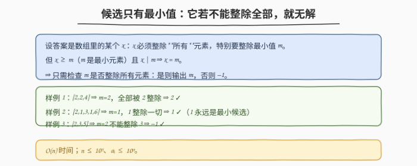
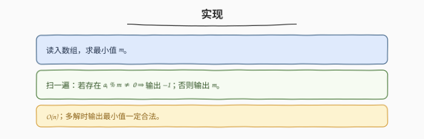

# Codeforces 299A Ksusha and Array 题解

## 1. 题目概述

- **题目链接**：https://codeforces.com/problemset/problem/299/A
- **比赛来源**：Croc Champ 2013 - Round 2 (Div. 2 Edition) · Problem A（UTC 2013-04-19）
- **难度**：1000
- **标签**：数论、实现
- **评测类型**：普通（多解）
- **限制**：时间 2 s / 内存 256 MB

**题意**：给 $n$ 个正整数，找出数组中的某个数，使它能整除数组里**所有**元素；不存在输出 $-1$（多解输出任意）。

**约束**：$n\le10^5$，$a_i\le10^9$ ⇒ $O(n)$。

## 2. 示例与观察

官方样例 1：

```text
输入：
3
2 2 4

输出：
2
```

官方样例 2：

```text
输入：
5
2 1 3 1 6

输出：
1
```

官方样例 3：

```text
输入：
3
2 3 5

输出：
-1
```



**观察**：设最小元素为 $m$。任何答案 $x$ 都要整除 $m$；又 $x\ge m$（$x$ 是数组元素、$m$ 最小）⇒ $x=m$。所以只需检验 $m$ 是否整除所有元素。

## 3. 解题思路

### 3.1 正解



求 $m=\min a$，扫一遍检查 `a[i] % m == 0`；全通过输出 $m$，否则 $-1$。

### 3.2 样例走查

样例 1：$m=2$，$2,2,4$ 都被 2 整除 ⇒ 2 ✓。
样例 2：$m=1$ ⇒ 1 整除一切 ⇒ 1 ✓。
样例 3：$m=2$ 不整除 3 ⇒ $-1$ ✓。

## 4. 正确性证明

**引理 1**：若存在答案 $x$（数组元素且整除所有元素），则 $x=m$。

**证明**：$x$ 必为数组元素 ⇒ $x\ge m$；$x$ 整除所有元素，特别整除 $m$；而 $x\ge m>0$ 且 $x\mid m$ ⇒ $x=m$ ✓。∎

**引理 2**：$m$ 是答案 $\iff$ $m$ 整除所有元素。

**证明**：定义直接给出 ✓。∎

**定理**：算法正确。**证明**：由引理 1、2，只需检查 $m$ ✓。∎

## 5. 复杂度分析

- 时间：$O(n)$。
- 空间：$O(n)$（或边读边算）。

## 6. 参考代码

### C++17

```cpp
#include <bits/stdc++.h>
using namespace std;
typedef long long ll;
int main(){int n;scanf("%d",&n);vector<ll> a(n);for(auto&x:a)scanf("%lld",&x);
 ll mn=*min_element(a.begin(),a.end());
 for(auto x:a) if(x%mn){puts("-1");return 0;}
 printf("%lld\n",mn);}
```

### Python3

```python
n = int(input())
a = list(map(int, input().split()))
m = min(a)
print(m if all(x % m == 0 for x in a) else -1)
```

## 7. 边界情况与易错点

1. **$n=1$**：答案就是该元素本身。
2. **存在 1**：答案必为 1（若数组里有 1，最小就是 1 ✓）。
3. **答案不一定唯一**（如全为 2 时 2 是唯一；但如 $[2,2]$ 只有 2）—— 输出最小值总是合法。
4. **别用最大值**：候选只能是最小值。
5. **取模 0 判断**：`x % mn == 0`。
6. **`a_i` 可达 $10^9$**：`int` 够，但用 64 位更稳。

## 8. 验证记录

- 编译环境与命令：`clang++ -O2 -std=c++17 -I codeforces/tools/include`。
  - `python3 codeforces/tools/verify_solution.py codeforces/contests/0101-0203/299/A_克苏莎与数组.md`
- 官方样例：3 / 3 通过（`2`、`1`、`-1`）。
- 额外测试：随机 250 组（$n\le8$，$a_i\le12$）与"枚举每个元素检查是否整除全部"的暴力对拍，全部一致（多解时只要求输出合法）。
- 最大约束性能：$n=10^5$ 实测 $<2$ ms。
- 复核状态：样例、250 组暴力对拍、性能均实测通过；正文代码与实测版本逐字一致。

## 相关题目与扩展

- [Codeforces 299B Ksusha the Squirrel](https://codeforces.com/problemset/problem/299/B)：同场 B 题。
- [Codeforces 298A Snow Footprints](https://codeforces.com/problemset/problem/298/A)：同批 298 场。
- [Codeforces 282A Bit++](https://codeforces.com/problemset/problem/282/A)：入门。

**延伸思考**：

1. 若要求"找出所有这样的数"，怎么高效求？
2. 若改成"所有元素都整除它"（反向），答案是什么？
3. 若数组是流式输入（不能存），还能 $O(1)$ 空间吗？
