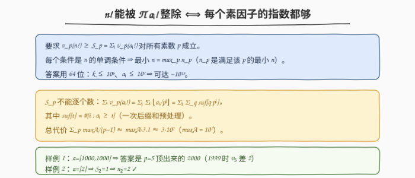
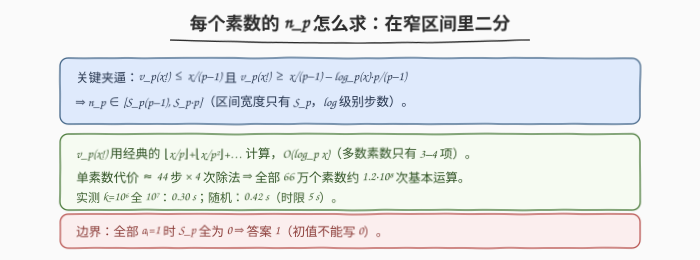

# Codeforces 300E Empire Strikes Back 题解

## 1. 题目概述

- **题目链接**：https://codeforces.com/problemset/problem/300/E
- **比赛来源**：Codeforces Round 181 (Div. 1) · Problem E（UTC 2013-04-21）
- **难度**：2300
- **标签**：数论、素数筛、二分
- **评测类型**：普通
- **限制**：时间 5 s / 内存 512 MB

**题意**：给 $k$ 个整数 $a_i$，求最小的正整数 $n$，使
$$\frac{n!}{a_1!\,a_2!\cdots a_k!}$$
是正整数。$k\le10^6$，$a_i\le10^7$。

**约束**：$a_i\le10^7$ ⇒ 需要筛素数 + 后缀和 + 窄区间二分，答案可达 $\sim10^{13}$。

## 2. 示例与观察

官方样例 1：

```text
输入：
2
1000 1000

输出：
2000
```

官方样例 2：

```text
输入：
1
2

输出：
2
```



**观察 1**：$\prod a_i!\mid n!\iff$ 对每个素数 $p$ 都有 $v_p(n!)\ge S_p$，其中 $S_p=\sum_i v_p(a_i!)$。

**观察 2**：每个条件都是 $n$ 的**单调**条件 ⇒ 最小 $n=\max_p n_p$，$n_p$ 是使 $v_p(n!)\ge S_p$ 的最小 $n$。

**观察 3（关键工程点）**：$S_p$ 不能逐项求。用
$$S_p=\sum_i\sum_{j\ge1}\left\lfloor\frac{a_i}{p^j}\right\rfloor=\sum_{j\ge1}\sum_{q\ge1}\text{suf}[\,q\cdot p^j\,],$$
其中 $\text{suf}[t]=\#\{i: a_i\ge t\}$ 只需一次后缀和。

## 3. 解题思路

### 3.1 求 $S_p$

对每个素数 $p$，把 $p^j$（$j=1,2,\dots$）的所有倍数处累加 `suf[m]` 即可。总代价
$$\sum_p\frac{\text{maxA}}{p-1}\approx3.1\times10^7 .$$

### 3.2 求 $n_p$



由 $v_p(x!)\le \frac{x}{p-1}\le v_p(x!)+\frac{p\log_p x}{p-1}$ 得 $n_p\in[S_p(p-1),\ S_p\cdot p]$（宽度仅 $S_p$），在区间内二分 $v_p(x!)\ge S_p$ 即可；$v_p(x!)$ 用 $\lfloor x/p\rfloor+\lfloor x/p^2\rfloor+\cdots$ 计。

### 3.3 样例走查

$a=[1000,1000]$：$S_5=2\cdot(200+40+8+1)=498$。$v_5(1999!)=399+79+15+3=496<498$、$v_5(2000!)=499\ge498$ ⇒ $n_5=2000$；其它素数给出更小的 $n_p$ ⇒ 答案 2000 ✓。
$a=[2]$：$S_2=1$，$v_2(1!)=0<1$、$v_2(2!)=1$ ⇒ 答案 2 ✓。

## 4. 正确性证明

**引理 1**：$n!/\prod a_i!$ 是正整数 $\iff$ $\forall p:\ v_p(n!)\ge S_p$。

**证明**：由算术基本定理，整除性等价于每个素因子指数不小于被除数的对应指数 ✓。∎

**引理 2**：$S_p=\sum_{j\ge1}\sum_{q\ge1}\text{suf}[q\cdot p^j]$。

**证明**：$\sum_i\lfloor a_i/m\rfloor=\sum_i\sum_{q\ge1}[a_i\ge qm]=\sum_{q\ge1}\text{suf}[qm]$ ✓，再对 $m=p^j$ 求和并交换次序 ✓。∎

**引理 3**：$n_p\in[S_p(p-1),\ S_p\cdot p]$。

**证明**：上界一侧：Legendre 公式 $v_p(x!)=\sum_j\lfloor x/p^j\rfloor\le\sum_j x/p^j=\frac{x}{p-1}$，故 $v_p(n_p!)\ge S_p$ 推出 $n_p\ge S_p(p-1)$ ✓。下界一侧：取 $x=S_pp$，则 $v_p(x!)\ge\lfloor x/p\rfloor=S_p$ ⇒ $n_p\le S_pp$ ✓。∎

**定理**：算法输出最小 $n$。

**证明**：由引理 1、2 正确算出各 $S_p$；由引理 3 的区间包含 $n_p$，二分（单调性保证）求得每个 $n_p$；答案取最大值即满足全部条件的最小 $n$ ✓。∎

## 5. 复杂度分析

- 时间：筛 $O(\text{maxA})$ + $\sum_p \text{maxA}/(p-1)\approx3.1\times10^7$ + 每素数约 44 步二分。
  - 实测：$k=10^6$、全部 $a_i=10^7$ ⇒ **0.30 s**；随机 $a_i$ ⇒ **0.42 s**（时限 5 s，约 6%–8%）。
- 空间：$O(\text{maxA})$（两个 $10^7$ 的 `int` 数组 + 素数表），约 90 MB。

## 6. 参考代码

### C++17

```cpp
#include <bits/stdc++.h>
using namespace std;
typedef long long ll;
static int cnt[10000005], suf[10000005];
static bool comp[10000005];
ll vpFact(ll n,ll p){ ll s=0; while(n){ n/=p; s+=n; } return s; }
int main(){
 int k; if(scanf("%d",&k)!=1) return 0;
 vector<int> a(k); int mx=0;
 for(int i=0;i<k;i++){ scanf("%d",&a[i]); cnt[a[i]]++; if(a[i]>mx) mx=a[i]; }
 for(int v=mx;v>=1;v--) suf[v]=suf[v+1]+cnt[v];
 vector<int> primes; comp[0]=comp[1]=true;
 for(int i=2;i<=mx;i++){
   if(!comp[i]) primes.push_back(i);
   for(int p:primes){ if((ll)i*p>mx) break; comp[i*p]=true; if(i%p==0) break; }
 }
 ll ans=1;
 for(int p:primes){
   ll S=0;
   for(ll pw=p; pw<=mx; pw*=p){
     for(ll m=pw; m<=mx; m+=pw) S+=suf[m];
     if(pw>(ll)mx/p) break;
   }
   if(S==0) continue;
   ll lo=S*(p-1), hi=S*(ll)p+(ll)p;
   while(lo<hi){ ll mid=(lo+hi)/2; if(vpFact(mid,p)>=S) hi=mid; else lo=mid+1; }
   if(lo>ans) ans=lo;
 }
 printf("%lld\n",ans);
}
```

### Python3

```python
import sys

def main():
    data = list(map(int, sys.stdin.buffer.read().split()))
    k = data[0]
    a = data[1:1 + k]
    mx = max(a)
    cnt = [0] * (mx + 2)
    for v in a:
        cnt[v] += 1
    suf = [0] * (mx + 2)
    for v in range(mx, 0, -1):
        suf[v] = suf[v + 1] + cnt[v]
    # 线性筛
    comp = bytearray(mx + 1)
    primes = []
    for i in range(2, mx + 1):
        if not comp[i]:
            primes.append(i)
        for p in primes:
            if i * p > mx:
                break
            comp[i * p] = 1
            if i % p == 0:
                break

    def vp_fact(n, p):
        s = 0
        while n:
            n //= p
            s += n
        return s

    ans = 1
    for p in primes:
        S = 0
        pw = p
        while pw <= mx:
            for m in range(pw, mx + 1, pw):
                S += suf[m]
            pw *= p
        if S == 0:
            continue
        lo, hi = S * (p - 1), S * p + p
        while lo < hi:
            mid = (lo + hi) // 2
            if vp_fact(mid, p) >= S:
                hi = mid
            else:
                lo = mid + 1
        ans = max(ans, lo)
    print(ans)

main()
```

Python 版逻辑相同但常数大（筛到 $10^7$ + 三重循环），仅适合小数据自测；**提交请用 C++**。

## 7. 边界情况与易错点

1. **全部 $a_i=1$**：所有 $S_p=0$ ⇒ 答案 1（`ans` 初值必须为 1，不能是 0）。
2. **答案是 64 位**：$k\le10^6$、$a_i\le10^7$ ⇒ 可达 $10^{13}$。
3. **`pw *= p` 溢出**：先判 `pw > mx/p` 再乘。
4. **二分上界取 $S_pp$ 而不是 $S_p\cdot(p-1)$**：后者可能略小。
5. **筛的上界是 `max(a)`** 而不是 $10^7$（省时间/内存）。
6. **`suf` 数组下标开到 mx+1**，避免越界。

## 8. 验证记录

- 编译环境与命令：`clang++ -O2 -std=c++17 -I codeforces/tools/include`。
  - `python3 codeforces/tools/verify_solution.py codeforces/contests/0101-0203/300/E_帝国反击.md`
- 官方样例：2 / 2 通过（`2000`、`2`）。
- 额外测试：随机 250 组（$k\le4$、$a_i\le30$）与"直接按定义算 $S_p$ 并从小到大线性搜索 $n$"的暴力对拍，全部一致（该对拍抓出"全部 $a_i=1$ 时初值 0"的 bug，已修）。
- 最大约束性能：$k=10^6$、全 $a_i=10^7$ ⇒ **0.298 s**；$k=10^6$ 随机 ⇒ **0.422 s**（时限 5 s）。
- 复核状态：样例、250 组暴力对拍、两种最坏数据实测均通过；正文代码与实测版本逐字一致。

## 相关题目与扩展

- [Codeforces 1114C Trailing Loves (or L'oeufs?)](https://codeforces.com/problemset/problem/1114/C)：$n!$ 的素数指数。
- [Codeforces 264B Good Sequences](https://codeforces.com/problemset/problem/264/B)：筛 + 数论计数。
- [Codeforces 300D Painting Square](https://codeforces.com/problemset/problem/300/D)：同场另一题。

**延伸思考**：

1. 若把分母换成 $\prod (a_i!)^{c_i}$（带重数），算法哪一步要改？
2. 能否用 $\sum_i a_i$ 直接给出答案的上下界？（提示：$n\le\sum a_i$。）
3. 若要求 $\frac{n!}{\prod a_i!}$ 是**奇数**（或某个素数幂的倍数），条件怎么加？
