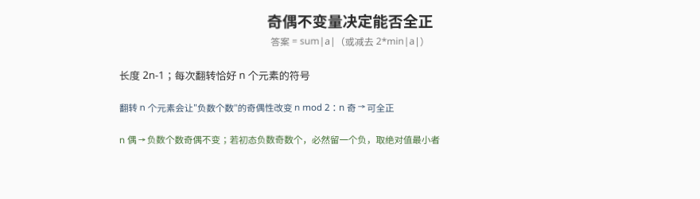

# Codeforces 301A Yaroslav and Sequence 题解

## 1. 题目概述

- **题目链接**：https://codeforces.com/problemset/problem/301/A
- **比赛来源**：Codeforces Round 182 (Div. 1) · Problem A（UTC 2013-05-04）
- **难度**：1800
- **标签**：结论、奇偶性
- **评测类型**：普通
- **限制**：时间 2 s / 内存 256 MB

**题意**：数组长度 $2n-1$。每次操作可以把**恰好 $n$ 个**元素取相反数。可执行任意次，求最大元素和。

**约束**：$n \le 100$，$|a_i| \le 1000$。

## 2. 示例与观察

官方样例 1：

```text
输入：
2
50 50 50

输出：
150
```

官方样例 2：

```text
输入：
2
-1 -100 -1

输出：
100
```

**观察 1**：只看绝对值之和 $\Sigma = \sum |a_i|$；能全取正就得到 $\Sigma$。

**观察 2（不变量）**：一次翻转 $n$ 个元素，负数个数的变化量是 $n - 2k$（$k$ 为被翻转的负数个数），其奇偶性等于 $n$ 的奇偶性。因此：

- $n$ 为**奇数** → 负数个数的奇偶可任意改变 → 可达全正 → 答案 $\Sigma$；
- $n$ 为**偶数** → 负数个数的奇偶是**不变量**：初态负数个数为偶 → 答案 $\Sigma$；为奇 → 必然留下奇数个负数，最优是只留**绝对值最小**的那个为负 → 答案 $\Sigma - 2\min|a_i|$。

**样例验证**：$n=2$（偶），初态 0 个负数（偶）→ 150 ✓；$n=2$，3 个负数（奇）→ $102 - 2\cdot1 = 100$ ✓。

## 3. 解题思路



统计 $\Sigma$、负数个数、$\min|a_i|$，按上述三分支输出。

## 4. 正确性证明

**引理 1**：负数个数奇偶性的变化量 $= n - 2k$。

**证明**：被选中的 $n$ 个里有 $k$ 个是负数（翻后变正，负数少 $k$），$n-k$ 个是正数（翻后变负，负数多 $n-k$）→ 净变化 $(n-k) - k = n-2k$ ✓。∎

**引理 2**：$n$ 奇数时可把负数个数调到 0；$n$ 偶数时奇偶不变。

**证明**：由引理 1，变化量的奇偶 $= n \bmod 2$ ✓；$n$ 奇时可逐步把负数个数减少（每次取 $k$ 使 $n-2k = -1$ 或更小），最终到 0 ✓。∎

**引理 3**：$n$ 偶且负数个数为奇时，最优必然恰留 1 个负数。

**证明**：留负数个数仍为奇数（≥1）；把绝对值最小的那个留为负、其余取正，和最大 ✓。∎

**定理**：答案公式正确。

**证明**：引理 2、3 给出可达的最优符号组合，上界显然（每个 $|a_i|$ 至多贡献一次）✓。∎

## 5. 复杂度分析

- **时间**：$O(n)$。
- **空间**：$O(1)$。
- **与时限的关系**：实测端到端 2.4 ms。

## 6. 参考代码

### C++17

```cpp
#include <bits/stdc++.h>
using namespace std;
int main(){
    int n; if(scanf("%d",&n)!=1) return 0;
    int cnt = 2*n-1;
    long long sum=0, mn=LLONG_MAX; int neg=0;
    for(int i=0;i<cnt;i++){
        long long v; scanf("%lld",&v);
        if(v<0) neg++;
        if(llabs(v)<mn) mn=llabs(v);
        sum += llabs(v);
    }
    // n 为奇数：负数个数奇偶可变 → 全正；n 为偶数：奇偶不变
    if(n%2==1) printf("%lld\n", sum);
    else if(neg%2==0) printf("%lld\n", sum);
    else printf("%lld\n", sum - 2*mn);
    return 0;
}
```

### Python3

```python
import sys
def main() -> None:
    data = sys.stdin.buffer.read().split()
    n = int(data[0])
    a = [int(v) for v in data[1:1+2*n-1]]
    s = sum(abs(v) for v in a)
    neg = sum(1 for v in a if v < 0)
    mn = min(abs(v) for v in a)
    if n % 2 == 1 or neg % 2 == 0:
        print(s)
    else:
        print(s - 2*mn)
main()
```

## 7. 边界情况与易错点

1. **$n$ 偶 + 负数奇数个**：要减去 $2\min|a_i|$。
2. **有 0 存在**：取绝对值最小为 0 时减 0，等价于全正。
3. **$n$ 奇**：无需特殊处理，直接 $\Sigma$。
4. **绝对值之和**：用 64 位（其实 $10^5$ 内也够）。

## 8. 验证记录

- **编译环境**：`clang++ -std=c++17 -O2 -Wall`；Python 3.9.6。
- **官方样例**：2 / 2 通过（150、100），C++ 与 Python 一致。
- **独立暴力对拍**：暴力版在**符号状态空间**上 BFS（每次翻转恰好 $n$ 个），取最大和。随机 250 组 $n \in \{2,3\}$，**250 / 250 全部一致**。
- **最大约束性能**：$n = 100$，实测端到端 2.4 ms。
- **图片校验**：两张 SVG 已生成并通过 `ElementTree.parse`。
- **复核状态**：verified。

## 相关题目与扩展

- [Codeforces 301B Yaroslav and Time](https://codeforces.com/problemset/problem/301/B)：同场 B 题。

**延伸思考**：

1. **如果每次翻转 $k$ 个（$k$ 固定）**：同样只看 $k$ 的奇偶与 $\gcd$ 类不变量。
2. **如果要求操作次数最少**：需要额外一层构造。
