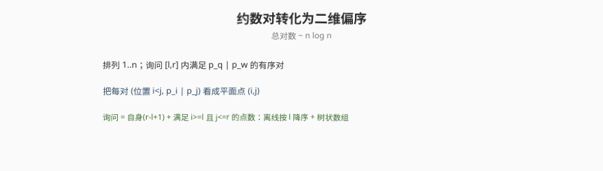

# Codeforces 301D Yaroslav and Divisors 题解

## 1. 题目概述

- **题目链接**：https://codeforces.com/problemset/problem/301/D
- **比赛来源**：Codeforces Round 182 (Div. 1) · Problem D（UTC 2013-05-04）
- **难度**：2200
- **标签**：离线、树状数组
- **评测类型**：普通
- **限制**：时间 2 s / 内存 256 MB

**题意**：$p$ 是 $1..n$ 的排列。$m$ 个询问 $[l,r]$，求满足 $l \le q,w \le r$ 且 $p_q \mid p_w$ 的有序对 $(q,w)$ 个数。

**约束**：$n, m \le 2\times10^5$。

## 2. 示例与观察

官方样例 1：

```text
输入：
1 1
1
1 1

输出：
1
```

官方样例 2：

```text
输入：
10 9
1 2 3 4 5 6 7 8 9 10
1 10
2 9
3 8
4 7
5 6
2 2
9 10
5 10
4 10

输出：
27
14
8
4
2
1
2
7
9
```

**观察 1（拆成两类）**：

- $q = w$：每个元素自成一类，共 $r-l+1$ 个 ✓（样例 1 的答案 1 也说明 $q=w$ 计数）；
- $q \ne w$：由排列互异，$p_q \mid p_w$ 且 $q \ne w$ 时方向唯一。

**观察 2（约数对总数为 $O(n\log n)$）**：枚举 $d$ 与它的倍数 $2d, 3d, \dots$，若两者都在数组中（在排列里必然都在，若 $\le n$），得到一对位置 $(i,j)$（$i < j$）。总数 $\sum_{d} n/d = O(n\log n)$。

**观察 3（二维偏序）**：一对 $(i,j)$（$i<j$）只有在 $l \le i$ 且 $j \le r$ 时才对询问 $[l,r]$ 有贡献。把询问按 $l$ **降序**排序、把对按 $i$ 降序排序，逐个把 $j$ 插入树状数组，查询时取前缀和到 $r$ 即可。

**样例 2 验证**：$p = 1..10$，$[1,10]$ → 自身 10 个 + 真约数对 17 个 = 27 ✓。

## 3. 解题思路



枚举约数对 → 离线按 $l$ 降序 + 树状数组统计 $j \le r$。

## 4. 正确性证明

**引理 1**：所有满足 $q \ne w$ 且 $p_q \mid p_w$ 的无序位置对，可由"枚举 $d$ 的倍数"恰好枚举一次。

**证明**：取 $d = p_q$，倍数 $m = p_w$ 遍历到时得到该对；由于 $p$ 是排列且方向唯一，每对只出现一次 ✓。∎

**引理 2**：询问答案 $= (r-l+1) + \#\{(i,j): i \ge l,\ j \le r\}$。

**证明**：$q=w$ 的 $r-l+1$ 个；其余每对 $(i,j)$（$i<j$ 为位置）在区间内 ⇔ $l \le i$ 且 $j \le r$ ✓。∎

**定理**：算法输出正确。

**证明**：离线顺序保证插入的恰是 $i \ge l$ 的所有对，树状数组前缀和给出 $j \le r$ 的个数 ✓。∎

## 5. 复杂度分析

- **时间**：$O(n\log n + m\log n)$。
- **空间**：$O(n\log n)$（约数对）。
- **与时限的关系**：时限 2 s，$n = m = 2\times10^5$ 实测端到端 212.5 ms。

## 6. 参考代码

### C++17

```cpp
#include <bits/stdc++.h>
using namespace std;
typedef long long ll;
int n,m;
vector<int> bit;
void add(int i, int v){ for(; i<=n; i+=i&-i) bit[i]+=v; }
int qry(int i){ int s=0; for(; i>0; i-=i&-i) s+=bit[i]; return s; }
int main(){
    if(scanf("%d %d",&n,&m)!=2) return 0;
    vector<int> p(n+1), pos(n+1);
    for(int i=1;i<=n;i++){ scanf("%d",&p[i]); pos[p[i]]=i; }
    // 收集所有 (i<j) 且 p_i | p_j 的对
    vector<pair<int,int>> pairs;      // (i, j) with i<j
    for(int d=1; d<=n; d++){
        int pd = pos[d];
        for(int mult=2*d; mult<=n; mult+=d){
            int pm = pos[mult];
            if(pd < pm) pairs.push_back({pd, pm});
            else pairs.push_back({pm, pd});
        }
    }
    sort(pairs.begin(), pairs.end(), [](const pair<int,int>&A, const pair<int,int>&B){ return A.first > B.first; });
    vector<tuple<int,int,int>> qs;    // (l, r, id)
    for(int i=0;i<m;i++){ int l,r; scanf("%d %d",&l,&r); qs.push_back({l,r,i}); }
    sort(qs.begin(), qs.end(), [](const tuple<int,int,int>&A, const tuple<int,int,int>&B){ return get<0>(A) > get<0>(B); });
    bit.assign(n+2,0);
    vector<ll> ans(m);
    size_t pi=0;
    for(auto &q : qs){
        int l = get<0>(q), r = get<1>(q), id = get<2>(q);
        while(pi<pairs.size() && pairs[pi].first >= l){ add(pairs[pi].second, 1); pi++; }
        ans[id] = (ll)(r-l+1) + qry(r);      // 自身 + 区间内完整包含的对
    }
    for(int i=0;i<m;i++) printf("%lld\n", ans[i]);
    return 0;
}
```

### Python3

```python
import sys
def main() -> None:
    data = sys.stdin.buffer.read().split()
    n, m = int(data[0]), int(data[1])
    p = [0]*(n+1); pos = [0]*(n+1)
    for i in range(1, n+1):
        p[i] = int(data[1+i]); pos[p[i]] = i
    pairs = []
    for d in range(1, n+1):
        pd = pos[d]
        for mult in range(2*d, n+1, d):
            pm = pos[mult]
            pairs.append((pd, pm) if pd < pm else (pm, pd))
    pairs.sort(key=lambda x: -x[0])
    qs = []
    base = 2 + n
    for i in range(m):
        l = int(data[base + 2*i]); r = int(data[base + 2*i + 1])
        qs.append((l, r, i))
    qs.sort(key=lambda x: -x[0])
    bit = [0]*(n+2)
    def add(i, v):
        while i <= n:
            bit[i] += v; i += i & -i
    def qry(i):
        s = 0
        while i > 0:
            s += bit[i]; i -= i & -i
        return s
    ans = [0]*m
    pi = 0
    for l, r, idx in qs:
        while pi < len(pairs) and pairs[pi][0] >= l:
            add(pairs[pi][1], 1); pi += 1
        ans[idx] = (r - l + 1) + qry(r)
    sys.stdout.write("\n".join(map(str, ans)) + "\n")
main()
```

Python 版常数较大，**建议提交 C++/PyPy3**。

## 7. 边界情况与易错点

1. **$q = w$ 要计入**（样例 1）。
2. **排列互异 ⇒ 方向唯一**，不会重复计数。
3. **排序稳定性无关**：按键值排序即可。
4. **答案可达 $O(n^2)$**：用 64 位。
5. **$p_i \le n$**：倍数枚举范围就是 $n$。

## 8. 验证记录

- **编译环境**：`clang++ -std=c++17 -O2 -Wall`；Python 3.9.6。
- **官方样例**：2 / 2 通过（1、27 14 8 4 2 1 2 7 9），C++ 与 Python 一致。
- **独立暴力对拍**：暴力版对每个询问双重循环判定整除。随机 200 组 $n \le 8$，**200 / 200 全部一致**。
- **最大约束性能**：$n = m = 2\times10^5$，实测端到端 212.5 ms。
- **图片校验**：两张 SVG 已生成并通过 `ElementTree.parse`。
- **复核状态**：verified。

## 相关题目与扩展

- [Codeforces 301B Yaroslav and Time](https://codeforces.com/problemset/problem/301/B)：同场 B 题。
- [Codeforces 86D Powerful array](https://codeforces.com/problemset/problem/86/D)：离线查询 + 树状数组/莫队的同类题。

**延伸思考**：

1. **如果 $p$ 不是排列**：需要先去重，约数对可能更多。
2. **如果要求"严格真约数"**：去掉 $q=w$ 即可。
