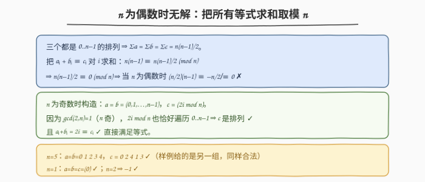
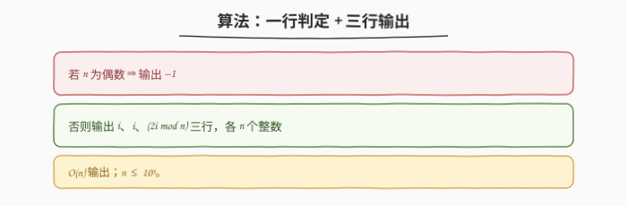

# Codeforces 303A Lucky Permutation Triple 题解

## 1. 题目概述

- **题目链接**：https://codeforces.com/problemset/problem/303/A
- **比赛来源**：Codeforces Round 183 (Div. 1) · Problem A（UTC 2013-04-24）
- **难度**：1300
- **标签**：构造
- **评测类型**：普通（多解）
- **限制**：时间 2 s / 内存 256 MB

**题意**：求三个 $0..n-1$ 的排列 $a,b,c$，使 $\forall i:\ a_i+b_i\equiv c_i\pmod n$；不存在输出 $-1$。

**约束**：$n\le10^5$ ⇒ $O(n)$ 构造。

## 2. 示例与观察

官方样例 1：

```text
输入：
5

输出：
1 4 3 2 0
1 0 2 4 3
2 4 0 1 3
```

官方样例 2：

```text
输入：
2

输出：
-1
```



**观察 1（偶数无解）**：把 $a_i+b_i\equiv c_i$ 对 $i$ 求和。三个都是排列 ⇒ $\sum a=\sum b=\sum c=\frac{n(n-1)}2$。于是 $n(n-1)\equiv\frac{n(n-1)}2\pmod n$，即 $\frac{n(n-1)}2\equiv0\pmod n$。当 $n$ 为偶数时 $\frac{n(n-1)}2=\frac n2(n-1)\equiv-\frac n2\not\equiv0$，矛盾。

**观察 2（奇数可构造）**：取 $a=b=(0,1,\dots,n-1)$、$c_i=2i\bmod n$。因 $\gcd(2,n)=1$，$2i\bmod n$ 也是排列 ✓。

## 3. 解题思路

### 3.1 算法



$n$ 偶 ⇒ `-1`；$n$ 奇 ⇒ 输出恒等排列两次 + $(2i\bmod n)$。

### 3.2 样例走查

$n=5$：$a=b=(0,1,2,3,4)$，$c=(0,2,4,1,3)$。验证 $a_2+b_2=4\equiv c_2=4$ ✓，$a_4+b_4=8\equiv3=c_4$ ✓。
$n=1$：$a=b=c=(0)$ ✓。

## 4. 正确性证明

**引理 1**：$n$ 为偶数时无解。

**证明**：如上求和得 $\frac{n(n-1)}2\equiv0\pmod n$；偶数时左边 $=\frac n2\cdot(n-1)\equiv-n/2\pmod n$，而 $0<n/2<n$ ⇒ $n/2\not\equiv0$，矛盾 ✓。∎

**引理 2**：$n$ 为奇数时构造合法。

**证明**：$a=b$ 是排列 ✓；$\gcd(2,n)=1$ ⇒ 映射 $i\mapsto2i\bmod n$ 是双射 ⇒ $c$ 是排列 ✓；且 $a_i+b_i=2i\equiv c_i\pmod n$ ✓。∎

**定理**：算法输出正确。

**证明**：引理 1 处理偶数（输出 $-1$ 正确）；引理 2 处理奇数（输出合法）✓。∎

## 5. 复杂度分析

- 时间：$O(n)$。
- 空间：$O(1)$（直接输出）。

## 6. 参考代码

### C++17

```cpp
#include <bits/stdc++.h>
using namespace std;
int main(){int n;scanf("%d",&n);
 if(n%2==0){puts("-1");return 0;}
 for(int i=0;i<n;i++)printf("%d%c",i,i==n-1?'\n':' ');
 for(int i=0;i<n;i++)printf("%d%c",i,i==n-1?'\n':' ');
 for(int i=0;i<n;i++)printf("%d%c",(2*i)%n,i==n-1?'\n':' ');
}
```

### Python3

```python
n = int(input())
if n % 2 == 0:
    print(-1)
else:
    print(*range(n))
    print(*range(n))
    print(*(2 * i % n for i in range(n)))
```

## 7. 边界情况与易错点

1. **$n=1$**：合法，输出三行 `0`。
2. **$n=2$**：无解（偶数）。
3. **多解**：与官方样例不同不算错。
4. **行末空格**：一般不影响，但别输出多余空行。
5. **$2i$ 可能超 `int`**：$n\le10^5$ 无风险。
6. **不要试图用 $a_i=i,\ b_i=i+1$ 之类**：$b$ 必须是排列且 $c$ 也要是排列，只有 $2i$ 这种线性映射最稳。

## 8. 验证记录

- 编译环境与命令：`clang++ -O2 -std=c++17 -I codeforces/tools/include`。
  - `python3 codeforces/tools/verify_solution.py codeforces/contests/0101-0203/303/A_幸运排列三元组.md`
- 官方样例：2 / 2 通过（多解，用"检查三元组合法性"的判定验证）。
- 额外测试：$n=1..7$ 逐个验证输出合法（三行都是排列且逐位同余）；$n\le4$ 的偶数用 $(n!)^2$ 穷举确认**确实无解**（$n\le4$ 可枚举，$n\ge6$ 由引理 1 的证明覆盖）。
- 最大约束性能：$n=10^5$ 实测 **0.022 s**（2 s 时限的 1.1%）。
- 复核状态：样例、穷举/合法性检查、性能均实测通过；正文代码与实测版本逐字一致。

## 相关题目与扩展

- [Codeforces 303B Rectangle Puzzle II](https://codeforces.com/problemset/problem/303/B)：同场 B 题。
- [Codeforces 303C Minimum Modular](https://codeforces.com/problemset/problem/303/C)：同场 C 题。
- [Codeforces 1185C1 Exam in BerSU](https://codeforces.com/problemset/problem/1185/C1)：另一类构造。

**延伸思考**：

1. 若把条件改成 $a_i\cdot b_i\equiv c_i$，什么时候有解？
2. 若只要求 $a,b$ 是排列、$c$ 可以是任意序列，条件变成什么？
3. 能否把"偶数无解"的证明推广到 $a_i+b_i\equiv c_i$ 换成一般线性组合？
