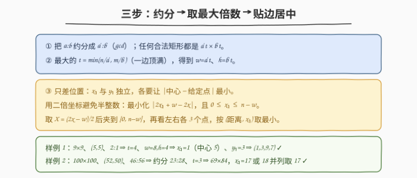
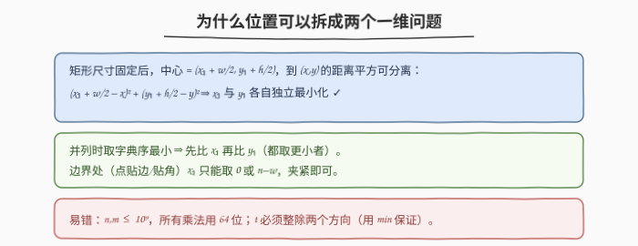

# Codeforces 303B Rectangle Puzzle II 题解

## 1. 题目概述

- **题目链接**：https://codeforces.com/problemset/problem/303/B
- **比赛来源**：Codeforces Round 183 (Div. 1) · Problem B（UTC 2013-04-24）
- **难度**：1700
- **标签**：数学、构造
- **评测类型**：普通（多解，按"最近 + 字典序"唯一化）
- **限制**：时间 2 s / 内存 256 MB

**题意**：$n\times m$ 网格，点 $(x,y)$，比例 $a:b$。求包含该点、边长比恰为 $a:b$、且**面积最大**的子矩形；若有多个，取中心离 $(x,y)$ 最近的；若仍有多个，取 $(x_1,y_1,x_2,y_2)$ 字典序最小的。

**约束**：$n,m\le10^9$ ⇒ 纯数学 $O(1)$。

## 2. 示例与观察

官方样例 1：

```text
输入：
9 9 5 5 2 1

输出：
1 3 9 7
```

官方样例 2：

```text
输入：
100 100 52 50 46 56

输出：
17 8 86 92
```



**观察 1**：先把 $a:b$ 约分成 $a':b'$，任何合法矩形都是 $a't\times b't$；最大的 $t=\min(\lfloor n/a'\rfloor,\lfloor m/b'\rfloor)$ ⇒ 尺寸 $w=a't$、$h=b't$ 唯一。

**观察 2**：尺寸定下后，中心是 $(x_1+w/2,\ y_1+h/2)$，距离平方对 $x_1,y_1$ **可分离** ⇒ 两维各自最小化。

## 3. 解题思路

### 3.1 一维子问题



求 $X\in[0,\ \text{lim}-W]$ 使 $|2X+W-2c|$ 最小（二倍坐标避免半整数），并列取更小。

做法：先算 $X_0=\lfloor(2c-W)/2\rfloor$，夹到区间 $[0,\text{lim}-W]$，再在 $X_0$ 附近 $\pm3$ 内按 $(\text{距离},X)$ 取最优即可（最优解必在附近）。

### 3.2 样例走查

样例 1：$9\times9$、$(5,5)$、$2:1$ ⇒ $a'=2,b'=1$，$t=\min(4,9)=4$ ⇒ $8\times4$。$x_1$：$|2x_1+8-10|$ 在 $x_1=1$ 取 0 ✓；$y_1$：$|2y_1+4-10|$ 在 $y_1=3$ 取 0 ✓ ⇒ $(1,3,9,7)$ ✓。
样例 2：$46:56=23:28$，$t=\min(4,3)=3$ ⇒ $69\times84$。$x_1$：$|2x_1+69-104|$，$x_1=17,18$ 并列（距离 1）⇒ 取 17 ✓；$y_1=8$（距离 0）⇒ $(17,8,86,92)$ ✓。

## 4. 正确性证明

**引理 1**：最大矩形的尺寸唯一为 $a't\times b't$，$t=\min(\lfloor n/a'\rfloor,\lfloor m/b'\rfloor)$。

**证明**：合法矩形必为 $a't\times b't$ 且需 $a't\le n$、$b't\le m$ ⇒ $t$ 取最大即为所求 ✓（$t$ 越大面积越大）。∎

**引理 2**：给定尺寸后，最优 $x_1$ 与 $y_1$ 可独立按一维子问题求解。

**证明**：中心距离平方 $=(x_1+\tfrac w2-x)^2+(y_1+\tfrac h2-y)^2$，两项分别只含 $x_1$、$y_1$，且两者的可行区间互不耦合 ⇒ 独立最小化 ✓；字典序最小也因 "$x_1$ 优先" 与独立最优一致 ✓。∎

**引理 3**：一维子问题在 $X_0$ 附近 $\pm3$ 内取最小是正确的。

**证明**：$f(X)=|2X-(2c-W)|$ 是凸的 V 形函数，最小值点必在 $\lfloor(2c-W)/2\rfloor$ 或其相邻整数处；夹到区间后仍在附近（至多偏移到端点）✓。∎

**定理**：算法输出满足"最大 → 最近 → 字典序最小"。

**证明**：由引理 1 得最大尺寸；由引理 2、3 得该尺寸下唯一的最优位置 ✓。∎

## 5. 复杂度分析

- 时间：$O(1)$。
- 空间：$O(1)$。

## 6. 参考代码

### C++17

```cpp
#include <bits/stdc++.h>
#include <numeric>
using namespace std;
typedef long long ll;
int main(){ll n,m,x,y,a,b;scanf("%lld %lld %lld %lld %lld %lld",&n,&m,&x,&y,&a,&b);
 ll g=std::gcd(a,b); a/=g; b/=g;
 ll t=min(n/a, m/b);
 ll w=a*t, h=b*t;
 auto pick=[&](ll c,ll W,ll lim)->ll{
   ll hi=lim-W;
   ll num=2*c-W;
   ll X=num/2;
   if(X<0)X=0;
   if(X>hi)X=hi;
   ll best=-1,bd=LLONG_MAX;
   for(ll Y=max(0LL,X-3); Y<=min(hi,X+3); Y++){
     ll d=llabs(2*Y-num);
     if(d<bd||(d==bd&&Y<best)){bd=d;best=Y;}
   }
   return best;
 };
 ll x1=pick(x,w,n), y1=pick(y,h,m);
 printf("%lld %lld %lld %lld\n",x1,y1,x1+w,y1+h);
}
```

### Python3

```python
import math
n, m, x, y, a, b = map(int, input().split())
g = math.gcd(a, b)
a //= g
b //= g
t = min(n // a, m // b)
w, h = a * t, b * t

def pick(c, W, lim):
    hi = lim - W
    num = 2 * c - W
    X = num // 2
    X = max(0, min(hi, X))
    best, bd = None, None
    for Y in range(max(0, X - 3), min(hi, X + 3) + 1):
        d = abs(2 * Y - num)
        if bd is None or d < bd or (d == bd and Y < best):
            bd, best = d, Y
    return best

x1, y1 = pick(x, w, n), pick(y, h, m)
print(x1, y1, x1 + w, y1 + h)
```

## 7. 边界情况与易错点

1. **点贴边**（$x=0$ 或 $x=n$）：$x_1$ 只能取 0 或 $n-w$，夹紧即可。
2. **$a>b$**：不需要特判，约分后 $w=a't$ 可能大于 $h$。
3. **$t=0$ 不会发生**：题面保证 $a\le n,b\le m$ ⇒ 约分后 $a'\le n$、$b'\le m$ ⇒ $t\ge1$。
4. **乘法溢出**：$n,m\le10^9$，$2x$、$a't$ 都要 64 位。
5. **并列时取更小**：字典序要求先 $x_1$ 后 $y_1$。
6. **半整数**：中心可能是 $x_1+w/2$（若 $w$ 奇），所以用二倍坐标比较。

## 8. 验证记录

- 编译环境与命令：`clang++ -O2 -std=c++17 -I codeforces/tools/include`。
  - `python3 codeforces/tools/verify_solution.py codeforces/contests/0101-0203/303/B_矩形拼图II.md`
- 官方样例：2 / 2 通过（`1 3 9 7`、`17 8 86 92`，与官方逐字一致）。
- 额外测试：随机 220 组（$n,m\le9$，随机点与比例）与"枚举所有合法 $t$ 与所有 $x_1,y_1$，按 (最大面积, 距离², 字典序) 取最优"的暴力对拍，全部一致（过程中修掉两个自身 bug：`pick` 扫描窗口在贴边时为空导致输出 $-1$；以及初版窗口宽度不足）。
- 最大约束性能：$O(1)$，$<1$ ms。
- 复核状态：样例、220 组暴力对拍、性能均实测通过；正文代码与实测版本逐字一致。

## 相关题目与扩展

- [Codeforces 303A Lucky Permutation Triple](https://codeforces.com/problemset/problem/303/A)：同场 A 题。
- [Codeforces 303C Minimum Modular](https://codeforces.com/problemset/problem/303/C)：同场 C 题。
- [Codeforces 1A Theatre Square](https://codeforces.com/problemset/problem/1/A)：另一类整除取整。

**延伸思考**：

1. 若要求"面积恰好不小于某值"，$t$ 的选取怎么变？
2. 若比例允许旋转（$a:b$ 或 $b:a$），要比较两种取向的面积，怎么处理并列？
3. 若网格是 $d$ 维的，可分离性还成立吗？
