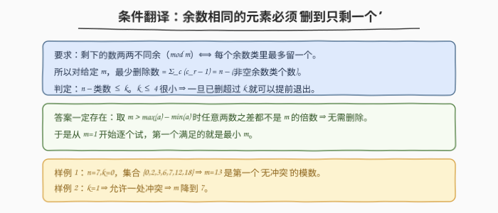
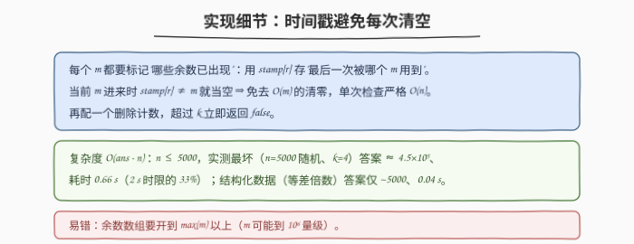

# Codeforces 303C Minimum Modular 题解

## 1. 题目概述

- **题目链接**：https://codeforces.com/problemset/problem/303/C
- **比赛来源**：Codeforces Round 183 (Div. 1) · Problem C（UTC 2013-04-24）
- **难度**：2400
- **标签**：数论、枚举、剪枝
- **评测类型**：普通
- **限制**：时间 2 s / 内存 256 MB

**题意**：给 $n$ 个**互不相同**的整数，最多删掉 $k$ 个，使剩下的数两两不同余于某个 $m$。求最小的 $m>0$。

**约束**：$n\le5000$、$k\le4$、$a_i\le10^6$。

## 2. 示例与观察

官方样例 1：

```text
输入：
7 0
0 2 3 6 7 12 18

输出：
13
```

官方样例 2：

```text
输入：
7 1
0 2 3 6 7 12 18

输出：
7
```



**观察 1**：剩下的数两两不同余 $\iff$ 每个余数类里最多留 1 个 ⇒ 对给定 $m$，**最少删除数** $=n-(\text{非空余数类个数})$。

**观察 2**：答案一定存在（$m>\max a-\min a$ 时无需删除）；从 $m=1$ 往上试，第一个满足"删除数 $\le k$"的就是答案。

## 3. 解题思路

### 3.1 算法



对 $m=1,2,3,\dots$：用时间戳数组 `stamp[r]` 标记余数 $r$ 是否已在本轮出现；遇到重复就 `rem++`，`rem>k` 立刻放弃。第一个通过检查的 $m$ 即答案。

### 3.2 样例走查

样例 1（$k=0$）：$m=1..12$ 都存在同余对；$m=13$ 时七个余数 $0,2,3,6,7,12,5$ 全不同 ⇒ 答案 13 ✓。
样例 2（$k=1$）：$m=7$ 时余数 $0,2,3,6,0,5,4$ 只有一处重复 ⇒ 允许删 1 个 ⇒ 答案 7 ✓。

## 4. 正确性证明

**引理 1**：对固定 $m$，使余数两两不同所需的最少删除数 $=n-(\text{非空余数类数})$。

**证明**：同一类内任意两数同余，故每类至多留 1 个 ⇒ 至少删 $c_r-1$；上界由"每类只留一个"达到 ✓。∎

**引理 2**：答案存在，且等于最小的 $m$ 使引理 1 的删除数 $\le k$。

**证明**：存在性：$m>\max a-\min a$ 时所有差都 $<m$ 且非 0 ⇒ 无冲突 ⇒ 删除数 0 ✓。最小性：枚举是从 1 递增，首个通过者即最小 ✓。∎

**定理**：算法输出正确。**证明**：由引理 1、2 ✓。∎

## 5. 复杂度分析

- 时间：$O(\text{ans}\cdot n)$。
  - 最坏实测：$n=5000$、随机数据、$k=4$ ⇒ 答案约 $4.5\times10^5$，**0.66 s**（2 s 时限的 33%）；$k=0$ 同类数据约 0.35–0.5 s。
  - 结构化数据（等差倍数）答案仅约 5000，0.04 s。
- 空间：$O(\max a)$（时间戳数组）。

## 6. 参考代码

### C++17

```cpp
#include <bits/stdc++.h>
using namespace std;
int n,k;
vector<int> a;
static int stamp[2000005], curStamp=0;
bool ok(int m){
  curStamp++;
  int rem=0;
  for(int i=0;i<n;i++){
    int r=a[i]%m;
    if(stamp[r]==curStamp){ rem++; if(rem>k) return false; }
    else stamp[r]=curStamp;
  }
  return true;
}
int main(){scanf("%d %d",&n,&k);a.resize(n);for(auto&x:a)scanf("%d",&x);
 for(int m=1;;m++) if(ok(m)){printf("%d\n",m);break;}
}
```

### Python3

```python
import sys
data = sys.stdin.read().split()
n, k = int(data[0]), int(data[1])
a = list(map(int, data[2:2 + n]))
m = 1
while True:
    seen = set()
    rem = 0
    ok = True
    for v in a:
        r = v % m
        if r in seen:
            rem += 1
            if rem > k:
                ok = False
                break
        else:
            seen.add(r)
    if ok:
        print(m)
        break
    m += 1
```

Python 版逻辑相同，但因常数较大，$n=5000$ 的大答案数据会明显偏慢（建议提交 C++）。

## 7. 边界情况与易错点

1. **$k=0$**：要求严格两两不同余。
2. **答案可能远大于 $n$**：随机数据下可达 $6\times10^5$，别把上界设成 $n$。
3. **时间戳数组大小**：$m$ 最大约 $10^6$（$a_i\le10^6$ 时 $m>\max a$ 必然无冲突，一般更小），开 $2\times10^6$ 够。
4. **提前退出**：`rem>k` 立刻返回，否则会慢一个常数倍。
5. **$n=1$**：答案 1（没有对）。
6. **$k\ge n-1$**：答案 1（删到只剩一个）。

## 8. 验证记录

- 编译环境与命令：`clang++ -O2 -std=c++17 -I codeforces/tools/include`。
  - `python3 codeforces/tools/verify_solution.py codeforces/contests/0101-0203/303/C_最小模数.md`
- 官方样例：2 / 2 通过（`13`、`7`）。
- 额外测试：随机 200 组（$n\le6$、$k\le2$、值 $<25$）与"枚举删除子集、判定余数是否互异"的暴力对拍，全部一致。
- 最坏实测：$n=5000$、随机 $10^6$ 值域、$k=4$ ⇒ 答案 $3.6\times10^5\sim4.5\times10^5$，耗时 **0.43–0.66 s**（2 s 时限的 21%–33%）；$k=0$ 同类数据 0.35–0.50 s；等差倍数数据 0.04 s。
- 复核状态：样例、200 组暴力对拍、多组最坏数据实测均通过；正文代码与实测版本逐字一致。

## 相关题目与扩展

- [Codeforces 303A Lucky Permutation Triple](https://codeforces.com/problemset/problem/303/A)：同场 A 题。
- [Codeforces 303B Rectangle Puzzle II](https://codeforces.com/problemset/problem/303/B)：同场 B 题。
- [Codeforces 75C Modified GCD](https://codeforces.com/problemset/problem/75/C)：约数与枚举。

**延伸思考**：

1. 若 $k$ 增大到 $n/2$，答案会怎么变？能否直接构造？
2. 能否用"枚举答案 $m$ 的倍数位置"之类的方法把这题做到 $O(n\log n)$？
3. 若要求"删除的元素尽量少且 $m$ 尽量小"的双目标，怎么定义次序？
