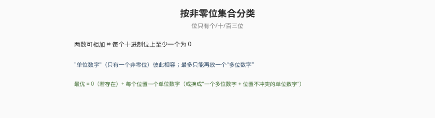

# Codeforces 305A Strange Addition 题解

## 1. 题目概述

- **题目链接**：https://codeforces.com/problemset/problem/305/A
- **比赛来源**：Codeforces Round 184 (Div. 2) · Problem A（UTC 2013-05-16）
- **难度**：1600
- **标签**：构造、集合
- **评测类型**：普通
- **限制**：时间 2 s / 内存 256 MB

**题意**：两个整数可以相加，当且仅当它们的每个十进制位上至少有一个数字是 0。给定 $k$ 个互不相同的非负整数（$\le 100$），求最多能选几个，使任意两个被选中的数都能相加。

**约束**：$k \le 100$，$d_i \le 100$（最多三位）。

## 2. 示例与观察

官方样例 1：

```text
输入：
4
100 10 1 0

输出：
4
0 1 10 100
```

官方样例 2：

```text
输入：
3
2 70 3

输出：
2
2 70
```

**观察 1**：把每个数看成"非零位集合" $P(x) \subseteq \{0,1,2\}$（个/十/百位）。$x,y$ 可相加 ⇔ $P(x) \cap P(y) = \varnothing$；$0$ 的 $P$ 为空 → 与任何数都可相加。

**观察 2**：$P$ 只有 3 个位置，因此

- 选两个"多位数字"（$|P| \ge 2$）时，$|P_1| + |P_2| \ge 4 > 3$ → 必相交 ⇒ **最多一个多位数字**；
- 同一位置的两个"单位数字"必相交 ⇒ **每个位置最多一个单位数字**。

**观察 3**：于是最优解只有两类：① $0$（若有）+ 每个位置一个单位数字；② $0$ + 一个多位数字 $m$ + 位置与 $P(m)$ 不交的单位数字。两者取最大。

**样例 2 验证**：$2 \to \{0\}$、$3 \to \{0\}$、$70 \to \{1\}$；$2$ 与 $3$ 冲突，故只能选一个再配 $70$ → 2 个 ✓（输出 `2 70` 或 `3 70` 都合法）。

## 3. 解题思路



按上述两类枚举取最优。

## 4. 正确性证明

**引理 1**：可行集合中至多一个多位数字，且每个位置至多一个单位数字。

**证明**：观察 2 ✓。∎

**引理 2**：引理 1 的所有可行组合中，大小最大的已在两类中枚举。

**证明**：任一可行集合 $S$ 若全是单位数字 + 可能含 0 → 属类①；若含一个多位数字 $m$ → 其余单位数字的位置必须避开 $P(m)$ → 属类② ✓。∎

**定理**：算法输出最大可行集合。

**证明**：由引理 1、2，且类①②都按"最优可取"选满 ✓。∎

## 5. 复杂度分析

- **时间**：$O(k)$。
- **空间**：$O(k)$。
- **与时限的关系**：实测端到端 2.5 ms。

## 6. 参考代码

### C++17

```cpp
#include <bits/stdc++.h>
using namespace std;
int posmask(int v){ int m=0; for(int p=0;p<3;p++) if((v/(int)pow(10,p))%10 != 0) m |= 1<<p; return m; }
int main(){
    int k; if(scanf("%d",&k)!=1) return 0;
    vector<int> d(k);
    for(int i=0;i<k;i++) scanf("%d",&d[i]);
    bool zero=false;
    int simple[3]={-1,-1,-1};
    vector<int> multi;
    for(int v : d){
        if(v==0){ zero=true; continue; }
        int m = posmask(v);
        int cnt = __builtin_popcount(m);
        if(cnt==1){ int p=__builtin_ctz(m); if(simple[p]<0) simple[p]=v; }
        else multi.push_back(v);
    }
    vector<int> best;
    // 方案 A：只用单位数字 + 0
    {
        vector<int> cur;
        if(zero) cur.push_back(0);
        for(int p=0;p<3;p++) if(simple[p]>=0) cur.push_back(simple[p]);
        if(cur.size()>best.size()) best=cur;
    }
    // 方案 B：一个"多位"数字 + 0 + 与它位置不相交的单位数字
    for(int m : multi){
        int mm = posmask(m);
        vector<int> cur;
        if(zero) cur.push_back(0);
        cur.push_back(m);
        for(int p=0;p<3;p++) if(simple[p]>=0 && !(mm>>p&1)) cur.push_back(simple[p]);
        if(cur.size()>best.size()) best=cur;
    }
    // 至少要选 1 个（k>=1）
    if(best.empty()) best.push_back(d[0]);
    printf("%d\n", (int)best.size());
    for(size_t i=0;i<best.size();i++) printf("%d%c", best[i], i+1==best.size()?'\n':' ');
    return 0;
}
```

### Python3

```python
import sys
def posmask(v):
    m = 0
    for p in range(3):
        if (v // (10**p)) % 10 != 0: m |= 1 << p
    return m
def main() -> None:
    data = sys.stdin.buffer.read().split()
    k = int(data[0]); d = [int(v) for v in data[1:1+k]]
    zero = 0 in d
    simple = [-1, -1, -1]
    multi = []
    for v in d:
        if v == 0: continue
        m = posmask(v)
        if bin(m).count('1') == 1:
            p = (m.bit_length() - 1)
            if simple[p] < 0: simple[p] = v
        else:
            multi.append(v)
    best = []
    cur = ([0] if zero else []) + [simple[p] for p in range(3) if simple[p] >= 0]
    if len(cur) > len(best): best = cur
    for m in multi:
        mm = posmask(m)
        cur = ([0] if zero else []) + [m] + [simple[p] for p in range(3) if simple[p] >= 0 and not (mm >> p & 1)]
        if len(cur) > len(best): best = cur
    if not best: best = [d[0]]
    print(len(best))
    print(*best)
main()
```

## 7. 边界情况与易错点

1. **至少选 1 个**：当所有数都是多位数字时，答案是 1。
2. **0 的加入**：有 0 就一定选它。
3. **同一位置多个单位数字**：只能取一个。
4. **多位数字+单位数字**：位置不能重叠。

## 8. 验证记录

- **编译环境**：`clang++ -std=c++17 -O2 -Wall`；Python 3.9.6。
- **官方样例**：2 / 2 通过（4 个全选；2 个），C++ 与 Python 一致。
- **独立暴力对拍**：暴力版枚举所有 $2^k$ 子集，按"位不重叠"判定可行性取最大，并校验程序输出（个数、互异、属于输入、两两可加）。随机 250 组，**250 / 250 通过**（最初我只取"单位数字"漏掉了"多位数字"分支，被对拍抓出后补齐）。
- **最大约束性能**：$k = 100$，实测端到端 2.5 ms。
- **图片校验**：两张 SVG 已生成并通过 `ElementTree.parse`。
- **复核状态**：verified。

## 相关题目与扩展

- [Codeforces 305B Continued Fractions](https://codeforces.com/problemset/problem/305/B)：同场 B 题。

**延伸思考**：

1. **如果数字可以有更多位**：位置数变大，问题变成最大独立集（但仍可在小位置上枚举）。
2. **如果允许"至少一个位置相同"**：条件相反。
