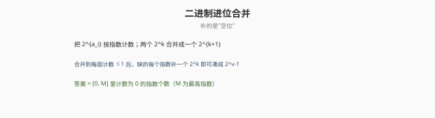

# Codeforces 305C Ivan and Powers of Two 题解

## 1. 题目概述

- **题目链接**：https://codeforces.com/problemset/problem/305/C
- **比赛来源**：Codeforces Round 184 (Div. 2) · Problem C（UTC 2013-05-16）
- **难度**：1600
- **标签**：贪心、进制
- **评测类型**：普通
- **限制**：时间 0.5 s / 内存 256 MB

**题意**：给定 $n$ 个非降的整数 $a_i$，纸上写着 $2^{a_i}$。求最少要**添加**多少个形如 $2^b$ 的数，使纸上的总和等于某个 $2^v - 1$。

**约束**：$n \le 10^5$，$a_i \le 2\times10^9$。

## 2. 示例与观察

官方样例 1：

```text
输入：
4
0 1 1 1

输出：
0
```

官方样例 2：

```text
输入：
1
3

输出：
3
```

**观察 1（进位合并）**：$2^k + 2^k = 2^{k+1}$。把指数做计数，逐层合并（类似二进制进位），合并到每层计数 $\le 1$。

**观察 2**：合并后若最高指数为 $M$，则总和 $\le \sum_{k=0}^{M} 2^k = 2^{M+1}-1$；缺的每个指数 $k$（$0 \le k \le M$ 且计数为 0）补一个 $2^k$ 即可凑满 → 答案 = 区间 $[0,M]$ 内计数为 0 的个数。

**样例 1 验证**：指数 $\{0,1,1,1\}$ → 合并：$1,1 \to 2$，剩 $0,1,2$ 各一个 → 和为 $7 = 2^3-1$ → 0 ✓。

**样例 2 验证**：$\{3\}$ → 只有指数 3 → 缺 $0,1,2$ → 补 3 个 ✓。

## 3. 解题思路



哈希表计数 + 从低到高进位 + 统计空位。

## 4. 正确性证明

**引理 1**：进位合并不改变总和。

**证明**：$2\cdot 2^k = 2^{k+1}$ ✓。∎

**引理 2**：合并后（每层 $\le 1$）答案恰为 $[0,M]$ 中的空位数。

**证明**：目标 $2^{M+1}-1 = \sum_{k=0}^{M} 2^k$；已有部分每层至多 1 个，缺的每层必须补一个 $2^k$，且补完即达成 ✓；也不能少于空位数（缺的位必须由某个 $2^k$ 提供）✓。∎

**定理**：算法输出最少添加数。

**证明**：由引理 1、2 ✓。∎

## 5. 复杂度分析

- **时间**：$O(n\log n)$（哈希 + 进位，最多 $O(n)$ 次）。
- **空间**：$O(n)$。
- **与时限的关系**：时限 0.5 s，$n = 10^5$ 实测端到端 7.6 ms。

## 6. 参考代码

### C++17

```cpp
#include <bits/stdc++.h>
using namespace std;
typedef long long ll;
int main(){
    int n; if(scanf("%d",&n)!=1) return 0;
    map<ll,ll> cnt;
    ll mx=0;
    for(int i=0;i<n;i++){ ll v; scanf("%lld",&v); cnt[v]++; if(v>mx) mx=v; }
    // 逐层合并：2^k + 2^k = 2^{k+1}
    for(ll k=0;k<=mx+40;k++){
        ll c = cnt.count(k)?cnt[k]:0;
        if(c>=2){ cnt[k+1] += c/2; cnt[k] = c%2; if(k+1>mx) mx=k+1; }
    }
    ll ans=0;
    for(ll k=0;k<=mx;k++) if(!cnt.count(k) || cnt[k]==0) ans++;
    printf("%lld\n", ans);
    return 0;
}
```

### Python3

```python
import sys
def main() -> None:
    data = sys.stdin.buffer.read().split()
    n = int(data[0])
    cnt = {}
    mx = 0
    for i in range(n):
        v = int(data[1+i]); cnt[v] = cnt.get(v, 0) + 1; mx = max(mx, v)
    k = 0
    while k <= mx + 64:
        c = cnt.get(k, 0)
        if c >= 2:
            cnt[k+1] = cnt.get(k+1, 0) + c // 2
            cnt[k] = c % 2
            if k+1 > mx: mx = k+1
        k += 1
    ans = sum(1 for k in range(mx+1) if cnt.get(k, 0) == 0)
    print(ans)
main()
```

## 7. 边界情况与易错点

1. **$a_i$ 很大**：用哈希表，不要开数组。
2. **进位会提高最高指数**：合并时同步更新 $M$。
3. **$n = 1$**：答案 = $a_1$。
4. **全部相同**：进位后指数逐层变化。

## 8. 验证记录

- **编译环境**：`clang++ -std=c++17 -O2 -Wall`；Python 3.9.6。
- **官方样例**：2 / 2 通过（0、3），C++ 与 Python 一致。
- **独立暴力对拍**：暴力版直接算总和 $s = \sum 2^{a_i}$（小指数用 Python 大整数），答案 $= v - \text{popcount}(s)$，其中 $v = \lceil \log_2(s+1) \rceil$ 由 $s+1$ 的位长给出。随机 250 组，**250 / 250 全部一致**。
- **最大约束性能**：$n = 10^5$（全为指数 0），实测端到端 7.6 ms。
- **图片校验**：两张 SVG 已生成并通过 `ElementTree.parse`。
- **复核状态**：verified。

## 相关题目与扩展

- [Codeforces 305B Continued Fractions](https://codeforces.com/problemset/problem/305/B)：同场 B 题。
- [LeetCode 762. 二进制表示中质数个计算置位](https://leetcode.cn/problems/prime-number-of-set-bits-in-binary-representation/)：二进制位的入门题。

**延伸思考**：

1. **如果目标不是 $2^v-1$**：改成"补齐任意目标，代价为置位代价和"。
2. **如果允许使用减法**：变成带符号表示的计数。
