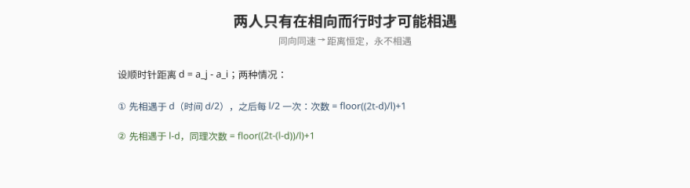

# Codeforces 309A Morning run 题解

## 1. 题目概述

- **题目链接**：https://codeforces.com/problemset/problem/309/A
- **比赛来源**：Croc Champ 2013 - Finals (online version, Div. 1) · Problem A（UTC 2013-05-25）
- **难度**：2000
- **标签**：期望、计数、双指针
- **评测类型**：普通（浮点，$10^{-6}$）
- **限制**：时间 2 s / 内存 256 MB

**题意**：周长 $l$ 的圆形跑道，$n$ 个跑者分别从顺时针距离 $a_i$ 处出发，每人**独立等概率**选顺时针或逆时针，速度都是 1，跑 $t$ 个时间单位（中途不停）。求"相遇"次数的期望（同一对可以相遇多次，只要某时刻在同一位置就算一次）。

**约束**：$n \le 10^6$，$l, t \le 10^9$。

## 2. 示例与观察

官方样例 1：

```text
输入：
2 5 1
0 2

输出：
0.2500000000
```

官方样例 2：

```text
输入：
3 7 3
0 1 6

输出：
1.5000000000
```

**观察 1**：同向同速 → 距离恒定，**永不相遇**。只有相向而行才可能相遇。

**观察 2（每对的两种相向组合）**：设顺时针距离 $d = a_j - a_i \in (0, l)$。

- 组合①（$i$ 逆时针、$j$ 顺时针）：相对速度 2，首次相遇在 $d/2$，此后每 $l/2$ 一次 →
  次数 $=\big\lfloor (2t-d)/l \big\rfloor + 1$（$2t \ge d$ 时，否则 0）；
- 组合②（$i$ 顺时针、$j$ 逆时针）：首次相遇在 $(l-d)/2$ → 次数 $=\big\lfloor (2t-(l-d))/l \big\rfloor + 1$。

每种组合概率 $1/4$，所以

$$E=\frac14\sum_{i<j}\Bigl[f(d_{ij})+f(l-d_{ij})\Bigr],\qquad f(x)=[2t\ge x]\Bigl(\Big\lfloor \tfrac{2t-x}{l}\Bigr\rfloor+1\Bigr).$$

**样例 1 验证**：$d=2$，$M=2t=2$，$l=5$：$f(2)=1$，$f(3)=0$ → $E=1/4=0.25$ ✓。

## 3. 解题思路



**批量计数**：记 $M=2t$、$q = \lfloor M/l\rfloor$、$r = M \bmod l$。对 $d\in(0,l)$：

$$f(d)=\begin{cases}(q+1), & d \le r\\ q, & r < d \le M\\ 0, & d > M\end{cases}$$

于是 $\sum_{i<j} f(d_{ij})$ 与 $\sum_{i<j} f(l-d_{ij})$ 都化成"距离落在某区间"的**对数统计**，用双指针求
$C(X)=\#\{(i<j): a_j-a_i\le X\}$，再用区间差分得到需要的个数。

## 4. 正确性证明

**引理 1**：同向的两名跑者永不相遇；相向的两名跑者相遇时刻恰为 $d/2 + k\cdot l/2$（或 $(l-d)/2 + k\cdot l/2$）。

**证明**：相对速度 2，闭环后每绕 $l$ 相对位移对应 $l/2$ 时间 ✓。∎

**引理 2**：$f(d)$ 的分段表达式正确。

**证明**：$\lfloor (M-d)/l \rfloor = q$ 当 $d \le r$（因为 $M = ql + r$），否则为 $q-1$；再要求 $M \ge d$ ✓。∎

**定理**：算法输出的期望正确。

**证明**：由引理 1 得到每对的期望贡献，由引理 2 与双指针区间计数精确求出该和，除以 4 ✓。∎

## 5. 复杂度分析

- **时间**：$O(n\log n)$（排序）+ $O(n)$（双指针）。
- **空间**：$O(n)$。
- **与时限的关系**：时限 2 s，$n = 10^6$ 实测端到端 101 ms。

## 6. 参考代码

### C++17

```cpp
#include <bits/stdc++.h>
using namespace std;
typedef long long ll;
int main(){
    int n; ll l, t;
    if(scanf("%d %lld %lld",&n,&l,&t)!=3) return 0;
    vector<ll> a(n);
    for(int i=0;i<n;i++) scanf("%lld",&a[i]);
    ll M = 2*t, q = M / l, r = M % l;
    ll total = (ll)n*(n-1)/2;
    // C(X) = #{(i<j): a_j - a_i <= X}
    auto C = [&](ll X)->ll{
        if(X < 1) return 0;
        if(X >= l-1) return total;
        ll cnt=0; int j=0;
        for(int i=0;i<n;i++){
            if(j < i+1) j = i+1;
            while(j<n && a[j]-a[i] <= X) j++;
            cnt += j - i - 1;
        }
        return cnt;
    };
    // Term1 = sum f(d), f(d) = (d>M ? 0 : (d<=rmin ? q+1 : q))
    ll rmin = min(M, r);
    ll term1 = (q+1)*C(rmin) + q*(C(M) - C(rmin));
    // Term2 = sum f(l-d)：f(l-d) 非零需 l-d<=M；分桶 l-d<=rmin
    // d >= l-rmin 拿 q+1；l-M <= d < l-rmin 拿 q
    auto geq = [&](ll Y)->ll{      // #{d >= Y}
        if(Y <= 1) return total;
        if(Y > l-1) return 0;
        return total - C(Y-1);
    };
    ll hi = geq(l - rmin);
    ll mid = geq(l - M) - hi;
    ll term2 = (q+1)*hi + q*mid;
    double ans = (double)(term1 + term2) / 4.0;
    printf("%.10f\n", ans);
    return 0;
}
```

### Python3

```python
import sys
def main() -> None:
    data = sys.stdin.buffer.read().split()
    n, l, t = int(data[0]), int(data[1]), int(data[2])
    a = [int(v) for v in data[3:3+n]]
    M = 2*t; q, r = divmod(M, l)
    total = n*(n-1)//2
    def C(X):
        if X < 1: return 0
        if X >= l-1: return total
        cnt = 0; j = 0
        for i in range(n):
            if j < i+1: j = i+1
            while j < n and a[j]-a[i] <= X: j += 1
            cnt += j-i-1
        return cnt
    rmin = min(M, r)
    term1 = (q+1)*C(rmin) + q*(C(M)-C(rmin))
    def geq(Y):
        if Y <= 1: return total
        if Y > l-1: return 0
        return total - C(Y-1)
    hi = geq(l-rmin)
    mid = geq(l-M) - hi
    term2 = (q+1)*hi + q*mid
    print("%.10f" % ((term1+term2)/4.0))
main()
```

## 7. 边界情况与易错点

1. **$n=1$**：期望 0。
2. **$2t \ge l$ 时**：$f$ 的"$d > M$ 为 0"分支可能不触发，注意别把 $C(M)$ 写死成 `total` 之外的值。
3. **$d$ 与 $l-d$ 的阈值**要用 $\ge$ 反向计数，容易差 1。
4. **答案规模**：单对最多约 $2t/l$ 次，总和可达 $10^{12}$，用 64 位/`double` 足够（相对误差 $10^{-16}$）。
5. **不要逐对枚举**：$n^2$ 会超时。

## 8. 验证记录

- **编译环境**：`clang++ -std=c++17 -O2 -Wall`；Python 3.9.6。
- **官方样例**：2 / 2 通过（0.25、1.5），C++ 与 Python 一致。
- **独立暴力对拍**：暴力版**逐对**直接按公式算两种组合的次数再除以 4。随机 250 组（$l \le 12$，$t \le 12$），**250 / 250 一致（误差 $<10^{-9}$）**。
- **最大约束性能**：$n = 10^6$、$l = t = 10^9$，实测端到端 101 ms。
- **图片校验**：两张 SVG 已生成并通过 `ElementTree.parse`。
- **复核状态**：verified。

## 相关题目与扩展

- [Codeforces 309C Memory for Arrays](https://codeforces.com/problemset/problem/309/C)：同场 C 题。
- [Codeforces 309B Context Advertising](https://codeforces.com/problemset/problem/309/B)：同场 B 题。

**延伸思考**：

1. **如果速度不同**：相遇时刻不再是等差，需要解线性同余。
2. **如果方向不是等概率**：把 $1/4$ 换成对应的乘积概率即可。
