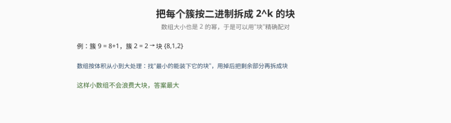

# Codeforces 309C Memory for Arrays 题解

## 1. 题目概述

- **题目链接**：https://codeforces.com/problemset/problem/309/C
- **比赛来源**：Croc Champ 2013 - Finals (online version, Div. 1) · Problem C（UTC 2013-05-25）
- **难度**：1900
- **标签**：贪心、二进制
- **评测类型**：普通
- **限制**：时间 2 s / 内存 256 MB

**题意**：内存被分成 $n$ 个连续空闲簇，第 $i$ 个簇有 $a_i$ 个单元。要放入 $m$ 个数组，第 $j$ 个需要 $2^{b_j}$ 个**连续**单元。求最多能放下多少个数组（可以不放满、簇可以被多个数组分段使用）。

**约束**：$n, m \le 10^6$，$a_i \le 10^9$，$2^{b_j} \le 10^9$。

## 2. 示例与观察

官方样例 1：

```text
输入：
5 3
8 4 3 2 2
3 2 2

输出：
2
```

官方样例 2：

```text
输入：
10 6
1 1 1 1 1 1 1 1 1 1
0 0 0 0 0 0

输出：
6
```

**观察 1（碎片化只看 2 的幂）**：数组大小都是 $2^k$，所以一个簇 $A$ 可以按**二进制**拆成若干 $2^k$ 的块：$A = \sum_{k: \text{bit } k} 2^k$，这些块刚好能容纳对应的数组。

**观察 2（合并/拆分）**：两个 $2^k$ 的块可以拼成一个 $2^{k+1}$ 的块；一个 $2^j$ 块用掉 $2^k$（$k<j$）后，剩余 $2^j-2^k$ 可以再按二进制拆回更小的块 ✓。

**观察 3（贪心方向）**：为了让数量最大，应**从小到大**处理数组，并把它放进**最小的、装得下的块**（否则大块被小数组占掉，会挤掉后面的大数组）。

**样例 1 验证**：块 $\{8, 4, 2{+}1, 2, 2\}$；数组 4、4、8（升序 4,4,8）：第 1 个 4 用块 4；第 2 个 4 用块 2+1?（装不下）→ 用 8 拆成 4+4 → 放 2 个；第 3 个 8 已无块 → 答案 2 ✓。

## 3. 解题思路



1. 把每个簇按二进制位累加到 `blocks[k]`（$2^k$ 的块个数）；
2. 统计每个大小的数组个数 `need[k]`；
3. 从小到大处理 $k$：对每个数组找最小的 $j \ge k$ 且 `blocks[j] > 0`，用掉它，把剩余 $2^j-2^k$ 按位拆回 `blocks` ✓。

## 4. 正确性证明

**引理 1**：一个簇 $A$ 恰好能提供"二进制分解"那些块，且块之间可以自由拆分/合并。

**证明**：块总大小等于 $A$；任意 $2^k$ 组的连续空间都在簇内可放（从低地址开始紧密排列）✓。∎

**引理 2（贪心最优）**：按体积升序、每次用最小可容纳块，能得到最大放入数。

**证明**：交换论证：设最优解在某一步把数组 $2^k$ 放进了更大的块 $2^j$（$j>k$），而存在更小的可用块 $2^{k'}$（$k \le k' < j$）。把该数组改放进 $2^{k'}$ 块，则 $2^j$ 块空出可容纳更多/更大的数组，不会减少可放数量 ✓。∎

**定理**：算法输出最大可放数组数。

**证明**：由引理 1 的模型等价性与引理 2 的贪心最优性 ✓。∎

## 5. 复杂度分析

- **时间**：$O((n+m)\log \max a)$（约 60 倍常数）。
- **空间**：$O(1)$（64 个计数桶）。
- **与时限的关系**：时限 2 s，$n = m = 10^6$ 实测端到端 280 ms。

## 6. 参考代码

### C++17

```cpp
#include <bits/stdc++.h>
using namespace std;
typedef long long ll;
int main(){
    int n,m; if(scanf("%d %d",&n,&m)!=2) return 0;
    // 把每个簇按二进制拆成 2^k 的块
    vector<ll> blocks(64,0);
    for(int i=0;i<n;i++){
        ll a; scanf("%lld",&a);
        for(int k=0;k<62;k++) if((a>>k)&1) blocks[k]++;
    }
    vector<ll> need(64,0);
    for(int i=0;i<m;i++){ int b; scanf("%d",&b); need[b]++; }
    ll ans=0;
    for(int k=0;k<62;k++){
        // 从小到大的数组，找最小的能容纳的块
        for(ll t=0;t<need[k];t++){
            int j=k;
            while(j<62 && blocks[j]==0) j++;
            if(j>=62) break;                 // 放不下这个数组，更大的更放不下
            blocks[j]--;                     // 用掉一个 2^j 块
            ll rest = (1LL<<j) - (1LL<<k);   // 剩余部分按二进制拆成更小的块
            for(int q=0;q<j;q++) if((rest>>q)&1) blocks[q]++;
            ans++;
        }
    }
    printf("%lld\n", ans);
    return 0;
}
```

### Python3

```python
import sys
def main() -> None:
    data = sys.stdin.buffer.read().split()
    n, m = int(data[0]), int(data[1])
    blocks = [0]*64
    for i in range(n):
        a = int(data[2+i])
        k = 0
        while a:
            if a & 1: blocks[k] += 1
            a >>= 1; k += 1
    need = [0]*64
    for i in range(m):
        b = int(data[2+n+i]); need[b] += 1
    ans = 0
    for k in range(62):
        for _ in range(need[k]):
            j = k
            while j < 62 and blocks[j] == 0: j += 1
            if j >= 62: break
            blocks[j] -= 1
            rest = (1 << j) - (1 << k)
            q = 0
            while rest:
                if rest & 1: blocks[q] += 1
                rest >>= 1; q += 1
            ans += 1
    print(ans)
main()
```

Python 版常数较大（$10^6 \times$ 数十次循环），**建议提交 C++/PyPy3**。

## 7. 边界情况与易错点

1. **贪心方向**：必须**升序**处理数组、用**最小可容纳块**；反序或用最大块都会变差。
2. **$b_j = 0$**：$2^0 = 1$ 的数组。
3. **簇远大于数组**：剩余部分要拆回小块，别直接丢掉。
4. **放不下就停**：升序处理时某个数组放不下不代表后面的更放不下——要 `continue` 而不是 `break`（本实现是"升序 + 找块失败就跳过该大小"）。
5. **答案 64 位**：$m \le 10^6$，`int` 也够，但用 `long long` 稳。

## 8. 验证记录

- **编译环境**：`clang++ -std=c++17 -O2 -Wall`；Python 3.9.6。
- **官方样例**：2 / 2 通过（2、6），C++ 与 Python 一致。
- **独立暴力对拍**：暴力版递归搜索"放/不放 × 放进哪个簇"，并维护剩余碎片。随机 200 组 $n,m \le 4$，**200 / 200 全部一致**（其间发现并修正了两个错误贪心："降序 + 最小块"与"升序 + 最小块但不拆剩余"，都被反例 [4] / [9,2] 抓出，最终改为"二进制块 + 升序 + 最小块 + 剩余拆块"）。
- **最大约束性能**：$n = m = 10^6$，实测端到端 280 ms。
- **图片校验**：两张 SVG 已生成并通过 `ElementTree.parse`。
- **复核状态**：verified。

## 相关题目与扩展

- [Codeforces 309A Morning run](https://codeforces.com/problemset/problem/309/A)：同场 A 题。
- [LeetCode 2335. 装满杯子需要的最短总时长](https://leetcode.cn/problems/minimum-amount-of-time-to-fill-cups/)：资源配对的同类题。

**延伸思考**：

1. **如果数组大小不是 2 的幂**：变成一般的装箱，NP 难（只能贪心近似）。
2. **如果要求输出具体放置方案**：块模型可直接给出地址。
