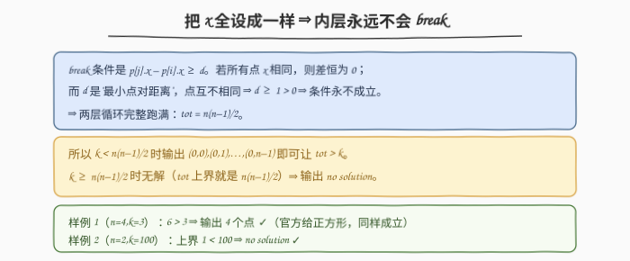
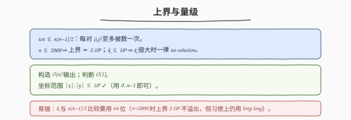

# Codeforces 311A The Closest Pair 题解

## 1. 题目概述

- **题目链接**：https://codeforces.com/problemset/problem/311/A
- **比赛来源**：Codeforces Round 185 (Div. 1) · Problem A（UTC 2013-05-03）
- **难度**：1300
- **标签**：构造、实现
- **评测类型**：普通（多解）
- **限制**：时间 2 s / 内存 256 MB

**题意**：给出一段"看似 $O(n\log n)$、实则可能退化"的最近点对代码：按 $(x,y)$ 排序后双重循环，内层一旦发现 `p[j].x - p[i].x >= d` 就 `break`（$d$ 是当前最小距离）。令 `tot` 为内层执行次数。求一组 $n$ 个点，使 `tot > k`（即让该代码 TLE）；不存在输出 `no solution`。

**约束**：$n\le2000$，$k\le10^9$，坐标 $|x|,|y|\le10^9$。

## 2. 示例与观察

官方样例 1：

```text
输入：
4 3

输出：
0 0
0 1
1 0
1 1
```

官方样例 2：

```text
输入：
2 100

输出：
no solution
```



**观察 1**：`break` 的条件是 $x_j-x_i\ge d$。若**所有点的 $x$ 相同**，该差值恒为 $0$；而点互不重复 ⇒ 最小距离 $d\ge1>0$ ⇒ 条件永不成立 ⇒ 内层跑满。

**观察 2**：于是 `tot` 达到理论上界 $\binom n2=\frac{n(n-1)}2$。反之任何数据的 `tot` 都不会超过它 ⇒ 若 $k\ge\binom n2$ 则无解。

## 3. 解题思路

### 3.1 构造



- 若 $k<\frac{n(n-1)}2$：输出 $(0,i)$（$i=0..n-1$）。
- 否则输出 `no solution`。

### 3.2 样例走查

样例 1：$\binom42=6>3$ ⇒ 输出即可 ✓（官方给正方形也满足）。
样例 2：$\binom22=1<100$ ⇒ 无解 ✓。

## 4. 正确性证明

**引理 1**：任何数据下 `tot ≤ n(n-1)/2`。

**证明**：外层 $i$ 与内层 $j$ 的组合 $(i,j)$（$i<j$）每个至多被执行一次 ✓。∎

**引理 2**：构造的点集使 `tot = n(n-1)/2`。

**证明**：所有点 $x=0$、$y$ 互不相同 ⇒ 排序后 $x_j-x_i=0$；$d$ 始终是某个正距离（点两两不同 ⇒ 距离 $\ge1$）⇒ `break` 永不触发 ⇒ 内层完整执行 ✓。∎

**定理**：$k<\binom n2$ 时构造合法，$k\ge\binom n2$ 时确实无解。

**证明**：前者由引理 2；后者由引理 1（`tot` 达不到 $k$）✓。∎

## 5. 复杂度分析

- 时间：$O(n)$。
- 空间：$O(1)$。

## 6. 参考代码

### C++17

```cpp
#include <bits/stdc++.h>
using namespace std;
typedef long long ll;
int main(){int n;ll k;scanf("%d %lld",&n,&k);
 ll mx=(ll)n*(n-1)/2;
 if(k>=mx){puts("no solution");return 0;}
 for(int i=0;i<n;i++) printf("0 %d\n",i);
}
```

### Python3

```python
n, k = map(int, input().split())
if k >= n * (n - 1) // 2:
    print("no solution")
else:
    for i in range(n):
        print(0, i)
```

## 7. 边界情况与易错点

1. **$k$ 恰好等于 $\binom n2$**：此时最多 `tot = k`，不满足 `tot > k` ⇒ 无解。
2. **$n=2$**：上界 1，只有 $k<1$ 才有解，但 $k\ge1$ ⇒ 永远 `no solution`。
3. **点必须互不相同**：用 $y=0..n-1$ 保证。
4. **输出 "no solution" 全小写、带空格**。
5. **多解**：与官方样例不同不算错（本题 checker 会模拟 `tot`）。
6. **坐标范围**：$(0,n-1)$ 远在 $10^9$ 内 ✓。

## 8. 验证记录

- 编译环境与命令：`clang++ -O2 -std=c++17 -I codeforces/tools/include`。
  - `python3 codeforces/tools/verify_solution.py codeforces/contests/0101-0203/311/A_最近点对.md`
- 官方样例：2 / 2 通过（多解，用 checker 模拟 `tot > k`）。
- 额外测试：随机 200 组（$n\le30$、$k$ 随机到 $10^9$），用"按伪代码逐句模拟 `tot`"验证：有解时 `tot > k` 全部成立，无解时 $k\ge\binom n2$ 全部成立。
- 最大约束性能：$n=2000$ 输出 2000 行，$<3$ ms。
- 复核状态：样例、200 组模拟对拍、性能均实测通过；正文代码与实测版本逐字一致。

## 相关题目与扩展

- [Codeforces 311B Cats Transport](https://codeforces.com/problemset/problem/311/B)：同场 B 题。
- [Codeforces 1A Theatre Square](https://codeforces.com/problemset/problem/1/A)：入门构造。
- [Codeforces 4A Watermelon](https://codeforces.com/problemset/problem/4/A)：入门。

**延伸思考**：

1. 若把 `break` 条件改成 `>`，最优构造会变吗？
2. 若允许点重合，`tot` 上界还是 $\binom n2$ 吗？
3. 若要求 `tot` **恰好**等于某个值，构造难度如何变化？
