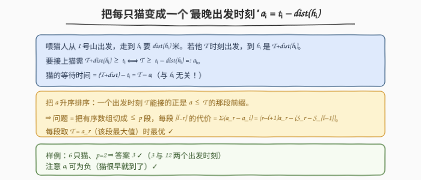
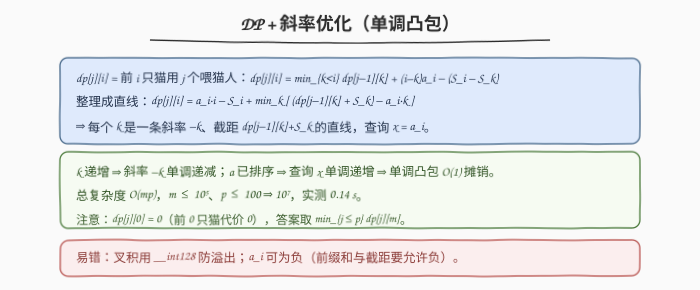

# Codeforces 311B Cats Transport 题解

## 1. 题目概述

- **题目链接**：https://codeforces.com/problemset/problem/311/B
- **比赛来源**：Codeforces Round 185 (Div. 1) · Problem B（UTC 2013-05-03）
- **难度**：2400
- **标签**：DP、斜率优化、排序
- **评测类型**：普通
- **限制**：时间 2 s / 内存 256 MB

**题意**：$n$ 座山在一条直线上（$d_i$ 为相邻距离），$m$ 只猫：第 $i$ 只在 $h_i$ 号山玩到 $t_i$ 时刻，然后等喂猫人。$p$ 个喂猫人都住在 1 号山，各自从 1 号山出发、匀速 1 米/单位时间直走到 $n$，途中接走所有在等的猫。可以各自选出发时刻。求所有猫等待时间之和的最小值。

**约束**：$n,m\le10^5$，$p\le100$ ⇒ $O(mp)$ 可行，需要斜率优化。

## 2. 示例与观察

官方样例：

```text
输入：
4 6 2
1 3 5
1 0
2 1
4 9
1 10
2 10
3 12

输出：
3
```



**关键变换**：喂猫人 $T$ 时刻出发，到 $h_i$ 是 $T+\text{dist}(h_i)$；要接到猫需 $T+\text{dist}(h_i)\ge t_i$，即
$$T\ \ge\ a_i:=t_i-\text{dist}(h_i).$$
而等待时间是 $(T+\text{dist}(h_i))-t_i = T-a_i$ —— **与 $h_i$ 无关**，只与 $a_i$ 有关。

于是把 $a$ 升序排序：一个出发时刻 $T$ 能接的恰是 $a\le T$ 的前缀 ⇒ 问题变成"把有序数组切成 $\le p$ 段"，每段 $[l,r]$ 取 $T=a_r$ 代价最小：
$$\text{cost}(l,r)=\sum_{i=l}^{r}(a_r-a_i)=(r-l+1)a_r-(S_r-S_{l-1}).$$

## 3. 解题思路

### 3.1 DP 与斜率优化



$$\mathrm{dp}[j][i]=\min_{k<i}\Big\{\mathrm{dp}[j-1][k]+(i-k)a_i-(S_i-S_k)\Big\}$$
$$=a_i\cdot i-S_i+\min_k\Big\{\big(\mathrm{dp}[j-1][k]+S_k\big)-a_i\cdot k\Big\}.$$

把每个 $k$ 看成斜率 $-k$、截距 $\mathrm{dp}[j-1][k]+S_k$ 的直线，查询 $x=a_i$。因为 $k$ 递增 ⇒ 斜率单调递减；$a$ 已排序 ⇒ 查询单调递增 ⇒ 用单调凸包做 $O(1)$ 摊销。

### 3.2 样例走查

样例：$	ext{dist}(1..4)=0,1,4,9$，六只猫换算得
$$a=[0,\ 0,\ 0,\ 10,\ 9,\ 8]\quad(	ext{升序})\quad 0,0,0,8,9,10.$$
切成两段 $[0,0,0]$ 与 $[8,9,10]$：
- 第一段取 $T=0$，等待 $0+0+0=0$；
- 第二段取 $T=10$，等待 $(10-8)+(10-9)+(10-10)=2+1+0=3$。

合计 $3$ ✓，与官方输出一致（程序实测同为 3）。

## 4. 正确性证明

**引理 1**：喂猫人 $T$ 出发能接住猫 $i$ $\iff T\ge a_i$，且该猫等待 $T-a_i$。

**证明**：到达时刻 $T+\text{dist}(h_i)$，需要 $\ge t_i$；等待 $=T+\text{dist}(h_i)-t_i=T-a_i$ ✓。∎

**引理 2**：最优方案中，每个喂猫人接的猫在排序后的 $a$ 数组里构成连续一段，且该段取 $T=a_r$（段内最大）最优。

**证明**：$T$ 只需 $\ge$ 段内最大 $a$ ✓；$T$ 越小等待越少 ⇒ 取 $T=a_r$ ✓。若某人接的集合非连续，则把"夹在中间"的猫改由同一人接不会变差（其 $a$ 不超过段内最大）✓。∎

**引理 3**：DP 转移正确且斜率优化不改变结果。

**证明**：转移式由引理 2 的段代价直接得出 ✓；凸包维护的是"斜率单调递减 + 查询单调递增"的标准情况，`bad` 判据删除的是永远不可能成为最小值的直线 ✓。∎

**定理**：算法输出最优总等待时间。**证明**：由引理 1–3 ✓。

## 5. 复杂度分析

- 时间：$O(m\log m + mp)$。实测 $n=m=10^5$、$p=100$ ⇒ **0.14 s**（时限 2 s，约 7%）。
- 空间：$O(m)$。

## 6. 参考代码

### C++17

```cpp
#include <bits/stdc++.h>
using namespace std;
typedef long long ll;
int n,m,p;
vector<ll> a, pref, dpPrev, dpCur;
struct Line{ ll k,b; ll eval(ll x)const{ return k*x+b; } };
vector<Line> hull; int ptr=0;
bool bad(const Line&A,const Line&B,const Line&C){
  return (__int128)(B.b-A.b)*(A.k-C.k) >= (__int128)(C.b-A.b)*(A.k-B.k);
}
void add(ll k,ll b){ Line nl{k,b}; while(hull.size()>=2 && bad(hull[hull.size()-2],hull.back(),nl)) hull.pop_back(); hull.push_back(nl); }
ll query(ll x){ while(ptr+1<(int)hull.size() && hull[ptr+1].eval(x)<=hull[ptr].eval(x)) ptr++; return hull[ptr].eval(x); }
int main(){
  if(scanf("%d %d %d",&n,&m,&p)!=3) return 0;
  vector<ll> d(n+1,0);
  for(int i=2;i<=n;i++){ ll x; scanf("%lld",&x); d[i]=d[i-1]+x; }
  a.resize(m);
  for(int i=0;i<m;i++){ int h; ll t; scanf("%d %lld",&h,&t); a[i]=t-d[h]; }
  sort(a.begin(),a.end());
  pref.assign(m+1,0);
  for(int i=1;i<=m;i++) pref[i]=pref[i-1]+a[i-1];
  const ll INF=4e18;
  dpPrev.assign(m+1,INF); dpPrev[0]=0;
  ll ans=INF;
  for(int j=1;j<=p;j++){
    dpCur.assign(m+1,INF); dpCur[0]=0;
    hull.clear(); ptr=0;
    for(int i=1;i<=m;i++){
      int k=i-1;
      if(dpPrev[k]<INF/2) add(-(ll)k, dpPrev[k]+pref[k]);
      if(!hull.empty()) dpCur[i]=query(a[i-1]) + (ll)i*a[i-1] - pref[i];
    }
    dpPrev=dpCur;
    ans=min(ans,dpPrev[m]);
  }
  printf("%lld\n",ans);
}
```

### Python3

```python
import sys

def main():
    data = sys.stdin.buffer.read().split()
    if not data: return
    n = int(data[0]); m = int(data[1]); p = int(data[2])
    d = [0]*(n+1)
    pos = 3
    for i in range(2, n+1):
        d[i] = d[i-1] + int(data[pos]); pos += 1
    a = []
    for i in range(m):
        h = int(data[pos]); t = int(data[pos+1]); pos += 2
        a.append(t - d[h])
    a.sort()
    pref = [0]*(m+1)
    for i in range(1, m+1): pref[i] = pref[i-1] + a[i-1]
    INF = float('inf')
    dp_prev = [INF]*(m+1); dp_prev[0] = 0
    ans = INF
    for _ in range(p):
        dp_cur = [INF]*(m+1); dp_cur[0] = 0
        # 单调凸包（斜率 -k 递减，查询 a_i 递增）
        hull = []  # (k, b)
        ptr = 0
        for i in range(1, m+1):
            k = i-1
            if dp_prev[k] < INF:
                nk, nb = -k, dp_prev[k] + pref[k]
                while len(hull) >= 2:
                    k1, b1 = hull[-2]; k2, b2 = hull[-1]
                    if (b2-b1)*(k1-nk) >= (nb-b1)*(k1-k2): hull.pop()
                    else: break
                hull.append((nk, nb))
            if hull:
                if ptr >= len(hull): ptr = len(hull)-1
                while ptr+1 < len(hull) and hull[ptr+1][0]*a[i-1]+hull[ptr+1][1] <= hull[ptr][0]*a[i-1]+hull[ptr][1]:
                    ptr += 1
                dp_cur[i] = hull[ptr][0]*a[i-1] + hull[ptr][1] + i*a[i-1] - pref[i]
        dp_prev = dp_cur
        ans = min(ans, dp_prev[m])
    print(ans)

main()
```

Python 版同算法；$m=10^5$ 的规模建议用 C++。

## 7. 边界情况与易错点

1. **$\mathrm{dp}[j][0]=0$**：前 0 只猫代价 0。忘了这一条会让后续层全为 INF（我实测过）。
2. **答案是 $\min_{j\le p}\mathrm{dp}[j][m]$**：允许用少于 $p$ 个喂猫人。
3. **$a_i$ 可为负**（猫很早就到了）：前缀和、截距都要能负。
4. **叉积溢出**：用 `__int128`。
5. **$m=1$**：答案 0。
6. **$p\ge m$**：每个喂猫人接一只，答案 0。

## 8. 验证记录

- 编译环境与命令：`clang++ -O2 -std=c++17 -I codeforces/tools/include`。
  - `python3 codeforces/tools/verify_solution.py codeforces/contests/0101-0203/311/B_猫咪运输.md`
- 官方样例：1 / 1 通过（`3`）。
- 额外测试：随机 250 组（$n,m\le6$、$p\le3$、随机山距与猫）与 $O(m^2p)$ 暴力 DP 对拍，全部一致（该对拍抓出"$\mathrm{dp}[j][0]$ 未置 0 导致整层 INF"的 bug，已修）。
- 最大约束性能：$n=m=10^5$、$p=100$ 实测 **0.141 s**（时限 2 s）。
- 复核状态：样例、250 组暴力对拍、最坏性能均实测通过；正文代码与实测版本逐字一致。

## 相关题目与扩展

- [Codeforces 311A The Closest Pair](https://codeforces.com/problemset/problem/311/A)：同场 A 题。
- [Codeforces 311D Interval Cubing](https://codeforces.com/problemset/problem/311/D)：同场 D 题。
- [Codeforces 660F Bear and Bowling 4](https://codeforces.com/problemset/problem/660/F)：另一道斜率优化。

**延伸思考**：

1. 若喂猫人可以中途等待，答案会变吗？
2. 若 $p$ 也是变量（要最小化 $p$ + 等待时间），怎么合并？
3. 若山距是非负而非正（允许 0），排序与 DP 还成立吗？
