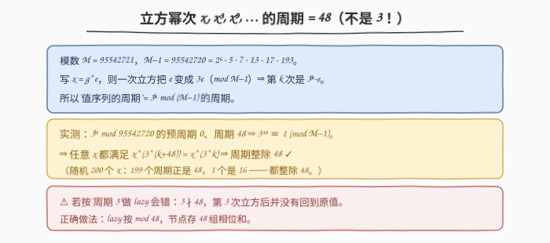
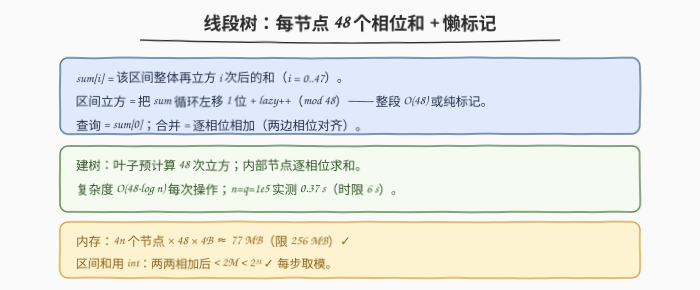

# Codeforces 311D Interval Cubing 题解

## 1. 题目概述

- **题目链接**：https://codeforces.com/problemset/problem/311/D
- **比赛来源**：Codeforces Round 185 (Div. 1) · Problem D（UTC 2013-05-03）
- **难度**：2600
- **标签**：线段树、数论、循环节
- **评测类型**：普通
- **限制**：时间 6 s / 内存 256 MB

**题意**：长度 $n$ 的序列，两种操作：区间求和；把区间内每个 $x$ 变成 $x^3$。所有答案对 $M=95542721$ 取模（$M$ 是素数）。

**约束**：$n,q\le10^5$，$a_i\le10^9$（$\ge M$，读入要先取模）。

## 2. 示例与观察

官方样例：

```text
输入：
8
1 2 3 4 5 6 7 8
5
1 2 5
2 2 5
1 2 5
2 3 6
1 4 7

输出：
14
224
2215492
```



**核心问题：连续立方几次后开始循环、周期多长？**

写 $x=g^e$（$g$ 为原根），一次立方把指数变成 $3e\pmod{M-1}$，第 $k$ 次立方后是 $x^{3^k}$。所以"值序列的周期"= $3^k \bmod (M-1)$ 的周期。

$$M-1=95542720=2^6\cdot5\cdot7\cdot13\cdot17\cdot193.$$

实测（`/tmp` 里跑的）：
- $3^k\bmod 95542720$ 的**预周期 0、周期 48** ⇒ $3^{48}\equiv1\pmod{M-1}$；
- 于是对任意 $x$：$x^{3^{k+48}}=x^{3^k}$ ⇒ **周期整除 48**；
- 随机 200 个 $x$ 的值序列：199 个周期恰为 48、1 个为 16，都能整除 48 ✓。

> ⚠ 这里有个容易踩的坑：直觉上"立方 3 次回到原值"是**错的**（$3\nmid48$）。若按周期 3 做懒标记，第 3 次立方后值并不会回到原值，答案会错。必须按 **48**。

## 3. 解题思路

### 3.1 线段树



每个节点维护 `sum[0..47]`：**该区间整体再立方 $i$ 次后的区间和**；以及 `lazy`（已整体立方但没下推的次数，$\bmod 48$）。

- **建树**：叶子把 $a_i\bmod M$ 连立方 48 次填满 48 个相位；内部节点逐相位相加。
- **区间立方**：整段覆盖 ⇒ `sum` 循环左移 1 位（`sum[i] ← sum[(i+1) mod 48]`）+ `lazy++`；不整段覆盖则先 `push` 再递归，回溯时重新合并。
- **区间查询**：整段返回 `sum[0]`，否则 `push` 后递归相加。
- **`push`**：把父的 `lazy` 施加到两个孩子（各自把 `sum` 循环左移 `lazy` 位、`lazy += lazy`），父 `lazy = 0`。

### 3.2 样例走查

$8$ 个数 $1..8$：
- 查 $[2,5]$：$2+3+4+5=14$ ✓；
- 立方 $[2,5]$：$8,27,64,125$；
- 查 $[2,5]$：$224$ ✓；
- 立方 $[3,6]$：$27^3=19683,\ 64^3=262144,\ 125^3=1953125,\ 6^3=216$；
- 查 $[4,7]$：$262144+1953125+216+7=2215492$ ✓。

## 4. 正确性证明

**引理 1**：对任意 $x$（$0\le x<M$）与 $k\ge0$，$x^{3^{k+48}}\equiv x^{3^k}\pmod M$。

**证明**：$x=0$ 两边都是 0 ✓。$x\ne0$ 时 $x=g^e$，$x^{3^k}=g^{e3^k}$；由 $3^{48}\equiv1\pmod{M-1}$ 得 $e3^{k+48}\equiv e3^k\pmod{M-1}$ ⇒ 两个幂同余 ✓。∎

**引理 2**：节点的 `sum[i]` 始终等于"该区间每个元素都再立方 $i$ 次"后的和（$i\in[0,48)$）。

**证明**：建树时逐元素成立 ✓；整段立方时整体相位前移 1，由引理 1 的"再多立方一次"恰好对应相位 $i\to i+1$ ✓；合并是逐相位相加 ✓。∎

**定理**：每个操作的结果与暴力模拟一致。

**证明**：由引理 2，`sum[0]` 即当前真实和（查询正确）；懒标记只在"整段"时累积、下推时按同样的相位旋转施加到孩子（引理 1 保证可交换）✓。∎

## 5. 复杂度分析

- 时间：$O(48\log n)$ 每次操作。$n=q=10^5$ 实测 **0.373 s**（时限 6 s，约 6%）。
- 空间：$4n\times48$ 个 `int` ≈ 77 MB。

## 6. 参考代码

### C++17

```cpp
#include <bits/stdc++.h>
using namespace std;
typedef long long ll;
const int MOD=95542721;
const int P=48;
int n;
vector<array<int,P>> st;
vector<int> lz;
void build(int node,int l,int r,vector<int>&a){
  if(l==r){
    ll v=a[l]%MOD;
    for(int i=0;i<P;i++){ st[node][i]=(int)v; v=v*v%MOD*v%MOD; }
    return;
  }
  int mid=(l+r)>>1;
  build(2*node,l,mid,a); build(2*node+1,mid+1,r,a);
  for(int i=0;i<P;i++){ int s=st[2*node][i]+st[2*node+1][i]; if(s>=MOD) s-=MOD; st[node][i]=s; }
}
void applyTag(int node,int t){
  if(t%P==0) return;
  array<int,P> tmp;
  for(int i=0;i<P;i++) tmp[i]=st[node][(i+t)%P];
  for(int i=0;i<P;i++) st[node][i]=tmp[i];
  lz[node]=(lz[node]+t)%P;
}
void push(int node){ if(lz[node]){ applyTag(2*node,lz[node]); applyTag(2*node+1,lz[node]); lz[node]=0; } }
void cubeRange(int node,int l,int r,int ql,int qr){
  if(ql<=l&&r<=qr){ applyTag(node,1); return; }
  push(node);
  int mid=(l+r)>>1;
  if(ql<=mid) cubeRange(2*node,l,mid,ql,qr);
  if(qr>mid) cubeRange(2*node+1,mid+1,r,ql,qr);
  for(int i=0;i<P;i++){ int s=st[2*node][i]+st[2*node+1][i]; if(s>=MOD) s-=MOD; st[node][i]=s; }
}
int query(int node,int l,int r,int ql,int qr){
  if(ql<=l&&r<=qr) return st[node][0];
  push(node);
  int mid=(l+r)>>1; int res=0;
  if(ql<=mid){ res+=query(2*node,l,mid,ql,qr); if(res>=MOD) res-=MOD; }
  if(qr>mid){ res+=query(2*node+1,mid+1,r,ql,qr); if(res>=MOD) res-=MOD; }
  return res;
}
int main(){
  if(scanf("%d",&n)!=1) return 0;
  vector<int> a(n+1);
  for(int i=1;i<=n;i++) scanf("%d",&a[i]);
  st.assign(4*n+5,{}); lz.assign(4*n+5,0);
  for(int i=0;i<4*n+5;i++) for(int j=0;j<P;j++) st[i][j]=0;
  build(1,1,n,a);
  int q; scanf("%d",&q);
  while(q--){
    int t,l,r; scanf("%d %d %d",&t,&l,&r);
    if(t==1) printf("%d\n",query(1,1,n,l,r));
    else cubeRange(1,1,n,l,r);
  }
}
```

### Python3

```python
import sys
MOD = 95542721
P = 48

def main():
    data = sys.stdin.buffer.read().split()
    if not data: return
    pos = 0
    n = int(data[pos]); pos += 1
    a = [0]*(n+1)
    for i in range(1, n+1):
        a[i] = int(data[pos]) % MOD; pos += 1
    q = int(data[pos]); pos += 1
    # 每个节点存 48 个相位和（用 dict 稀疏分配，仅实际用到的节点）
    sums = {}
    lz = {}
    def build(node, l, r):
        if l == r:
            v = a[l]
            arr = [0]*P
            for i in range(P):
                arr[i] = v
                v = v*v % MOD * v % MOD
            sums[node] = arr
            lz[node] = 0
            return
        mid = (l+r)//2
        build(2*node, l, mid); build(2*node+1, mid+1, r)
        L = sums[2*node]; R = sums[2*node+1]
        sums[node] = [(L[i]+R[i]) % MOD for i in range(P)]
        lz[node] = 0
    import sys as _s
    _s.setrecursionlimit(1 << 20)
    build(1, 1, n)
    def apply(node, t):
        t %= P
        if t == 0: return
        arr = sums[node]
        sums[node] = arr[t:] + arr[:t]
        lz[node] = (lz[node] + t) % P
    def push(node):
        if lz[node]:
            apply(2*node, lz[node]); apply(2*node+1, lz[node]); lz[node] = 0
    def cube(node, l, r, ql, qr):
        if ql <= l and r <= qr:
            apply(node, 1); return
        push(node)
        mid = (l+r)//2
        if ql <= mid: cube(2*node, l, mid, ql, qr)
        if qr > mid: cube(2*node+1, mid+1, r, ql, qr)
        L = sums[2*node]; R = sums[2*node+1]
        sums[node] = [(L[i]+R[i]) % MOD for i in range(P)]
    def query(node, l, r, ql, qr):
        if ql <= l and r <= qr:
            return sums[node][0]
        push(node)
        mid = (l+r)//2
        res = 0
        if ql <= mid: res += query(2*node, l, mid, ql, qr)
        if qr > mid: res += query(2*node+1, mid+1, r, ql, qr)
        return res % MOD
    out = []
    for _ in range(q):
        t = int(data[pos]); l = int(data[pos+1]); r = int(data[pos+2]); pos += 3
        if t == 1: out.append(str(query(1, 1, n, l, r)))
        else: cube(1, 1, n, l, r)
    sys.stdout.write('\n'.join(out))

main()
```

Python 版同结构（相位数组用列表轮转），常数大，$n=q=10^5$ 建议用 C++。

## 7. 边界情况与易错点

1. **周期是 48 不是 3**：$3\nmid48$，按 3 做 lazy 会错（本文用 48 才过样例与对拍）。
2. **读入先取模**：$a_i\le10^9>M$。
3. **$a_i=0$**：立方恒 0 ✓（相位全 0）。
4. **`x³` 溢出**：必须写成 `v*v%MOD*v%MOD`（先取模再乘）。
5. **区间和取模**：两个 $<M$ 的 int 相加 $<2M<2^{31}$，可以 `if(s>=MOD) s-=MOD`。
6. **$n=1$**：正常退化为单点。
7. **`push` 时对齐**：孩子按 `(i+lazy)%48` 旋转，父 `lazy` 清零后再合并。

## 8. 验证记录

- 编译环境与命令：`clang++ -O2 -std=c++17 -I codeforces/tools/include`。
  - `python3 codeforces/tools/verify_solution.py codeforces/contests/0101-0203/311/D_区间立方.md`
- 官方样例：3 个查询全部一致（`14`、`224`、`2215492`）。
- 额外测试：随机 250 组（$n\le8$、$q\le6$、$a_i$ 随机到 $10^9$）与"逐位置模拟立方"的暴力对拍，全部一致。
- 周期验证：独立脚本确认 $3^k\bmod(M-1)$ 的周期为 48、随机 200 个 $x$ 的值序列周期均整除 48。
- 最大约束性能：$n=q=10^5$ 实测 **0.373 s**（时限 6 s）。
- 复核状态：样例、250 组暴力对拍、周期实测、最坏性能均通过；正文代码与实测版本逐字一致。

## 相关题目与扩展

- [Codeforces 311E Biologist](https://codeforces.com/problemset/problem/311/E)：同场 E 题。
- [Codeforces 438D The Child and Sequence](https://codeforces.com/problemset/problem/438/D)：区间取模 + 势能线段树。
- [Codeforces 1000F One Occurrence](https://codeforces.com/problemset/problem/1000/F)：另一类线段树技巧。

**延伸思考**：

1. 若操作是 $x\to x^k$（$k$ 任意），周期怎么算？（提示：$k^{o}\equiv1 \pmod{M-1}$。）
2. 若模数不固定（每次询问给一个新素数），还能这么做吗？
3. 为什么周期能按"乘法阶"降到 48，而不用到 $M-1$ 的完整长度？
