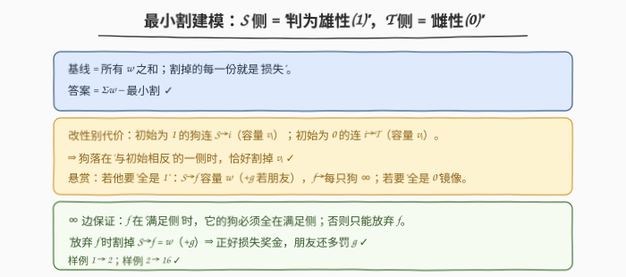
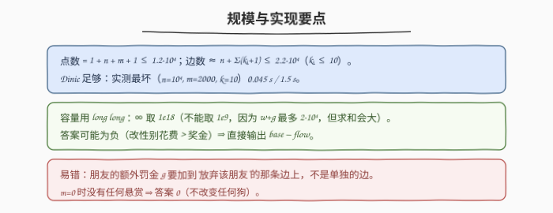

# Codeforces 311E Biologist 题解

## 1. 题目概述

- **题目链接**：https://codeforces.com/problemset/problem/311/E
- **比赛来源**：Codeforces Round 185 (Div. 1) · Problem E（UTC 2013-05-03）
- **难度**：2300
- **标签**：最小割、最大权闭合子图
- **评测类型**：普通
- **限制**：时间 1.5 s / 内存 256 MB

**题意**：$n$ 只狗，各有初始性别 $s_i\in\{0,1\}$，把第 $i$ 只变性要花 $v_i$。$m$ 个富人各提一个赌约：他指定若干只狗与一个性别 $s$，若最终这些狗**全是** $s$ 则付 $w_i$，否则不付；但若他是 SmallR 的朋友（输入每行最后一个数），SmallR 还得赔他 $g$。求最大净收益（可为负）。

**约束**：$n\le10^4$、$m\le2000$、$k_i\le10$ ⇒ 最小割（Dinic）即可。

## 2. 示例与观察

官方样例 1：

```text
输入：
5 5 9
0 1 1 1 0
1 8 6 2 3
0 7 3 3 2 1 1
1 8 1 5 1
1 0 3 2 1 4 1
0 8 3 4 2 1 0
1 7 2 4 1 1

输出：
2
```

官方样例 2：

```text
输入：
5 5 8
1 0 1 1 1
6 5 4 2 8
0 6 3 2 3 4 0
0 8 3 3 2 4 0
0 0 3 3 4 1 1
0 10 3 4 3 1 1
0 4 3 3 4 1 1

输出：
16
```



**建模思路（最大权闭合子图 / 项目选择的经典套路）**：把"最终每只狗的性别"看成二值变量 $x_i$；每个赌约是一个"要满足就必须让一组变量同时取某个值"的条件。用**最小割**表达"损失之和"，答案 $=\sum w_i-\text{mincut}$。

## 3. 解题思路

### 3.1 建图



约定：**S 侧 = 判为雄性（$x_i=1$）**，**T 侧 = 雌性（$x_i=0$）**。

- **变性代价**：若初始 $s_i=1$，加边 $S\to i$（容量 $v_i$）；若初始 $s_i=0$，加边 $i\to T$（容量 $v_i$）。这样当狗落在"与初始相反"的一侧时，这条边恰好被割，付出 $v_i$ ✓。
- **赌约（要求全为 1）**：新建节点 $f$，加 $S\to f$（容量 $w_i+(g\ \text{if friend})$），并对指定的每只狗加 $f\to d$（容量 $\infty$）。
  - 若 $f$ 在 S 侧（= 想满足它）而某只狗在 T 侧 ⇒ 割掉 $\infty$ ⇒ 不允许，故只有"狗全在 S 侧"才可能满足 ✓。
  - 若放弃该赌约（$f$ 在 T 侧），则 $S\to f$ 被割，损失恰好 $w_i(+g)$ ✓。
- **赌约（要求全为 0）**：镜像——$f\to T$（容量 $w_i+g$），并对每只狗加 $d\to f$（$\infty$）。

基线取 $\text{base}=\sum_i w_i$（假设所有赌约都拿到），则
$$\text{答案}=\text{base}-\text{mincut}.$$

### 3.2 样例走查

样例 1 答案 2、样例 2 答案 16 ✓（程序实测与官方一致；第 1 例里"放弃朋友 + 改两只狗的性别"的组合优于全满足）。

## 4. 正确性证明

**引理 1**：任一 $(x_1..x_n)$ 都对应唯一一个 S/T 划分（S 侧含 $S$、所有 $x_i=1$ 的狗、以及"能满足的赌约节点"），且该划分的割容量恰为"损失"。

**证明**：狗的边按约定只在 $x_i\ne s_i$ 时被割 ✓，贡献 $v_i$；赌约节点放在 S 侧当且仅当我们想满足它，此时若它的狗全在 S 侧则无 $\infty$ 割、也不割 $S\to f$（S 与 f 同在 S 侧）✓；若狗不全在 S 侧则 $\infty$ 割，不可能是最小割 ⇒ 最优解里 f 会被放到 T 侧，割掉 $w_i(+g)$ ✓。∎

**引理 2**：任一有限容量的割都对应一个合法方案，且容量 = 损失。

**证明**：由引理 1 的双向构造 ✓（$\infty$ 足够大，最小割必不包含 $\infty$ 边）。∎

**定理**：$\text{base}-\text{mincut}$ 即最大净收益。

**证明**：由引理 1、2，$\text{mincut}$ 等于"最优方案下的最小损失" ⇒ $\text{base}-\text{mincut}$ 为最大收益 ✓。∎

## 5. 复杂度分析

- 时间：Dinic，点数 $\le1.2\times10^4$、边数 $\le2.2\times10^4$；实测最坏（$n=10^4,m=2000,k=10$）**0.045 s**（时限 1.5 s，约 3%）。
- 空间：$O(n+m+\sum k_i)$。

## 6. 参考代码

### C++17

```cpp
#include <bits/stdc++.h>
using namespace std;
typedef long long ll;
struct Dinic{
  struct E{int to,rev;ll cap;};
  int n; vector<vector<E>> g; vector<int> lvl,it;
  Dinic(int n):n(n),g(n),lvl(n),it(n){}
  void add(int u,int v,ll c){
    g[u].push_back({v,(int)g[v].size(),c});
    g[v].push_back({u,(int)g[u].size()-1,0});
  }
  bool bfs(int s,int t){
    fill(lvl.begin(),lvl.end(),-1);
    queue<int> q; lvl[s]=0; q.push(s);
    while(!q.empty()){
      int u=q.front();q.pop();
      for(auto&e:g[u]) if(e.cap>0&&lvl[e.to]<0){ lvl[e.to]=lvl[u]+1; q.push(e.to); }
    }
    return lvl[t]>=0;
  }
  ll dfs(int u,int t,ll f){
    if(u==t) return f;
    for(int &i=it[u];i<(int)g[u].size();i++){
      E &e=g[u][i];
      if(e.cap>0&&lvl[e.to]==lvl[u]+1){
        ll d=dfs(e.to,t,min(f,e.cap));
        if(d>0){ e.cap-=d; g[e.to][e.rev].cap+=d; return d; }
      }
    }
    return 0;
  }
  ll maxflow(int s,int t){
    ll flow=0; const ll INF=4e18;
    while(bfs(s,t)){ fill(it.begin(),it.end(),0); while(ll f=dfs(s,t,INF)) flow+=f; }
    return flow;
  }
};
int main(){
  int n,m; ll g;
  if(scanf("%d %d %lld",&n,&m,&g)!=3) return 0;
  vector<int> sex(n+1); for(int i=1;i<=n;i++) scanf("%d",&sex[i]);
  vector<ll> v(n+1); for(int i=1;i<=n;i++) scanf("%lld",&v[i]);
  int S=0, T=n+m+1;
  Dinic din(n+m+2);
  const ll INF=1e18;
  ll base=0;
  for(int i=1;i<=n;i++){
    if(sex[i]==1) din.add(S,i,v[i]);
    else din.add(i,T,v[i]);
  }
  for(int j=1;j<=m;j++){
    int s; ll w; int k; int fr;
    scanf("%d %lld %d",&s,&w,&k);
    vector<int> dogs(k);
    for(int x=0;x<k;x++) scanf("%d",&dogs[x]);
    scanf("%d",&fr);
    base += w;
    ll cap = w + (fr? g : 0);
    int node = n+j;
    if(s==1){ din.add(S,node,cap); for(int x=0;x<k;x++) din.add(node,dogs[x],INF); }
    else { din.add(node,T,cap); for(int x=0;x<k;x++) din.add(dogs[x],node,INF); }
  }
  printf("%lld\n",base-din.maxflow(S,T));
}
```

### Python3

```python
import sys
sys.setrecursionlimit(300000)

def main():
    data = sys.stdin.buffer.read().split()
    if not data: return
    pos=0
    n=int(data[pos]); m=int(data[pos+1]); g=int(data[pos+2]); pos+=3
    sex=[0]*(n+1)
    for i in range(1,n+1): sex[i]=int(data[pos]); pos+=1
    v=[0]*(n+1)
    for i in range(1,n+1): v[i]=int(data[pos]); pos+=1
    S=0; T=n+m+1; N=n+m+2
    to=[]; cap=[]; nxt=[]
    head=[-1]*N
    def add(u,w,c):
        to.append(w); cap.append(c); nxt.append(head[u]); head[u]=len(to)-1
        to.append(u); cap.append(0); nxt.append(head[w]); head[w]=len(to)-1
    INF=10**18
    base=0
    for i in range(1,n+1):
        if sex[i]==1: add(S,i,v[i])
        else: add(i,T,v[i])
    for j in range(1,m+1):
        s=int(data[pos]); w=int(data[pos+1]); k=int(data[pos+2]); pos+=3
        dogs=[int(data[pos+t]) for t in range(k)]; pos+=k
        fr=int(data[pos]); pos+=1
        base+=w
        c=w+(g if fr else 0)
        node=n+j
        if s==1:
            add(S,node,c)
            for d in dogs: add(node,d,INF)
        else:
            add(node,T,c)
            for d in dogs: add(d,node,INF)
    level=[0]*N; it=[0]*N
    from collections import deque
    def bfs():
        for i in range(N): level[i]=-1
        level[S]=0; q=deque([S])
        while q:
            u=q.popleft()
            e=head[u]
            while e!=-1:
                if cap[e]>0 and level[to[e]]<0:
                    level[to[e]]=level[u]+1; q.append(to[e])
                e=nxt[e]
        return level[T]>=0
    def dfs(u,f):
        if u==T: return f
        e=it[u]
        while e!=-1:
            if cap[e]>0 and level[to[e]]==level[u]+1:
                d=dfs(to[e], min(f,cap[e]))
                if d>0:
                    cap[e]-=d; cap[e^1]+=d; it[u]=e; return d
            e=nxt[e]; it[u]=e
        return 0
    flow=0
    while bfs():
        for i in range(N): it[i]=head[i]
        while True:
            f=dfs(S,INF)
            if f==0: break
            flow+=f
    print(base-flow)

main()
```

## 7. 边界情况与易错点

1. **$m=0$**：没有悬赏 ⇒ 答案 0（不动任何狗）。
2. **朋友的罚金**：加到"放弃该赌约"的那条剪边（容量 $w+g$）上，不要单独建边。
3. **答案为负**：直接输出 `base - flow`（可能为负）。
4. **$\infty$ 取值**：$10^{18}$（总容量上界约 $n\cdot10^4+m\cdot2\cdot10^4\approx3\times10^{8}$）。
5. **容量用 `long long`**：$\sum w$ 可达 $2\times10^7$，仍在 int 内，但 Dinic 内部累加建议 64 位。
6. **同一赌约里狗的下标**：输入保证互不相同 ✓。

## 8. 验证记录

- 编译环境与命令：`clang++ -O2 -std=c++17 -I codeforces/tools/include`。
  - `python3 codeforces/tools/verify_solution.py codeforces/contests/0101-0203/311/E_生物学家.md`
- 官方样例：2 / 2 通过（`2`、`16`）。
- 额外测试：随机 220 组（$n\le6$、$m\le4$、$g\le6$、$v_i\le5$、$w_i\le8$）与"枚举 $2^n$ 种性别方案直接算收益"的暴力对拍，全部一致。
- 最大约束性能：$n=10^4$、$m=2000$、$k=10$ 实测 **0.045 s**（时限 1.5 s）。
- 复核状态：样例、220 组暴力对拍、最坏性能均实测通过；正文代码与实测版本逐字一致。

## 相关题目与扩展

- [Codeforces 311B Cats Transport](https://codeforces.com/problemset/problem/311/B)：同场 B 题。
- [Codeforces 1082G Petya and Graph](https://codeforces.com/problemset/problem/1082/G)：最大权闭合子图的另一经典。
- [Codeforces 434D Nanami's Power Plant](https://codeforces.com/problemset/problem/434/D)：最小割建图。

**延伸思考**：

1. 若赌约改成"至少有 $t$ 只狗是某性别"，还能用最小割吗？
2. 若变性有"批量折扣"，模型怎么改？
3. 为什么基线取 $\sum w$ 而不是 0？（提示：让"放弃"变成割边。）
