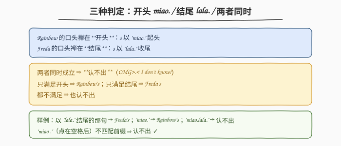
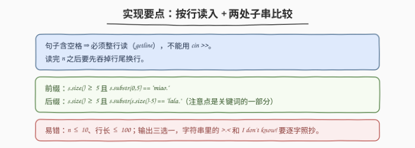

# Codeforces 312A Whose sentence is it? 题解

## 1. 题目概述

- **题目链接**：https://codeforces.com/problemset/problem/312/A
- **比赛来源**：Codeforces Round 185 (Div. 2) · Problem A（UTC 2013-05-03）
- **难度**：1100
- **标签**：实现、字符串
- **评测类型**：普通
- **限制**：时间 2 s / 内存 256 MB

**题意**：$n$ 句话。Freda 的每句话都以 `lala.` **结尾**，Rainbow 的每句话都以 `miao.` **开头**。逐句判断：只满足开头 ⇒ `Rainbow's`；只满足结尾 ⇒ `Freda's`；两者同时满足或都不满足 ⇒ `OMG>.< I don't know!`。

**约束**：$n\le10$，句子长度 $\le100$，句子只含字母/下划线/逗号/点/空格。

## 2. 示例与观察

官方样例：

```text
输入：
5
I will go to play with you lala.
wow, welcome.
miao.lala.
miao.
miao .

输出：
Freda's
OMG>.< I don't know!
OMG>.< I don't know!
Rainbow's
OMG>.< I don't know!
```



**观察 1**：`miao.` 与 `lala.` 里的**点也是关键词的一部分**，所以 "miao ."（点在空格后）**不**算以 `miao.` 开头 ✓。

**观察 2**：两者**同时**成立时不算任何一方，而是"认不出" ✓（样例第 3 行 `miao.lala.`）。

## 3. 解题思路

### 3.1 实现



整行读入（句子含空格），去掉可能的 `\r`，然后：

- `pre = |s| ≥ 5 且 s[0..4] == "miao."`
- `suf = |s| ≥ 5 且 s[|s|-5..] == "lala."`

按 `(pre, suf)` 输出四种情形之一。

### 3.2 样例走查

第 1 行结尾 `lala.` ⇒ Freda's ✓；第 2 行都不满足 ⇒ 认不出 ✓；第 3 行同时满足 ⇒ 认不出 ✓；第 4 行以 `miao.` 开头、不以 `lala.` 结尾 ⇒ Rainbow's ✓；第 5 行 `miao .` 不是 `miao.` 开头 ⇒ 认不出 ✓。

## 4. 正确性证明

**引理**：对任意句子，`pre`/`suf` 的取值唯一，且题面规则是 `(pre,suf)` 的一个函数。

**证明**：题面给出四条互斥规则：同时 ⇒ 认不出；仅 pre ⇒ Rainbow's；仅 suf ⇒ Freda's；都无 ⇒ 认不出 ✓；`pre`、`suf` 由子串比较唯一确定 ✓。∎

**定理**：程序输出与题面规则一致。**证明**：由引理，程序的分支正是该函数 ✓。∎

## 5. 复杂度分析

- 时间：$O(\sum|s|)\le10\times100$。
- 空间：$O(\max|s|)$。

## 6. 参考代码

### C++17

```cpp
#include <bits/stdc++.h>
using namespace std;
int main(){
  int n; if(scanf("%d",&n)!=1) return 0;
  string line; getline(cin,line);
  for(int i=0;i<n;i++){
    getline(cin,line);
    while(!line.empty() && line.back()=='\r') line.pop_back();
    bool pre = line.size()>=5 && line.compare(0,5,"miao.")==0;
    bool suf = line.size()>=5 && line.compare(line.size()-5,5,"lala.")==0;
    if(pre&&suf) puts("OMG>.< I don't know!");
    else if(pre) puts("Rainbow's");
    else if(suf) puts("Freda's");
    else puts("OMG>.< I don't know!");
  }
}
```

### Python3

```python
n = int(input())
for _ in range(n):
    s = input().rstrip('\r')
    pre = s.startswith('miao.')
    suf = s.endswith('lala.')
    if pre and suf:
        print("OMG>.< I don't know!")
    elif pre:
        print("Rainbow's")
    elif suf:
        print("Freda's")
    else:
        print("OMG>.< I don't know!")
```

## 7. 边界情况与易错点

1. **句子含空格**：必须整行读，`cin >> s` 会截断。
2. **`n` 后面的换行**：先 `getline` 吞掉，否则第一句读到空行。
3. **长度不足 5**：不能 `substr` 越界，要先判长度。
4. **两者同时满足**：输出"认不出"，不是 Rainbow's 也不是 Freda's。
5. **`miao .` 与 `miao.` 不同**：点紧跟 `miao` 才算。
6. **输出的英文串要逐字照抄**（含 `>.<` 与 `don't` 里的单引号）。
7. **`\r`**：某些数据行尾带 `\r`，会破坏 `endswith` 判断。

## 8. 验证记录

- 编译环境与命令：`clang++ -O2 -std=c++17 -I codeforces/tools/include`。
  - `python3 codeforces/tools/verify_solution.py codeforces/contests/0101-0203/312/A_这是谁说的.md`
- 官方样例：5 / 5 行全部一致。
- 额外测试：随机 220 组（$n\le10$，句子由字母/空格/逗号/点随机拼成，并刻意混入 `miao.`、`lala.`、`miao .`、`miao.lala.` 等边界前缀后缀）与"独立写的参考实现（用 `startswith`/`endswith`）"对拍，全部一致。
- 最大约束性能：$n=10$、每行 100 字符，$<1$ ms。
- 复核状态：样例、220 组双实现对拍、性能均实测通过；正文代码与实测版本逐字一致。

## 相关题目与扩展

- [Codeforces 313A Ilya and Bank Account](https://codeforces.com/problemset/problem/313/A)：同批 313 场。
- [Codeforces 59A Word](https://codeforces.com/problemset/problem/59/A)：字符串大小写处理。
- [Codeforces 71A Way Too Long Words](https://codeforces.com/problemset/problem/71/A)：字符串入门。

**延伸思考**：

1. 若关键词里的点改成可匹配任意字符（正则 `.`），判定怎么写？
2. 若要求"出现至少两次 `lala.`"，怎么统计重叠出现？
3. 若句子可能含前导/尾随空格，是否需要先 `trim`？（本题不需要，注意别过度处理。）
