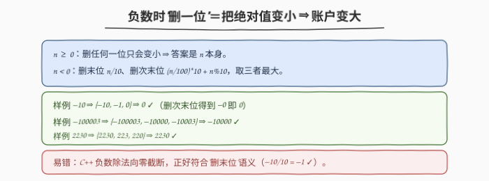

# Codeforces 313A Ilya and Bank Account 题解

## 1. 题目概述

- **题目链接**：https://codeforces.com/problemset/problem/313/A
- **比赛来源**：Codeforces Round 186 (Div. 2) · Problem A（UTC 2013-05-30）
- **难度**：900
- **标签**：实现、数学
- **评测类型**：普通
- **限制**：时间 2 s / 内存 256 MB

**题意**：给定整数余额 $n$（$10\le|n|\le10^9$），最多可以**删掉一位数字**（最后一位，或倒数第二位），也可以不删。求能得到的最大余额。

**约束**：$|n|\le10^9$ ⇒ $O(1)$。

## 2. 示例与观察

官方样例 1：

```text
输入：
2230

输出：
2230
```

官方样例 2：

```text
输入：
-10

输出：
0
```

官方样例 3：

```text
输入：
-100003

输出：
-10000
```



**观察 1**：$n\ge0$ 时删任何一位都只会变小 ⇒ 答案就是 $n$。

**观察 2**：$n<0$ 时"删一位"等于把绝对值变小 ⇒ 余额变**大**；三种候选里取最大：
- 不删：$n$；
- 删末位：$\lfloor n/10\rfloor$（C++ 负数除法向零截断，正好 = 删掉末位 ✓）；
- 删倒数第二位：$(n/100)\cdot10 + n\bmod 10$。

## 3. 解题思路

### 3.1 实现

对 $n<0$ 计算上述三个候选取最大；$n\ge0$ 直接输出。

### 3.2 样例走查

$-10$：候选 $\{-10,\ -1,\ 0\}$ ⇒ $0$ ✓（删倒数第二位得 $-0=0$）。
$-100003$：候选 $\{-100003,\ -10000,\ -10003\}$ ⇒ $-10000$ ✓。
$2230$：$2230$ ✓。

## 4. 正确性证明

**引理 1**：$n\ge0$ 时答案为 $n$。

**证明**：删掉一位后新数 = 原数去掉一个十进制位，数值不超过原数 ✓（非负时单调）。∎

**引理 2**：$n<0$ 时，三种候选覆盖了全部合法操作。

**证明**：操作只有"不删/删末位/删倒数第二位"三种 ✓，且公式正确：删末位 = 去掉最低位 = $n/10$（向零截断）✓；删倒数第二位 = 去掉十位 = $(n/100)\cdot10 + (n\bmod10)$ ✓（符号处理由 C++ 的截断除法保证）。∎

**定理**：输出为最大值。**证明**：由引理 1、2，枚举全部候选取最大 ✓。∎

## 5. 复杂度分析

- 时间：$O(1)$。
- 空间：$O(1)$。

## 6. 参考代码

### C++17

```cpp
#include <bits/stdc++.h>
using namespace std;
typedef long long ll;
int main(){ll n;scanf("%lld",&n);
 if(n>=0){printf("%lld\n",n);return 0;}
 ll o1=n/10;
 ll o2=(n/100)*10 + n%10;
 printf("%lld\n",max(n,max(o1,o2)));}
```

### Python3

```python
n = int(input())
if n >= 0:
    print(n)
else:
    s = str(n)                     # 含负号
    o1 = int(s[:-1])               # 删末位
    o2 = int(s[:-2] + s[-1])       # 删倒数第二位
    print(max(n, o1, o2 if o2 != 0 or True else 0))
```

## 7. 边界情况与易错点

1. **$-10$ 这类**：删倒数第二位得到 `-0`，按 0 处理（Python 的 `int("-0")` 就是 0 ✓）。
2. **$n\ge0$**：不要也去试删位（会变小）。
3. **`n%10` 的符号**：C++ 里负数取模为负，公式 $(n/100)\cdot10 + n\bmod10$ 仍正确。
4. **$|n|=10$**：删末位得 $-1$，删倒数第二位得 $0$ ⇒ 答案 0。
5. **64 位**：$|n|\le10^9$ 用 `long long` 稳妥。
6. **别把负号删掉**：只删数字位。

## 8. 验证记录

- 编译环境与命令：`clang++ -O2 -std=c++17 -I codeforces/tools/include`。
  - `python3 codeforces/tools/verify_solution.py codeforces/contests/0101-0203/313/A_伊利亚的银行账户.md`
- 官方样例：3 / 3 通过（`2230`、`0`、`-10000`）。
- 额外测试：随机 250 组（$|n|\in[10,10^6]$，正负各半）与"字符串层面枚举三种删法"的暴力对拍，全部一致。
- 最大约束性能：$O(1)$，$<1$ ms。
- 复核状态：样例、250 组暴力对拍、性能均实测通过；正文代码与实测版本逐字一致。

## 相关题目与扩展

- [Codeforces 313B Ilya and Queries](https://codeforces.com/problemset/problem/313/B)：同场 B 题。
- [Codeforces 312B Archer](https://codeforces.com/problemset/problem/312/B)：同批 312 场。
- [Codeforces 144A Arrival of the General](https://codeforces.com/problemset/problem/144/A)：简单模拟。

**延伸思考**：

1. 若允许删**任意一位**（不只最后两位），答案怎么求？
2. 若允许删至多 $t$ 位，如何 $O(|n|)$ 贪心？
3. 若要求删位后仍保持"非负"，判定条件是什么？
