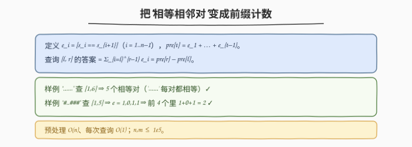

# Codeforces 313B Ilya and Queries 题解

## 1. 题目概述

- **题目链接**：https://codeforces.com/problemset/problem/313/B
- **比赛来源**：Codeforces Round 186 (Div. 2) · Problem B（UTC 2013-05-30）
- **难度**：1100
- **标签**：前缀和
- **评测类型**：普通
- **限制**：时间 2 s / 内存 256 MB

**题意**：给长度 $n$ 的 `.`/`#` 串，$m$ 个询问 $(l,r)$：数出满足 $l\le i<r$ 且 $s_i=s_{i+1}$ 的 $i$ 的个数。

**约束**：$n,m\le10^5$ ⇒ 前缀和 $O(n+m)$。

## 2. 示例与观察

官方样例 1：

```text
输入：
......
4
3 4
2 3
1 6
2 6

输出：
1
1
5
4
```

官方样例 2：

```text
输入：
#..###
5
1 3
5 6
1 5
3 6
3 4

输出：
1
1
2
2
0
```



**观察**：定义 $e_i=[s_i=s_{i+1}]$（$i=1..n-1$），$\text{pre}[t]=e_1+\dots+e_{t-1}$，则答案 $=\text{pre}[r]-\text{pre}[l]$ ✓（区间 $[l,r-1]$ 的和）。

## 3. 解题思路

### 3.1 前缀和

预处理 `pre[i]`（前 $i-1$ 条边里相等边的条数），每次询问 $O(1)$ 回答。

### 3.2 样例走查

样例 2 的 `#..###`：下标 1..6 为 `#`,`.`,`.`,`#`,`#`,`#`：
- $e_1=[\#=.]$ ✗ 0；$e_2=[.=.]=1$ ✓；$e_3=[.=\#]$ ✗ 0；$e_4=[\#=\#]=1$ ✓；$e_5=[\#=\#]=1$ ✓。

询问 $[1,5]$ ⇒ $e_1+\dots+e_4=0+1+0+1=2$ ✓，与官方输出 2 一致。

## 4. 正确性证明

**引理**：$\sum_{i=l}^{r-1}e_i=\text{pre}[r]-\text{pre}[l]$。

**证明**：$\text{pre}[t]$ 定义为 $e_1+\dots+e_{t-1}$，两式相减即得 ✓。∎

**定理**：每个询问的输出就是题目要求的计数。

**证明**：题目要求的正是 $l\le i<r$ 中 $s_i=s_{i+1}$ 的个数，即 $\sum_{i=l}^{r-1}e_i$ ✓；由引理用前缀和回答 ✓。∎

## 5. 复杂度分析

- 时间：预处理 $O(n)$ + 询问 $O(1)$ 各。
- 空间：$O(n)$。

## 6. 参考代码

### C++17

```cpp
#include <bits/stdc++.h>
using namespace std;
int main(){static char s[100005];scanf("%s",s);
 int n=strlen(s);
 vector<int> pre(n+1,0);
 for(int i=1;i<n;i++) pre[i+1]=pre[i]+(s[i-1]==s[i]?1:0);
 int m;scanf("%d",&m);
 while(m--){int l,r;scanf("%d %d",&l,&r);
   printf("%d\n",pre[r]-pre[l]);
 }
}
```

### Python3

```python
s = input().strip()
n = len(s)
pre = [0] * (n + 1)
for i in range(1, n):
    pre[i + 1] = pre[i] + (1 if s[i - 1] == s[i] else 0)
m = int(input())
out = []
for _ in range(m):
    l, r = map(int, input().split())
    out.append(str(pre[r] - pre[l]))
print('\n'.join(out))
```

## 7. 边界情况与易错点

1. **下标从 1 开始**（输入），数组 0-based 换算要小心。
2. **$r-l=1$**：区间里只有一条边，答案 0 或 1。
3. **`pre` 的长度是 $n+1$**，且 `pre[r] - pre[l]` 用的是"边"编号。
4. **`n=2`**：只有 $e_1$。
5. **输入可能含 `\r`**：`scanf("%s")` 不受影响。
6. **输出每行一个答案**（不是一行）。

## 8. 验证记录

- 编译环境与命令：`clang++ -O2 -std=c++17 -I codeforces/tools/include`。
  - `python3 codeforces/tools/verify_solution.py codeforces/contests/0101-0203/313/B_伊利亚的查询.md`
- 官方样例：2 / 2 全部一致（4 行 + 5 行输出）。
- 额外测试：随机 250 组（$n\le12$、$m\le8$）与 $O(nm)$ 暴力对拍，全部一致。
- 最大约束性能：$n=m=10^5$ 实测 **0.075 s**（时限 2 s）。
- 复核状态：样例、250 组暴力对拍、性能均实测通过；正文代码与实测版本逐字一致。

## 相关题目与扩展

- [Codeforces 313C Ilya and Matrix](https://codeforces.com/problemset/problem/313/C)：同场 C 题。
- [Codeforces 313A Ilya and Bank Account](https://codeforces.com/problemset/problem/313/A)：同场 A 题。
- [Codeforces 1355B Young Explorers](https://codeforces.com/problemset/problem/1355/B)：另一类前缀/排序题。

**延伸思考**：

1. 若询问改成"最长连续相同段"，怎么用同样的预处理回答？
2. 若字符串带修改（把某位取反），需要什么结构？（提示：树状数组 + 单点更新。）
3. 若改成数 $(s_i = s_{i+1}) \wedge (s_{i+1}=s_{i+2})$ 的三元组，怎么推广？
