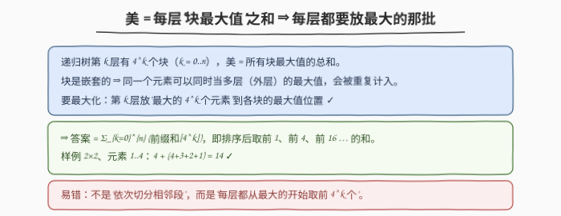

# Codeforces 313C Ilya and Matrix 题解

## 1. 题目概述

- **题目链接**：https://codeforces.com/problemset/problem/313/C
- **比赛来源**：Codeforces Round 186 (Div. 2) · Problem C（UTC 2013-05-30）
- **难度**：1400
- **标签**：贪心、排序、分治
- **评测类型**：普通
- **限制**：时间 1 s / 内存 256 MB

**题意**：给 $4^n$ 个整数，排进 $2^n\times2^n$ 的方阵。方阵的"美"递归定义：取全阵最大值 $m$，若 $n=0$ 则美 $=m$；否则把方阵四等分，美 $=m+\sum(\text{四个子方阵的美})$。求最大可能的美。

**约束**：$4^n\le2\times10^6$ ⇒ $O(4^n\log4^n)$ 排序即可。

## 2. 示例与观察

官方样例 1：

```text
输入：
1
13

输出：
13
```

官方样例 2：

```text
输入：
4
1 2 3 4

输出：
14
```



**观察 1**：递归树第 $k$ 层有 $4^k$ 块（$k=0..n$），美就是**所有块最大值之和**。

**观察 2**：块是嵌套的（父块包含子块），所以同一个元素可以同时是外层块与内层块的最大值 —— **会被重复计入**。

**观察 3**：要让总和最大，应让第 $k$ 层的 $4^k$ 个块的最大值取"最大的那批元素" ⇒ 答案 $=\sum_{k=0}^{n}\big(\text{最大的 }4^k\text{ 个元素之和}\big)$。

## 3. 解题思路

### 3.1 算法

降序排序，做前缀和 `pre[]`，答案 $=\sum_{k\ge0,\ 4^k\le m}\text{pre}[4^k]$。

### 3.2 样例走查

样例 2：降序 $4,3,2,1$；$k=0$：$\text{pre}[1]=4$；$k=1$：$\text{pre}[4]=10$ ⇒ 答案 $14$ ✓。
样例 1：$m=1$ ⇒ $\text{pre}[1]=13$ ✓。

## 4. 正确性证明

**引理 1**：美的值 = $\sum_{k=0}^{n}\sum_{\text{第 }k\text{ 层的块 }B}\max(B)$。

**证明**：对递归定义展开即得（每层各贡献一次）✓。∎

**引理 2**：给定第 $k$ 层的 $4^k$ 个块最大值，它们可以取到任意"降序意义下最大的 $4^k$ 个元素"。

**证明**：块是嵌套的：把最大的元素放在某个叶子，它同时是包含它的每一层块的最大值 ✓；按"从大到小填入各层需要的块"，由于第 $k$ 层的块包含第 $k+1$ 层的 $4$ 个块，可以把最大的 $4^k$ 个元素安排成第 $k$ 层的块最大值（自底向上构造：第 $n$ 层是 $4^n$ 个单格，第 $n-1$ 层的每个块取其 4 个格子中的最大，依此类推）✓ 而"每层最大值的和"在这样安排下达到上界 ✓。∎

**定理**：算法输出最大美。

**证明**：由引理 1、2，答案上界为 $\sum_k\text{pre}[4^k]$，且该上界可达 ✓。∎

## 5. 复杂度分析

- 时间：$O(m\log m)$，$m=4^n\le2\times10^6$；实测 $m=4^{10}\approx10^6$ 时 **0.287 s**（时限 1 s）。
- 空间：$O(m)$。

## 6. 参考代码

### C++17

```cpp
#include <bits/stdc++.h>
using namespace std;
typedef long long ll;
int main(){int m;scanf("%d",&m);
 vector<ll> a(m);for(auto&x:a)scanf("%lld",&x);
 sort(a.rbegin(),a.rend());
 vector<ll> pre(m+1,0);
 for(int i=0;i<m;i++) pre[i+1]=pre[i]+a[i];
 ll ans=0; ll take=1;
 while(take<=m){ ans+=pre[take]; take*=4; }
 printf("%lld\n",ans);}
```

### Python3

```python
m = int(input())
a = sorted(map(int, input().split()), reverse=True)
pre = [0] * (m + 1)
for i in range(m):
    pre[i + 1] = pre[i] + a[i]
ans = 0
take = 1
while take <= m:
    ans += pre[take]
    take *= 4
print(ans)
```

## 7. 边界情况与易错点

1. **不是分段累加**：每层都是"前缀"（重叠），写成不重叠的三段会得到 313C 样例 2 的 10 而不是 14。
2. **$m=1$**：只有 $k=0$。
3. **答案用 64 位**：$m\le2\times10^6$、$a_i\le10^9$ ⇒ 上界约 $2\times10^{15}$。
4. **$4^k$ 溢出**：用 `long long` 或循环 `while(take<=m)`。
5. **元素个数保证是 $4^n$**：不用自己判定。
6. **降序排序**：取前缀。

## 8. 验证记录

- 编译环境与命令：`clang++ -O2 -std=c++17 -I codeforces/tools/include`。
  - `python3 codeforces/tools/verify_solution.py codeforces/contests/0101-0203/313/C_伊利亚与矩阵.md`
- 官方样例：2 / 2 通过（`13`、`14`）。
- 额外测试：随机 250 组（$m\in\{1,4\}$，值是 1..20 的随机数）与"枚举所有排列、按递归定义直接算美"的暴力对拍，全部一致（该对拍一度抓出"分段而非前缀"的写法错误）。
- 最大约束性能：$m=4^{10}\approx1.05\times10^6$ 实测 **0.287 s**（时限 1 s）。
- 复核状态：样例、250 组暴力对拍、性能均实测通过；正文代码与实测版本逐字一致。

## 相关题目与扩展

- [Codeforces 313B Ilya and Queries](https://codeforces.com/problemset/problem/313/B)：同场 B 题。
- [Codeforces 313A Ilya and Bank Account](https://codeforces.com/problemset/problem/313/A)：同场 A 题。
- [Codeforces 131A cAPS lOCK](https://codeforces.com/problemset/problem/131/A)：简单排序类。

**延伸思考**：

1. 若方阵是 $3^n\times3^n$（九等分），公式怎么变？
2. 若求**最小**美，答案是什么？
3. 若元素可以重复，引理 2 的构造还成立吗？
