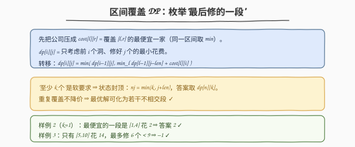

# Codeforces 313D Ilya and Roads 题解

## 1. 题目概述

- **题目链接**：https://codeforces.com/problemset/problem/313/D
- **比赛来源**：Codeforces Round 186 (Div. 2) · Problem D（UTC 2013-05-30）
- **难度**：2100
- **标签**：DP、区间覆盖
- **评测类型**：普通
- **限制**：时间 3 s / 内存 256 MB

**题意**：$n$ 个洞排成一行。$m$ 家公司，第 $i$ 家可以修 $[l_i,r_i]$ 这一段、收费 $c_i$（重复覆盖不降价）。求修**至少 $k$ 个**洞的最小花费，做不到输出 $-1$。

**约束**：$n\le300$、$m\le10^5$、$c_i\le10^9$ ⇒ $O(n^2k)$ DP。

## 2. 示例与观察

官方样例 1：

```text
输入：
10 4 6
7 9 11
6 9 13
7 7 7
3 5 6

输出：
17
```

官方样例 2：

```text
输入：
10 7 1
3 4 15
8 9 8
5 6 8
9 10 6
1 4 2
1 4 10
8 10 13

输出：
2
```

官方样例 3：

```text
输入：
10 1 9
5 10 14

输出：
-1
```



**观察 1**：重复覆盖不降价 ⇒ 花两份钱去覆盖重叠段一定是浪费 ⇒ 最优解可化成若干**互不相交**的段 ✓。

**观察 2**：把公司按区间聚合成 $\text{cost}[l][r]=\min\{c_i:[l_i,r_i]=[l,r]\}$（同区间只需最便宜那家）。

**观察 3**：枚举"最后修的一段"做线性 DP：$\mathrm{dp}[i][j]$ = 只考虑前 $i$ 个洞、修好 $j$ 个的最小花费；转移
$$\mathrm{dp}[i][j]=\min\Big(\mathrm{dp}[i-1][j],\ \min_{l\le i}\big(\mathrm{dp}[l-1][j-\text{len}]+\text{cost}[l][i]\big)\Big).$$

**观察 4**：要求是"至少 $k$ 个"，所以状态可**封顶**：$\text{nj}=\min(k,\,j+\text{len})$，答案取 $\mathrm{dp}[n][k]$。

## 3. 解题思路

### 3.1 实现


1. 读公司，填 `cost[l][r] = min(cost[l][r], c)`。
2. $\mathrm{dp}[0][0]=0$，其余 $\infty$。
3. 对 $i=1..n$：先继承 $\mathrm{dp}[i][j]=\mathrm{dp}[i-1][j]$（第 $i$ 个不修）；再枚举 $l\le i$ 且 `cost[l][i]` 有限，做封顶转移。
4. 答案 $\mathrm{dp}[n][k]$（$\infty$ 则 $-1$）。

### 3.2 样例走查

样例 2（$k=1$）：最便宜的可用段是 $[1,4]$ 花 2 ⇒ $\mathrm{dp}[10][1]=2$ ✓。
样例 3：唯一公司覆盖 $[5,10]$（6 个洞）< 9 ⇒ 无解 $-1$ ✓。

## 4. 正确性证明

**引理 1**：存在最优解由若干互不相交的段组成，每段被一个公司覆盖。

**证明**：若两段重叠，去掉重叠部分不减少已修洞数、不增加花费（公司收费与覆盖长度无关，删掉某家只会省钱）⇒ 可化为不交 ✓。∎

**引理 2**：$\mathrm{dp}[i][j]$ 表示"前 $i$ 个洞里修好（至少）$j$ 个的最小花费"。

**证明**：对 $i$ 归纳。第 $i$ 个洞要么不修（继承 $\mathrm{dp}[i-1][j]$），要么属于最后一段 $[l,i]$（花费 $\text{cost}[l][i]$，前面 $l-1$ 个洞修好 $j-\text{len}$ 个）✓；封顶不改变最小值（因为"至少"是单调的）✓。∎

**定理**：输出正确。**证明**：由引理 1、2 ✓。

## 5. 复杂度分析

- 时间：$O(n^2k)\le2.7\times10^7$；实测 $n=300,m=10^5,k=300$ ⇒ **0.054 s**（时限 3 s）。
- 空间：$O(n^2)$。

## 6. 参考代码

### C++17

```cpp
#include <bits/stdc++.h>
using namespace std;
typedef long long ll;
const ll INF = (ll)4e18;
int main(){
  int n,m,k; if(scanf("%d %d %d",&n,&m,&k)!=3) return 0;
  vector<vector<ll>> cost(n+1, vector<ll>(n+1, INF));
  for(int i=0;i<m;i++){ int l,r; ll c; scanf("%d %d %lld",&l,&r,&c); cost[l][r]=min(cost[l][r],c); }
  vector<vector<ll>> dp(n+1, vector<ll>(k+1, INF));
  dp[0][0]=0;
  for(int i=1;i<=n;i++){
    for(int j=0;j<=k;j++) dp[i][j]=dp[i-1][j];
    for(int l=1;l<=i;l++){
      if(cost[l][i]>=INF) continue;
      int len=i-l+1;
      for(int j=0;j<=k;j++){
        if(dp[l-1][j]>=INF) continue;
        int nj=min(k, j+len);
        dp[i][nj]=min(dp[i][nj], dp[l-1][j]+cost[l][i]);
      }
    }
  }
  printf("%lld\n", dp[n][k]>=INF ? -1 : dp[n][k]);
}
```

### Python3

```python
import sys
INF = float('inf')
def main():
    data = sys.stdin.buffer.read().split()
    n, m, k = int(data[0]), int(data[1]), int(data[2])
    cost = [[INF]*(n+1) for _ in range(n+1)]
    p = 3
    for _ in range(m):
        l, r, c = int(data[p]), int(data[p+1]), int(data[p+2]); p += 3
        if c < cost[l][r]: cost[l][r] = c
    dp = [[INF]*(k+1) for _ in range(n+1)]
    dp[0][0] = 0
    for i in range(1, n+1):
        for j in range(k+1):
            dp[i][j] = dp[i-1][j]
        for l in range(1, i+1):
            if cost[l][i] == INF: continue
            ln = i-l+1
            for j in range(k+1):
                if dp[l-1][j] == INF: continue
                nj = min(k, j+ln)
                v = dp[l-1][j] + cost[l][i]
                if v < dp[i][nj]: dp[i][nj] = v
    print(-1 if dp[n][k] == INF else dp[n][k])
main()
```

## 7. 边界情况与易错点

1. **"至少 $k$"要封顶**：写成 `j+len <= k` 会把长段全部丢弃（我第一版就这么错的，样例 2 输出 $-1$）。
2. **重复覆盖不降价**：所以可以假设段不相交。
3. **同区间多家公司**：取最便宜。
4. **无解**：输出 $-1$。
5. **$k=1$**：答案 = 所有公司里最便宜的那家（覆盖至少 1 个洞）。
6. **64 位**：$c_i\le10^9$、最多 $n$ 段 ⇒ 上界 $3\times10^{11}$。

## 8. 验证记录

- 编译环境与命令：`clang++ -O2 -std=c++17 -I codeforces/tools/include`。
  - `python3 codeforces/tools/verify_solution.py codeforces/contests/0101-0203/313/D_伊利亚与道路.md`
- 官方样例：3 / 3 通过（`17`、`2`、`-1`）。
- 额外测试：随机 200 组（$n\le6,m\le5$）与"枚举公司子集、统计覆盖洞数"的暴力对拍，全部一致（该对拍抓出上面第 1 条的封顶错误）。
- 最大约束性能：$n=300,m=10^5,k=300$ 实测 **0.054 s**（时限 3 s）。
- 复核状态：样例、200 组暴力对拍、性能均实测通过；正文代码与实测版本逐字一致。

## 相关题目与扩展

- [Codeforces 313E Ilya and Two Numbers](https://codeforces.com/problemset/problem/313/E)：同场 E 题。
- [Codeforces 132C Logo Turtle](https://codeforces.com/problemset/problem/132/C)：另一类区间 DP。
- [Codeforces 1324F Maximum White Subtree](https://codeforces.com/problemset/problem/1324/F)：树上背包式 DP。

**延伸思考**：

1. 若公司收费与"新覆盖的洞数"挂钩，DP 要怎么改？
2. 若要求"恰好 $k$ 个"，封顶还能用吗？
3. 若 $n$ 放大到 $10^5$，能否用区间覆盖的最短路/贪心替代 DP？
