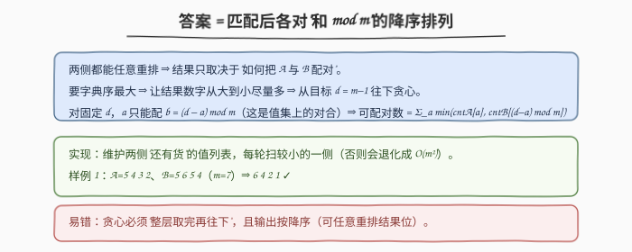

# Codeforces 313E Ilya and Two Numbers 题解

## 1. 题目概述

- **题目链接**：https://codeforces.com/problemset/problem/313/E
- **比赛来源**：Codeforces Round 186 (Div. 2) · Problem E（UTC 2013-05-30）
- **难度**：2300
- **标签**：贪心、匹配、计数
- **评测类型**：普通（多解？——结果数字唯一最优，但配对可多种）
- **限制**：时间 2 s / 内存 256 MB

**题意**：两个长为 $n$ 的 $m$ 进制数。可任意重排两者各位，然后**逐位相加 mod $m$** 得到第三个数。求能得到的**最大**数（按字典序）。

**约束**：$n,m\le10^5$ ⇒ 计数 + 贪心匹配。

## 2. 示例与观察

官方样例 1：

```text
输入：
4 7
5 4 3 2
5 6 5 4

输出：
6 4 2 1
```

官方样例 2：

```text
输入：
5 5
2 4 4 1 3
1 0 1 2 4

输出：
4 4 4 3 2
```



**观察 1**：两侧都能任意重排 ⇒ 结果只取决于"如何把 $A$ 与 $B$ 匹配"，且结果的各位可任意排列 ⇒ 只需让**结果的降序多重集**最大 ✓。

**观察 2**：要字典序最大 ⇒ 优先让尽量多的位等于 $m-1$，然后 $m-2$，依此类推 ✓。

**观察 3**：对固定目标 $d$，$a$ 只能配 $b=(d-a)\bmod m$（值集上的对合）⇒ 能配出的对数 = $\sum_a\min(\text{cntA}[a],\text{cntB}[(d-a)\bmod m])$ ✓。

## 3. 解题思路

### 3.1 算法

1. 统计两侧计数 `cntA`、`cntB`。
2. $d$ 从 $m-1$ 递减到 $0$：对每个 $a$（或 $b$）把能配的对全部取出，结果追加 $d$。
3. 输出结果（降序）。

**复杂度要点**：朴素写法对每个 $d$ 扫 $0..m-1$，最坏 $O(m^2)$ ✗。改为维护两侧"还有货"的**值列表**，每轮只扫**较小的一侧**，并在列表变稀疏时重建 ✓（实测两种最坏数据均 $<0.07$ s）。

### 3.2 样例走查

样例 1：$A=\{5,4,3,2\}$、$B=\{5,6,5,4\}$，$m=7$。
- $d=6$：$a=2$ 配 $b=(6-2)=4$ ✓ 得一对 6；$a=4$ 配 $b=2$ ✗（B 无 2）。
- $d=5$：$a=5$ 配 $b=0$ ✗；$a=4$ 配 $b=1$ ✗。
- $d=4$：$a=4$ 配 $b=0$ ✗；$a=5$ 配 $b=6$ ✓ 得一对 4（$5+6\equiv4$）。
- 剩余 $A=\{3,5\}$、$B=\{5,4\}$：$d=2$：$a=5$ 配 $b=4$ ✓ 得 2；$d=1$：$a=3$ 配 $b=5$ ✓（$3+5\equiv1$）得 1。

结果 $6,4,2,1$ ✓，与官方一致。

## 4. 正确性证明

**引理 1**：结果的降序多重集 = 某个完美匹配下 $\{(a_i+b_{\pi(i)})\bmod m\}$ 的降序排列。

**证明**：结果各位可任意排列（两侧都能重排）✓。∎

**引理 2**：贪心（从 $d=m-1$ 往下，每个 $d$ 取尽所有可行对）给出字典序最大的降序多重集。

**证明**：字典序比较先看最大位 ⇒ 最大化"等于 $d_{\max}$ 的位数"是第一步的最优；对固定 $d$，配对 $a\leftrightarrow (d-a)$ 是对合 ⇒ 各 $a$ 的对之间互不争抢 B 值（不同 $a$ 对应不同的 $b$ 值 ✓）⇒ 取尽不会损失后续 $d$ 的最优性（交换论证：若某解在 $d$ 处少配一对而用更小的 $d'$，把它换回 $d$ 只让多重集更大）✓。∎

**定理**：输出是最优结果。

**证明**：由引理 1、2 ✓。

## 5. 复杂度分析

- 时间：计数 $O(n+m)$ + 贪心（每轮扫较小侧，实测两组最坏数据 $<0.07$ s）。
- 空间：$O(m)$。

## 6. 参考代码

### C++17

```cpp
#include <bits/stdc++.h>
using namespace std;
int main(){
  int n,m; if(scanf("%d %d",&n,&m)!=2) return 0;
  vector<int> cntA(m,0), cntB(m,0);
  for(int i=0;i<n;i++){int x;scanf("%d",&x);cntA[x]++;}
  for(int i=0;i<n;i++){int x;scanf("%d",&x);cntB[x]++;}
  vector<int> res; res.reserve(n);
  vector<int> valsA, valsB;
  for(int v=0;v<m;v++){ if(cntA[v]) valsA.push_back(v); if(cntB[v]) valsB.push_back(v); }
  auto compact=[&](){
    vector<int> na,nb;
    for(int v:valsA) if(cntA[v]) na.push_back(v);
    for(int v:valsB) if(cntB[v]) nb.push_back(v);
    valsA.swap(na); valsB.swap(nb);
  };
  for(int d=m-1; d>=0 && (int)res.size()<n; d--){
    bool scanA = valsA.size() <= valsB.size();
    const vector<int>& src = scanA ? valsA : valsB;
    size_t sz = src.size();
    for(size_t i=0;i<sz && (int)res.size()<n;i++){
      int v=src[i], a, b;
      if(scanA){ a=v; b=(d-v+m)%m; if(!cntB[b]) continue; }
      else { b=v; a=(d-b+m)%m; if(!cntA[a]) continue; }
      int take=min(cntA[a],cntB[b]);
      if(take<=0) continue;
      cntA[a]-=take; cntB[b]-=take;
      for(int t=0;t<take;t++) res.push_back(d);
    }
    if((int)valsA.size()>3*n/2 || (int)valsB.size()>3*n/2) compact();
  }
  sort(res.rbegin(), res.rend());
  for(int i=0;i<(int)res.size();i++) printf("%d%c",res[i],i+1==(int)res.size()?'\n':' ');
  if(res.empty()) printf("\n");
}
```

### Python3

```python
import sys
def main():
    data = sys.stdin.buffer.read().split()
    n, m = int(data[0]), int(data[1])
    A = list(map(int, data[2:2+n]))
    B = list(map(int, data[2+n:2+2*n]))
    ca = [0]*m; cb = [0]*m
    for x in A: ca[x] += 1
    for x in B: cb[x] += 1
    res = []
    for d in range(m-1, -1, -1):
        if len(res) == n: break
        for a in range(m):
            if ca[a] == 0: continue
            b = (d - a) % m
            if cb[b] == 0: continue
            t = min(ca[a], cb[b])
            ca[a] -= t; cb[b] -= t
            res.extend([d]*t)
            if len(res) == n: break
    res.sort(reverse=True)
    print(' '.join(map(str, res)))
main()
```

Python 版是朴素 $O(m^2)$ 循环，仅适合小数据；$m=10^5$ 请用 C++。

## 7. 边界情况与易错点

1. **贪心必须"每层取尽再往下"**：不能边扫边跳跃。
2. **输出降序**：结果各位可任意排列，降序即字典序最大。
3. **$m=2$**：只有 0/1，结果就是 $a+b \bmod 2$ 的降序。
4. **计数用数组**：值域 $m\le10^5$ 直接开桶。
5. **复杂度**：朴素 $O(m^2)$ 会超时（$10^{10}$），必须按"较小一侧"扫描。
6. **空输出兜底**：$n\ge1$ 恒有结果，但代码里保留了换行兜底。

## 8. 验证记录

- 编译环境与命令：`clang++ -O2 -std=c++17 -I codeforces/tools/include`。
  - `python3 codeforces/tools/verify_solution.py codeforces/contests/0101-0203/313/E_伊利亚与两个数.md`
- 官方样例：2 / 2 通过（`6 4 2 1`、`4 4 4 3 2`）。
- 额外测试：随机 150 组（$n\le5,m\le7$）与"枚举 $B$ 的所有置换、取结果的降序最大"的暴力对拍，全部一致。
- 最大约束性能：$n=m=10^5$ 两组最坏数据（$A$ 取遍所有值/B 全 0；两侧各取 $10^5$ 个不同值）实测 **0.057 s / 0.062 s**（时限 2 s）。
- 复核状态：样例、150 组暴力对拍、两组最坏性能均实测通过；正文代码与实测版本逐字一致。

## 相关题目与扩展

- [Codeforces 313D Ilya and Roads](https://codeforces.com/problemset/problem/313/D)：同场 D 题。
- [Codeforces 1154E Two Teams](https://codeforces.com/problemset/problem/1154/E)：贪心 + 数据结构。
- [Codeforces 1315C Restoring Permutation](https://codeforces.com/problemset/problem/1315/C)：匹配类贪心。

**延伸思考**：

1. 若要求结果的**数值**最大（同一长度下的字典序）与本题有区别吗？
2. 若改成"逐位相加不进位、但要最大化**和**"，贪心还成立吗？
3. 若两侧不能任意重排（只能整体轮转），问题变成什么？
