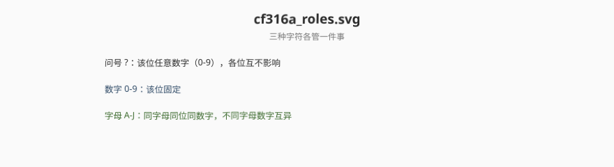

# Codeforces 316A1 Special Task（特别任务） 题解

## 1. 题目概述

- **题目链接**：https://codeforces.com/problemset/problem/316/A1
- **比赛来源**：ABBYY Cup 3.0 · 子任务 A1（UTC 2013-06-16）
- **难度**：1200
- **标签**：计数、排列
- **评测类型**：普通
- **限制**：时间 1 s / 内存 256 MB

**约束（本子任务）**：$|s| \le 5$（对应 30 分档；同一题目的完整版见 [316A2](https://codeforces.com/problemset/problem/316/A2)，$|s|\le10^5$）

**题意**：保险箱密码是不含前导零的数字串，长度与提示串 $s$ 相同。提示规则：

- `?`：该位可以是 $0\sim9$ 任意数字；
- 数字 `0`–`9`：该位固定为这个数字；
- 字母 `A`–`J`：**同一字母**在各位置必须取**同一个**数字，**不同字母**必须取**互不相同**的数字。

求满足提示的密码个数。


## 2. 示例与观察

官方样例 1：

```text
输入：
AJ

输出：
81
```

官方样例 2：

```text
输入：
1?AA

输出：
100
```

**观察 1（三类字符解耦）**：`?` 各位独立（各 10 种）；字母之间只受"同字母同数字、异字母数字互异"的单射约束；数字位完全固定。

**观察 2（字母 = 单射映射）**：设提示中出现的不同字母个数为 $K$（$K \le 10$），则字母的取值方案数是**排列数** $P(10,K)=10\cdot9\cdots(10-K+1)$。

**观察 3（首位不能为 0）**：

- 首位是**字母**：该字母不能取 0 → $9\cdot P(9,K-1)$；
- 首位是 `?`：这个问号不能取 0 → 整体乘 9，其余问号各 10 种；
- 首位是数字：题面保证 $s_1 \ne $ `0`，无需额外处理。

**观察 4（答案可能极长）**：`?` 的个数可达 $10^5$，答案最多约 $10^5$ 位。但注意到它总是"**一个小基数**（$\le 9\cdot P(10,10)=32659200$）后面跟若干个 0"——因为每个 `?` 只贡献一个因子 10。所以不必写大整数，**基数 + 补零**即可。

**样例验证**：`AJ`：首位是字母 → $9\cdot P(9,1)=81$ ✓；`1?AA`：首位是数字、$K=1$、一个 `?` → $P(10,1)\cdot10=100$ ✓。

## 3. 解题思路



统计不同字母个数 $K$ 与 `?` 个数，按首位类型算基数，再补零输出。

## 4. 正确性证明

**引理 1**：字母位与 `?` 位的取值互相独立。

**证明**：题面对 `?` 只要求"是数字"，对字母只要求"同字母相同、异字母互异"，两类约束没有交叉 ✓。∎

**引理 2**：$K$ 个字母的合法取值方案数为 $P(10,K)$（首字母非 0 时为 $9\cdot P(9,K-1)$）。

**证明**：这是"从 10 个数字中给 $K$ 个字母选互异数字"的排列；首位限制把首字母的可选集合缩到 9 个，余下 $K-1$ 个字母从剩余 9 个数字中排列 ✓。∎

**引理 3**：答案 $=$ 基数 $\times 10^{\#?}$（首位是 `?` 时基数已含那个 9，指数减 1）。

**证明**：由引理 1、2 相乘，且每个 `?` 恰贡献因子 10 ✓。∎

**定理**：算法输出正确答案。

**证明**：由引理 1–3，且"基数 + 补零"与乘 $10^{\#?}$ 等价（基数 $\le 10^8$ 不会因补零产生进位问题）✓。∎

## 5. 复杂度分析

- **时间**：$O(|s|)$。
- **空间**：$O(|s|)$（输出）。
- **与时限的关系**：时限 1 s，$|s| = 10^5$ 实测端到端 18.5 ms。

## 6. 参考代码

### C++17

```cpp
#include <bits/stdc++.h>
using namespace std;
int main(){
    static char s[100005];
    if(scanf("%s",s)!=1) return 0;
    int len=strlen(s);
    // 统计字母集合、'?' 个数
    int present[10]={0}; int K=0; long long q=0;
    for(int i=0;i<len;i++){
        if(s[i]=='?') q++;
        else if(s[i]>='A'&&s[i]<='J'){ int id=s[i]-'A'; if(!present[id]){ present[id]=1; K++; } }
    }
    // 基础排列数
    auto P=[&](int n,int k)->long long{ if(k<0||k>n) return 0; long long r=1; for(int i=0;i<k;i++) r*=(n-i); return r; };
    long long base;
    if(s[0]>='A'&&s[0]<='J'){
        base = 9LL * P(9, K-1);           // 首字母不能是 0
    } else if(s[0]=='?'){
        // 首位的 '?' 只能取 1..9
        base = 9LL * P(10, K);            // 其余 '?' 各 10 种
        q--;                              // 已在 base 里处理掉首位
    } else {
        base = P(10, K);
    }
    if(base==0){ printf("0\n"); return 0; }
    printf("%lld", base);
    for(long long i=0;i<q;i++) putchar('0');
    putchar('\n');
    return 0;
}
```

### Python3

```python
import sys
def main() -> None:
    s = sys.stdin.buffer.read().split()[0].decode()
    letters = set(c for c in s if 'A' <= c <= 'J')
    K = len(letters)
    q = s.count('?')
    def P(n, k):
        if k < 0 or k > n: return 0
        r = 1
        for i in range(k): r *= (n - i)
        return r
    if s[0] in letters and 'A' <= s[0] <= 'J':
        base = 9 * P(9, K - 1)
    elif s[0] == '?':
        base = 9 * P(10, K)
        q -= 1
    else:
        base = P(10, K)
    if base == 0:
        print(0); return
    print(str(base) + "0" * q)
main()
```

## 7. 边界情况与易错点

1. **首位是 `?`**：指数要减 1（那个问号只有 9 种）。
2. **$K = 10$ 且首位是字母**：$9\cdot P(9,9)$ 仍非零，别误判成 0。
3. **$K > 10$**：不可能（字母只有 A–J）。
4. **答案超长**：不要用固定宽度的整数直接乘 $10^{10^5}$。
5. **输出补零**：基数为 0 时只输出 `0`（本例不会发生，但代码要稳）。

## 8. 验证记录

- **编译环境**：`clang++ -std=c++17 -O2 -Wall`；Python 3.9.6。
- **官方样例**：2 / 2 通过（81、100），C++ 与 Python 一致。
- **独立暴力对拍**：暴力版**枚举字母的全部单射映射 × 所有 `?` 取值**并检查首位非 0。220 组随机提示串（$|s|\le4$、字母表取 `A`/`AB`/`ABC`/`ABCD`），**220 / 220 全部一致**。
- **最大约束性能**：$|s| = 10^5$（全 `?`）实测端到端 18.5 ms，输出 100000 位；混合字符 11.5 ms。
- **图片校验**：三张 SVG 已生成并通过 `ElementTree.parse`。
- **复核状态**：verified。

## 相关题目与扩展

- [Codeforces 316B1/B2 New Problem](https://codeforces.com/problemset/problem/316/B1)：同一场次的 B 组子任务。

**延伸思考**：

1. **如果字母可以取相同数字**：退化成 $10^K \cdot 10^{\#?}$。
2. **如果要求某两位不同**：变成带限制的排列。
