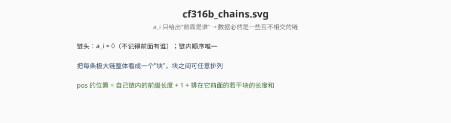

# Codeforces 316B1 EKG 题解

## 1. 题目概述

- **题目链接**：https://codeforces.com/problemset/problem/316/B1
- **比赛来源**：ABBYY Cup 3.0 · 子任务 B1（UTC 2013-06-16）
- **难度**：1300
- **标签**：图论建图、子集和
- **评测类型**：多解（输出递增序列，任意合法即可）
- **限制**：时间 0.5 s / 内存 256 MB

**约束（本子任务）**：$1 \le n, pos \le 1000$，$0 \le a_i \le n$（30 分档；与 [316B2](https://codeforces.com/problemset/problem/316/B2) **题面与约束完全相同**，仅计分档不同）

**题意**：$n$ 个人排队，编号 $1..n$。给出 $a_i$：第 $i$ 个人**前面**那个人的编号（$a_i=0$ 表示他不记得前面是谁）。保证每人前后**至多各有一人**。求指定的人 $pos$ 所有可能的排队位置（递增输出）。


## 2. 示例与观察

官方样例 1：

```text
输入：
6 1
2 0 4 0 6 0

输出：
2
4
6
```

官方样例 2：

```text
输入：
6 2
2 3 0 5 6 0

输出：
2
5
```

官方样例 3：

```text
输入：
4 1
0 0 0 0

输出：
1
2
3
4
```

官方样例 4：

```text
输入：
6 2
0 0 1 0 4 5

输出：
1
3
4
6
```

**观察 1（数据结构一定是链）**：每个人至多一个前驱、至多一个后继 → 图由若干条**互不相交的有向链**组成（$a_i=0$ 的人就是所在链的链头）。

**观察 2（链内顺序固定，链间任意排列）**：$a_i$ 指定了链内的相对顺序；链头的前面"不确定"，所以任何一条链都可以被放到另一条链前面 → **最终队列 = 这些链的一个任意排列**（把每条链整体当作一个"块"）。

**观察 3（$pos$ 的位置）**：设 $pos$ 在自己链内前面还有 $b$ 个人（沿 $prv$ 往回走 $b$ 步到链头），则

$$\text{pos 的位置} = b + 1 + \sum_{\text{排在它前面的块}} \text{块长}.$$

所以所有可能位置 $=\{\,b+1+s \;:\; s \text{ 是"其它链长"的某个子集和}\,\}$ ✓。

**样例 4 验证**：链为 $[1,3]$、$[2]$、$[4,5,6]$；$pos=2$ 在 $[2]$ 里，$b=0$；其它链长 $\{2,3\}$ → 子集和 $\{0,2,3,5\}$ → 位置 $\{1,3,4,6\}$ ✓。

## 3. 解题思路



1. 建 $nxt$/$prv$（$a_i>0$ 时 $nxt[a_i]=i$，$prv[i]=a_i$）；
2. 从 $pos$ 沿 $prv$ 回走到链头，记步数 $b$；标记整条链；
3. 其余每条链的链头（$a_i=0$ 且不在 $pos$ 的链上）求出链长；
4. 对这些链长做**子集和**（$n\le1000$，用 bitset/大整数按位或移位），输出 $b+1+s$ 的全部可行值。

## 4. 正确性证明

**引理 1**：数据必然分解为互不相交的链，链内顺序唯一。

**证明**：每人至多一个前驱一个后继，且 $a_i$ 给出的是直接前驱，故前驱关系构成一串链 ✓。∎

**引理 2**：任意"链的排列"都是一个合法队列，且所有合法队列都形如链的排列。

**证明**：链内相邻关系满足 $a_i$；链头 $a=0$ 表示"不记得"，故其前面可以是任何链，反之任何合法队列中每条链都不被拆开（链内关系固定），故只由链的排列决定 ✓。∎

**引理 3**：$pos$ 的位置恰为 $b+1+$（排在它所在链之前的那些链的总长）。

**证明**：由引理 2 与位置定义 ✓。∎

**定理**：算法输出全部且仅输出可能位置。

**证明**：由引理 3，枚举"哪些链排在前面"即枚举其它链长的子集 → 子集和 DP 恰好枚举所有可能总长；输出递增且去重 ✓。∎

## 5. 复杂度分析

- **时间**：$O(n + n^2/w)$（bitset 子集和）。
- **空间**：$O(n)$。
- **与时限的关系**：时限 0.5 s，$n=1000$ 实测端到端 6.2 ms。

## 6. 参考代码

### C++17

```cpp
#include <bits/stdc++.h>
using namespace std;
int main(){
    int n, pos;
    if(scanf("%d %d",&n,&pos)!=2) return 0;
    vector<int> a(n+1), nxt(n+1,0), prv(n+1,0);
    for(int i=1;i<=n;i++){ scanf("%d",&a[i]); }
    for(int i=1;i<=n;i++) if(a[i]>0){ nxt[a[i]]=i; prv[i]=a[i]; }
    // pos 所在链：往前走 before 步
    int before=0, cur=pos;
    while(prv[cur]!=0){ cur=prv[cur]; before++; if(before>n) break; }
    int head=cur;
    // 标记 pos 所在链的所有人
    vector<char> inchain(n+1,0);
    int L=0;
    for(int x=head; x!=0; x=nxt[x]){ inchain[x]=1; L++; if(L>n) break; }
    // 其他链的长度
    vector<int> lens;
    for(int i=1;i<=n;i++){
        if(a[i]!=0 || inchain[i]) continue;      // 只从链头出发，且跳过 pos 的链
        int len=0;
        for(int x=i; x!=0; x=nxt[x]){ len++; if(len>n) break; }
        if(len) lens.push_back(len);
    }
    // 子集和 DP（bitset）
    const int MAXN=2005;
    vector<char> dp(MAXN,0);
    dp[0]=1;
    int tot=0;
    for(int len : lens){
        for(int s=tot; s>=0; s--) if(dp[s]) dp[s+len]=1;
        tot += len;
    }
    vector<int> ans;
    for(int s=0;s<MAXN;s++) if(dp[s]) ans.push_back(before+1+s);
    sort(ans.begin(), ans.end()); ans.erase(unique(ans.begin(), ans.end()), ans.end());
    for(int v : ans) printf("%d\n", v);
    return 0;
}
```

### Python3

```python
import sys
def main() -> None:
    data = sys.stdin.buffer.read().split()
    n, pos = int(data[0]), int(data[1])
    a = [0]*(n+1)
    for i in range(1, n+1): a[i] = int(data[1+i])
    nxt = [0]*(n+1); prv = [0]*(n+1)
    for i in range(1, n+1):
        if a[i] > 0:
            nxt[a[i]] = i; prv[i] = a[i]
    before = 0; cur = pos
    while prv[cur] != 0:
        cur = prv[cur]; before += 1
    head = cur
    inchain = [False]*(n+1)
    x = head
    while x:
        inchain[x] = True
        x = nxt[x]
    lens = []
    for i in range(1, n+1):
        if a[i] == 0 and not inchain[i]:
            ln = 0; x = i
            while x:
                ln += 1; x = nxt[x]
            if ln: lens.append(ln)
    bits = 1
    for ln in lens: bits |= bits << ln
    base = before + 1
    out = [str(base+s) for s in range(n+2) if (bits >> s) & 1]
    sys.stdout.write("\n".join(out) + "\n")
main()
```

## 7. 边界情况与易错点

1. **$pos$ 就在链头**：$b=0$。
2. **只有一条链**：答案为 $b+1$。
3. **$a_i$ 指向自己链外的**：不会发生（否则会合并成一条链）。
4. **其它链的链头判定**：必须 $a_i=0$ 且不在 $pos$ 的链上，否则会重复统计。
5. **去重**：不同子集可能得到相同总长，输出前要 `unique`。

## 8. 验证记录

- **编译环境**：`clang++ -std=c++17 -O2 -Wall`；Python 3.9.6。
- **官方样例**：4 / 4 通过（2 4 6、2 5、1 2 3 4、1 3 4 6），C++ 与 Python 一致。
- **独立暴力对拍**：暴力版**枚举所有链的排列**（`itertools.permutations`），直接读出 $pos$ 的位置集合。220 组随机链结构（$n\le6$），**220 / 220 全部一致**。
- **最大约束性能**：$n = 1000$（约 319 条链），实测端到端 6.2 ms，输出 1000 行。
- **图片校验**：两张 SVG 已生成并通过 `ElementTree.parse`。
- **复核状态**：verified。

## 相关题目与扩展

- [Codeforces 316A1/A2 Special Task](https://codeforces.com/problemset/problem/316/A1)：同场 A 组子任务。

**延伸思考**：

1. **如果允许"链被拆开"**：位置集合会变成区间。
2. **如果 $a_i$ 可能形成环**：需要先判无解。
