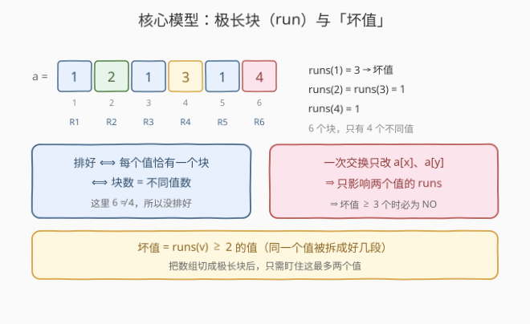
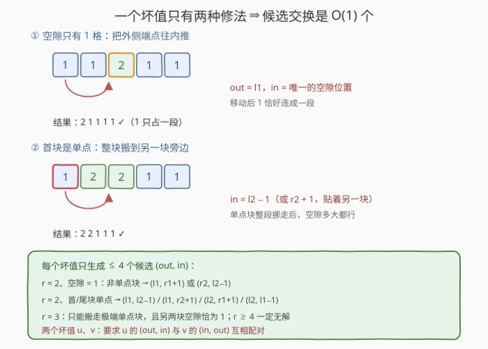
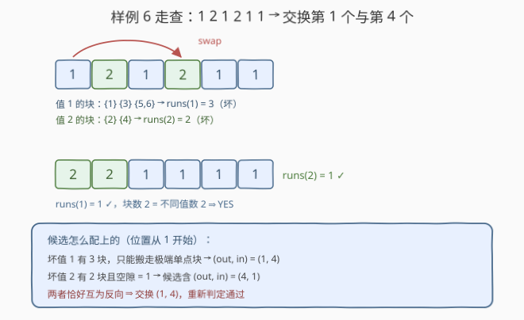

# Codeforces 2233D 货架上的商品 题解

## 1. 题目概述

- **标题 / 题号**：货架上的商品（Codeforces 2233D，英文名 Goods on the Shelf）
- **链接**：https://codeforces.com/problemset/problem/2233/D
- **来源**：Educational Codeforces Round 191 (Rated for Div. 2) · Problem D
- **难度**：1900（题面标注 $\ast 1900$）
- **限制**：时间 2 s / 内存 512 MB
- **标签**：暴力、数据结构、实现、双指针（官方标签：brute force, data structures, implementation, two pointers）

**题意**：给定长度为 $n$ 的数组 $a$，货架「排好」的定义是：对任意 $i<j$ 且 $a_i=a_j$，区间 $[i,j]$ 内所有元素都等于 $a_i$——也就是**每种商品的位置必须连成一段**。最多允许交换两个**不同**位置上的商品一次（也可以不交换），判断能否把货架排好。多测。

**约束**：

- $1 \le t \le 10^4$，$2 \le n \le 2\times 10^5$，$\sum n \le 2\times 10^5$；
- $1 \le a_i \le 10^9$，值的具体大小无意义，只需相等关系；
- 每组必须做到 $O(n)$ 或 $O(n\log n)$：枚举交换对是 $O(n^2)$，乘上判定就是 $O(n^3)$，$n=2\times10^5$ 时完全不可行。

## 2. 示例与观察
官方样例（输入 / 输出原样，共 7 组）：

```text
输入
7
3
1 2 1
2
7 7
6
1 2 3 1 2 3
6
1 1 2 3 2 3
7
1 2 3 1 2 3 4
6
1 2 1 2 1 1
6
1 2 2 3 3 1
```

```text
输出
YES
YES
NO
YES
NO
YES
NO
```

逐组观察：

| # | $a$ | 答案 | 原因 |
|---|-----|------|------|
| 1 | `1 2 1` | YES | 交换前两个，得 `2 1 1` |
| 2 | `7 7` | YES | 本来就排好了 |
| 3 | `1 2 3 1 2 3` | NO | 三个值各被拆成 2 段，一次交换只能救 2 个值 |
| 4 | `1 1 2 3 2 3` | YES | 交换第 4、5 个，得 `1 1 2 2 3 3` |
| 5 | `1 2 3 1 2 3 4` | NO | 同样是三个值被拆开 |
| 6 | `1 2 1 2 1 1` | YES | 交换第 1、4 个，得 `2 2 1 1 1 1` |
| 7 | `1 2 2 3 3 1` | NO | 值 1 与值 3 各被拆成 2 段且首尾相扣，一次交换救不回来 |

补 1 组自造示例（非官方）：

```text
输入
2
8
1 2 1 3 1 4 4 4
7
1 2 1 3 1 4 1
```

```text
输出
YES
NO
```

第 1 组里值 1 占了 3 段但都是单点，可以整段搬；第 2 组值 1 占了 4 段，一次交换最多只能拼回一个空档，必然失败。

## 3. 解题思路

### 3.1 暴力思路

枚举「不交换」与所有 $\binom{n}{2}$ 个位置对，每次用 $O(n)$ 扫一遍判断是否排好：总 $O(n^3)$，$n=2\times10^5$ 是 $8\times10^{15}$ 级别，毫无希望。即便把判定优化到 $O(1)$，$\binom{n}{2}\approx 2\times10^{10}$ 个候选交换也枚举不完。

突破口是：**好货架的结构极其强，而一次交换只动两个元素，所以能用上的交换极少**。

### 3.2 核心观察：极长块与「坏值」



把相邻且相等的元素合并，数组被切成 $K$ 个**极长块**（run），整个值域里共有 $D$ 个不同值（交换不改变多重集，$D$ 不变）。记 $\mathrm{runs}(v)$ 为值 $v$ 占了几个块。

**判定**：货架排好 $\iff$ 每个值都恰有一个块 $\iff K=D$。

理由：每个块至少对应一个不同值，故恒有 $K\ge D$；取等号时不可能有某个值占了两个块（否则它贡献两个块却只算一个值，块数会更多）。

称 $\mathrm{runs}(v)\ge 2$ 的值为**坏值**。排好等价于**没有坏值**。

交换 $(x,y)$ 只改变 $a_x,a_y$ 两个位置。若 $v\notin\{a_x,a_y\}$，那么 $v$ 的位置集合原封不动，"某位置是不是 $v$ 的块首"的判定也不会变（相邻位置的值即使被换掉，也仍然不等于 $v$）。所以：

- 坏值个数为 $0$：本来就排好，输出 YES；
- 坏值个数 $\ge 3$：一次交换最多只影响 2 个值的 $\mathrm{runs}$，必有坏值残留，输出 NO；
- 只剩「坏值恰有 1 个」与「坏值恰有 2 个」两种情形，且此时数组已经"几乎"排好。

### 3.3 一个坏值的修复形态 ⇒ 常数个候选



设坏值 $v$ 的位置集合为 $P_v$，由 $r$ 个块 $B_1,\dots,B_r$ 组成。若交换 $(x,y)$ 把 $v$ 修好，则被交换的两个位置里**恰有一个**属于 $P_v$（两个都属于就只是同值互换，等于没换；都不属于则 $P_v$ 不变）。不妨 $a_x=v,\ a_y\ne v$，交换后

$$P_v' = P_v - \{x\} + \{y\}$$

必须是一个连续区间——也就是说，从 $P_v$ 里拿掉一个点、再补上一个点，就得把它接成一整段。

记 $x$ 所在的块为 $A$，分类讨论：

1. **$|A|\ge 2$**：拿掉 $x$ 后仍是 $r$ 个非空块、块间有 $r-1$ 个空档，而补上的 $\{y\}$ 只能填一个位置，故 $r-1\le 1$，即 $r\le 2$。同时 $x$ 必须是整段的**最外端**（$x=l_1$ 或 $x=r_2$），否则 $A$ 内部会被挖出一个洞。$r=2$ 时还要求两块之间的空档长 $g=l_2-r_1-1$ 恰为 $1$，且 $y$ 正是那个空档位置。
2. **$|A|=1$**：整个单点块被搬走，剩下 $r-1$ 块、$r-2$ 个空档，同理 $r\le 3$。$r=2$ 时 $y$ 贴着另一块的两侧即可（$l_2-1$ 或 $r_2+1$），与原空档多长无关；$r=3$ 时被搬走的必须是**极端**的单点块（搬中间那块会让两侧空档合并成至少 3 格，补不上），且另外两块之间的空档恰为 $1$。
3. **$r\ge 4$**：两种情形都至少留下 $2$ 个空档，一个补点填不满，无解。

把三种情形展开，一个坏值的全部候选 $(out,in)$（$out$ 为移出位置，$in$ 为移入位置）至多 4 个：

| 情形 | 候选 $(out,in)$ |
|------|----------------|
| $r=2$、$g=1$、$\lvert A\rvert\ge 2$ | $(l_1,\ r_1+1)$ |
| $r=2$、$g=1$、$\lvert B\rvert\ge 2$ | $(r_2,\ l_2-1)$ |
| $r=2$、$\lvert A\rvert=1$ | $(l_1,\ l_2-1)$、$(l_1,\ r_2+1)$ |
| $r=2$、$\lvert B\rvert=1$ | $(l_2,\ r_1+1)$、$(l_2,\ l_1-1)$ |
| $r=3$、$\lvert B_1\rvert=1$、$l_3-r_2=2$ | $(l_1,\ r_2+1)$ |
| $r=3$、$\lvert B_3\rvert=1$、$l_2-r_1=2$ | $(l_3,\ r_1+1)$ |

**两个坏值 $u,w$**：交换的两个位置必然一个取 $u$、一个取 $w$，于是只需在两张候选表里找**互为反向**的一对——$u$ 的 $(out,in)$ 与 $w$ 的 $(in,out)$。找不到就是 NO。

候选是常数个，逐个真交换一次、再用 $O(n)$ 的块数判定验证即可。

### 3.4 示例演算



以样例 6 的 $a=[1,2,1,2,1,1]$ 为例：值 $1$ 的块是 $\{1\},\{3\},\{5,6\}$，值 $2$ 的块是 $\{2\},\{4\}$，两个都是坏值。

- 值 $1$（$r=3$）：只有 $\{1\}$ 是极端单点块，删掉它后 $\{3\}$ 与 $\{5,6\}$ 的空档恰为 $1$，故唯一候选 $(out,in)=(1,4)$；
- 值 $2$（$r=2$）：两块都是单点，候选有 $(2,3),(2,5),(4,3),(4,1)$（1-indexed），其中含 $(4,1)$；
- $(1,4)$ 与 $(4,1)$ 互为反向 $\Rightarrow$ 交换第 $1$、$4$ 个，得到 $2\ 2\ 1\ 1\ 1\ 1$，块数 $2$ 等于不同值数 $2$，输出 YES。

自造的 $[1,2,1,3,1,4,4,4]$：值 $1$ 三块 $\{1\},\{3\},\{5\}$，两个空档都是 $1$，候选 $(1,4)$ 与 $(5,2)$；交换第 $1$、$4$ 个得 $3\ 2\ 1\ 1\ 1\ 4\ 4\ 4$，YES。而 $[1,2,1,3,1,4,1]$ 里值 $1$ 占了 $4$ 块，候选表为空，直接 NO。

## 4. 算法细节

1. **离散化**：$a_i\le 10^9$，先排序去重把值压到 $[0,D)$，之后所有"每个值的块表、$\mathrm{runs}$"都用下标访问数组；Python 直接用 `dict`。
2. **建块表**：一次扫描，若 $i=0$ 或 $b_i\ne b_{i-1}$ 则新建块 $[i,i]$，否则把当前块右端点改成 $i$。每个值维护 `vector<pair<int,int>>`，块内有序。
3. **判定函数**：数一遍相邻不同的次数得到块数 $K$，与 $D$ 比较。别写成对每个值再扫一遍区间，那样是 $O(n^2)$。
4. **坏值筛选**：块数 $\ge 2$ 的值即坏值；个数 $>2$ 立刻 NO，为空立刻 YES。
5. **候选生成**：按 §3.3 的六种情形展开，注意 $r_2+1=n$、$l_1-1<0$ 时该候选越界要丢弃；$g=1$ 时 $(l_1,r_1+1)$ 与 $(l_1,l_2-1)$ 是同一对，去重可省时间。
6. **两坏值配对**：要求 $u$ 的 $out$ 等于 $w$ 的 $in$、$u$ 的 $in$ 等于 $w$ 的 $out$；不要退化成"枚举候选表的笛卡尔积再各自判定"。
7. **验证与回滚**：候选至多 4 个，逐个 `swap` 后 $O(n)$ 重判，判完**立刻换回**，否则后面的候选是在被污染的数组上判断。
8. **多测**：块表、坏值表、候选表每组重建；$t$ 可达 $10^4$，不要用按值域开的数组。

## 5. 正确性证明

**引理 1（判定等价）**：货架排好 $\iff$ 没有坏值 $\iff K=D$。

**证明**：若某个值占了两个块，则它的两次出现之间有别的值，违反定义；反之若货架排好，每个值的出现位置是一个区间，故它只占一个块。又每个块至少对应一个不同值，故 $K\ge D$，且等号成立当且仅当没有值跨两个块。∎

**引理 2（坏值个数上界）**：若一次交换能排好货架，则交换前坏值至多 2 个。

**证明**：设交换 $(x,y)$。对 $v\notin\{a_x,a_y\}$，$v$ 的位置集合不变，且任何位置 $i$ 的"块首"标志 $[a_i=v]\land[i=1\text{ 或 }a_{i-1}\ne v]$ 只涉及 $i$ 与 $i-1$ 两处的值，这两处都不属于 $\{x,y\}$ 时标志不变，故 $\mathrm{runs}(v)$ 不变。交换后所有值都必须 $\mathrm{runs}=1$，所以交换前的坏值只能是 $a_x,a_y$ 两个值。∎

**引理 3（修复的结构约束）**：设交换 $(x,y)$ 使坏值 $v$ 在交换后满足 $\mathrm{runs}(v)=1$，$a_x=v$、$a_y\ne v$，$P=P_v$，则 $P'=P-\{x\}+\{y\}$ 是区间，并且只有以下可能：

1. $r=2$、$x=l_1$、$l_2-r_1=2$、$y=r_1+1$；或 $x=r_2$、$l_2-r_1=2$、$y=l_2-1$；
2. $r=2$、$x=l_1$ 是单点块、$y\in\{l_2-1,r_2+1\}$；或对称地 $x=l_2$ 是单点块、$y\in\{l_1-1,r_1+1\}$；
3. $r=3$、$B_1$ 是单点块、$l_3-r_2=2$、$y=l_3-1$；或对称地 $B_3$ 是单点块、$l_2-r_1=2$、$y=r_1+1$。

**证明**：$P'=P-\{x\}+\{y\}$ 是区间且 $|P'|=|P|$，而 $P'\setminus(P-\{x\})=\{y\}$，所以 $P-\{x\}$ 相对自身凸包的所有空档必须被 $\{y\}$ 一次填满：空档总数至多 $1$，且它只能是单点 $y$。

若 $x$ 所在块 $A$ 有 $|A|\ge2$，则 $P-\{x\}$ 仍有 $r$ 个非空块、$r-1$ 个非空档，故 $r-1\le1$，$r\le 2$。若 $x$ 是 $A$ 的内点，$A-\{x\}$ 自身分裂，空档至少 2 个，矛盾；故 $x$ 是 $A$ 的端点。$r=2$ 且 $x=r_1$（或 $x=l_2$）时，$A$ 与 $B$ 之间的空档变成 $g+1\ge2$ 个点，仍矛盾；故 $x=l_1$ 或 $x=r_2$，此时空档恰为原空档，必须是单点，$y$ 只能取它。这给出情形 1。

若 $|A|=1$，则 $P-\{x\}$ 有 $r-1$ 个块、$r-2$ 个空档，同样 $r-2\le 1$，$r\le 3$。$r=2$ 时 $P-\{x\}$ 是一整块（另一块），$y$ 必须与它相邻，即 $l_2-1$ 或 $r_2+1$（对称情形同理），得情形 2。$r=3$ 时，若 $A=B_2$（中间块），则另两块之间的空档包含 $B_2$ 整体与两侧空档，长至少 $3$，矛盾；故 $A$ 是极端块，另两块只需补一个点接上，故它们的空档恰为单点，$y$ 就是它，得情形 3。$r\ge4$ 时无论 $|A|\ge2$ 还是 $|A|=1$ 都留下至少 2 个空档，无解。∎

**引理 4（候选完备）**：设存在一次交换能排好货架，则算法会枚举到它。

**证明**：由引理 2，坏值只有 1 个或 2 个。若只有坏值 $v$，则交换必涉及 $v$ 的一个位置与一个非 $v$ 位置（两位置同值等于没换），由引理 3 该 $(out,in)$ 落在 §3.3 的候选表中，算法逐一验证故不会漏。若坏值是 $u,w$，则交换的两位置一个取 $u$、一个取 $w$，对 $u$ 用引理 3 得 $(out,in)=(p,q)$，对 $w$ 得 $(out,in)=(q,p)$，二者互为反向，配对条件命中。∎

**定理（算法正确）**：算法输出 YES $\iff$ 存在至多一次交换把货架排好。

**证明**：$(\Leftarrow)$ 由引理 4 该交换被枚举，且验证步骤是完整的块数判定，故必输出 YES。$(\Rightarrow)$ 输出 YES 意味着某个候选交换被真实验证为排好，而候选都是合法的一次交换（$out\ne in$，越界候选已丢弃），故确实存在合法方案。∎

## 6. 复杂度分析

- **时间**：每组离散化 $O(n\log n)$，扫描建块表 $O(n)$，判定一次 $O(n)$；候选至多 4 个（两坏值时配对后同样至多 4 次验证），故每组 $O(n\log n)$，总计 $O(\sum n\log n)\le 2\times10^5\times 18$ 量级。
- **空间**：$O(n)$ 存数组、块表与离散化副本，与 512 MB 相比可忽略。
- **实测**（Apple clang `-O2`，限时 2 s，2 倍余量要求）：单组 $n=2\times10^5$ 的五种极端（三块单点、两个坏值各两块、已排好、全交替、$t=10^4$ 组每组 $n=20$）C++ 均不超过 $0.02$ s，余量在 100 倍以上；Python3 同规模 $0.05$–$0.11$ s（含解释器启动），同样远在 2 s 内。

## 7. 参考代码

### C++17

```cpp
#include <bits/stdc++.h>
using namespace std;

int main() {
    int T;
    if (scanf("%d", &T) != 1) return 0;
    while (T--) {
        int n;
        scanf("%d", &n);
        vector<int> a(n);
        for (int i = 0; i < n; i++) scanf("%d", &a[i]);

        // 离散化，值的大小无关，只保留相等关系
        vector<int> vals(a);
        sort(vals.begin(), vals.end());
        vals.erase(unique(vals.begin(), vals.end()), vals.end());
        int m = (int)vals.size();
        vector<int> b(n);
        for (int i = 0; i < n; i++)
            b[i] = (int)(lower_bound(vals.begin(), vals.end(), a[i]) - vals.begin());

        // 每个值的极大块 [l, r]
        vector<vector<pair<int, int>>> blocks(m);
        for (int i = 0; i < n; i++) {
            if (i == 0 || b[i] != b[i - 1]) blocks[b[i]].push_back({i, i});
            else blocks[b[i]].back().second = i;
        }

        vector<int> badv;                       // 坏值：占了 >= 2 个块
        for (int v = 0; v < m; v++)
            if (blocks[v].size() >= 2) badv.push_back(v);

        if (badv.empty()) { puts("YES"); continue; }
        if (badv.size() > 2) { puts("NO"); continue; }

        // 一个坏值的全部候选 (out, in)：至多 4 个
        auto gen = [&](int v) {
            vector<pair<int, int>> res;
            const auto &B = blocks[v];
            int r = (int)B.size();
            if (r == 2) {
                int l1 = B[0].first, r1 = B[0].second;
                int l2 = B[1].first, r2 = B[1].second;
                int g = l2 - r1 - 1;            // 两块之间的空档长度
                if (g == 1) {
                    if (r1 > l1) res.push_back({l1, r1 + 1});
                    if (r2 > l2) res.push_back({r2, l2 - 1});
                }
                if (l1 == r1) {                 // 首块是单点，整块搬走
                    res.push_back({l1, l2 - 1});
                    if (r2 + 1 < n) res.push_back({l1, r2 + 1});
                }
                if (l2 == r2) {                 // 尾块是单点
                    res.push_back({l2, r1 + 1});
                    if (l1 - 1 >= 0) res.push_back({l2, l1 - 1});
                }
            } else if (r == 3) {
                int a1 = B[0].first, a2 = B[0].second;
                int b1 = B[1].first, b2 = B[1].second;
                int c1 = B[2].first, c2 = B[2].second;
                if (a1 == a2 && c1 - b2 - 1 == 1) res.push_back({a1, b2 + 1});
                if (c1 == c2 && b1 - a2 - 1 == 1) res.push_back({c1, a2 + 1});
            }
            sort(res.begin(), res.end());
            res.erase(unique(res.begin(), res.end()), res.end());
            return res;
        };

        auto good = [&]() {                     // 块数 == 不同值数
            int runs = 1;
            for (int i = 1; i < n; i++)
                if (b[i] != b[i - 1]) runs++;
            return runs == m;
        };

        bool ok = false;
        if (badv.size() == 1) {
            for (auto &p : gen(badv[0])) {
                swap(b[p.first], b[p.second]);
                if (good()) ok = true;
                swap(b[p.first], b[p.second]);  // 回滚
                if (ok) break;
            }
        } else {
            auto P = gen(badv[0]);
            auto Q = gen(badv[1]);
            for (auto &p : P) {
                for (auto &q : Q) {
                    if (p.first == q.second && p.second == q.first) {   // 互为反向
                        swap(b[p.first], b[p.second]);
                        if (good()) ok = true;
                        swap(b[p.first], b[p.second]);
                        if (ok) break;
                    }
                }
                if (ok) break;
            }
        }
        puts(ok ? "YES" : "NO");
    }
    return 0;
}
```

### Python3

```python
import sys


def solve_case(n, a):
    # 每个值的极大块：[l, r]
    blocks = {}
    for i in range(n):
        if i == 0 or a[i] != a[i - 1]:
            blocks.setdefault(a[i], []).append([i, i])
        else:
            blocks[a[i]][-1][1] = i

    distinct = len(blocks)                  # 交换不改变不同值个数
    bad = [v for v, bl in blocks.items() if len(bl) >= 2]
    if not bad:
        return True
    if len(bad) > 2:
        return False

    def gen(v):
        """一个坏值的全部候选 (out, in)，至多 4 个"""
        res = []
        B = blocks[v]
        r = len(B)
        if r == 2:
            l1, r1 = B[0]
            l2, r2 = B[1]
            g = l2 - r1 - 1
            if g == 1:
                if r1 > l1:
                    res.append((l1, r1 + 1))
                if r2 > l2:
                    res.append((r2, l2 - 1))
            if l1 == r1:
                res.append((l1, l2 - 1))
                if r2 + 1 < n:
                    res.append((l1, r2 + 1))
            if l2 == r2:
                res.append((l2, r1 + 1))
                if l1 - 1 >= 0:
                    res.append((l2, l1 - 1))
        elif r == 3:
            a1, a2 = B[0]
            b1, b2 = B[1]
            c1, c2 = B[2]
            if a1 == a2 and c1 - b2 - 1 == 1:
                res.append((a1, b2 + 1))
            if c1 == c2 and b1 - a2 - 1 == 1:
                res.append((c1, a2 + 1))
        return list(dict.fromkeys(res))

    def good():
        runs = 1
        for i in range(1, n):
            if a[i] != a[i - 1]:
                runs += 1
        return runs == distinct

    if len(bad) == 1:
        for x, y in gen(bad[0]):
            a[x], a[y] = a[y], a[x]
            ok = good()
            a[x], a[y] = a[y], a[x]         # 回滚
            if ok:
                return True
        return False

    P, Q = gen(bad[0]), gen(bad[1])
    for p in P:
        for q in Q:
            if p[0] == q[1] and p[1] == q[0]:   # 互为反向
                x, y = p
                a[x], a[y] = a[y], a[x]
                ok = good()
                a[x], a[y] = a[y], a[x]
                if ok:
                    return True
    return False


def main():
    data = sys.stdin.buffer.read().split()
    t = int(data[0])
    pos = 1
    out = []
    for _ in range(t):
        n = int(data[pos]); pos += 1
        a = [int(x) for x in data[pos:pos + n]]
        pos += n
        out.append("YES" if solve_case(n, a) else "NO")
    sys.stdout.write("\n".join(out) + "\n")


main()
```

## 8. 边界情况与易错点

1. **本来就排好**：`badv` 为空时必须直接 YES，别漏掉"不交换"这一选项（样例 2 只有两个元素）。
2. **一个值出现 4 段**：如 `1 2 1 3 1 4 1`，无论怎么交换都补不满多个空档，候选表为空，输出 NO；不要以为"差一点点"就一定能救。
3. **空档很大但块是单点**：`1 2 2 2 1` 是 YES（把某个 `1` 搬到 `l_2-1`），候选生成里必须包含"整块搬到另一块两侧"这一分支，否则会误判 NO。
4. **越界候选**：`r_2+1==n`、`l_1-1<0` 时该候选不存在（搬出去没有位置），生成时就要丢弃，否则 `swap` 会越界读写。
5. **候选重复**：$g=1$ 时 $(l_1,r_1+1)$ 与 $(l_1,l_2-1)$ 是同一对位置，去重只影响常数，不影响正确性。
6. **候选必须真实交换后重判**：两个坏值时要求 $u$ 的 $out$ 正好是 $w$ 的 $in$（"两边都有候选"不够，否则交换后两个值仍各占两块）；只有一个坏值时（样例 7）候选也可能因为被搬进来的值自己断成两段而失败，所以结构条件只能筛候选，结论必须靠交换后的完整判定。
7. **验证后要回滚**：每组候选验证完必须把数组换回去，否则后续候选是在被改过的数组上判定，答案随机地错。
8. **多测与值域**：$t\le10^4$、$\sum n\le2\times10^5$，所有结构按组重建即可；不要按 $a_i\le10^9$ 开数组，务必离散化或用哈希表。

## 9. 验证记录

- **编译环境与命令**：`clang++ -std=c++17 -O2`（本机无 GNU g++，配 `codeforces/tools/include/bits/stdc++.h` 兼容头；正文代码只用标准库，可原样提交 GNU C++17）；Python 侧为 `Python 3.9.6`。
- **官方样例**：1 / 1 通过（按 Codeforces 标准 checker 的 token 比对，忽略空白与大小写）。
- **复核状态**：audited（2026-11-19 统一回归：编译 + 官方样例；写作期的随机对拍与暴力未重跑）。

## 相关题目与扩展

- [LeetCode 1151. 最少交换次数来组合所有的 1](https://leetcode.cn/problems/minimum-swaps-to-group-all-1s-together/)：把某个值聚成一段的最少交换数，滑动窗口视角，与本题"块"的建模同源。
- [LeetCode 2134. 最少交换次数来组合所有的 1 II](https://leetcode.cn/problems/minimum-swaps-to-group-all-1s-together-ii/)：环形版本，窗口跨端点，可以看作本题"块"在环上的推广。
- [Codeforces 2233C. Cost of a Bracket Sequence](https://codeforces.com/problemset/problem/2233/C)：同一场的 C 题，同样以"一次操作后的结构分析"为骨架。

**延伸思考**：

- 若允许**至多两次**交换，坏值可以放宽到 4 个，但两个交换之间的位置会互相影响，候选表要两两配对，复杂度仍可做到 $O(n\cdot\text{常数})$，只是分类会繁琐很多。
- 若要求**输出具体交换**（构造题版本），本题的候选已经在枚举时给出了 $(out,in)$，命中后直接输出即可，不需要额外工作。
- 若把货架改成**环形**（首尾相接），"块"要按环上的断点数统计，单点块与空档的定义都要绕环处理。
- 若把"每个值一段"改成"每个值至多 $k$ 段"，判定从 $K=D$ 变成 $K\le kD$，但一次交换只能把某个值的段数减少至多 2，候选构造需要重新推导。
