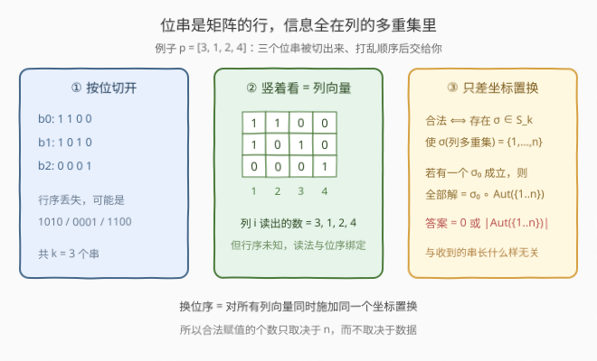
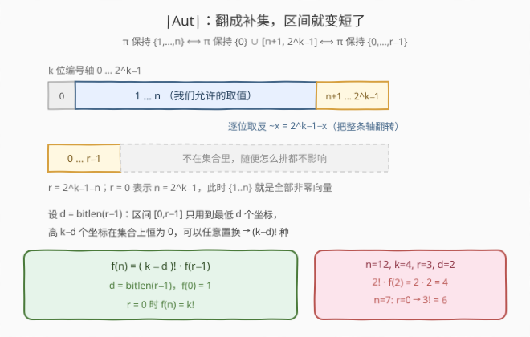
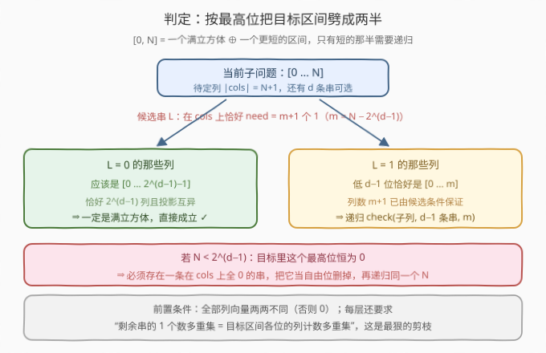
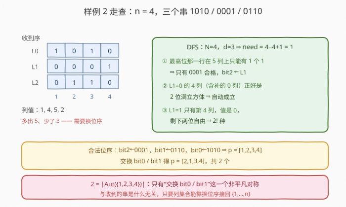

# Codeforces 2233E1 排列传输（简单版） 题解

## 1. 题目概述

- **标题 / 题号**：排列传输（Easy Version）（Codeforces 2233E1，英文名 Permutation Transmission (Easy Version)）
- **链接**：https://codeforces.com/problemset/problem/2233/E1
- **来源**：Educational Codeforces Round 191 (Rated for Div. 2) · Problem E1
- **难度**：2300
- **限制**：时间 2 s / 内存 512 MB
- **标签**：位运算、组合数学、排序（题面挂 bitmasks / combinatorics / sortings，本解法核心是"坐标置换 + 轨道计数"）

**题意**：有一个 $1\sim n$ 的排列 $p$。把每个 $p_i$ 的二进制写出来，把**同一位**的所有比特拼成一个长度为 $n$ 的 01 串；从最低位 $b=0$ 一直取到 $n$ 的最高位，共 $k=\lceil\log_2(n+1)\rceil$ 个串（正好是 $n$ 的二进制位数）。这 $k$ 个串出信道时**顺序被打乱**。给定它们，问能产生它们的原排列 $p$ 有多少个；若数据不可能来自任何排列，输出 $0$。

**约束**：

- $1\le t\le 200$，$1\le n\le 2000$，$\sum n\le 2000$——平均每组只有几十个字符，正解可以做到每组 $O(n\log n)$ 甚至更小
- 每组给 $k=\lceil\log_2(n+1)\rceil$ 行、每行恰好 $n$ 个 01 字符；由 $n\le2000$ 得 $k\le11$
- 答案不超过 $11!=39916800$，`int` 存得下，代码里用 `long long` 更稳妥

## 2. 示例

官方样例（输入 / 输出原样）：

```text
输入：
6
1
1
4
1010
0001
0110
7
0101011
1100101
0110110
5
10110
01100
11001
6
001011
111000
000000
7
1100001
1100001
1100011

输出：
1
2
6
0
0
0
```

自造一组（覆盖"满立方体 / 只交换 $p_1,p_2$ / 改坏一个比特"）：

```text
输入：
3
8
10101010
01100110
00011110
00000001
8
01101010
10100110
00011110
00000001
8
10101010
01100110
00011010
00000001

输出：
6
6
0
解释：第一组是 p=[1..8] 的位串，n=8 时 |Aut|=6（低三位可任意置换）；
      第二组只交换 p1,p2，列多重集没变，仍是 6；
      第三组把第三行第 6 个比特取反，列多重集坏掉，答案 0。
```

## 3. 解题思路

### 3.1 暴力思路

最直接的做法是**枚举"哪个串对应哪一位"**，即枚举 $k$ 个行的排列（$k\le11$，最多 $11!\approx4\times10^7$ 种），每种把 $n$ 列的比特拼成 $n$ 个数、检查是否恰好是 $\{1,\dots,n\}$，单次 $O(n)$。总量 $8\times10^{10}$ 量级，必然超时。

更麻烦的是**对 $p$ 去重**：如果两个串内容完全相同，交换它们的位并不改变 $p$，所以"排列数"并不等于"$p$ 的个数"。而 $n\le2000$、$\sum n\le2000$ 的规模说明，正解根本不该枚举 $k!$。

### 3.2 核心观察：竖过来看，答案只由 $n$ 决定



把收到的 $k$ 个串摞成 $k\times n$ 的矩阵 $M$：**行**是"某个位"，**列**是"下标 $i$"。选一种位序，就是对 $k$ 个坐标做一个置换 $\sigma$；排出来的 $p_i$，就是把第 $i$ 列的 $k$ 个比特按 $\sigma$ 重排后读出的那个数。于是：

- 令 $U=\{u_1,\dots,u_n\}$ 为 $n$ 个**列向量**构成的多重集（$u_i\in\{0,1\}^k$）；
- 令 $T=\{1,2,\dots,n\}$，也看作 $k$ 位 0/1 向量的集合；
- 一种"位序猜测"合法，当且仅当 $\sigma(U)=T$。

关键的一步：$\sigma(U)=T$ 的**解集**是一个陪集。若已有 $\sigma_0(U)=T$，则

$$\sigma(U)=T\iff(\sigma\sigma_0^{-1})(T)=T\iff\sigma\sigma_0^{-1}\in\mathrm{Aut}(T),$$

其中 $\mathrm{Aut}(T)$ 是"把 $T$ 映到自身的坐标置换"构成的群。因此**合法猜测的个数恒等于 $|\mathrm{Aut}(T)|$，与收到的串长什么样完全无关**；一个合法猜测都没有时答案是 $0$。

去重也顺手解决：给定 $p$，每一对应位的串内容是被唯一确定的，所以"内容级别的猜测"到 $p$ 是单射；而 $T$ 的 $k$ 行 01 串**两两不同**（值 $2^b$ 只在第 $b$ 位是 $1$，在 $2^{b'}\ (b'\ne b)$ 处是 $0$），于是收到的串只要有重复内容就必然无解。结论：

$$\text{答案}=\begin{cases}|\mathrm{Aut}(\{1,\dots,n\})|,&\text{列多重集能靠坐标置换变成 }\{1,\dots,n\},\\0,&\text{否则.}\end{cases}$$

### 3.3 算法流程

#### (a) 算 $|\mathrm{Aut}(\{1,\dots,n\})|$：翻成补集递归



记 $k=\mathrm{bl}(n)$ 为 $n$ 的二进制位数，$r=2^k-1-n$。把坐标置换 $\pi$ 作用在 $k$ 位全空间上：

- $\pi$ 保持 $\{1,\dots,n\}$ $\iff$ $\pi$ 保持补集 $\{0\}\cup[n+1,\,2^k-1]$，其中 $0$ 必被固定；
- 而逐位取反 $x\mapsto 2^k-1-x$ 把 $[n+1,2^k-1]$ 变成 $[0,r-1]$，且取反与坐标置换可交换，故**等价于 $\pi$ 保持 $[0,r-1]$**；
- 若 $r=0$（即 $n=2^k-1$），$\{1,\dots,n\}$ 就是全部非零向量，$|\mathrm{Aut}|=k!$；
- 若 $r\ge1$：设 $d=\mathrm{bl}(r-1)$。$[0,r-1]$ 的元素只用到最低 $d$ 位，**高 $k-d$ 个坐标在集合上恒为 $0$**，可任意置换，贡献 $(k-d)!$；剩下低 $d$ 位要保住的正是 $[0,r-1]$（$0$ 固定后即 $[1,r-1]$），递归下去。

$$
f(0)=1,\qquad f(n)=\bigl(\mathrm{bl}(n)-\mathrm{bl}(r-1)\bigr)!\cdot f(r-1)\ \ (r\ge1),\qquad f(n)=\mathrm{bl}(n)!\ \ (r=0).
$$

每步的二进制位数至少减 $1$，故最多 $O(\log n)$ 步。例如 $n=4$：$r=3,d=\mathrm{bl}(2)=2$，$f(4)=1!\cdot f(2)=2$；$n=2000$：$5!\cdot f(46)=\cdots=2880$。

#### (b) 判定合法性：区间分裂 DFS



先补一列**全 0 的虚拟列**（每个串尾部补一个 `0`），"列多重集能否变成 $\{1,\dots,n\}$"就变成"能否变成 $[0,n]$"，并且不变式"列数 $=N+1$"始终成立。递归 `check(cols, lines, N)`：待定列集 `cols`（$|cols|=N+1$）、还没用的 $d$ 条串 `lines`、目标区间 $[0,N]$。

1. **最强剪枝**：每条剩余串在 `cols` 上 $1$ 的个数，其多重集必须等于 $[0,N]$ 各位的列计数多重集（$c_b=\lfloor (N+1)/2^{b+1}\rfloor\cdot2^b+\max(0,(N+1)\bmod 2^{b+1}-2^b)$）。不等直接 `false`。
2. 若 $N=2^d-1$：目标是整个 $d$ 维立方体。$|cols|=2^d$ 且列互异（全局已保证）$\Rightarrow$ 投影必然遍历整个立方体，直接 `true`。
3. 若 $N\ge2^{d-1}$：目标最高位为 $1$ 的恰有 $m+1$ 个（$m=N-2^{d-1}$）。枚举"在 `cols` 上恰好 $m+1$ 个 $1$"的串 $L$ 作为最高位：$L=1$ 的列递归 $[0,m]$；$L=0$ 的列恰有 $2^{d-1}$ 个且投影互异，自动是满立方体。
4. 若 $N<2^{d-1}$：目标里这个最高位恒为 $0$，必须存在一条在 `cols` 上**全 $0$** 的串，把它当自由位删掉，$N$ 不变继续递归。

进入 DFS 前先做全局检查：把每列的 $k$ 位读成一个数并排序去重，有重复列直接输出 $0$。

### 3.4 示例演算



以样例 2 为例（$n=4$，$k=3$，收到的三行是 `1010`、`0001`、`0110`）：

- 按收到的行序读列：第 1 列 $(1,0,0)=1$，第 2 列 $(0,0,1)=4$，第 3 列 $(1,0,1)=5$，第 4 列 $(0,1,0)=2$，列多重集是 $\{1,4,5,2\}$——**多了 5、少了 3**，必须换位序。
- DFS：$N=4,d=3\Rightarrow m=0$，最高位那一行在 $5$ 列（含虚拟 $0$ 列）上只能有 $1$ 个 $1$。`1010` 有 $2$ 个、`0110` 有 $2$ 个，只有 `0001` 合格，于是 $\text{bit}_2\leftarrow$ `0001`。
- `0001` 为 $0$ 的 $4$ 列（虚拟列 $+$ 前三个下标）恰好组成 $2$ 位满立方体，自动成立；为 $1$ 的只有第 $4$ 列，值是 $0$，剩两位自由。
- 于是 $\text{bit}_1\leftarrow$ `0110`、$\text{bit}_0\leftarrow$ `1010` 得 $p=[1,2,3,4]$；交换 $\text{bit}_0/\text{bit}_1$ 得 $p=[2,1,3,4]$，恰好 $2=|\mathrm{Aut}(\{1,2,3,4\})|$。

## 4. 算法细节

- **$k$ 由 $n$ 推出**：$k=\mathrm{bitlen}(n)=\lceil\log_2(n+1)\rceil$，不要靠"读了几行"反推，多测时更不会错位。
- **虚拟全 0 列**：在每行末尾加 `'0'`。它把目标从 $\{1,\dots,n\}$ 补齐成 $[0,n]$，使递归的 $|cols|=N+1$、$N=0$ 边界统一，读列时也自然包含"值 $0$"。
- **列值化 + 去重**：第 $c$ 列的值 $=\sum_j [M_{j,c}=1]\cdot2^j$（$j$ 是收到的行号），$O(nk)$ 求出后排序，相邻相同即重复列。
- **列计数**：$[0,N]$ 中第 $b$ 位为 $1$ 的个数用整除分块公式 $O(1)$ 算，DFS 每层算 $O(k)$ 个，避免 $O(Nk)$ 的重复统计。
- **剪枝顺序**：先比多重集（$O(k\log k)$ 排序）再枚举候选行；非法数据几乎在根节点就被挡掉。
- **`cnt` 要复制**：多重集比较需要对 `cnt` 排序，但 `cnt[idx]` 之后还要与 `lines[idx]` 对齐，所以比较用副本，不要原地排序（这个 bug 会让样例 2 从 2 变 0）。
- **答案不取模**：$|\mathrm{Aut}|\le k!\le11!$，`long long` 足够，直接输出整数。

## 5. 正确性证明

**引理 1**：设 $\sigma_0(U)=T$，则 $\{\sigma:\sigma(U)=T\}=\{\tau\sigma_0:\tau\in\mathrm{Aut}(T)\}$，其大小为 $|\mathrm{Aut}(T)|$。
**证明**：$\sigma(U)=T\iff(\sigma\sigma_0^{-1})(T)=T\iff\sigma\sigma_0^{-1}\in\mathrm{Aut}(T)$，而 $\sigma\mapsto\sigma\sigma_0^{-1}$ 是双射。∎

**引理 2**：答案 $=$ 合法猜测数 $/\prod_j m_j!$；若收到的串有重复内容，则合法猜测数为 $0$。
**证明**：内容相同的 $m_j$ 个串互相交换只改变"猜测"、不改变 $p$，这种交换有 $\prod_j m_j!$ 种；又由"给定 $p$ 每位串唯一"知内容级猜测到 $p$ 是单射。若两行内容相同，任何猜测得到的矩阵这两行都相同；但 $T$ 的第 $b$ 行只在值 $2^b$ 处为 $1$、在其它 $2^{b'}$ 处为 $0$，故 $T$ 各行两两不同，矛盾。∎

**引理 3**：$f$ 的递推式成立，且 $f(n)=|\mathrm{Aut}(\{1,\dots,n\})|$。
**证明**：$\pi$ 保持 $\{1,\dots,n\}$ 等价于保持 $\{0\}\cup[n+1,2^k-1]$；逐位取反把它变成 $[0,r-1]$ 且与坐标置换交换，故等价于保持 $[0,r-1]$。$r\ge1$ 时该集合只用最低 $d=\mathrm{bl}(r-1)$ 位，高 $k-d$ 个坐标恒 $0$，它们之间的置换（$(k-d)!$ 种）都合法且与低 $d$ 位的选择独立；低 $d$ 位须保持 $[0,r-1]$，$0$ 固定后即保持 $[1,r-1]$，数目为 $f(r-1)$。$r=0$ 时集合是全部非零向量，对任意坐标置换封闭，故为 $k!$。∎

**引理 4**：`check(cols, lines, N)` 返回真，当且仅当存在坐标置换把 `cols` 的投影变成 $[0,N]$。
**证明**：对 $(N,d)$ 归纳。$N=2^d-1$ 时列数为 $2^d$ 且互异，投影两两不同，恰覆盖立方体。$N\ge2^{d-1}$ 时目标按最高位分成 $[0,2^{d-1}-1]$ 与 $[2^{d-1},N]$（低 $d-1$ 位取遍 $[0,m]$）：被选作最高位的行在 `cols` 上须有 $m+1$ 个 $1$（候选条件），其 $=1$ 的部分由归纳假设须是 $[0,m]$ 的坐标置换像；$=0$ 的部分列数恰为 $2^{d-1}$ 且互异，自动成立。$N<2^{d-1}$ 时最高位恒 $0$，对应那行在 `cols` 上须全 $0$，删掉它不改变问题。多重集剪枝只是必要条件，不会误杀合法解。∎

**定理**：算法输出恰为题目所求。
**证明**：由引理 1、2，答案为 $0$ 或 $|\mathrm{Aut}(T)|$；引理 4 判定的正是"是否存在坐标置换使列多重集变成 $[0,n]$"（虚拟列与值 $0$ 一一对应）；$|\mathrm{Aut}(T)|$ 由引理 3 的递推给出。∎

## 6. 复杂度分析

- **时间**：读入与列值化 $O(nk)$；排序去重 $O(n\log n)$；$f$ 的递推至多 $k$ 步、每步 $O(k)$；DFS 每层花 $O(k\cdot|cols|)$ 做计数与多重集比较，深度 $\le k$，每层候选又被"1 的个数多重集 + 精确的 $m+1$"夹到极窄。整体 $O(nk+n\log n)$ 级别。
- **空间**：矩阵 $O(nk)$ 个字符，列值数组 $O(n)$，递归栈 $O(k)$，总计 $O(nk)$，远小于 512 MB。
- **对照时限**：本机 $n=2000$ 单组实测 $<1$ ms；$200$ 组小数据（$\sum n=2000$）合计约 $3$ ms（含进程启动），2 s 限制下有几百倍余量；Python 版同样可过。

## 7. 参考代码

### C++17

```cpp
#include <bits/stdc++.h>
using namespace std;

static int n, k;
static vector<string> s;   // k bit-rows of length n+1; last column is virtual and all-zero

// |Aut({1,...,n})| : how many bit permutations preserve {1,...,n}
static long long autCount(long long n) {
    long long res = 1, cur = n;
    while (true) {
        int kb = 0;
        while ((1LL << kb) <= cur) kb++;              // kb = bit length of cur
        long long r = (1LL << kb) - 1 - cur;          // size of the missing top part
        if (r == 0) {                                 // cur = 2^kb - 1 : the whole cube
            for (int i = 2; i <= kb; i++) res *= i;
            return res;
        }
        long long nxt = r - 1;
        int db = 0;
        while ((1LL << db) <= nxt) db++;               // db = bit length of nxt (0 if nxt==0)
        for (int i = 2; i <= kb - db; i++) res *= i;   // free coordinates
        if (nxt == 0) return res;
        cur = nxt;
    }
}

// number of x in [0..N] whose b-th bit is 1
static int popcountRange(long long N, int b) {
    long long period = 1LL << (b + 1), half = 1LL << b;
    long long full = (N + 1) / period, rem = (N + 1) % period;
    return (int)(full * half + max(0LL, rem - half));
}

// cols: undecided columns, lines: unused bit positions, target = {0,...,N}
static bool checkRec(const vector<int>& cols, const vector<int>& lines, int N) {
    int kk = (int)lines.size();
    if (kk == 0) return N == 0;
    vector<int> cnt(kk, 0);
    for (int idx = 0; idx < kk; idx++) {
        int j = lines[idx], c1 = 0;
        for (int c : cols) c1 += (s[j][c] == '1');
        cnt[idx] = c1;
    }
    {   // necessary condition: multiset of one-counts must match the target's
        vector<int> scnt = cnt, need(kk);
        for (int b = 0; b < kk; b++) need[b] = popcountRange(N, b);
        sort(scnt.begin(), scnt.end());
        sort(need.begin(), need.end());
        if (scnt != need) return false;
    }
    if (N == (1 << kk) - 1) return true;               // full cube: size + distinctness suffice
    if (N >= (1 << (kk - 1))) {
        int need = N - (1 << (kk - 1)) + 1;            // columns that must carry the top bit
        for (int idx = 0; idx < kk; idx++) {
            if (cnt[idx] != need) continue;
            int j = lines[idx];
            vector<int> sub, nl;
            sub.reserve(need);
            nl.reserve(kk - 1);
            for (int c : cols) if (s[j][c] == '1') sub.push_back(c);
            for (int t = 0; t < kk; t++) if (t != idx) nl.push_back(lines[t]);
            if (checkRec(sub, nl, N - (1 << (kk - 1)))) return true;
        }
        return false;
    }
    // the highest target bit is unused here: some line must be identically zero on `cols`
    for (int idx = 0; idx < kk; idx++) {
        if (cnt[idx] != 0) continue;
        vector<int> nl;
        nl.reserve(kk - 1);
        for (int t = 0; t < kk; t++) if (t != idx) nl.push_back(lines[t]);
        if (checkRec(cols, nl, N)) return true;
    }
    return false;
}

int main() {
    int T;
    if (scanf("%d", &T) != 1) return 0;
    static char buf[200005];
    while (T--) {
        scanf("%d", &n);
        k = 1;
        while ((1 << k) <= n) k++;                     // k = ceil(log2(n+1)) = bit length of n
        s.assign(k, string());
        for (int i = 0; i < k; i++) {
            scanf("%s", buf);
            s[i] = buf;
            s[i] += '0';                               // virtual all-zero column
        }
        int m = n + 1;
        vector<int> val(m);
        for (int c = 0; c < m; c++) {
            int v = 0;
            for (int j = 0; j < k; j++)
                if (s[j][c] == '1') v |= (1 << j);
            val[c] = v;
        }
        sort(val.begin(), val.end());
        bool distinct = true;
        for (int i = 1; i < m; i++)
            if (val[i] == val[i - 1]) { distinct = false; break; }
        long long ans = 0;
        if (distinct) {
            vector<int> cols(m), lines(k);
            for (int i = 0; i < m; i++) cols[i] = i;
            for (int i = 0; i < k; i++) lines[i] = i;
            if (checkRec(cols, lines, n)) ans = autCount(n);
        }
        printf("%lld\n", ans);
    }
    return 0;
}
```

### Python3

```python
import sys


def aut_count(n):
    res = 1
    cur = n
    while True:
        kb = cur.bit_length()
        r = (1 << kb) - 1 - cur
        if r == 0:                        # cur = 2^kb - 1 : every bit permutation works
            for i in range(2, kb + 1):
                res *= i
            return res
        nxt = r - 1
        db = nxt.bit_length()             # 0 when nxt == 0
        for i in range(2, kb - db + 1):   # free coordinates
            res *= i
        if nxt == 0:
            return res
        cur = nxt


def popcount_range(N, b):
    period = 1 << (b + 1)
    half = 1 << b
    full, rem = divmod(N + 1, period)
    return full * half + max(0, rem - half)


def solve_case(n, rows):
    k = len(rows)
    s = [row + '0' for row in rows]           # virtual all-zero column
    m = n + 1
    vals = []
    for c in range(m):
        v = 0
        for j in range(k):
            if s[j][c] == '1':
                v |= 1 << j
        vals.append(v)
    if len(set(vals)) != m:                   # columns must be pairwise different
        return 0

    def check(cols, lines, N):
        kk = len(lines)
        if kk == 0:
            return N == 0
        cnt = [sum(1 for c in cols if s[j][c] == '1') for j in lines]
        need = [popcount_range(N, b) for b in range(kk)]
        if sorted(cnt) != sorted(need):
            return False
        if N == (1 << kk) - 1:                # full cube
            return True
        if N >= (1 << (kk - 1)):
            half = 1 << (kk - 1)
            want = N - half + 1
            for idx, j in enumerate(lines):
                if cnt[idx] != want:
                    continue
                sub = [c for c in cols if s[j][c] == '1']
                if check(sub, lines[:idx] + lines[idx + 1:], N - half):
                    return True
            return False
        for idx, j in enumerate(lines):       # unused top bit -> drop an all-zero line
            if cnt[idx] != 0:
                continue
            if check(cols, lines[:idx] + lines[idx + 1:], N):
                return True
        return False

    return aut_count(n) if check(list(range(m)), list(range(k)), n) else 0


def main():
    data = sys.stdin.buffer.read().split()
    p = 0
    t = int(data[p]); p += 1
    out = []
    for _ in range(t):
        n = int(data[p]); p += 1
        k = n.bit_length()
        rows = [data[p + i].decode() for i in range(k)]
        p += k
        out.append(str(solve_case(n, rows)))
    sys.stdout.write('\n'.join(out) + '\n')


if __name__ == '__main__':
    main()
```

## 8. 边界情况与易错点

1. **$n=1$**：$k=1$，只有一行，必须是 `1`（此时列是 $1$ 和虚拟 $0$，正好是 $[0,1]$），答案 $1$；输入 `0` 输出 $0$。
2. **别忘虚拟全 0 列**：不补这一列，递归的 $|cols|=N+1$ 不变式在"值 $0$"这一档会整体错位，$N=0$ 的分支也取不到列。
3. **列向量必须两两不同**：有重复列时"满立方体"分支会因"列数 $=2^d$"而误判为真（$2^d$ 个列并不一定覆盖整个立方体），所以进去之前一定要排序去重。
4. **`cnt` 不能原地排序**：比较用副本，否则 `cnt[idx]` 与 `lines[idx]` 的下标含义被打乱。
5. **答案不取模**：$|\mathrm{Aut}|\le k!$，直接输出整数；顺手取模反而错。
6. **`1<<k` 的宽度**：$k\le11$ 时无所谓，写通用代码时用 `1LL<<k`，`kb` 的循环条件也别写成 `1<<31`。

## 相关题目与扩展

- [Codeforces 2233E2 排列传输（Difficult Version）](https://codeforces.com/problemset/problem/2233/E2)：$n\le2\times10^5$、$t\le10^4$。同一套"答案是稳定化子大小"的结论，差别在判定要做成 $O(n\log n)$——把每层的"1 的个数多重集"用桶排序比对即可。
- [Educational Codeforces Round 191 官方题解](https://codeforces.com/blog/entry/154371)：可对照 E1/E2 的出题思路。

**延伸思考**：

- 一个等价的看法：$f(n)$ 在数值上恰好等于 $\prod_c(\text{列计数 } c \text{ 出现次数})!$，也就是"保持每列 $1$ 的个数不变"的置换群大小（$n=2000$ 的列计数是 $1000,1000,1000,1000,993,992,977,977,977,977,977$，故答案 $4!\cdot5!=2880$）。这条路线只需算出 $k$ 个列计数，比本文的补集递推更省事，E2 的题解用的就是它；本文保留递推，是为了让"为什么只有这些位可以互换"有完整的证明。
- 若把"置换坐标"换成 $\mathrm{GF}(2)$ 上任意的可逆线性变换，合法变换仍是稳定化子的陪集，个数变成 $|\mathrm{Stab}_{\mathrm{GL}(k,2)}(T)|$。用 $n=2^m-1$ 的"全非零"集合检验一下：它对任意可逆线性变换封闭，此时群会从 $S_k$ 暴涨成整个 $\mathrm{GL}(k,2)$。
- 若位串会**丢失若干条**或多出乱码，答案不再是"$0$ 或 $|\mathrm{Aut}|$"，而要数"部分坐标已知"的列，可以沿用区间分裂，把已知坐标当成固定前缀。
- 若把 $\{1,\dots,n\}$ 换成任意集合 $S$，"答案只由 $S$ 决定"仍成立，难的只剩"$U$ 与 $S$ 是否同构"，那已是接近图同构的搜索——这正是本题把 $S$ 取成区间的原因。
