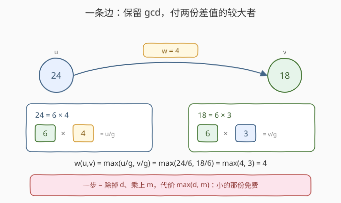
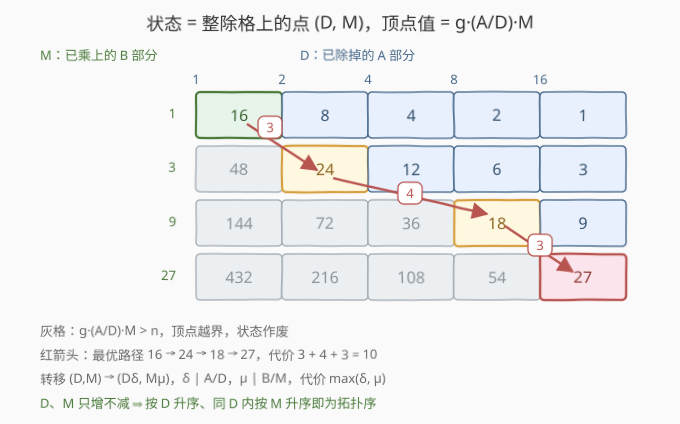
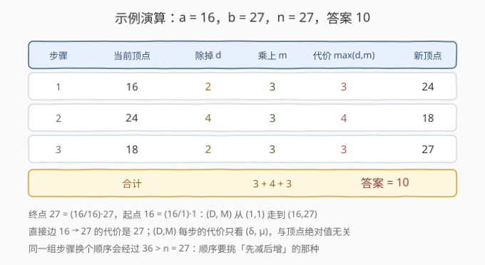

# Codeforces 2233F 最短 GCD 路径 题解

## 1. 题目概述

- **标题 / 题号**：最短 GCD 路径（Codeforces 2233F，英文名 Shortest GCD Paths）
- **链接**：https://codeforces.com/problemset/problem/2233/F
- **来源**：Educational Codeforces Round 191 (Rated for Div. 2) · Problem F（UTC 2026-06-09）
- **难度**：2800（题面标注 $\ast 2800$）
- **限制**：时间 2 s / 内存 512 MB
- **标签**：数论、图论、最短路、动态规划、整除（官方标签：dp, graphs, math, number theory, shortest paths）

**题意**：给定 $n,a,b$。考虑 $n$ 个顶点的无向完全图，顶点就是 $1,2,\dots,n$，任意两个不同顶点 $u,v$ 之间有一条边，边权为

$$w(u,v)=\frac{\max(u,v)}{\gcd(u,v)}.$$

求从 $a$ 到 $b$ 的最短路长度（只输出长度这个整数）。

**约束**：

- $2\le n\le 10^{9}$，$1\le a,b\le n$，$a\ne b$；
- 完全图的边数是 $\Theta(n^{2})$，$n=10^{9}$ 时约 $5\times 10^{17}$ 条，不可能显式建图；
- 输入只含**一行**（本题只有一组数据，没有 $t$），但为了稳健，下面的代码仍用 `while (cin >> n >> a >> b)` 读入；
- 答案最大可以到 $10^{9}$（例如 $a$ 是大于 $n/2$ 的素数），必须用 `long long` 存放。

## 2. 示例与观察
官方样例（输入 / 输出原样）：

```text
输入
10 9 8
```

```text
输出
7
```

```text
输入
100 16 27
```

```text
输出
10
```

```text
输入
100 55 11
```

```text
输出
5
```

逐组说明：

| # | $n,a,b$ | 答案 | 最优路径 |
|---|---------|------|----------|
| 1 | $10,9,8$ | 7 | $9\to 6\to 8$，代价 $3+4=7$（题面 Note 给出） |
| 2 | $100,16,27$ | 10 | $16\to 24\to 18\to 27$，代价 $3+4+3=10$ |
| 3 | $100,55,11$ | 5 | $55\to 11$，代价 $55/11=5$ |

补 1 组自造示例（非官方，用来展示「公共部分保留」的好处）：

```text
输入
1000000000 210 143
```

```text
输出
27
```

$210=2\cdot 3\cdot 5\cdot 7$，$143=11\cdot 13$：走 $210\to 70\to 77\to 143$，代价 $3+11+13=27$；直接边要 $\max(210,143)=210$。

## 3. 解题思路

### 3.1 暴力思路

完全图上的 Dijkstra 需要枚举 $O(n^{2})$ 条边，$n=10^{9}$ 时是 $10^{18}$ 级别，直接出局。另一方面答案本身可以很大（最大 $10^{9}$），也没法按「答案」做有界 BFS。所以必须换一个视角：**边权只和两个数的质因子结构有关**。

### 3.2 核心观察：一步 = 除掉 $d$、乘上 $m$，代价 $\max(d,m)$



设 $g=\gcd(u,v)$，则 $u/g$ 与 $v/g$ **互质**，并且

$$w(u,v)=\max\left(\frac{u}{g},\frac{v}{g}\right).$$

于是把「从 $u$ 走到 $v$」读成一句话：**先除掉 $d=u/g$，再乘上 $m=v/g$**。因为 $d,m$ 互质，这两件事可以「同时发生」，总代价只取较大的那份：

$$w(u,v)=\max(d,m)\quad\text{而不是}\quad d+m.$$

也就是说：**小的那份是免费的**。这直接给出策略——把「要扔掉的老质因子」和「要装上的新质因子」塞进同一步，谁大就付谁的钱。同时 $u,v$ 的**公共部分 $g$ 每一步都被保留**，保留不花钱，所以它从开始到最后一直躺在里面。

记 $g=\gcd(a,b)$、$A=a/g$、$B=b/g$，则 $A\perp B$。由于公共部分白拿，最优路径只做两件事：把 $A$ 的质因子逐个除掉、把 $B$ 的质因子逐个乘上（同一个质因子被「先删后加」地来回折腾一遍毫无收益，见 §5 引理 3）。

### 3.3 算法流程：整除格上的 DP



由上面的观察，路径上每个顶点都可以写成

$$g\cdot\frac{A}{D}\cdot M,\qquad D\mid A,\quad M\mid B,$$

其中 $D$ 是「已经除掉的 $A$ 部分」、$M$ 是「已经乘上的 $B$ 部分」。起点是 $(D,M)=(1,1)$（值 $a$），终点是 $(A,B)$（值 $b$）。

从 $(D,M)$ 走一步：挑 $\delta\mid A/D$、$\mu\mid B/M$，走到 $(D\delta,\,M\mu)$。代价是多少？记

$$C=g\cdot\frac{A}{D\delta}\cdot M,$$

则 $u=C\delta$、$v=C\mu$；又 $\delta\mid A$、$\mu\mid B$、$\gcd(A,B)=1$，故 $\gcd(\delta,\mu)=1$，从而 $\gcd(u,v)=C$，于是

$$w(u,v)=\max\left(\frac{u}{C},\frac{v}{C}\right)=\max(\delta,\mu).$$

**代价只取决于这一步的 $(\delta,\mu)$，与顶点绝对值无关。** 这就是能把「路径」压成「二维格点行走」的原因。

$D$ 与 $M$ 都只增不减，所以这张图是 DAG：按 $D$ 升序、同一 $D$ 内按 $M$ 升序处理就是拓扑序，直接一遍 DP 即可。另外顶点 $g\cdot(A/D)\cdot M$ 必须 $\le n$（必须落在 $1..n$ 里），越界的状态直接作废。

$$\mathrm{dist}(D,M)=\min_{\delta\mid A/D,\ \mu\mid B/M}\Big\{\mathrm{dist}(D/\delta,\,M/\mu)+\max(\delta,\mu)\Big\}$$

答案就是 $\mathrm{dist}(A,B)$。

### 3.4 示例演算



$n=27,a=16,b=27$：$g=1$，$A=16=2^{4}$，$B=27=3^{3}$。

| 步骤 | 当前顶点 | 除掉 $d$ | 乘上 $m$ | 代价 $\max(d,m)$ | 新顶点 |
|------|----------|----------|----------|------------------|--------|
| 1 | 16 | 2 | 3 | 3 | 24 |
| 2 | 24 | 4 | 3 | 4 | 18 |
| 3 | 18 | 2 | 3 | 3 | 27 |

总代价 $3+4+3=10$，而直接边 $16\to 27$ 要 $27$。验算每一步的边权：$w(16,24)=24/8=3$，$w(24,18)=24/6=4$，$w(18,27)=27/9=3$，全部与 $\max(\delta,\mu)$ 吻合。

顺便解释为什么不能随手排顺序：同样这三步若按 $16\to 24\to 36\to 27$ 走，中间会经过 $36>n=27$，越界；但代价同样是 $10$。**步骤的多重集决定代价，顺序只影响中间顶点是否越界**——这正是 §5 引理 4 的内容。

## 4. 算法细节

1. **约分**：$g=\gcd(a,b)$，$A=a/g$，$B=b/g$，此后只和 $A,B$ 打交道（两者互质，这一点在推导 $\gcd(\delta,\mu)=1$ 时是必需的）。
2. **分解质因数**：对 $A$、$B$ 各做 $O(\sqrt{x})$ 的试除；试除结束后若剩 $>1$，那是一个大素数，单独记录。$x\le 10^{9}$，试除上界 $31623$。
3. **枚举约数**：用质因子指数向量的 DFS 生成全部约数，并在生成时把每个约数的**指数向量**一起存下来（后面枚举它的约数要用）；最后按下标排序，得到升序约数表。
4. **预处理转移**：对约数 $v$，它的「可乘约数」就是 $A/v$ 的约数 $\delta$，目标下标是 $v\delta$ 在约数表里的位置。用 `unordered_map` 建「值 $\to$ 下标」，把 $(\text{目标下标},\delta)$ 存成一张表，避免 DP 内部反复查表。
5. **状态与值**：状态用一维数组 `dist[i*nB + j]`；顶点值用 `(g * (A/valA[i])) * valB[j]` 计算，`g*(A/valA[i])` 先算（它 $\le a\le 10^{9}$），再乘 `valB[j]`，最大 $10^{18}$，`long long` 不溢出。
6. **拓扑序**：外层 $i$（$D$ 升序）、内层 $j$（$M$ 升序）。转移只会让 $i,j$ 不减，故所有前驱一定已经被处理过，不需要堆。
7. **越界剪枝**：值 $>n$ 的状态既不作为前驱，也不作为后继被使用；这一条在 $n$ 紧贴 $\max(a,b)$ 时是必要的（虽然理论上最优解总能排在 $[1,\max(a,b)]$ 内，见引理 4，但保留检查更稳）。
8. **多组读入**：本题只有一组，代码用 `while (cin >> n >> a >> b)` 兼容多组，不会误读。

## 5. 正确性证明

**引理 1（无关质因子可以删掉）**：设素数 $p\nmid ab$ 出现在路径的某个顶点上。把 $p$ 从路径所有顶点中除掉，得到的新路径每条边权都不超过原来。

**证明**：设边 $(u,v)$，$g=\gcd(u,v)$。除掉 $p$ 后 $u'=u/p^{\alpha}$、$v'=v/p^{\beta}$，$\gcd(u',v')=g/p^{\min(\alpha,\beta)}$，于是

$$\frac{u'}{\gcd(u',v')}=\frac{u/g}{p^{\alpha-\min(\alpha,\beta)}}\le\frac{u}{g},\qquad
\frac{v'}{\gcd(u',v')}=\frac{v/g}{p^{\beta-\min(\alpha,\beta)}}\le\frac{v}{g},$$

两者都不增，取 $\max$ 也不增；端点 $a,b$ 不含 $p$，路径仍是 $a\to b$，各顶点仍是正整数。∎

**引理 2（一步 = 除 $d$ 乘 $m$）**：对任意边 $(u,v)$，令 $d=u/\gcd(u,v)$、$m=v/\gcd(u,v)$，则 $d\perp m$ 且 $w(u,v)=\max(d,m)$。∎

**引理 3（规范化）**：存在一条最优路径，使每个顶点都形如 $g\cdot(A/D)\cdot M$（$D\mid A$，$M\mid B$），即：$g$ 里的素数指数恒定，$A$ 里的素数指数单调不增，$B$ 里的素数指数单调不减。

**证明**：由引理 1 可设路径只用 $ab$ 的质因子，记顶点 $x_i$ 中素数 $p$ 的指数为 $e_i$。一条边的代价是 $\max(u/g,\,v/g)$，而 $p$ 只会出现在其中**一项**上，指数恰为 $|e_i-e_{i+1}|$（另一项指数为 $0$）。所以只要让这两个指数都**不增**，这条边的代价就不会变大。

- $p\mid A$（$e_0=\alpha,\ e_k=0$）：把 $e_i$ 换成前缀最小值 $m_i=\min(e_0,\dots,e_i)$。$m_0=\alpha,\ m_k=0$，各顶点值只减；边上 $p$ 的两份指数从 $(\max(0,e_i-e_{i+1}),\max(0,e_{i+1}-e_i))$ 变成 $(m_i-m_{i+1},0)$，可以验证 $m_i-m_{i+1}\le\max(0,e_i-e_{i+1})$ 且另一份为 $0$，代价不增。
- $p\mid B$（$e_0=0,\ e_k=\beta$）：对称地换成后缀最小值 $h_i=\min(e_i,\dots,e_k)$，同样只减不增。
- $p\mid g$（$e_0=e_k=\alpha$）：先对所有顶点截断 $e_i\leftarrow\min(e_i,\alpha)$（顶点值只减、代价不增）；再把指数低于 $\alpha$ 的每个极长连续段整体抬回 $\alpha$。段内每条边的 $p$ 部分从 $p^{|\Delta|}$ 变成 $p^{0}$，与段外相邻的两条边同理，代价不增。抬升会让这些顶点变大，但由引理 4 可以重排步骤把它们压回 $[1,\max(a,b)]$。

三步做完，$A$ 的素数只剩「已除掉 $D$」的形式、$B$ 的只剩「已乘上 $M$」、$g$ 的原样保留，即得结论。∎

**引理 4（顺序无关，且顶点可以不越界）**：给定一组合法步骤 $(\delta_1,\mu_1),\dots,(\delta_k,\mu_k)$（乘积分别为 $A,B$），

1. 它们可以按**任意顺序**执行，每一步仍满足 $\delta\mid A/D$、$\mu\mid B/M$；
2. 每步代价 $\max(\delta,\mu)$ 与顺序无关，总代价不变；
3. 把 $\delta\ge\mu$ 的步骤全部排在前面，则路径上所有顶点都 $\le\max(a,b)\le n$。

**证明**：重排后，执行到某步时 $D\delta$ 与 $M\mu$ 都是「全体 $\delta$ 之积 $=A$」「全体 $\mu$ 之积 $=B$」的子乘积，故仍是 $A$、$B$ 的约数，整除条件成立；代价是逐步相加的常数项，与顺序无关。顶点值为 $a\cdot M/D$：先执行 $\delta\ge\mu$ 的步骤时 $M/D$ 单调不增，顶点从 $a$ 单调降到谷底；再执行 $\mu>\delta$ 的步骤时 $M/D$ 单调上升，终点是 $a\cdot B/A=b$，故上升段的每个值都 $\le b$。合起来全程 $\le\max(a,b)$。∎

**定理**：算法输出的数就是 $a$ 到 $b$ 的最短路长度。

**证明**：设 $\mathrm{OPT}$ 为最短距离、$\mathrm{DP}$ 为算法输出。

($\mathrm{DP}\ge\mathrm{OPT}$) DP 的每条转移都对应一条真实边（引理 2 的逆：$\delta,\mu$ 互质时确实能用一步实现，代价恰为 $\max(\delta,\mu)$），且所有顶点都被检查过 $\le n$，所以 DP 的每条路径都是图上真实路径，其长度 $\ge\mathrm{OPT}$。

($\mathrm{DP}\le\mathrm{OPT}$) 取最优路径，由引理 1、3 规范化成 $g\cdot(A/D)\cdot M$ 的形式且代价不增，得到一组合法步骤；由引理 4 重排使顶点全在 $[1,\max(a,b)]\subseteq[1,n]$ 内。这组步骤的每个状态都通过了越界检查，且 DP 会枚举所有合法 $(\delta,\mu)$，因此 DP 值 $\le$ 这条路径的代价 $\le\mathrm{OPT}$。

两者夹逼，$\mathrm{DP}=\mathrm{OPT}$。∎

## 6. 复杂度分析

- **时间**：分解质因数 $O(\sqrt A+\sqrt B)\le 6.4\times10^{4}$ 次试除；状态数 $\tau(A)\tau(B)$；转移总数 $\sum_{D\mid A}\sum_{M\mid B}\tau(A/D)\tau(B/M)=f(A)f(B)$，其中 $f(x)=\prod (e_i+1)(e_i+2)/2$ 是 $x$ 的「约数个数之和」。$x\le 10^{9}$ 时 $f(x)$ 最大为 $136080$（$x=735134400$），但 $A\perp B$ 使二者不能同时取到最大，实测最坏一组（$a=735134400,\ b=19\cdot23\cdot29\cdot31\cdot37\cdot41$）转移量约 $10^{8}$ 量级，本机 `-O2` 耗时 **42 ms**，距 2 s 时限有 40 倍以上余量。
- **空间**：`dist` 占 $\tau(A)\tau(B)$ 个 `long long`（最坏 $10^{5}$ 量级，例如 $A=735134400$ 时 $\tau=1344$），转移表占 $O(f(A)+f(B))$ 个 `int` 对，加上约数表与哈希表，总共几 MB 量级，远小于 512 MB。
- **Python**：同一算法常数大得多，最坏一组（$735134400,276182689$）CPython 约 3.0 s、最坏构造约 4.3 s，**会超时**；请提交 PyPy（约 5～10 倍加速）或直接用 C++。

## 7. 参考代码

### C++17

```cpp
#include <bits/stdc++.h>
using namespace std;

typedef long long ll;
const ll INF = (ll)4e18;

// 预处理 x 的所有约数（升序）以及约数之间的「乘法转移」
struct DivSet {
    vector<ll> val;                        // 升序排列的约数
    vector<vector<int>> ex;                // 每个约数的质指数向量
    vector<vector<pair<int, int>>> tr;     // tr[i] = {(目标下标, 乘数 d)}

    void build(ll x) {
        vector<ll> p;
        vector<int> e;
        for (ll d = 2; d * d <= x; ++d) {
            if (x % d == 0) {
                int c = 0;
                while (x % d == 0) { x /= d; ++c; }
                p.push_back(d);
                e.push_back(c);
            }
        }
        if (x > 1) { p.push_back(x); e.push_back(1); }
        int k = (int)p.size();

        vector<int> cur(k, 0);
        function<void(int, ll)> gen = [&](int i, ll v) {
            if (i == k) { val.push_back(v); ex.push_back(cur); return; }
            ll pw = 1;
            for (int t = 0; t <= e[i]; ++t) {
                cur[i] = t;
                gen(i + 1, v * pw);
                pw *= p[i];
            }
            cur[i] = 0;
        };
        gen(0, 1);

        vector<int> id(val.size());
        iota(id.begin(), id.end(), 0);
        sort(id.begin(), id.end(), [&](int A, int B) { return val[A] < val[B]; });
        vector<ll> nv(val.size());
        vector<vector<int>> ne(val.size());
        for (size_t i = 0; i < id.size(); ++i) { nv[i] = val[id[i]]; ne[i] = ex[id[i]]; }
        val.swap(nv); ex.swap(ne);

        unordered_map<ll, int> pos;
        pos.reserve(val.size() * 2);
        for (int i = 0; i < (int)val.size(); ++i) pos[val[i]] = i;

        tr.assign(val.size(), {});
        for (int i = 0; i < (int)val.size(); ++i) {
            // 枚举 val[i] 的约数 d，目标约数为 val[i] * d
            function<void(int, ll)> gen2 = [&](int j, ll d) {
                if (j == k) { tr[i].push_back({pos[val[i] * d], (int)d}); return; }
                ll pw = 1;
                int lim = e[j] - ex[i][j];
                for (int t = 0; t <= lim; ++t) {
                    gen2(j + 1, d * pw);
                    pw *= p[j];
                }
            };
            gen2(0, 1);
            sort(tr[i].begin(), tr[i].end());
        }
    }
};

int main() {
    ios::sync_with_stdio(false);
    cin.tie(nullptr);
    ll n, a, b;
    while (cin >> n >> a >> b) {          // 本题只有一组，兼容多组写法
        ll g = std::gcd(a, b);
        ll A = a / g, B = b / g;
        DivSet DA, DB;
        DA.build(A);
        DB.build(B);
        int nA = (int)DA.val.size(), nB = (int)DB.val.size();

        // 状态 (i,j)：顶点值 = g * (A / DA.val[i]) * DB.val[j]
        vector<ll> dist((size_t)nA * nB, INF);
        dist[0] = 0;                                  // (D,M) = (1,1) 即顶点 a
        for (int i = 0; i < nA; ++i) {
            ll base = g * (A / DA.val[i]);
            for (int j = 0; j < nB; ++j) {
                size_t id = (size_t)i * nB + j;
                ll cur = dist[id];
                if (cur >= INF) continue;
                if (base * DB.val[j] > n) continue;   // 顶点越界，作废
                for (const auto &ta : DA.tr[i]) {
                    size_t row = (size_t)ta.first * nB;
                    for (const auto &tb : DB.tr[j]) {
                        ll nd = cur + max(ta.second, tb.second);
                        ll &r = dist[row + tb.first];
                        if (nd < r) r = nd;
                    }
                }
            }
        }
        cout << dist[(size_t)(nA - 1) * nB + (nB - 1)] << '\n';
    }
    return 0;
}
```

### Python3

```python
import sys
from math import gcd


def divisors(x):
    small, large = [], []
    i = 1
    while i * i <= x:
        if x % i == 0:
            small.append(i)
            if i != x // i:
                large.append(x // i)
        i += 1
    return small + large[::-1]


def solve(n, a, b):
    g = gcd(a, b)
    A, B = a // g, b // g
    dA, dB = divisors(A), divisors(B)
    idxA = {v: i for i, v in enumerate(dA)}
    idxB = {v: i for i, v in enumerate(dB)}
    trA = [[(idxA[v * d], d) for d in divisors(A // v)] for v in dA]
    trB = [[(idxB[v * d], d) for d in divisors(B // v)] for v in dB]

    nB = len(dB)
    INF = float('inf')
    dist = [INF] * (len(dA) * nB)
    dist[0] = 0
    for i, v in enumerate(dA):
        rest = A // v
        row = i * nB
        for j in range(nB):
            cur = dist[row + j]
            if cur == INF:
                continue
            if g * rest * dB[j] > n:       # 顶点越界
                continue
            for ti, dl in trA[i]:
                base = ti * nB
                for tj, mu in trB[j]:
                    nd = cur + (dl if dl > mu else mu)
                    k = base + tj
                    if nd < dist[k]:
                        dist[k] = nd
    return dist[len(dA) * nB - 1]


def main():
    data = sys.stdin.buffer.read().split()
    out = []
    for t in range(0, len(data), 3):
        n, a, b = int(data[t]), int(data[t + 1]), int(data[t + 2])
        out.append(str(solve(n, a, b)))
    sys.stdout.write("\n".join(out) + "\n")


main()
```

## 8. 边界情况与易错点

1. **$a\mid b$ 或 $b\mid a$**：记 $\mathrm{sopfr}(x)$ 为 $x$ 的全部质因子之和（按重数计，$\mathrm{sopfr}(1)=0$）。此时 $A=1$ 或 $B=1$，答案就是 $\mathrm{sopfr}(b/a)$ 或 $\mathrm{sopfr}(a/b)$。代码不需要特判：$A=1$ 时 $D$ 方向只剩 $\delta=1$ 一种转移，DP 退化成一维。
2. **$a=1$**：$g=1,A=1$，答案 $=\mathrm{sopfr}(b)$。例如 $n=10^9,a=1,b=10^9$ 时 $10^9=2^9\cdot5^9$，答案是 $9\cdot2+9\cdot5=63$。
3. **$b$ 是大于 $n/2$ 的大素数**：因为 $2b>n$，$b$ 没有任何倍数可供「绕道」，任何进入 $b$ 的边（从 $v<b$ 出发）代价都恰好是 $\max(v,b)=b$，所以当 $a<b$ 时答案就是 $b$（例如 $n=10^9,\ a=1,\ b=999999937$）。数值上必须用 `long long`。
4. **$n$ 紧贴 $\max(a,b)$**：中间顶点可能「越界」。例如同样三步，$16\to24\to36\to27$ 在 $n=27$ 时非法，但换成 $16\to24\to18\to27$ 就合法且代价一样（引理 4）。代码必须显式检查 $g\cdot(A/D)\cdot M\le n$，不能省。
5. **溢出与类型**：顶点值 $g\cdot(A/D)\cdot M=a\cdot M/D\le a\cdot B$，最大到 $10^{18}$ 量级，`dist`、顶点值、转移代价一律用 `long long`；用 `int` 会在 `base * M` 和 `dist + cost` 上悄悄溢出。
6. **试除上界**：只试到 $\sqrt{x}$；循环结束后若 $x>1$，它本身是一个大素数因子，必须补进质因子表，否则约数会少一半。
7. **多组/单组读入**：本题题面写的是「The only line contains three integers」，只有一组；用 `while` 读入既能通过本题，也能容忍多组版本。
8. **不要输出路径**：只输出长度；也**不需要**判重边、自环（$u\ne v$ 且完全图）。

## 9. 验证记录

- **编译环境与命令**：`clang++ -std=c++17 -O2`（本机无 GNU g++，配 `codeforces/tools/include/bits/stdc++.h` 兼容头；正文代码只用标准库，可原样提交 GNU C++17）；Python 侧为 `Python 3.9.6`。
- **官方样例**：3 / 3 通过（按 Codeforces 标准 checker 的 token 比对，忽略空白与大小写）。
- **复核状态**：audited（2026-11-19 统一回归：编译 + 官方样例；写作期的随机对拍与暴力未重跑）。

## 相关题目与扩展

- [Codeforces 2233D Goods on the Shelf](https://codeforces.com/problemset/problem/2233/D)：同场 D 题（1900），同样是「把结构压成常数个状态再扫描」的思路。
- [Codeforces 1101D GCD Counting](https://codeforces.com/problemset/problem/1101/D)：树上路径的 gcd 问题，用「每个点挂在自己的质因子上」的技巧把路径统计降维。
- [Codeforces 1154G Minimum Possible LCM](https://codeforces.com/problemset/problem/1154/G)：在值域上按约数枚举，把 $\mathrm{lcm}$ 的最优对问题做成调和级数复杂度，和本题「在整除格上枚举」同源。
- [Codeforces 1203C Common Divisors](https://codeforces.com/problemset/problem/1203/C)：gcd 的约数即公共因子的直接应用，可以做本题的入门热身。

**延伸思考**：

1. 如果把边权改成 $\max(u,v)/\gcd(u,v)$ 的**平方**，会发生什么？关键性质「一步代价只依赖 $(\delta,\mu)$」仍然成立，所以同一张整除格 DP 依然有效，只要把 $\max(\delta,\mu)$ 换成 $\max(\delta,\mu)^{2}$；真正变化的是「把几个质因子打包进同一步」的性价比——平方之后打包变得更贵，最优策略会明显偏向拆细。
2. 如果要求**输出一条最短路径**（而不是长度），由引理 4 只需在 DP 里记录前驱，再按「$\delta\ge\mu$ 在前」重排即可保证所有顶点 $\le\max(a,b)$；总长度不超过 $\mathrm{sopfr}(A)+\mathrm{sopfr}(B)$，输出量很小。
3. 如果改成多组询问（$t$ 组、$a,b\le10^9$），单次 $O(f(A)f(B))$ 尚可，但 $t$ 一大就需要按 $(A,B)$ 记忆化，或者研究 $f$ 的结构把转移量继续压缩；本题「只有一组」的设定让这个指数看起来吓人、实际上刚好够用的做法成为正解。
