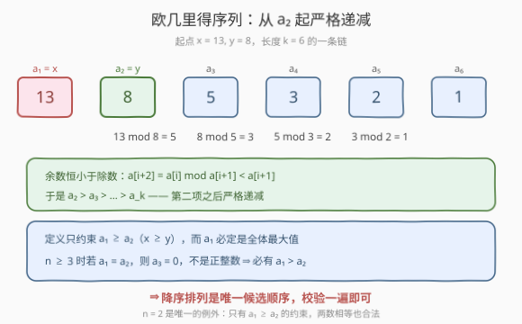
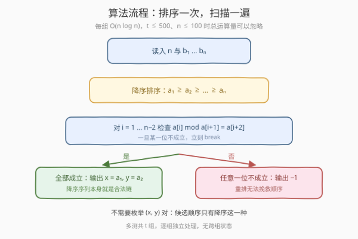
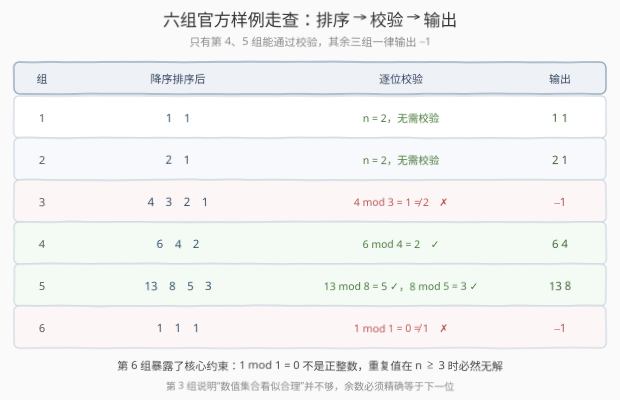

# Codeforces 2234A 欧几里得序列与两个数 题解

## 1. 题目概述

- **标题 / 题号**：欧几里得序列与两个数（Codeforces 2234A，英文名 Euclid, Sequence and Two Numbers）
- **链接**：https://codeforces.com/problemset/problem/2234/A
- **来源**：Codeforces Round 1102 (Div. 2) · Problem A
- **难度**：800（*800）
- **限制**：时间 1 s / 内存 256 MB
- **标签**：数学、数论、排序

**题意**：对两个正整数 $x \ge y$，定义长度 $k \ge 2$ 的**欧几里得算法序列**为

$$a_1 = x,\quad a_2 = y,\quad a_{i+2} = a_i \bmod a_{i+1}\ (1 \le i \le k-2).$$

给定长度为 $n$ 的序列 $b$，问能否**重排**它的元素，使它成为某个 $(x, y)$ 的欧几里得算法序列。可以的话输出这样一对 $x, y$（多解任意），否则输出 $-1$。

注意序列**只要求满足递推式**，不要求「一直除到 $0$」也没有任何「必须最短」「必须完整」的附加条件；被允许的只有重排，元素一个都不能少、一个都不能多。

**约束**：

- $1 \le t \le 500$（测试组数）
- $2 \le n \le 100$，$1 \le b_i \le 10^9$
- $x \ge y$ 且两者都必须是正整数
- 输出形如 `x y`，无解输出单独一行 `-1`

## 2. 示例

官方样例（输入 / 输出原样，共 6 组）：

```text
输入：
6
2
1 1
2
1 2
4
1 2 3 4
3
6 4 2
4
3 8 13 5
3
1 1 1

输出：
1 1
2 1
-1
6 4
13 8
-1
```

- 第 1 组：$k=2$ 时递推式不生效，$(1,1)$ 直接合法。
- 第 3 组：$\{1,2,3,4\}$ 降序为 $(4,3,2,1)$，而 $4 \bmod 3 = 1 \ne 2$，无解。
- 第 4 组：$6 \bmod 4 = 2$，序列 $(6,4,2)$ 成立。
- 第 5 组：重排成 $(13,8,5,3)$，$13 \bmod 8 = 5$、$8 \bmod 5 = 3$。
- 第 6 组：$1 \bmod 1 = 0$，不是正整数，无解。

自造三组【非官方】，分别覆盖合法长链、整除判死、重复值判死：

```text
输入：
3
4
21 13 8 5
3
6 3 1
4
2 2 1 1

输出：
21 13
-1
-1
```

- $(21,13,8,5)$：$21 \bmod 13 = 8$、$13 \bmod 8 = 5$，合法。
- $(6,3,1)$：$3 \mid 6$，故 $6 \bmod 3 = 0$，而 $0$ 不是正整数，无解。
- $(2,2,1,1)$：$2 \bmod 2 = 0$，重复的最大值立刻判死。

## 3. 解题思路

### 3.1 暴力思路

最朴素的想法是枚举**所有排列**：对每种排列检查 $n-2$ 个递推式，取第一个通过的，复杂度 $O(n! \cdot n)$。$n$ 最大 $100$，这个量级没有任何希望。

退一步可以只枚举**起点的两个数**：合法序列完全由 $(x,y)$ 决定（每个后继都是唯一确定的余数），所以枚举 $b$ 中所有有序对作为 $(x,y)$，生成 $n$ 项并核对是否与 $b$ 的多重集相同。复杂度 $O(n^2 \cdot n) = O(n^3)$，单组 $10^6$，但 $t=500$ 时最坏 $5 \times 10^8$ 次运算，1 秒的时限下并不稳。想清楚结构后，这两步都可以省掉。

### 3.2 核心观察：合法的顺序只有「降序」这一种



关键只有一句话：**余数严格小于除数**。对任意 $i \ge 1$，

$$a_{i+2} = a_i \bmod a_{i+1} < a_{i+1},$$

把 $i = 1,2,\dots,k-2$ 全部写出来，就得到

$$a_2 > a_3 > a_4 > \cdots > a_k,$$

也就是说：除了开头的 $a_1$，其余部分**严格递减**。再加上定义里的 $a_1 \ge a_2$，立刻得到三条推论：

1. $a_1$ 是全体元素里的（一个）最大值，$a_2$ 是「剩下的数」里的最大值；
2. $k \ge 3$ 时不可能有 $a_1 = a_2$，否则 $a_3 = a_1 \bmod a_2 = 0$，而 $0$ 不是正整数；
3. 因此 $n \ge 3$ 时合法序列是**严格递减**的，而一个多重集的严格递减排列是唯一的——它就是降序排序的结果。

于是候选顺序被完全钉死：**只需把 $b$ 降序排序，然后逐个校验递推式**。$n = 2$ 是唯一的例外，此时只有 $a_1 \ge a_2$ 这一条约束，降序排好直接输出即可（两数相等也合法，样例 1 就是 $[1,1]$）。

### 3.3 算法流程



1. 读入 $n$ 与 $b_1,\dots,b_n$；
2. 把 $b$ **降序**排序为 $a_1 \ge a_2 \ge \dots \ge a_n$；
3. 对 $i = 1,2,\dots,n-2$ 检查 $a_i \bmod a_{i+1} = a_{i+2}$，任一位不成立就立刻判定无解；
4. 全部成立则输出 `a[0] a[1]`（即 $x=a_1$、$y=a_2$），否则输出 `-1`。

整个算法没有分支枚举、没有回溯，排序加一次线性扫描就是全部。

### 3.4 示例演算



| 组 | 降序排序后 | 逐位校验 | 输出 |
|----|------------|----------|------|
| 1 | $1, 1$ | $n=2$，无递推式 | `1 1` |
| 2 | $2, 1$ | $n=2$，无递推式 | `2 1` |
| 3 | $4, 3, 2, 1$ | $4 \bmod 3 = 1 \ne 2$ ✗ | `-1` |
| 4 | $6, 4, 2$ | $6 \bmod 4 = 2$ ✓ | `6 4` |
| 5 | $13, 8, 5, 3$ | $13 \bmod 8 = 5$ ✓、$8 \bmod 5 = 3$ ✓ | `13 8` |
| 6 | $1, 1, 1$ | $1 \bmod 1 = 0 \ne 1$ ✗ | `-1` |

第 3 组值得单独看一眼：只检查「两两不同」是不够的，$\{1,2,3,4\}$ 四个数互不相同，也满足降序，但余数对不上，因此仍然无解。这也说明校验必须逐位做，不能只做集合层面的必要条件。

## 4. 算法细节

1. **一定要降序**。升序排序在 $n = 2$ 时会输出 $x < y$ 的一对（例如 $[1,2]$ 输出 `1 2`），直接违反 $x \ge y$；降序则天然满足 $a_1 \ge a_2$。
2. **`n = 2` 不需要特判**。把循环写成 `for (i = 0; i + 2 < n; i++)`，$n=2$ 时循环体一次都不执行，`ok` 保持 `true`，正好对应「长度为 2 的序列恒合法」。
3. **不变量是「排序后即候选」**。因为合法顺序唯一，校验对象只能是降序数组；不要试图边排序边校验，也不要对每个候选 $(x,y)$ 重新生成链。
4. **数据类型**：$b_i \le 10^9$ 用 `int` 足够，取模不会溢出；但统一用 `long long` 可以完全免疫「乘法/取模溢出」这类粗心错误，代价可以忽略。
5. **提前退出**：一旦某一位校验失败立刻 `break`，避免无意义地扫完剩余元素（$n \le 100$ 影响不大，但这是好习惯）。
6. **多测独立**：每组用一个局部数组，不共享状态；输入规模最多 $t \cdot n = 5 \times 10^4$ 个数，`scanf` 或关闭同步的 `cin` 都绰绰有余。
7. **输出格式**：合法时输出 `x y`（空格分隔），无解输出单独的 `-1`，不要输出 `-1 -1`；每组一行。
8. **链长上界（可选加速）**：由 $a_i = q \cdot a_{i+1} + a_{i+2}$（$q \ge 1$）得 $a_i \ge a_{i+1} + a_{i+2}$，最短首项按斐波那契增长，$F_{45} = 1134903170 > 10^9$，所以长度 $\ge 44$ 的合法序列在本题值域下**一定不存在**（长度上限是 $43$：$F_{44} = 701408733$）。想特判可以直接写 `if (n >= 44) -1`，但排序校验本身也会自然失败，属于纯优化。

## 5. 正确性证明

**引理 1（递减性）**：设 $a_1,\dots,a_k$ 是任一合法欧几里得算法序列，则 $a_2 > a_3 > \cdots > a_k$。

**证明**：对任意 $i \ge 1$，$a_{i+2}$ 是 $a_i$ 除以正整数 $a_{i+1}$ 的余数，因此 $0 \le a_{i+2} < a_{i+1}$。取 $i = 1,\dots,k-2$，依次得到 $a_3 < a_2$、$a_4 < a_3$、…、$a_k < a_{k-1}$，把这些不等式串联即得结论。∎

**引理 2（首项是最大值）**：对任一合法序列，$a_1 = \max\{a_1,\dots,a_k\}$。

**证明**：由定义 $a_1 = x \ge y = a_2$，再结合引理 1 得 $a_1 \ge a_2 > a_3 > \cdots > a_k$，故 $a_1$ 不小于任何元素。∎

**引理 3（$k \ge 3$ 时元素两两不同）**：若 $k \ge 3$，则 $a_1 > a_2 > a_3 > \cdots > a_k$。

**证明**：若 $a_1 = a_2$，则 $a_3 = a_1 \bmod a_2 = 0$，与「序列由正整数构成」矛盾，故 $a_1 > a_2$；再由引理 1 得后续严格递减，串起来就是严格递减。∎

**引理 4（候选顺序唯一）**：设 $d_1 \ge d_2 \ge \dots \ge d_n$ 是 $b$ 的降序排序。若存在某个重排 $c$ 使 $c$ 成为合法序列，则 $c_i = d_i$ 对一切 $i$ 成立。

**证明**：分两种情况。

- $n \ge 3$：由引理 3，$c$ 是 $b$ 的**严格递减**排列。严格递减排列在多重集中唯一存在，且恰为降序排序，故 $c = d$。
- $n = 2$：$c_1 \ge c_2$ 意味着 $c$ 也是降序排列，与 $d$ 至多在同值元素处交换次序，而值相同时 $c_i = d_i$ 依然成立。

∎

**定理**：若算法输出一对 $(x,y)$，则该对确实能生成 $b$ 的一个重排；若存在合法重排，算法一定输出而不输出 $-1$。

**证明**：

- **充分性**：若降序数组 $d$ 通过全部 $n-2$ 个校验，则 $d$ 满足定义中的全部递推式；又由排序 $d_1 \ge d_2$，且所有 $d_i \ge 1$ 为正整数，故取 $x = d_1, y = d_2$ 时 $d$ 就是一条合法序列，而 $d$ 是 $b$ 的重排，输出 $(d_1,d_2)$ 合法。
- **必要性**：假设存在合法重排 $c$。由引理 4，$c = d$，于是 $d$ 满足全部递推式，算法在每一步都能通过校验、不会输出 $-1$，且输出的恰是 $(c_1, c_2) = (x, y)$，正是题目要求的那一对。

两者合起来即得结论。∎

## 6. 复杂度分析

- **时间**：每组排序 $O(n \log n)$，校验 $O(n)$，合计 $O(n \log n)$；总复杂度 $O(t \cdot n \log n)$。取最坏的 $t = 500,\ n = 100$，也只有约 $500 \times 100 \times 7 \approx 3.5\times 10^5$ 次比较，远低于 $1$ 秒的时限（本机实测 500 组满规模仅 7 ms）。
- **空间**：每组一个长度为 $n$ 的数组，$O(n)$；与 $n \le 100$ 相比可忽略，也远低于 256 MB。

## 7. 参考代码

### C++17

```cpp
#include <bits/stdc++.h>
using namespace std;

int main() {
    int t;
    if (scanf("%d", &t) != 1) return 0;
    while (t--) {
        int n;
        scanf("%d", &n);
        vector<long long> a(n);
        for (int i = 0; i < n; i++) scanf("%lld", &a[i]);

        // 合法顺序唯一：降序排列
        sort(a.begin(), a.end(), greater<long long>());

        bool ok = true;
        for (int i = 0; i + 2 < n; i++) {
            if (a[i] % a[i + 1] != a[i + 2]) {   // 余数必须精确等于下一位
                ok = false;
                break;
            }
        }

        if (ok) printf("%lld %lld\n", a[0], a[1]);   // x = a1, y = a2
        else    printf("-1\n");
    }
    return 0;
}
```

### Python3

```python
import sys

def main():
    data = list(map(int, sys.stdin.buffer.read().split()))
    if not data:
        return
    t = data[0]
    pos = 1
    out = []
    for _ in range(t):
        n = data[pos]; pos += 1
        a = sorted(data[pos:pos + n], reverse=True)   # 降序：唯一候选顺序
        pos += n
        ok = all(a[i] % a[i + 1] == a[i + 2] for i in range(n - 2))
        out.append(f"{a[0]} {a[1]}" if ok else "-1")
    sys.stdout.write("\n".join(out) + "\n")

main()
```

两段代码都是完整可提交程序（含 `main`、支持多测）；$n = 2$ 时 `range(n-2)` 为空、`all` 恒真，正好输出降序后的两个数。

## 8. 边界情况与易错点

1. **$n = 2$ 恒可行**。$[1,1]$ 输出 `1 1`，$[5,5]$ 输出 `5 5`：$k=2$ 时递推式不生效，只要求 $x \ge y$。若在代码里额外加一条「必须严格递减」的判断，这里就会错判成 $-1$。
2. **降序而不是升序**。$[1,2]$ 的答案是 `2 1`；用升序会输出 `1 2`，违反 $x \ge y$。这条错误在 $n \ge 3$ 时往往被别的失败掩盖，只有 $n=2$ 才暴露。
3. **整除即死**。$a_{i+1} \mid a_i$ 时余数为 $0$，而序列元素必须是正整数，例如 $[6,3,1]$（$6 \bmod 3 = 0$）、$[2,2,1,1]$ 都是 $-1$。
4. **$n \ge 3$ 时有重复值必然无解**。$[1,1,1]$ 里 $1 \bmod 1 = 0$；一般情况下排序后相邻相等也会让某一位余数为 $0$。排序校验会自然发现，不需要显式判重。
5. **不要输出整个序列**。题面只要求输出 $(x, y)$ 这一对，多输出一个数会被判错。
6. **无解的格式**。输出单独一行 `-1`，不要输出 `-1 -1`；同时注意每组都要换行，最后一行也别漏。
7. **多测读入**。每组先读 $n$ 再读 $n$ 个整数，数字之间可以跨行，`scanf`/`split()` 都会自动跳过空白，不必按行读。
8. **长链天然无解**。$b_i \le 10^9$ 时合法链长上限是 $43$（$F_{44} = 701408733 \le 10^9 < F_{45}$），所以 $n \ge 44$ 必输出 `-1`；这正是「相邻两项严格递减 + 商至少为 1」的直接后果。

## 相关题目与扩展

- [Codeforces 2234B. Palindrome, Twelve and Two Terms](https://codeforces.com/problemset/problem/2234/B)：同场 B 题，同为「先找结构性约束、再构造」的套路。
- [Codeforces 1458A. Row GCD](https://codeforces.com/problemset/problem/1458/A)：把 $\gcd(a_1+b_j,\dots,a_n+b_j)$ 化成「$b_j$ 与相邻差分 $\gcd$」的关系，同样是化简递推结构后一次扫描。
- [Codeforces 1034A. Enlarge GCD](https://codeforces.com/problemset/problem/1034/A)：删去最少的数让整体 $\gcd$ 变大，需按质因子做倍数计数——数论题里「先除公因子再统计」的典型套路。
- [Codeforces 1349A. Orac and LCM](https://codeforces.com/problemset/problem/1349/A)：求所有两两 $\mathrm{lcm}$ 的 $\gcd$，按质因子的最小/次小指数统计，和本题一样是「只保留必要信息」的化简。

**延伸思考**：本题的「顺序唯一」来自余数的严格递减性，一旦放宽限制，问题立刻变难：

1. **允许删数**（从 $b$ 中删去若干元素，剩下的重排成合法链）：顺序仍然由降序决定，但要在降序数组上找「满足 $d_i \bmod d_{i+1} = d_{i+2}$ 的最长子序列」，可用 $O(n^2)$ 枚举前两项后顺序生成链再核对，或按位置做区间 DP。
2. **计数版本**（有多少对 $(x,y)$ 能生成某个重排）：$O(n^2)$ 枚举有序对、$O(n)$ 模拟判定，总 $O(n^3)$，正好是本文 3.1 里那个「正确但偏慢」的做法。
3. **要求完整欧几里得链**（一直除到 $0$，即最后两项为 $\gcd$ 与 $0$）：则额外要求 $\gcd(x,y) = 1$ 且链尾的两项为 $(1,1)$ 形式，Fibonacci 序列成为唯一的最坏情况构造，这与「欧几里得算法步数上界」是同一个经典结论。
