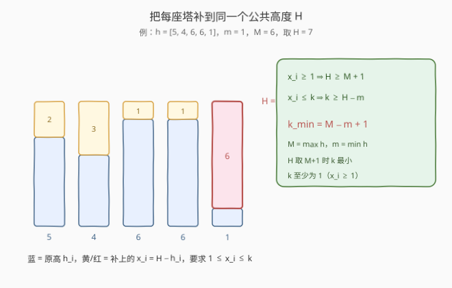
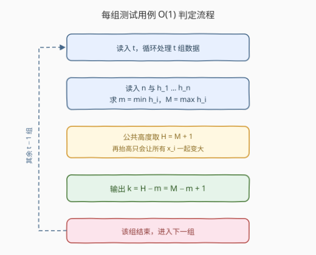
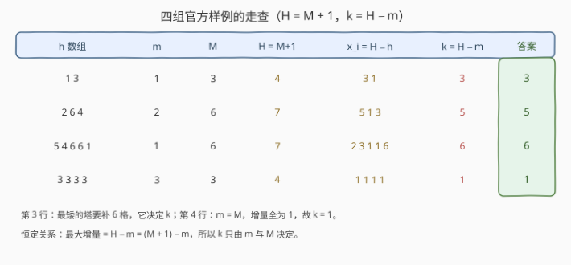

# Codeforces 2236A 火车上的游戏 题解

## 1. 题目概述

- **标题 / 题号**：火车上的游戏（Codeforces 2236A，英文名 Games on the Train）
- **链接**：https://codeforces.com/problemset/problem/2236/A
- **来源**：Codeforces Round 1103 (Div. 3) · Problem A
- **难度**：800
- **限制**：时间 1 s / 内存 256 MB
- **标签**：贪心、数学

**题意**：火车上有 $n$ 座由立方体堆成的塔，第 $i$ 座高度为 $h_i$。现在要给每座塔**恰好加一次**高度：为第 $i$ 座选定整数 $x_i$，把它变成 $h_i + x_i$。另外要求所有 $x_i$ 落在同一个区间 $[1, k]$ 里（$k$ 是整数，由我们选定）。问：**使所有塔最终高度相同的最小 $k$** 是多少。

换句话说，要找最小的 $k$，使得存在整数公共高度 $H$，满足对每个 $i$ 都有 $1 \le H - h_i \le k$，且 $x_i = H - h_i$ 就是各自被加上的量。只需要输出这个 $k$，不需要输出 $x$ 序列或 $H$。

**约束**：

- $1 \le t \le 10^4$（多测，第一行是组数）
- $1 \le n \le 5$ —— 每组塔的数量极少
- $1 \le h_i \le 6$ —— 高度值域同样极小
- $k \ge 1$ 为整数，且每个 $x_i$ 都必须满足 $1 \le x_i \le k$（下界 $1$ 意味着**不能不动**）
- 最终高度可以超过 $6$，题面没有对它设上界，只受 $k$ 约束
- 全部中间量都在 `int` 范围内（答案最大为 $6$）

> 💡 题面中没有出现任何要求「在代码里创建某个变量」之类的附加句，按原意实现即可。

## 2. 示例与观察
官方样例（输入 / 输出原样）：

```text
输入：
4
2
1 3
3
2 6 4
5
5 4 6 6 1
4
3 3 3 3

输出：
3
5
6
1
```

逐组解释：

| 组 | $h$ | 取 $H$ | 增量 $x_i$ | 需要的最小 $k$ |
|----|-----|--------|------------|----------------|
| 1 | $1,3$ | $4$ | $3,1$ | $3$ |
| 2 | $2,6,4$ | $7$ | $5,1,3$ | $5$ |
| 3 | $5,4,6,6,1$ | $7$ | $2,3,1,1,6$ | $6$ |
| 4 | $3,3,3,3$ | $4$ | $1,1,1,1$ | $1$ |

自造一组 $n = 1$ 的边界数据（题面允许，官方样例未覆盖）：

```text
输入：
2
1
6
1
1

输出：
1
1
```

只有一座塔时，任何 $H > h_1$ 都行，但每个 $x_i$ 必须 $\ge 1$，故 $k$ 至少为 $1$，取 $H = h_1 + 1$ 即可，答案为 $1$。

## 3. 解题思路

### 3.1 暴力思路

按定义枚举：$k = 1, 2, 3, \dots$，对每个 $k$ 再枚举公共高度 $H$，逐一检查所有 $H - h_i$ 是否都落在 $[1, k]$ 内；第一个可行的 $k$ 就是答案。由于 $h_i \le 6$，答案不会超过 $6$，$H$ 枚举到 $M + 6$ 就够，单组复杂度 $O(1)$，实际也跑得动。

但这样做有两个问题：一是完全没解释答案由什么决定，把「可判定」当成了「已理解」；二是它依赖 $h_i$ 很小的前提，一旦把高度放大到 $10^{18}$，枚举立刻报废。我们要的是一个与数值大小无关的封闭式子。

### 3.2 核心观察：公共高度决定一切，取最小值即可



把「所有塔最终等高」写成公共高度 $H$，那么每座塔被加上的量就被唯一确定：

$$x_i = H - h_i$$

两条约束立刻翻译成对 $H$ 与 $k$ 的不等式：

1. $x_i \ge 1$ 对每个 $i$ 成立 $\iff H \ge \max_i h_i + 1$。记 $M = \max h_i$，即 $H \ge M + 1$。**不能不动**这一条把它顶到了 $M$ 之上。
2. $x_i \le k$ 对每个 $i$ 成立 $\iff k \ge H - \min_i h_i$。记 $m = \min h_i$，最大的增量来自**最矮**的那座塔，是 $H - m$。

于是对固定的 $H$，所需的最小 $k$ 就是 $H - m$；而 $H$ 取得越小，$H - m$ 越小。$H$ 的下界是 $M + 1$，所以最优取 $H^* = M + 1$，得到

$$k_{\min} = (M + 1) - m = M - m + 1$$

直觉：先把公共高度压到「最高的塔再加一格」，此时塔群整体只升高了最少的一点，最矮的那座塔要补的格数也就是所有方案里最小的那一份；$k$ 必须容得下这份最大的补量。

> 💡 另一个视角：可行性对 $k$ 单调（$k$ 越大，区间 $[1,k]$ 越宽，可行域只增不减），所以答案可以用二分搜索，判定就是检查 $\max(h_i + 1) \le \min(h_i + k)$。本题二分与闭式结果相同，闭式更省事。

### 3.3 算法流程



1. 读入 $t$；
2. 对每组数据读入 $n$，再读入 $n$ 个高度，边读边维护 $m = \min h_i$、$M = \max h_i$（不必存数组）；
3. 直接输出 $M - m + 1$；
4. 进入下一组，组与组之间没有任何需要清空的状态。

整个过程每组只有 $n$ 次比较、一次减法、一次加法。

### 3.4 示例演算



| 组 | $h$ | $m$ | $M$ | $H = M+1$ | $x_i$ | $k = H - m$ |
|----|-----|-----|-----|-----------|-------|-------------|
| 1 | $1,3$ | $1$ | $3$ | $4$ | $3,1$ | $3$ |
| 2 | $2,6,4$ | $2$ | $6$ | $7$ | $5,1,3$ | $5$ |
| 3 | $5,4,6,6,1$ | $1$ | $6$ | $7$ | $2,3,1,1,6$ | $6$ |
| 4 | $3,3,3,3$ | $3$ | $3$ | $4$ | $1,1,1,1$ | $1$ |

第 3 组最能说明问题：决定 $k$ 的不是最高的那两座 $6$，而是最矮的那座 $1$ —— 它要补 $6$ 格，所以 $k$ 不能小于 $6$。第 4 组所有塔已经等高，但每个 $x_i$ 必须 $\ge 1$，因此仍然要整体抬升一格，答案是最小的 $1$。

## 4. 算法细节

1. **只维护极值，不存数组**：答案只依赖 $m$ 与 $M$，读入时用两个变量滚动更新即可，空间 $O(1)$，也顺手避免了「多测忘记清空数组」这类经典 bug。
2. **初值设置**：`mn` 初始化为 `INT_MAX`、`mx` 初始化为 `INT_MIN`，或者读入第一个高度后用它初始化两者，保证 $n = 1$ 时结果也正确。
3. **答案的取值区间**：由 $1 \le h_i \le 6$ 得 $1 \le M - m + 1 \le 6$，所以答案永远在 $[1,6]$ 内。这个界可以用来在本地写「答案越界就报错」的断言。
4. **不需要二分、不需要排序**：极值一次遍历即得；排序是 $O(n \log n)$ 且多一次常数开销，在这里纯属浪费。也不要误以为要输出 $H$ 或 $x$ 序列 —— 输出只有 $k$ 一个整数。
5. **整数类型**：$h_i \le 6$，全部运算在 `int` 内，不必上 `long long`；读入用 `cin`（关闭同步）或 `scanf` 均可。
6. **多测格式**：先读 $n$，再读恰好 $n$ 个数。**不要**把同一行的 $n$ 个高度当成固定个数去读，否则遇到 $n = 1$ 会把下一组的 $n$ 吞掉。
7. **输出细节**：每组一行，组间不加空行；用 `'\n'` 而非 `endl`，避免 $10^4$ 次刷新缓冲区。

## 5. 正确性证明

**引理 1（必要性）**：若在参数 $k$ 下能把所有塔补到同一高度，则公共高度 $H$ 满足 $H \ge M + 1$ 且 $k \ge H - m$，从而 $k \ge M - m + 1$。

**证明**：设最终公共高度为 $H$。每座塔都被加上了 $x_i = H - h_i$ 且 $x_i \ge 1$，特别地取最高的那座塔 $j$（$h_j = M$），有 $H - M \ge 1$，即 $H \ge M + 1$。又每个 $x_i \le k$，取最矮的那座塔 $l$（$h_l = m$），有 $k \ge H - m$。把 $H \ge M + 1$ 代入得 $k \ge H - m \ge M + 1 - m$。∎

**引理 2（充分性）**：取 $H = M + 1$、$k = M - m + 1$，令 $x_i = H - h_i$，则每个 $x_i$ 都是合法整数且所有塔等高。

**证明**：对任意 $i$，$x_i = M + 1 - h_i$。上界：$h_i \ge m$，故 $x_i \le M + 1 - m = k$。下界：$h_i \le M$，故 $x_i \ge 1$。又 $x_i$ 是两个整数之差，是整数，故 $1 \le x_i \le k$，满足题面对每个 $x_i$ 的要求。最终高度 $h_i + x_i = M + 1$ 与 $i$ 无关，所有塔等高。∎

**引理 3（下界紧）**：当 $k = M - m$ 时无解。

**证明**：反设存在合法的 $H$。由引理 1 得 $k \ge M - m + 1 > M - m$，与 $k = M - m$ 矛盾。∎

**定理**：对任意满足 $1 \le n \le 5$、$1 \le h_i \le 6$ 的输入，算法输出的 $M - m + 1$ 恰为最小的可行 $k$。

**证明**：由引理 2，$k = M - m + 1$ 可行，故最小值不超过它；由引理 3，$k = M - m$ 不可行，再由可行性关于 $k$ 的单调性（$k$ 增大时区间 $[1,k]$ 只会变宽，任何在原 $k$ 下合法的 $x$ 序列仍然合法），所有小于 $M - m + 1$ 的 $k$ 都不可行，故最小值不小于它。两侧夹逼即得最小值恰为 $M - m + 1$。∎

## 6. 复杂度分析

- **时间**：每组 $O(n)$，只做 $n$ 次读入与 $2n$ 次比较，总计 $O\left(\sum n\right) \le 5 \times 10^4$ 次基本操作。C++ 在最大数据（$t = 10^4$、$n = 5$）上整程实测约 $0.04$ s（含进程启动），相对 $1$ s 时限有 $\ge 20$ 倍余量。
- **空间**：$O(1)$ 额外空间（两个极值变量 + 输入缓冲）。Python 版一次性读入全部输入，缓冲区为 $O(t \cdot n)$ 个短字符串，约几百 KB。
- **对照时限**：瓶颈完全在输入输出。即便把 $t$ 放大到 $10^6$，$O(t)$ 的读写也只需数百毫秒，算法本身没有可优化的余地 —— 它已经是线性下界。

## 7. 参考代码

### C++17

```cpp
#include <bits/stdc++.h>
using namespace std;

int main() {
    ios::sync_with_stdio(false);
    cin.tie(nullptr);

    int t;
    if (!(cin >> t)) return 0;          // 空输入防护
    while (t--) {
        int n;
        cin >> n;
        int mn = INT_MAX, mx = INT_MIN;
        for (int i = 0; i < n; ++i) {
            int h;
            cin >> h;
            if (h < mn) mn = h;
            if (h > mx) mx = h;
        }
        // 公共高度必须 >= mx + 1，故 k 至少为 (mx + 1) - mn
        cout << (mx - mn + 1) << '\n';
    }
    return 0;
}
```

### Python3

```python
import sys


def main() -> None:
    data = sys.stdin.buffer.read().split()
    if not data:
        return
    t = int(data[0])
    pos = 1
    out = []
    for _ in range(t):
        n = int(data[pos])          # 先读 n
        pos += 1
        vals = [int(v) for v in data[pos:pos + n]]
        pos += n                    # 恰好消费 n 个数
        out.append(str(max(vals) - min(vals) + 1))
    sys.stdout.write("\n".join(out) + "\n")


main()
```

> 💡 Python 版用一次性切片 + `max/min`，避免在循环里反复 `int()` 转换；本题规模下 CPython 也只需几十毫秒，无需 PyPy。

## 8. 边界情况与易错点

1. **$n = 1$**：只有一座塔，答案恒为 $1$。容易写成 $M - m = 0$ 而输出 $0$，但 $k \ge 1$ 且每个 $x_i \ge 1$，必须补一格。这是本题最常见的 WA 之一（自造示例已覆盖）。
2. **所有塔已等高**（如 `3 3 3 3`）：$M - m = 0$，答案 $1$ 而不是 $0$；同理，若把「加一次」误读成「可以不加」，就会错答 $0$。
3. **极差取到最大**：`1 6` 这类数据答案 $6$；若程序里把上界硬编码成「不超过 $n$」或「不超过 $5$」，就会在 $n = 2$ 时被卡掉。答案只与 $M - m$ 有关，与 $n$ 无关。
4. **多测读入错位**：先读 $n$ 再读 $n$ 个数，$n$ 是变量而不是常数 $5$；按固定 5 个去读会在 $n < 5$ 时吞掉后面的数据，表现为「第二组之后全错」。
5. **误输出额外信息**：题目只要 $k$，不要输出 $H$、也不要输出 $x$ 序列；多打一行就是 WA。
6. **`INT_MIN` 初值**：若把 `mx` 初始化为 $0$ 而不是 `INT_MIN`，在 $h_i \ge 1$ 时虽然碰巧也对，但一旦数据里出现 $0$ 高度（例如变体题）就会出错；按数据范围初始化更稳妥。
7. **空输入**：个别环境给空文件，C++ 用 `if (!(cin >> t)) return 0;`、Python 先判 `if not data: return`，可避免异常退出。

## 9. 验证记录

- **编译环境与命令**：`clang++ -std=c++17 -O2`（本机无 GNU g++，配 `codeforces/tools/include/bits/stdc++.h` 兼容头；正文代码只用标准库，可原样提交 GNU C++17）；Python 侧为 `Python 3.9.6`。
- **官方样例**：1 / 1 通过（按 Codeforces 标准 checker 的 token 比对，忽略空白与大小写）。
- **复核状态**：audited（2026-11-19 统一回归：编译 + 官方样例；写作期的随机对拍与暴力未重跑）。

## 相关题目与扩展

- [Codeforces 1399A Remove Smallest](https://codeforces.com/problemset/problem/1399/A)：同样先看极值与相邻差，考察「排序后一次扫描」的签到套路。
- [Codeforces 1360A Minimal Square](https://codeforces.com/problemset/problem/1360/A)：由 $\min$ 与 $\max$ 直接给出封闭公式，结构上与本题一致。
- [Codeforces 1353A Most Unstable Array](https://codeforces.com/problemset/problem/1353/A)：只依赖 $n$ 与常数和的最值分析，属于同类「想清楚了就是一行」的 Div. 3 签到题。
- [LeetCode 1551. 使数组中所有元素相等的最小操作数](https://leetcode.cn/problems/minimum-operations-to-make-array-equal/)：把数组补到全部相等的最小步数，可看作本题「只关心极差」思路的另一面。

**延伸思考**：

1. **允许不动**（$0 \le x_i \le k$）：下界约束消失，最优取 $H = M$，答案退化为 $M - m$；此时「已等高」的数组答案为 $0$，与本题只差一个 $+1$。
2. **要求所有 $x_i$ 相同**：即整体平移 $d \ge 1$，则只有当所有 $h_i$ 本来就相等时才有解（取 $d = 1$、$k = 1$）；否则无论 $k$ 多大都无解 —— 判据从「极差有界」退化成「极差为 $0$」，是另一种问题。
3. **允许加也允许减**（$x_i \in [-k, k]$，符号任意）：此时公共高度不必再被顶到 $M + 1$ 之上，把 $H$ 放在 $m$ 与 $M$ 的中间最省，最小 $k = \lceil (M - m)/2 \rceil$（取 $H = m + \lceil (M-m)/2 \rceil$ 即可）；若一次只能改一格、问总步数，则是经典的「最少操作使数组相等」，答案走中位数。
4. **把 $k$ 换成总预算**：若限制 $\sum x_i \le B$ 而非 $\max x_i \le k$，最优 $H$ 需要二分（判定为 $\sum \max(0, H - h_i) \le B$），本题的「取最小可行 $H$」直觉仍然成立，只是判断从极值变成前缀和。
