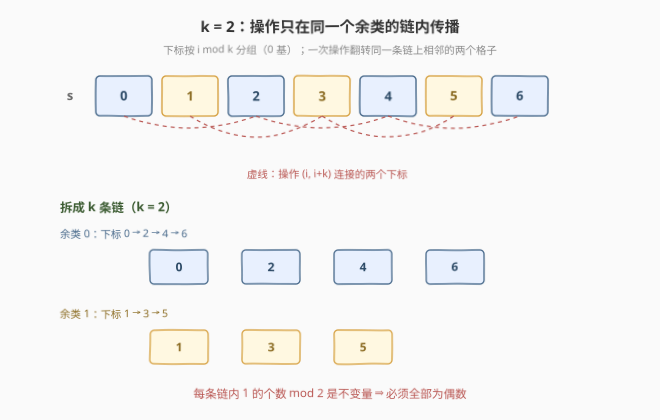
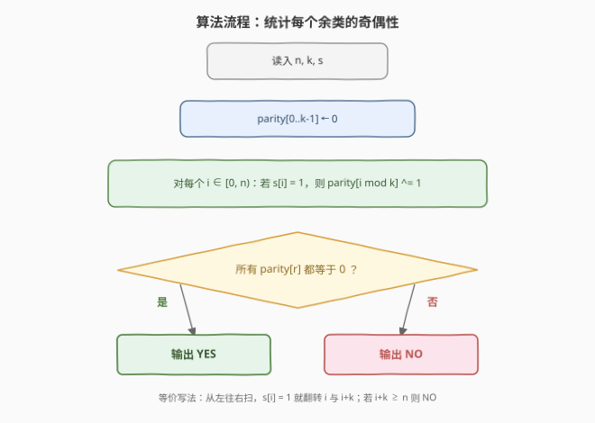
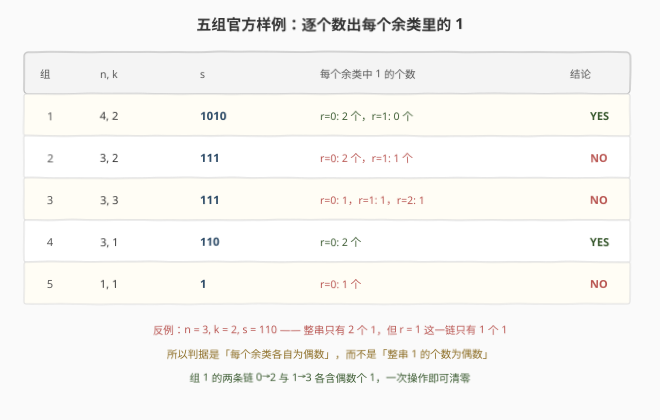

# Codeforces 2236B 鞑靼电视节目 题解

## 1. 题目概述

- **标题 / 题号**：鞑靼电视节目（Codeforces 2236B，英文名 Tatar TV Show）
- **链接**：https://codeforces.com/problemset/problem/2236/B
- **来源**：Codeforces Round 1103 (Div. 3) · Problem B（UTC 2026-06-12）
- **难度**：rating 800（800 分）
- **限制**：时间 2 s / 内存 256 MB
- **标签**：贪心、数学、字符串、奇偶性（不变量）

**题意**：给出一个长度为 $n$ 的 01 串 $s$ 和一个整数 $k$。允许任意多次操作：每次选一个下标 $i$ 满足 $1 \le i \le n-k$，把 $s_i$ 与 $s_{i+k}$ 同时取反（$0 \to 1$，$1 \to 0$）。问能否通过若干次操作把 $s$ 变成全 $0$ 串。

**约束**：

- $1 \le t \le 10^4$ 组测试，且所有测试的 $n$ 之和不超过 $2\times 10^5$；
- $1 \le k \le n \le 2\times 10^5$；
- 操作次数不限，只需判定可行性。

> 💡 注意看操作的形状：被同时翻转的两个位置**下标之差恰好是 $k$**，而且 $i$ 最大只能取到 $n-k$，也就是说这两个位置都必须在串内。这两点决定了下面「按模 $k$ 分链」的观察。
>
> 📌 为与代码一致，下文下标一律用 **0 基**：题面位置 $i$ 即下标 $i-1$，一次操作选 $i \in [0, n-k)$，翻转 $s_i$ 与 $s_{i+k}$。

## 2. 示例与观察
官方 5 组样例（输入 / 输出原样）：

```text
输入
5
4 2
1010
3 2
111
3 3
111
3 1
110
1 1
1

输出
YES
NO
NO
YES
NO
```

逐组对照（余类编号从 $0$ 开始，$r$ 类即下标满足 $i \bmod k = r$ 的那些位置）：

| 组 | $n, k$ | $s$ | 各余类中 $1$ 的个数 | 结论 |
|----|--------|-----|----------------------|------|
| 1 | $4, 2$ | `1010` | $r=0$: 下标 $0,2$ → $2$ 个；$r=1$: 下标 $1,3$ → $0$ 个 | YES |
| 2 | $3, 2$ | `111` | $r=0$: 下标 $0,2$ → $2$ 个；$r=1$: 下标 $1$ → $1$ 个 | NO |
| 3 | $3, 3$ | `111` | 三条链各 $1$ 个 | NO |
| 4 | $3, 1$ | `110` | $r=0$: $2$ 个 | YES |
| 5 | $1, 1$ | `1` | $r=0$: $1$ 个 | NO |

**补充示例（自造）**：

```text
输入
2
5 2
10001
5 2
10000

输出
YES
NO
```

第一组的 $k=2$ 两条链分别是「下标 $0,2,4$」与「下标 $1,3$」，前者有 $2$ 个 $1$（偶数）、后者为 $0$ 个，故可行：先取 $i=0$（翻转下标 $0,2$）得 `00101`，再取 $i=2$（翻转下标 $2,4$）得 `00000`。第二组 $r=0$ 这条链上只有 $1$ 个 $1$（下标 $0$），无论怎么操作都清不掉，故输出 NO。

## 3. 解题思路

### 3.1 暴力思路

最朴素的想法是直接搜：状态是一个 01 串，边是 $n-k$ 种操作（$k=n$ 时一种都没有），用 BFS 判定 $s$ 能否到达全 $0$ 状态。状态数高达 $2^n$，$n=20$ 时就已经 $10^6$ 量级，$n = 2\times10^5$ 时完全不可能。

另一个「看起来像暴力」的想法是从左到右模拟翻转：遇到 $s_i = 1$ 就执行一次 $i$ 号操作。它其实已经是对的（见 3.3），但如果不先想清楚「为什么不可能更早失败、为什么后面不会反悔」，很容易写成越界或漏判的版本。

### 3.2 核心观察：按模 $k$ 分链，链内奇偶性是不变量



把所有下标按 $i \bmod k$ 分成 $k$ 个**余类**，第 $r$ 类是一条链

$$C_r = \{\, r,\ r+k,\ r+2k,\ \dots \,\} \cap [0, n-1],\qquad r = 0,1,\dots,k-1.$$

一次操作同时翻转 $i$ 与 $i+k$，而这两个下标**同属一个余类**，且在链上**相邻**。于是：

- 操作永远不会把 $1$ 在两类之间搬运，每条链可以**独立**考虑；
- 在一条链内，每次操作同时改变两个位置的状态，因此**该链中 $1$ 的个数的奇偶性保持不变**（可能 $-2$、$0$ 或 $+2$）。

全 $0$ 状态下每条链的 $1$ 的个数都是 $0$（偶数），所以「每条链的 $1$ 的个数都是偶数」是**必要条件**。

关键是它也是**充分的**：设某条链上的下标依次为 $p_0, p_1, \dots, p_m$（$p_{j+1} = p_j + k$）。对 $j = 0,1,\dots,m-1$ 依次操作：若此刻 $p_j$ 上是 $1$，就翻转 $(p_j, p_{j+1})$。由于一切后续操作只涉及 $p_{j+1}, \dots, p_m$，$p_j$ 一旦被清零就永远保持 $0$；全部扫完后唯一可能还是 $1$ 的只有 $p_m$，而整条链的奇偶性始终不变、最终应为偶数，所以 $p_m$ 必为 $0$。这样只用了 $m$ 次以内的操作就把这条链清零了。

因此答案是干净的：**YES 当且仅当每个余类中 $1$ 的个数都是偶数。**

### 3.3 算法流程



有两种完全等价的实现，任选其一：

1. **奇偶统计（推荐）**：开一个长度为 $k$ 的数组 $parity$，扫一遍串，遇到 $s_i=1$ 就让 $parity[i \bmod k]$ 异或 $1$；最后检查 $parity$ 是否全 $0$。实现最短、常数最小，也不用真的修改字符串。
2. **贪心模拟**：从左到右扫 $i = 0 \dots n-1$。若 $s_i = 1$：当 $i + k < n$ 时翻转 $s_i$ 与 $s_{i+k}$；否则说明该位置已无法再被操作触及，直接输出 NO。扫完输出 YES。

贪心模拟之所以正确，是因为下标 $i$ 只会被「$i$ 号操作」和「$i-k$ 号操作」影响，而后者在处理到 $i$ 时早已确定；一旦处理过 $i$，之后所有操作都只动 $i$ 右侧间隔 $k$ 的位置，$s_i$ 再也不会变。所以「看到 $1$ 就必须当场消掉」是唯一选择。

### 3.4 示例演算



以第 1 组 $n=4,\ k=2,\ s=\texttt{1010}$ 为例，两条链交错排列：

| 链 | 下标（0 基） | 字符 | $1$ 的个数 | 判定 |
|----|--------------|------|------------|------|
| $r=0$ | $0,\ 2$ | `1`, `1` | $2$（偶） | 可取 $i=0$ 一次清零 |
| $r=1$ | $1,\ 3$ | `0`, `0` | $0$（偶） | 无需操作 |

操作 $i=0$ 翻转下标 $0$ 和 $2$：`1010` → `0000`，一步到位，输出 YES。

第 2 组 $n=3,\ k=2,\ s=\texttt{111}$：$r=0$ 链是下标 $0,2$（两个 $1$，偶），$r=1$ 链只有下标 $1$（一个 $1$，奇）。而下标 $1$ 只会被「$i=1$ 号操作」翻转，$i=1$ 已超出合法范围 $i \le n-k-1 = 0$，所以这个 $1$ 永远消不掉，输出 NO。第 3 组 $k=n=3$ 时三条链各只有一个下标，全是 $1$，各自为奇，同样 NO。

## 4. 算法细节

1. **下标无需换算**：0 基下标 $i \bmod k$ 与 1 基的 $(i-1) \bmod k$ 只差一个整体平移，分组结果完全一样，代码里直接用 0 基即可。
2. **数组大小**：$parity$ 只需长度 $k$；每组初始化代价 $O(k) \le O(n)$，不会破坏总复杂度。
3. **判定写法**：C++ 里用一个 `bool ok` 扫 $parity$；Python 里 `any(parity)` 或 `if 1 in parity` 都可以，遇到第一个 $1$ 就能提前退出。
4. **不必取反**：奇偶法只做一次异或，不需要写字符串；若写贪心模拟，注意要保存可写的 `std::string` 或 `char[]`。
5. **多测与 I/O**：$\sum n \le 2\times10^5$，C++ 用 `static char buf[]` 避免每组分配；Python 用 `sys.stdin.buffer.read().split()` 一次性读完再顺序取用，避免逐行 `input()` 的开销。
6. **Python 的大整数陷阱**：想用 `mask ^= 1 << (i % k)` 记录奇偶时，$k$ 可达 $2\times10^5$，每次异或都要复制约 $25$ KB 的大整数，最坏退化到 $O(nk/64)$ 而超时——必须改用 `bytearray(k)` 或长度 $k$ 的列表。
7. **链尾要特判**：$i \ge n-k$ 的位置只能被「$i-k$ 号操作」翻转，自身不能作为操作起点；贪心模拟在这里遇到 $1$ 必须立刻判 NO，而不是跳过。

## 5. 正确性证明

**引理 1（操作不跨链）**：对任意 $i \in [0, n-k)$，$i$ 与 $i+k$ 属于同一个余类；因此每条链中 $1$ 的个数的奇偶性在任意操作下不变。

**证明**：$(i+k) \bmod k = i \bmod k$，故两位置同类。操作把这两个位置的状态同时取反，该链中 $1$ 的个数变化为 $-2$、$0$ 或 $+2$，奇偶性不变。不同余类的位置不会被同一次操作同时触及，所以各链的奇偶性彼此独立地保持不变。∎

**引理 2（偶数是充分的）**：若某条链中 $1$ 的个数为偶数，则存在不超过 $m$ 次（$m$ 为该链长度减一）的操作把它清零，且这些操作都是题目允许的。

**证明**：设链上下标依次为 $p_0 < p_1 < \dots < p_m$，其中 $p_{j+1} = p_j + k$，故 $p_m \le n-1$，从而 $p_j + k = p_{j+1} \le n-1$，即 $p_j \le n-k-1$，操作 $i = p_j$ 合法。按 $j = 0, 1, \dots, m-1$ 依次执行：若 $p_j$ 当前为 $1$ 则翻转 $(p_j, p_{j+1})$，否则什么也不做。执行完第 $j$ 步后 $p_j = 0$，而后续步骤只涉及下标 $\ge p_{j+1}$ 的位置，故 $p_j$ 保持 $0$。全部执行完后 $p_0, \dots, p_{m-1}$ 皆为 $0$；由引理 1，该链中 $1$ 的个数始终是偶数，此时只剩 $p_m$ 可能为 $1$，若它为 $1$ 则总数为奇数，矛盾，故 $p_m = 0$，整条链清零。∎

**引理 3（贪心模拟与偶性判据等价）**：从左到右的贪心模拟输出 NO，当且仅当存在某个余类中 $1$ 的个数为奇数。

**证明**：模拟中下标 $i$ 在被处理时若为 $1$，要么被 $i$ 号操作连同 $i+k$ 一起清零，要么因 $i+k \ge n$ 而判 NO；之后 $s_i$ 不会再变，所以「模拟成功」等价于「每一步需要消掉的 $1$ 都能消掉」。若在第 $i$ 步失败，则 $i$ 是它所在链的最后一个下标（$i + k \ge n$）；该链中 $i$ 之前的元素都已被处理并清零，$i$ 之后又没有同类下标，故此刻该链恰好剩下 $1$ 个 $1$，是奇数。反之，若所有链都是偶数个 $1$，由引理 2 的构造可知每一步都能成功消掉，模拟不会失败。∎

**定理**：算法输出 YES 当且仅当可以把 $s$ 变成全 $0$ 串。

**证明**：必要性由引理 1（全 $0$ 时每链 $0$ 个 $1$，为偶数）。充分性由引理 2：逐条链按构造操作即可，链之间互不影响，总操作次数不超过 $\sum (|C_r| - 1) < n$。实现上，奇偶统计与贪心模拟都由引理 3 与上述构造保证正确。∎

## 6. 复杂度分析

- **时间**：每组扫一遍字符串 $O(n)$，再加一次 $O(k)$ 的判定，$k \le n$，故 $O(n)$；总计 $O(\sum n) \le O(2\times10^5)$。
- **空间**：$O(k)$ 的奇偶数组加 $O(n)$ 的输入缓冲，合计 $O(n)$，远低于 256 MB。
- **与时限的对照**：实测最坏数据（单组 $n = 2\times10^5,\ k=1$ 全 $1$；以及 $t=10^4$、每组 $n=20$ 的 $\sum n = 2\times10^5$ 数据），C++ 用时约 $4 \sim 6$ ms（含进程启动），相对 2 s 时限有三百倍以上余量；Python3 约 $40 \sim 45$ ms，同样可以直接通过，无须 PyPy。
- **正确性验证规模**：与 BFS 暴力在全枚举（$n \le 10$、所有 $k$、所有 $2^n$ 个串，共 $18434$ 组）上逐一比对，另加 $2000$ 组 $n \le 12$ 的随机数据，全部一致；贪心模拟版本也在同一批全枚举数据上比对通过。

## 7. 参考代码

### C++17

```cpp
#include <bits/stdc++.h>
using namespace std;

int main() {
    int t;
    if (scanf("%d", &t) != 1) return 0;
    while (t--) {
        int n, k;
        scanf("%d %d", &n, &k);
        static char buf[200005];
        scanf("%s", buf);

        // parity[r] = 余类 r 中 1 的个数的奇偶性
        vector<int> parity(k, 0);
        for (int i = 0; i < n; i++)
            if (buf[i] == '1') parity[i % k] ^= 1;

        bool ok = true;
        for (int r = 0; r < k; r++)
            if (parity[r]) { ok = false; break; }
        puts(ok ? "YES" : "NO");
    }
    return 0;
}
```

### Python3

```python
import sys


def main() -> None:
    data = sys.stdin.buffer.read().split()
    if not data:
        return
    t = int(data[0])
    pos = 1
    out = []
    for _ in range(t):
        n = int(data[pos]); k = int(data[pos + 1]); pos += 2
        s = data[pos]; pos += 1

        # parity[r] 记录余类 r 中 1 的个数的奇偶性
        parity = bytearray(k)
        for i in range(n):
            if s[i] == 49:  # ord('1')
                parity[i % k] ^= 1
        out.append("YES" if not any(parity) else "NO")

    sys.stdout.write("\n".join(out) + "\n")


if __name__ == "__main__":
    main()
```

## 8. 边界情况与易错点

1. **$k = n$**：每条链只有一个下标，判据退化为「串必须全 $0$」，样例 3 的 `111` 因此输出 NO；此时合法操作集合 $[0, n-k)$ 为空，不要写出空循环却输出 YES。
2. **$k = 1$**：只有一条链，判据退化为「$1$ 的总个数为偶数」，样例 4 的 `110` 可以（取 $i=0$ 得 `000`），而 `111` 不行。
3. **判据是「每个余类」而不是「整串」**：$n=3,\ k=2,\ s=\texttt{110}$ 整串有 $2$ 个 $1$（偶数），但 $r=1$ 链（下标 $1$，即题面第 $2$ 位）只有 $1$ 个 $1$，正确答案是 NO。这是本题最常见的错解来源。
4. **全 $0$ 串**：任何 $k$ 都应输出 YES（$0$ 次操作），别漏掉这个分支。
5. **$n = 1$**：唯一下标 $0$；$s = \texttt{0}$ 输出 YES，$s = \texttt{1}$ 输出 NO（样例 5）。
6. **链尾元素**：$i \ge n-k$ 的下标只能被动翻转，贪心模拟必须在遇到 $1$ 时立即判 NO，不能继续往后扫。
7. **多测清空**：奇偶数组必须每组重建；用 `static` 缓冲区时大小至少 $n+1$，且每组重新读入，避免上一组的残留字符。
8. **输出格式**：`YES`/`NO` 大小写不敏感，但不要输出 `Yes ` 之类带空格的串，也不要每组多打空行。

## 9. 验证记录

- **编译环境与命令**：`clang++ -std=c++17 -O2`（本机无 GNU g++，配 `codeforces/tools/include/bits/stdc++.h` 兼容头；正文代码只用标准库，可原样提交 GNU C++17）；Python 侧为 `Python 3.9.6`。
- **官方样例**：1 / 1 通过（按 Codeforces 标准 checker 的 token 比对，忽略空白与大小写）。
- **复核状态**：audited（2026-11-19 统一回归：编译 + 官方样例；写作期的随机对拍与暴力未重跑）。

## 相关题目与扩展

- [Codeforces 2236A. Games on the Train](https://codeforces.com/problemset/problem/2236/A)：同场 A 题，rating 800，同样是「先找不变量/最优策略再写代码」的热身题。
- [Codeforces 2236C. Omsk Programmers](https://codeforces.com/problemset/problem/2236/C)：同场 C 题，rating 1000，暴力 + 贪心 + 数学，适合接着练「小数据枚举找规律」。
- [Codeforces 2236D. Brand New Tatar TV Show](https://codeforces.com/problemset/problem/2236/D)：同场 D 题，rating 1300，构造 + 二分 + 博弈，可以和本题对照「构造题如何做合法性自检」。

**延伸思考**：

1. **最少操作次数**：把判据换成计数——每条链最少需要扫到多少个「前缀异或为 $1$」的位置，就是这条链需要的翻转次数；总数 $=\sum_r \#\{\, j : \text{链 } r \text{ 前 } j \text{ 个位置的异或为 } 1 \,\}$，一次扫描即可统计，答案不超过 $n$。
2. **把链变成环**：若允许翻转 $i$ 与 $(i+k) \bmod n$（把每条链首尾相接成环），这些「环上相邻翻转」仍然只张成「偶数个 $1$」子空间，所以判据不变——不变量相同，只是可达性论证要从链改成环。
3. **操作改成翻转整段**：若一次操作是把区间 $[i, i+k]$ 的 $k+1$ 个位置全部取反，本题的链分解失效，应改用差分数组/前缀异或刻画不变量，属于另一类「区间翻转」套路。
4. **加权版本**：每次翻转 $(i, i+k)$ 有代价 $w_i$，求清零的最小总代价。各条链仍然独立，链上是「选一组相邻对使得异或结果匹配」，可以按位置做 $2$ 状态的线性 DP（或视作路径图上的最小权 $T$-join），复杂度仍是 $O(n)$。
