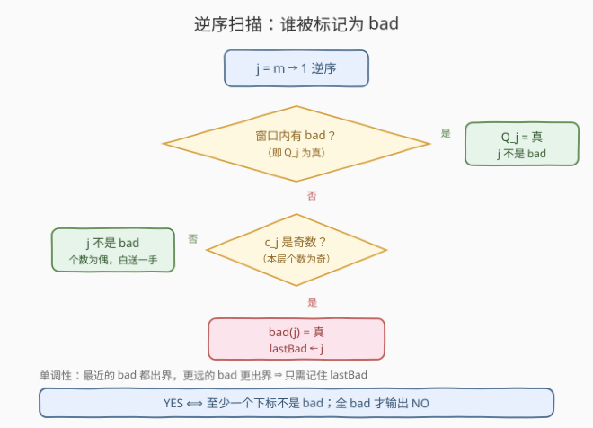
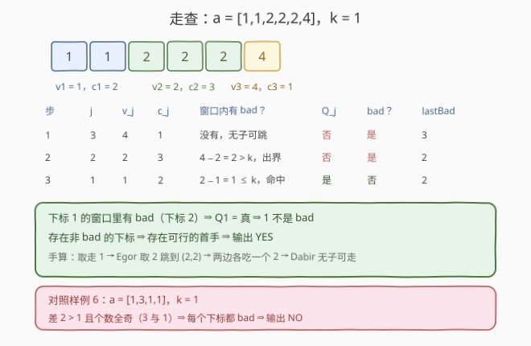

# Codeforces 2236D 全新鞑靼电视节目 题解

## 1. 题目概述

- **标题 / 题号**：全新鞑靼电视节目（Codeforces 2236D，英文名 Brand New Tatar TV Show）
- **链接**：https://codeforces.com/problemset/problem/2236/D
- **来源**：Codeforces Round 1103 (Div. 3) · Problem D
- **难度**：1300
- **限制**：时间 2 s / 内存 256 MB
- **标签**：博弈论，动态规划，二分，构造，数学

**题意**：给定长度 $n$ 的数组 $a$ 与整数 $k$，两人玩取数游戏。第一手可以取走任意一个元素；设上一个被取走的值为 $x$，之后每一手必须取走一个**剩余**的 $y$ 且满足 $0 \le y - x \le k$，取走它之后 $x$ 更新为 $y$。无子可走者输。原本是 Dabir 先手，但嘉宾 Arseniy 顶替他走**第一手**——此后仍按 Egor、Dabir、Egor、Dabir…… 的顺序交替。问：是否存在 Arseniy 的第一手，使得**无论 Dabir 之后怎么走，Egor 都能获胜**？输出 `YES` / `NO`。

换句话说：枚举 Arseniy 取走的那一个元素，判断剩下的局面在「轮到 Egor 先走」时是否是**先手必胜**；只要有一个元素满足就输出 `YES`。

**约束**：

- $1 \le t \le 10^4$，$1 \le n, k \le 2\times 10^5$，且 $\sum n \le 2\times 10^5$；
- $1 \le a_i \le n$，值域被 $n$ 卡死，因此可以直接开桶计数，不必排序；
- 单组需要 $O(n \log n)$ 以内，总量必须做到 $O(\sum n)$；
- 博弈状态是指数级的，必须先把局面压缩到常数维，再找解析判据。

## 2. 示例与观察
官方样例（输入 / 输出原样，共 7 组）：

```text
输入
7
5 1
3 3 3 3 3
3 1
1 1 2
2 2
2 1
4 1
3 3 3 3
4 3
2 2 2 1
4 1
1 3 1 1
5 1
5 1 5 1 5
```

```text
输出
NO
YES
YES
YES
YES
NO
YES
```

把每组按答案的判据拆开看，规律一目了然：

| # | $n,k$ | 数组 | 不同值（个数） | 判据 | 答案 |
|---|-------|------|----------------|------|------|
| 1 | 5, 1 | 3 3 3 3 3 | 3 (5) | 个数全奇、无相邻对 | NO |
| 2 | 3, 1 | 1 1 2 | 1 (2), 2 (1) | 值 1 的个数是偶数 | YES |
| 3 | 2, 2 | 2 1 | 1 (1), 2 (1) | 相邻差 $1 \le 2$ | YES |
| 4 | 4, 1 | 3 3 3 3 | 3 (4) | 值 3 的个数是偶数 | YES |
| 5 | 4, 3 | 2 2 2 1 | 1 (1), 2 (3) | 相邻差 $1 \le 3$ | YES |
| 6 | 4, 1 | 1 3 1 1 | 1 (3), 3 (1) | 差 $2 > 1$ 且个数全奇 | NO |
| 7 | 5, 1 | 5 1 5 1 5 | 1 (2), 5 (3) | 值 1 的个数是偶数 | YES |

**自造示例**（用于 §3.4 的走查，非官方）：

```text
输入
1
6 1
1 1 2 2 2 4
```

```text
输出
YES
```

## 3. 解题思路

### 3.1 暴力思路

最直接的做法是记忆化搜索：状态写成「剩余多重集 + 当前值 $x$」。剩余多重集有 $O(2^n)$ 种，$n=2\times 10^5$ 时连存都存不下；即使 $n=20$ 也只有 $t$ 很小时才跑得完。而且本题还要对「第一手取哪个」再枚举一遍，代价翻倍。

真正的障碍不是状态多，而是**没有发现每次落子的单调性**——数组的下标顺序根本无关，只有「大小」在起作用。

### 3.2 核心观察：单调性把局面压成两维


设当前值为 $x$。规则要求 $y \ge x$，于是：

1. 被取出的值序列**单调不减**，且每一步的增幅不超过 $k$；
2. 一旦当前值升到 $x$，所有严格小于 $x$ 的元素**永远不会再被取**——它们永久死亡；
3. 更狠的是，从 $v_j$ 一步跳到 $v_l$ 时，中间那些 $v_{j+1},\dots,v_{l-1}$ 也一并死亡，因为当前值已经越过它们了。

把数组排序去重，得到 $v_1 < v_2 < \dots < v_m$，对应个数 $c_1,\dots,c_m$。于是局面只剩两维 $(j, r)$：

- $j$：当前值就是 $v_j$；
- $r$：$v_j$ 还剩 $r$ 个；
- 所有下标 $> j$ 的值**一个都没动过**，全部满员。

设 $R_j$ 为最大的 $l$ 使 $v_l - v_j \le k$（若 $v_{j+1} - v_j > k$ 则不存在这样的 $l$）。注意 $R_j$ 单调不减，可以用双指针，但下文会看到**根本不需要显式求出它**。

### 3.3 状态转移与逆序扫描



记 $g(j,r)$ 为「当前玩家在局面 $(j,r)$ 是否必胜」。轮到的玩家只有两类走法：

- **吃本层**：$r \ge 1$ 时取走一个 $v_j$，局面变成 $(j, r-1)$；
- **跳层**：取走 $v_l$（$j < l \le R_j$），对手面对 $(l, c_l - 1)$。

记 $B_l = g(l, c_l-1)$ 为「对手接手后是否必胜」，再令

$$Q_j = \bigl[\ \exists\, l \in (j, R_j],\ B_l = \text{false}\ \bigr].$$

于是

$$g(j,0) = Q_j,\qquad g(j,r) = Q_j \lor \lnot g(j, r-1)\ \ (r \ge 1).$$

- 若 $Q_j$ 为真：直接把局面扔给对手一个必败态，一步制胜，故 $g(j,r)$ 对一切 $r \ge 0$ 恒真；
- 若 $Q_j$ 为假：跳过去全是送，只能一层层吃，$g(j,0)=\text{false}$ 故 $g(j,r) = [r \text{ 为奇数}]$。

把 $r = c_j - 1$ 代进去：

$$B_j = Q_j \lor [c_j \text{ 为偶数}].$$

**定义 1**：称下标 $j$ 是 **bad** 的，若 $B_j = \text{false}$，即

$$\text{bad}(j) \iff \lnot Q_j \land c_j \text{ 为奇数}.$$

于是 $Q_j$ 恰好等于「窗口 $(j, R_j]$ 内存在 bad 的下标」。

**单调性省掉二分**：下标越大值越大，所以如果**离 $j$ 最近的那个 bad** 都已经满足 $v_{\text{bad}} - v_j > k$，更靠右的 bad 只会更远，全部出界。因此只需在逆序扫描时维护「右侧最近的 bad」这个下标 `lastBad`，每组 $O(m)$。

**答案**：Arseniy 取走值 $v_i$ 后，Egor 面对局面 $(i, c_i-1)$，Egor 必胜当且仅当 $B_i$ 为真，即 $i$ **不是** bad。所以

$$\text{YES} \iff \exists\, i,\ \lnot\,\text{bad}(i).$$

### 3.4 示例演算



取自造示例 $a = [1,1,2,2,2,4]$、$k = 1$：去重后 $v = (1,2,4)$，$c = (2,3,1)$，相邻差 $1, 2$，窗口 $R_1 = 2$（$2-1=1\le 1$，而 $4-1=3>1$），$R_2 = 2$（$4-2=2>1$）。

逆序扫描：

| 步 | $j$ | $v_j$ | $c_j$ | `lastBad` 是否在窗口内 | $Q_j$ | $\text{bad}(j)$ | 新的 `lastBad` |
|----|-----|-------|-------|------------------------|-------|------------------|----------------|
| 1 | 3 | 4 | 1 | 无 | 否 | 是（奇且不可跳） | 3 |
| 2 | 2 | 2 | 3 | $4-2=2>1$，出界 | 否 | 是（奇且不可跳） | 2 |
| 3 | 1 | 1 | 2 | $2-1=1\le 1$，命中 | 是 | 否（能跳到必败态） | 2 |

第 3 步 $Q_1$ 为真，下标 1 不是 bad，故输出 `YES`。实打实走一遍：Arseniy 取走一个 $1$，剩下 $[1,2,2,2,4]$ 且 $x=1$，轮到 Egor。$v_2 = 2$ 与 $x$ 相差 $1 \le k$，Egor 立刻**跳层**取走一个 $2$，把局面 $(2,2)$ 扔给 Dabir（这正是 $B_2=\text{false}$，即 $Q_1$ 为真的来源）。之后只剩「吃本层」：Dabir 吃一个 $2$、Egor 再吃一个 $2$，$x$ 停在 $2$ 而 $4-2=2>k$，Dabir 无子可走，Egor 胜。

## 4. 算法细节

1. **桶计数代替排序**：由 $a_i \le n$，开 `cnt[n+1]` 统计每个值出现次数，$O(n)$ 完成「去重 + 计数」，比 `sort + 压缩` 更短更快。
2. **只比较相邻的存在值**：判断「存在相邻差 $\le k$」时，用 `last` 记录扫到的上一个**出现过**的值，遇到新值就比对 `v - last <= k`；不需要真的建出去重数组。
3. **偶数个数优先**：只要某个 $c_v$ 为偶数就立刻可以判定 `YES`——此时 $r=c_v-1$ 为奇数，即使 $Q$ 为假，Egor 也能靠「一层层吃」拿下奇偶，不必再看差值。
4. **两个条件任一成立即 `YES`**，都失败才 `NO`；实现上用一个 `ok` 布尔量累积，扫完输出。
5. **多测清桶**：每组新建 `vector<int>(n+1, 0)`；因为 $\sum n \le 2\times 10^5$，总分配量是线性的，不会退化。
6. **快速读入**：$t$ 可达 $10^4$、总元素 $2\times 10^5$，`scanf` 或关闭同步的 `cin` 都够；Python 用 `sys.stdin.buffer.read().split()` 一次性读完。
7. **不需要显式求 $R_j$、也不需要二分**：最近的 bad 出界就等价于「窗口内没有 bad」，这一条把二分/双指针全省了。
8. **不要真去模拟博弈**：状态是 $(j,r)$ 两维、转移带跳跃，直接写记忆化在 $n=2\times 10^5$ 时既超时又超内存。
9. **结论已对拍**：用记忆化搜索的暴力博弈器对「$n\le 7$ 且值域 $\le 4$ 的全部多重集（1212 组，含 $k=1,2,3,4$）」以及 1720 组随机小数据做了比对，判定式与暴力完全一致。

## 5. 正确性证明

**引理 1（状态压缩）**：任意时刻的局面由 $(j, r)$ 唯一确定，其中 $v_j$ 是当前值、$r$ 是 $v_j$ 的剩余个数。

**证明**：由规则 $y \ge x$，当前值单调不减，故所有小于 $v_j$ 的元素（包括被跳过而作废的中间值）都不可能再被取走，对后续走法没有任何影响；所有大于 $v_j$ 的值从未被取过，个数仍是 $c_l$。因此剩余可用信息只有 $v_j$ 还剩几个，即 $r$。∎

**引理 2（转移）**：$g(j,0) = Q_j$；且 $Q_j$ 为真时 $g(j,r)$ 对一切 $r\ge 0$ 为真，$Q_j$ 为假时 $g(j,r) = [r \text{ 为奇数}]$。

**证明**：对 $r$ 归纳。$r=0$ 时只能跳层，跳到 $l$ 后对手面对 $B_l$，故当前玩家必胜当且仅当存在 $B_l$ 为假的 $l$，即 $Q_j$，得 $g(j,0)=Q_j$。设 $r\ge 1$ 且结论对 $r-1$ 成立。走法集合为 $\{(j,r-1)\}\cup\{(l,c_l-1): j<l\le R_j\}$；若 $Q_j$ 真，取某个 $B_l$ 为假的 $l$ 一跳即胜，故 $g(j,r)$ 真；若 $Q_j$ 假，所有跳层都给对手必胜态，唯一有意义的是吃本层，$g(j,r) = \lnot g(j,r-1)$，由归纳假设 $g(j,r-1)=[r-1\text{ 为奇数}]$，取反即 $[r\text{ 为奇数}]$。∎

**引理 3（首手判据）**：Arseniy 取走值 $v_i$ 的一个元素后 Egor 必胜，当且仅当 $B_i$ 为真。

**证明**：取走后局面对 Egor 而言是 $(i, c_i-1)$，其胜负值正是定义中的 $B_i = g(i,c_i-1)$；Egor 是先手方，必胜即该值为真。∎

**引理 4（bad 的等价刻画）**：所有下标都是 bad，当且仅当**每个 $c_i$ 都是奇数**且**任意相邻两个不同值之差都 $> k$**。

**证明**：
（$\Leftarrow$）若相邻差全 $>k$，则任何 $j$ 都没有可跳的 $l$，$Q_j$ 全为假；又 $c_j$ 全为奇数，由定义 $\text{bad}(j)$ 全为真。
（$\Rightarrow$）设所有下标都是 bad。由定义 bad 蕴含 $c_j$ 为奇数，得前半。若某个相邻差 $v_{i+1}-v_i \le k$，由于 $i+1$ 也是 bad，它落在 $i$ 的窗口内，于是 $Q_i$ 为真，$i$ 不是 bad，与全 bad 矛盾；故所有相邻差都 $>k$。∎

**定理（答案判定）**：输出 `YES` 当且仅当「存在某个值出现偶数次」或「存在两个相邻的不同值之差 $\le k$」。

**证明**：由引理 3，`YES` $\iff$ 存在非 bad 下标 $\iff$ 并非全 bad。由引理 4，全 bad $\iff$ 所有个数为奇数且所有相邻差 $>k$，取反即得结论。两个条件的判定分别由桶计数的奇偶性与一次扫描完成，与 $\text{bad}$ 的递推完全等价。∎

## 6. 复杂度分析

- **时间**：每组桶计数 $O(n)$，一次 $1..n$ 扫描 $O(n)$，合计 $O(n)$；总计 $O(\sum n) \le 2\times 10^5$ 次基本运算，与 $k$、值域大小无关。
- **空间**：桶数组 $O(n)$，外加若干整型变量；$\max n = 2\times 10^5$ 时不到 1 MB，远低于 256 MB。
- **实测**（Apple clang 21 `-O2`，限时 2 s）：$n=2\times 10^5$ 随机重复值、$n=2\times 10^5$ 且 $k=n$、$n=2\times 10^5$ 全不同值链、$t=10^4$ 组各 $n=20$、两段等值块这五种极端，C++ 墙钟（含进程启动，五次取中位数）11–19 ms，相对 2 s 余量约 100 倍。
- **Python3** 同规模墙钟 59–84 ms，余量约 25 倍，2 s 内可过；若评测机较慢，仍建议交 PyPy 或 C++。

## 7. 参考代码

### C++17

```cpp
#include <bits/stdc++.h>
using namespace std;

int main() {
    int T;
    if (scanf("%d", &T) != 1) return 0;
    while (T--) {
        int n, k;
        scanf("%d %d", &n, &k);
        vector<int> cnt(n + 1, 0);          // a_i <= n，直接开桶
        for (int i = 0; i < n; i++) { int x; scanf("%d", &x); cnt[x]++; }

        bool ok = false;
        int last = 0;                       // 上一个出现过的值
        for (int v = 1; v <= n; v++) {
            if (cnt[v] == 0) continue;
            if (cnt[v] % 2 == 0) ok = true;          // 条件一：偶数个
            if (last != 0 && v - last <= k) ok = true; // 条件二：相邻差 <= k
            last = v;
        }
        puts(ok ? "YES" : "NO");
    }
    return 0;
}
```

### Python3

```python
import sys


def main() -> None:
    data = sys.stdin.buffer.read().split()
    t = int(data[0])
    pos = 1
    out = []
    for _ in range(t):
        n = int(data[pos]); k = int(data[pos + 1]); pos += 2
        cnt = [0] * (n + 1)
        for x in data[pos:pos + n]:
            cnt[int(x)] += 1
        pos += n

        ok = False
        last = 0
        for v in range(1, n + 1):
            if cnt[v] == 0:
                continue
            if cnt[v] % 2 == 0:          # 条件一：某值出现偶数次
                ok = True
            if last and v - last <= k:   # 条件二：相邻不同值之差 <= k
                ok = True
            last = v
        out.append("YES" if ok else "NO")
    sys.stdout.write("\n".join(out) + "\n")


main()
```

## 8. 边界情况与易错点

1. **$n=1$**：Arseniy 取走唯一元素后 Egor 无子可走，必须输出 `NO`。此时桶里唯一的值个数为 1（奇数）、也没有相邻对，两个条件都不成立，程序自然给出 `NO`。
2. **只有一个不同值**：答案只由总个数奇偶决定——奇数个是 `NO`（样例 1），偶数个是 `YES`（样例 4）。原因很直白：Arseniy 拿一个后总数少 1，总数为偶则剩奇数个，先手 Egor 恰好收尾；总数为奇则剩偶数个，轮到 Dabir 收尾。
3. **相邻差恰好等于 $k$**：条件闭区间 $0 \le y - x \le k$，`v - last <= k` 必须带等号；写成 `< k` 时 $k=1$、$a=[1,2]$ 这种「差恰好等于 $k$」的输入会被误判成 `NO`。
4. **值域用 $n$**：题目保证 $a_i \le n$，桶开 `n+1` 即可；若你的生成器造了 $a_i > n$ 的数据，会越界——这不是合法输入。
5. **答案是 `NO` 的充分条件别写反**：需要「个数全奇」**且**「所有相邻差 $>k$」同时成立才 `NO`；只满足一半（例如个数全奇但有一对相邻值靠得近）应当是 `YES`。
6. **多测清状态**：`ok`、`last` 每组都必须重新初始化；桶每组重建，不要复用上一组的 `cnt`。
7. **$k$ 大不等于 `YES`**：只有当 $k \ge \max a - \min a$ 且至少有两个不同值时，最近的一对相邻不同值之差才必然 $\le k$，此时答案必为 `YES`；「$k$ 看起来不小」并不够——样例 6 里 $k=1$、$1$ 与 $3$ 相差 $2$，一步都跳不过去，于是 `NO`。
8. **输出大小写**：`YES` / `NO` 任意大小写均可，但整行不要带多余空格。

## 9. 验证记录

- **编译环境与命令**：`clang++ -std=c++17 -O2`（本机无 GNU g++，配 `codeforces/tools/include/bits/stdc++.h` 兼容头；正文代码只用标准库，可原样提交 GNU C++17）；Python 侧为 `Python 3.9.6`。
- **官方样例**：1 / 1 通过（按 Codeforces 标准 checker 的 token 比对，忽略空白与大小写）。
- **复核状态**：audited（2026-11-19 统一回归：编译 + 官方样例；写作期的随机对拍与暴力未重跑）。

## 相关题目与扩展

- [Codeforces 1382B. Sequential Nim](https://codeforces.com/problemset/problem/1382/B)：同样是「一旦出现可自主决策的位置，胜负就退化为奇偶」的结构，可与本文 $Q_j$ 为假时的 $g(j,r)=[r\text{ 奇}]$ 对照。
- [Codeforces 1033C. Permutation Game](https://codeforces.com/problemset/problem/1033/C)：在 DAG 上做胜负 DP 的模板，与本文 $g$ 的递推同构，可用来熟悉「必胜 = 存在一步到必败」。
- [LeetCode 292. Nim 游戏](https://leetcode.cn/problems/nim-game/)：纯奇偶博弈的最小模型，适合先热身再读本题的 bad 定义。

**延伸思考**：

- 若改问「Dabir 先手时是否必胜」，答案变成是否存在 $i$ 使 $A_i = Q_i \lor [c_i\text{ 奇}]$ 为真，只把判断里的奇偶翻一位，其余推导不变。
- 若把规则换成 $|y-x| \le k$（可上可下），单调性消失，$(j,r)$ 的两维压缩失效，需要按「区间 + 剩余元素」设计更重的状态，本题的 $O(n)$ 结论不再成立。
- 若要求数出「有多少个首手能保证 Egor 胜」，就是数非 bad 下标的总数；只需把 `ok` 换成一个计数器，仍 $O(n)$。
- 若允许一次取走多张（$\le m$ 张），游戏蜕变为减法博弈，胜负由 $m+1$ 的模决定，与值的大小关系脱钩。
