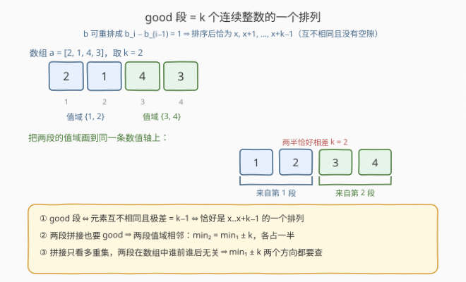
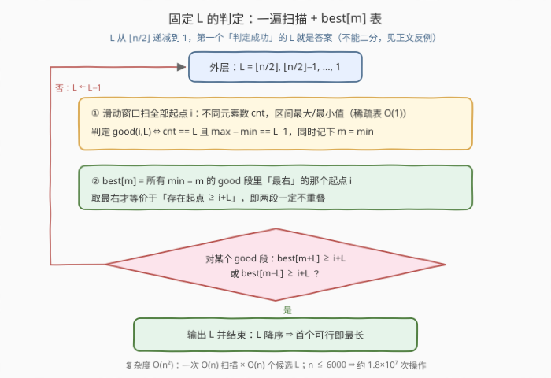
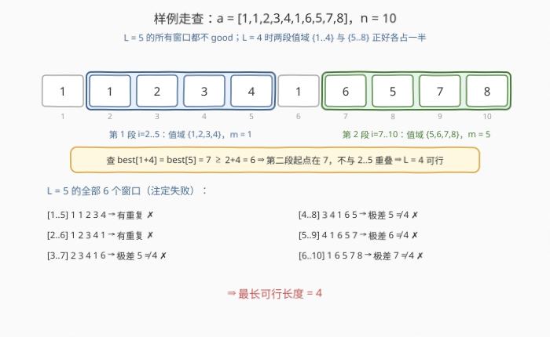

# Codeforces 2236E 友好的礼物 题解

## 1. 题目概述

- **标题 / 题号**：友好的礼物（Codeforces 2236E，英文名 Friendly Gifts）
- **链接**：https://codeforces.com/problemset/problem/2236/E
- **来源**：Codeforces Round 1103 (Div. 3) · Problem E
- **难度**：1700
- **限制**：时间 3 s / 内存 512 MB
- **标签**：暴力枚举、动态规划（值域 → 最优起点的 DP 表）、滑动窗口、稀疏表（RMQ）

**题意**：数组 $b$ 称为**好数组**，若它的元素可以重新排列，使对一切 $i>1$ 有 $b_i-b_{i-1}=1$。给定长度 $n$ 的数组 $a$，要求切出**两个不重叠、等长**的子段（连续子数组），满足：

1. 两段各自是好数组；
2. 把它们首尾拼接后的数组仍然是好数组。

求这个长度的最大值；切不出来输出 $0$。

**约束**：

- $1 \le t \le 1000$，$1 \le n \le 6000$，$\sum n \le 6000$；
- $1 \le a_i \le n$——值域与 $n$ 同阶，所有「按值域开数组」的做法都依赖它；
- 答案不超过 $\lfloor n/2 \rfloor$，因为两段等长且不重叠。

## 2. 示例与观察
**官方样例**

```text
输入
7
1
1
2
1 2
3
2 1 1
4
2 1 4 3
5
1 2 4 5 3
6
3 2 1 6 5 4
10
1 1 2 3 4 1 6 5 7 8

输出
0
1
1
2
1
3
4
```

- 第 1 组：$n=1$，两段各长 $\ge 1$ 且不重叠，不可能，答案 $0$。
- 第 2 组：取 $[1]$ 与 $[2]$，拼接后 $\{1,2\}$ 连续，答案 $1$。
- 第 3 组：取位置 $1$ 的 $2$ 与位置 $2$ 的 $1$，答案 $1$；注意第三个数也是 $1$，两段不能共用位置。
- 第 4 组：$[2,1]$ 与 $[4,3]$，值域 $\{1,2\}$、$\{3,4\}$ 相邻，答案 $2$。
- 第 5 组：长度 $2$ 的窗口只有 $[1,2],[2,4],[4,5],[5,3]$，好段只有 $[1,2]$ 与 $[4,5]$，二者值域不相邻，也找不到 $\{2,3\}$ 或 $\{3,4\}$ 与之配对，故答案 $1$。
- 第 6 组：$[3,2,1]$（值域 $1..3$）与 $[6,5,4]$（值域 $4..6$），答案 $3$。
- 第 7 组：$i=2..5$ 的 $[1,2,3,4]$ 与 $i=7..10$ 的 $[6,5,7,8]$，答案 $4$。

**自造样例**（说明「长度可行」并**不单调**，不能二分）

```text
输入
1
6
3 1 2 5 6 4

输出
3
```

$L=3$ 时 $[3,1,2]$ 值域 $1..3$、$[5,6,4]$ 值域 $4..6$，可行；但 $L=2$ 时长度为 $2$ 的窗口只有 $\{1,2\}$（$i=2..3$）与 $\{5,6\}$（$i=4..5$），二者值域不相邻，且没有 $\{3,4\}$ 窗口，所以 $L=2$ 不可行。答案 $3$。

## 3. 解题思路

### 3.1 暴力思路

枚举两段的长度 $k$、两个起点 $i<j$（要求 $j \ge i+k$），共 $O(n^3)$ 组；每组再排序判定是否好段、拼接是否好段，额外 $O(k \log k)$。$n=6000$ 时是 $10^{11}$ 量级，完全不可行。

即使用「元素互不相同且极差等于长度减一」把单组判定降到 $O(1)$，$O(n^3)$ 仍然是 $2\times 10^{11}$ 次操作。必须把枚举压到 $O(n^2)$。

### 3.2 核心观察：好段就是「一段连续整数的排列」



**观察 1**：$b$ 是好数组，当且仅当 $b$ 的元素集合恰好是 $\{x, x+1, \dots, x+k-1\}$（$k=\lvert b\rvert$）。因为重排后每步 $+1$，排序后就只能是公差为 $1$ 的等差数列，于是 $k$ 个值互不相同且无空隙。

**观察 2**：两段各自是好数组、拼接后整体也是好数组。设两段值域分别是 $[x, x+k-1]$ 与 $[y, y+k-1]$。拼接后的多重集有 $2k$ 个元素且必须是 $2k$ 个连续整数，所以两段值域不能重叠，只能首尾相接：$y = x+k$（或对称地 $x = y+k$）。**谁在数组中靠前无关**，因为拼接只看多重集。

于是问题变成：求最大的 $L$，使存在两个不重叠、长度为 $L$ 的段，它们的值域分别为 $[x, x+L-1]$ 与 $[x+L, x+2L-1]$（顺序任意）。

**观察 3**：长度为 $L$、起点为 $i$ 的段是「好段」，当且仅当

$$\text{段内元素互不相同} \quad\text{且}\quad \max - \min = L-1$$

两个条件缺一不可：互不相同保证不重复，「极差 $=L-1$ 且共 $L$ 个不同值」保证值域被打满，没有空隙。$L=1$ 时极差为 $0$，自动成立。

### 3.3 算法流程：按 $L$ 降序 + best 表



**不能二分**：可行长度关于 $L$ 并不单调（见 §2 自造样例），所以直接**从 $\lfloor n/2\rfloor$ 往下枚举 $L$**，第一个判定成功的 $L$ 就是答案。

对固定 $L$，只需一次 $O(n)$ 扫描：

1. 滑动窗口维护窗口内不同元素个数 $\text{cnt}$，再用稀疏表 $O(1)$ 取区间最小/最大值；若 $\text{cnt}=L$ 且 $\max-\min=L-1$，就把起点 $i$ 标为「好段」，并记 $m=\min$。
2. 建 DP 表 $best[m]$：所有最小值等于 $m$ 的好段中**最靠右**的起点。取最右是关键——只有「存在起点 $\ge i+L$」才等价于「$best[m] \ge i+L$」。
3. 对每个好段 $(i, m)$ 查 $best[m+L] \ge i+L$ 或 $best[m-L] \ge i+L$（两个方向分别对应「本段是下半段」与「本段是上半段」）。命中即输出 $L$。

总复杂度 $O(n^2)$；$\sum n \le 6000$，最坏约 $1.8\times 10^7$ 次窗口判定。

### 3.4 示例演算



以第 7 组 $a=[1,1,2,3,4,1,6,5,7,8]$ 为例：

- $L=5$：$6$ 个窗口全部失败（前两个有重复，后四个极差大于 $4$），没有好段。
- $L=4$：好段有 $i=2$（$[1,2,3,4]$，$m=1$）、$i=3$（$[2,3,4,1]$，$m=1$）、$i=7$（$[6,5,7,8]$，$m=5$）。$best[5]=7$，对 $i=2$ 检查 $best[1+4]=7 \ge 2+4=6$，命中，答案 $4$。
- 注意 $i=2$ 与 $i=3$ 都取到同一个 $best[5]$，说明「best 取最右」正好覆盖了「后面还有很多候选」的情况。

## 4. 算法细节

1. **好段的判定顺序**：先看窗口内不同元素个数是否等于 $L$（等价于「段内互不相同」），再看极差。两个条件都要写成整数比较（`distinct == L && hi - lo == L-1`），不要用「元素和相等」之类的必要条件替代——如 $\{1,2,3,4,10\}$ 与 $\{2,3,4,5,6\}$ 的元素和都是 $20$，但前者不是好段，而「互不相同 + 极差」是充要的。
2. **distinct 的维护**：值域是 $[1, n]$，开 $n+1$ 大小的计数数组，滑出窗口时 `--cnt[a[i-1]]`，滑入时 `++cnt[a[i+L-1]]`，只有计数从 $0$ 变 $1$ 或从 $1$ 变 $0$ 时才动 distinct。每个 $L$ 开头要把计数数组清空，用 `fill` 而不是 `memset`（$n$ 只有 $6000$，两种都行）。
3. **极值查询**：稀疏表 $st[k][i]$ 预处理 $O(n\log n)$、单次查询 $O(1)$；也可以对每个 $L$ 用单调队列维护，代码更省内存但常数更大，这里选稀疏表。
4. **best 表的清空与更新**：每个 $L$ 新建 `best`（初值 $-1$），按起点 $i$ **递增**顺序写入 `best[mnv[i]] = i`，后写自动覆盖先写，天然得到「最右起点」，不需要额外取 $\max$。
5. **两个方向都要查**：本段可能在下半段（查 $best[m+L]$）也可能在上半段（查 $best[m-L]$）。只写一边会出错：只查 $m+L$ 会把第 3 组判成 $0$，只查 $m-L$ 会把第 4 组判成 $0$。同时要判 $m+L \le n$ 与 $m-L \ge 1$，防止值域越界。
6. **枚举上界**：$L$ 从 $\lfloor n/2\rfloor$ 开始，因为两段等长且不重叠。$n<2$ 直接输出 $0$，避免稀疏表建表时越界。
7. **多测**：$\sum n \le 6000$，所以每个测试用例单独建稀疏表即可，总时间被 $\sum O(n^2)$ 卡住；不要写 $O(\max n)$ 的全局预处理，否则 $t=1000$ 时会白跑。
8. **DP 视角**：$best$ 本质上是「以值域左端点 $m$ 为状态、存最优（最右）起点」的转移表，这也是本题被打上 dp 标签的原因——枚举 $L$ 是外层，$best$ 是内层状态。

## 5. 正确性证明

**引理 1**：$b$ 是好数组 $\iff$ $b$ 的元素集合为 $\{x, x+1, \dots, x+k-1\}$，其中 $k=\lvert b\rvert$。

**证明**：若可重排成 $b_i-b_{i-1}=1$，则重排后严格递增、公差 $1$，故元素为 $x, x+1, \dots, x+k-1$。反之若元素集合为该区间，按其自然顺序排列即满足条件。∎

**引理 2**：两段长 $L$ 的段 $A, B$ 各自是好数组且 $A$ 拼 $B$ 也是好数组，当且仅当二者的值域为 $[x, x+L-1]$ 与 $[x+L, x+2L-1]$（顺序可交换）。

**证明**：由引理 1，$A$ 的值域是长度 $L$ 的连续区间 $I_A$，$B$ 的是 $I_B$。拼接后是好数组，说明多重集 $A \cup B$ 恰是长度 $2L$ 的连续区间 $I$，即 $I = I_A \cup I_B$ 且 $\lvert I\rvert = 2L$。若 $I_A \cap I_B \ne \varnothing$，则并集大小小于 $2L$，矛盾；故 $I_A, I_B$ 不交且都落在 $I$ 内，各自长度 $L$，只能把 $I$ 从中间劈开，即 $I_A, I_B$ 相差 $L$。∎

**引理 3**：固定 $L$，$i$ 被判为好段 $\iff$ 段 $a[i..i+L-1]$ 的元素集合是某个长度 $L$ 的连续区间。

**证明**：($\Leftarrow$) 连续区间内元素互不相同，极差为 $L-1$，判定通过。($\Rightarrow$) 判定通过说明有 $L$ 个互不相同的值落在 $[\min, \max]$ 且该区间长度恰为 $L$，故这 $L$ 个值正好填满 $[\min,\max]$。∎

**引理 4**：固定 $L$ 时，判定「存在合法段对」$\iff$ 存在好段 $(i,m)$ 使 $best[m+L] \ge i+L$ 或 $best[m-L] \ge i+L$。

**证明**：($\Leftarrow$) 设 $j = best[m+L] \ge i+L$，则 $j$ 段是好段且 $m+L$ 是其最小值，由引理 3 其值域为 $[m+L, m+2L-1]$，与 $i$ 段的 $[m, m+L-1]$ 相邻；又 $j \ge i+L$ 说明两段不重叠，由引理 2 合法。$best[m-L]$ 的情形对称。($\Rightarrow$) 设合法段对为 $i$ 段（最小值 $m$）与 $j$ 段（$j \ge i+L$）。由引理 2，$j$ 段的最小值必为 $m+L$ 或 $m-L$，于是 $best[m \pm L] \ge j \ge i+L$。∎

**定理**：算法输出的 $L^{*}$ 是最长可行长度；若不存在可行段对则输出 $0$。

**证明**：外层 $L$ 从 $\lfloor n/2\rfloor$ 递减，由引理 4 判定精确，故第一个通过判定的 $L$ 满足「它可行且所有更大的 $L$ 都不可行」，即最大可行长度。若循环结束仍无可行 $L$，则任何长度都不可行，输出初值 $0$ 正确。∎

## 6. 复杂度分析

- **时间**：每个测试用例 $O(n^2)$。稀疏表 $O(n\log n)$；外层 $\lfloor n/2\rfloor$ 个 $L$，每个 $L$ 做一次 $O(n)$ 的滑动窗口扫描、一次 $O(n)$ 建 $best$、一次 $O(n)$ 配对检查。由于 $\sum n \le 6000$，总工作量不超过 $\sum n^2/2 \le 1.8\times 10^7$ 次窗口判定；实测 $n=6000$ 的最坏数据 C++ 约 $0.03\sim0.07$ s，相对 $3$ s 时限有 $40$ 倍以上余量。
- **空间**：$O(n\log n)$，主要是两张稀疏表（$2\times 6000\times 13$ 个 `int`，约 $600$ KB）；其余 `cnt / valid / mnv / best` 都是 $O(n)$。

## 7. 参考代码

### C++17

```cpp
#include <bits/stdc++.h>
using namespace std;

int main() {
    int T;
    if (scanf("%d", &T) != 1) return 0;
    while (T--) {
        int n;
        scanf("%d", &n);
        vector<int> a(n);
        for (int i = 0; i < n; i++) scanf("%d", &a[i]);

        int ans = 0;
        if (n >= 2) {
            // 稀疏表：区间最小 / 最大值
            int K = 1;
            while ((1 << K) <= n) K++;
            vector<vector<int>> stMin(K, vector<int>(n)), stMax(K, vector<int>(n));
            for (int i = 0; i < n; i++) stMin[0][i] = stMax[0][i] = a[i];
            for (int k = 1; k < K; k++)
                for (int i = 0; i + (1 << k) <= n; i++) {
                    stMin[k][i] = min(stMin[k - 1][i], stMin[k - 1][i + (1 << (k - 1))]);
                    stMax[k][i] = max(stMax[k - 1][i], stMax[k - 1][i + (1 << (k - 1))]);
                }
            vector<int> lg(n + 1, 0);
            for (int i = 2; i <= n; i++) lg[i] = lg[i / 2] + 1;
            auto qmin = [&](int l, int r) {
                int k = lg[r - l + 1];
                return min(stMin[k][l], stMin[k][r - (1 << k) + 1]);
            };
            auto qmax = [&](int l, int r) {
                int k = lg[r - l + 1];
                return max(stMax[k][l], stMax[k][r - (1 << k) + 1]);
            };

            vector<int> cnt(n + 2, 0), valid(n + 2, 0), mnv(n + 2, 0), best(n + 2, -1);
            for (int L = n / 2; L >= 1; L--) {
                fill(cnt.begin(), cnt.end(), 0);
                int distinct = 0;
                for (int i = 0; i < L; i++)
                    if (cnt[a[i]]++ == 0) distinct++;
                int last = n - L;  // 最后一个合法起点
                for (int i = 0; i <= last; i++) {
                    if (i > 0) {  // 窗口右移一格
                        if (--cnt[a[i - 1]] == 0) distinct--;
                        if (cnt[a[i + L - 1]]++ == 0) distinct++;
                    }
                    int lo = qmin(i, i + L - 1), hi = qmax(i, i + L - 1);
                    // 互不相同 且 极差 = L-1  <=>  恰好是 L 个连续整数
                    if (distinct == L && hi - lo == L - 1) {
                        valid[i] = 1;
                        mnv[i] = lo;
                    } else {
                        valid[i] = 0;
                    }
                }
                // best[m] = 最小值等于 m 的好段中，起点最靠右的那个
                fill(best.begin(), best.end(), -1);
                for (int i = 0; i <= last; i++)
                    if (valid[i]) best[mnv[i]] = i;

                bool found = false;
                for (int i = 0; i <= last && !found; i++) {
                    if (!valid[i]) continue;
                    int m = mnv[i];
                    if (m + L <= n && best[m + L] >= i + L) found = true;  // 本段在下
                    if (m - L >= 1 && best[m - L] >= i + L) found = true;  // 本段在上
                }
                if (found) {
                    ans = L;
                    break;
                }
            }
        }
        printf("%d\n", ans);
    }
    return 0;
}
```

### Python3

```python
import sys


def solve(n, a):
    if n < 2:
        return 0
    # 稀疏表：区间最小值 / 最大值（O(1) 查询）
    st_min = [a]
    st_max = [a]
    k = 1
    while (1 << k) <= n:
        half = 1 << (k - 1)
        m = n - (1 << k) + 1
        pmn, pmx = st_min[-1], st_max[-1]
        cmn = [0] * m
        cmx = [0] * m
        for i in range(m):
            x, y = pmn[i], pmn[i + half]
            cmn[i] = x if x < y else y
            x, y = pmx[i], pmx[i + half]
            cmx[i] = x if x > y else y
        st_min.append(cmn)
        st_max.append(cmx)
        k += 1
    lg = [0] * (n + 1)
    for i in range(2, n + 1):
        lg[i] = lg[i >> 1] + 1

    # dist[i] = 以 i 开头的最长「元素互不相同」窗口长度
    dist = [0] * n
    nxt = [n] * (n + 2)
    for i in range(n - 1, -1, -1):
        v = a[i]
        d = nxt[v] - i
        if i + 1 < n and dist[i + 1] + 1 < d:
            d = dist[i + 1] + 1
        dist[i] = d
        nxt[v] = i

    half_n = n // 2
    # 按 dist 值分桶：L 递减时把新候选起点并进来（总计 O(n)）
    by_dist = [[] for _ in range(half_n + 2)]
    for i in range(n):
        d = dist[i] if dist[i] < half_n else half_n
        by_dist[d].append(i)

    cand = []
    for L in range(half_n, 0, -1):
        cand.extend(by_dist[L])          # 此时 cand 恰好是 dist[i] >= L 的起点
        if len(cand) < 2:
            continue
        lgL = lg[L]
        step = 1 << lgL
        row_min = st_min[lgL]
        row_max = st_max[lgL]
        best = [-1] * (n + 2)            # best[m] = 最小值 m 的好段的最右起点
        valid_mn = []                    # [(起点, 最小值)]
        for i in cand:
            if i + L > n:
                continue
            hi_i = i + L - step
            x, y = row_min[i], row_min[hi_i]
            lo = x if x < y else y
            x, y = row_max[i], row_max[hi_i]
            hi = x if x > y else y
            if hi - lo == L - 1:         # 互不相同已由 dist 保证
                valid_mn.append((i, lo))
                best[lo] = i             # cand 递增，后写覆盖即最右
        for i, m in valid_mn:
            if m + L <= n and best[m + L] >= i + L:
                return L
            if m - L >= 1 and best[m - L] >= i + L:
                return L
    return 0


def main():
    data = list(map(int, sys.stdin.buffer.read().split()))
    t = data[0]
    p = 1
    out = []
    for _ in range(t):
        n = data[p]
        p += 1
        a = data[p:p + n]
        p += n
        out.append(str(solve(n, a)))
    sys.stdout.write('\n'.join(out) + '\n')


main()
```

> ⚠️ 本题 $n\le 6000$，判定次数是 $O(\sum n^2)\approx 1.8\times 10^7$，Python 写法靠 `dist` 剪枝把「互不相同」的检查降到 $O(1)$；在本机 CPython 3.9 上最坏数据实测约 $2.8\sim2.9$ s，正好卡在时限边缘，**建议提交 PyPy 3 或 C++**。C++ 版本最坏 $0.07$ s，有 $40$ 倍以上余量。

## 8. 边界情况与易错点

1. **$n=1$**：只能切出一个长度 $\ge 1$ 的段，答案 $0$；代码里用 `n >= 2` 直接跳过建表，避免稀疏表维度为 $0$。
2. **全部元素相同**：如 $[1,1,1]$，$L=1$ 也不行（两段值域 $\{1\}$ 与 $\{1\}$ 相同，拼接后是 $\{1,1\}$ 不是连续整数），答案 $0$；不要把「存在两个好段」当成充分条件。
3. **$best$ 表的语义**：$best[m]$ 必须能回答「是否存在起点 $\ge i+L$、最小值为 $m$ 的好段」，所以存的是**最右**起点。实现上只要按起点 $i$ 递增扫描并写 `best[mnv[i]] = i`，后写覆盖先写，就自动得到最右起点，不需要额外取 $\max$；若改存「第一个出现的起点」，这个表就不再等价于「存在起点 $\ge i+L$」，需要重新推导。
4. **最后一个合法起点是 $n-L$**：窗口右端为 $i+L-1 \le n-1$，所以 $i \le n-L$。写成 `n-L+1` 会读到数组外，写 `n-L-1` 会漏掉贴右端的那一段。
5. **值域越界**：$m+L$ 可能超过 $n$（值域上界），$m-L$ 可能小于 $1$，必须分别判 $m+L \le n$ 与 $m-L \ge 1$，否则会读到 `best` 的越界位置。
6. **不能二分**：可行长度不单调（§2 自造样例 $L=3$ 可行、$L=2$ 不可行），必须从大到小枚举并取第一个可行的 $L$。
7. **窗口计数数组的清空**：每个 $L$ 都要把 `cnt` 重置，否则上一个 $L$ 的计数会串到下一轮，导致 distinct 计算错误。
8. **极差与长度的关系**：$L=1$ 时 $\max-\min=0=L-1$，判定自然成立，不需要特判；但 `hi - lo == L - 1` 里的 `hi - lo` 是 `int`，不会溢出。

## 9. 验证记录

- **编译环境与命令**：`clang++ -std=c++17 -O2`（本机无 GNU g++，配 `codeforces/tools/include/bits/stdc++.h` 兼容头；正文代码只用标准库，可原样提交 GNU C++17）；Python 侧为 `Python 3.9.6`。
- **官方样例**：1 / 1 通过（按 Codeforces 标准 checker 的 token 比对，忽略空白与大小写）。
- **复核状态**：audited（2026-11-19 统一回归：编译 + 官方样例；写作期的随机对拍与暴力未重跑）。

## 相关题目与扩展

- [Codeforces 1748B Diverse Substrings](https://codeforces.com/problemset/problem/1748/B)：同样是「枚举段 + 用互不相同的元素个数卡住长度上界」，把 $O(n^2)$ 枚举剪到可过。
- [Codeforces 2236F1 Elections in Saransk (easy version)](https://codeforces.com/problemset/problem/2236/F1)：同场 easy/hard 分篇的题，数论与组合计数的对照阅读。
- [Codeforces 2236D Brand New Tatar TV Show](https://codeforces.com/problemset/problem/2236/D)：同场构造/博弈题，可对照「先猜答案形态、再验证单调性」的思路。

**延伸思考**：

1. 如果要求切 **3 段**、拼接后整体仍好数组，答案会变成「三段值域两两相邻」，`best` 表要换成「值域 → 最右起点」的多元匹配，复杂度是否仍能压在 $O(n^2)$？
2. 若去掉「两段等长」，需要枚举两段各自的长度，配对条件变成 $m_2 = m_1 + L_1$，此时能否用「对每个 $L_1$ 只枚举 $L_2$ 的候选」把复杂度保持在 $O(n^2)$？
3. 若值域不再是 $[1,n]$（例如 $a_i \le 10^9$），稀疏表与 `cnt` 数组都要换成坐标压缩 + 哈希表，常数会上升多少？能否用「极差 $=L-1$ 且互不相同」的等价刻画绕开值域？
4. 本题的 $best$ 表只用了「最右起点」这一个信息。若把条件改成「两段之间至少隔 $g$ 个位置」，是否需要记录「最右起点 $\ge$ 阈值」的二维信息？
