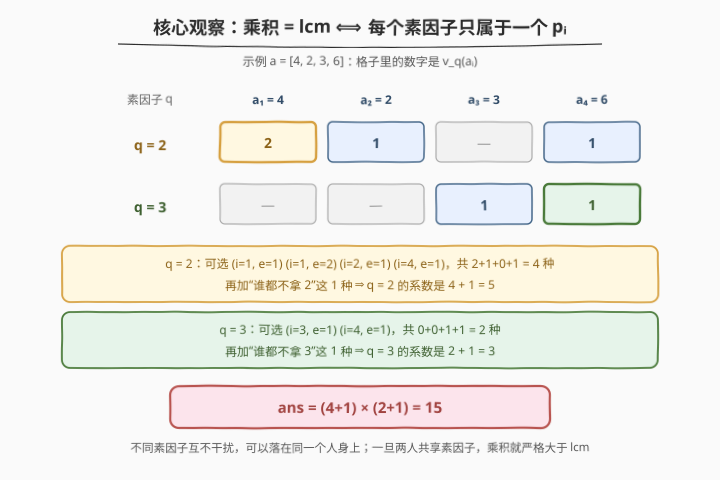
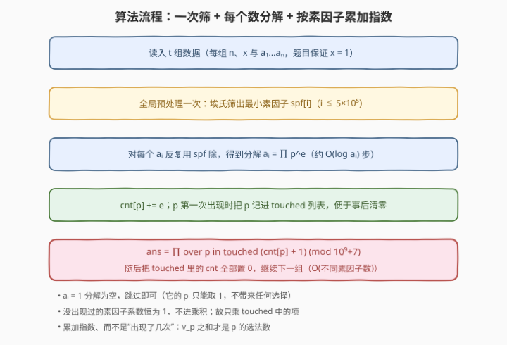
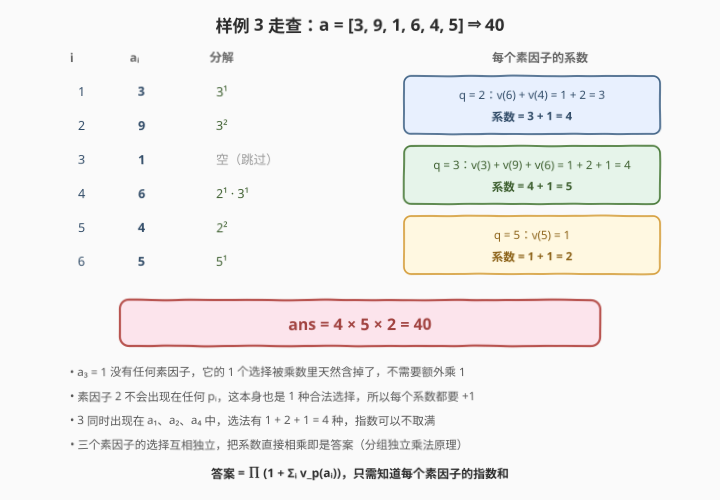

# Codeforces 2236F1 萨兰斯克的选举（简单版） 题解
## 1. 题目概述

- **标题 / 题号**：萨兰斯克的选举（简单版）（Codeforces 2236F1，英文名 Elections in Saransk (easy version)）
- **链接**：https://codeforces.com/problemset/problem/2236/F1
- **来源**：Codeforces Round 1103 (Div. 3) · Problem F1
- **难度**：1700（题面标注 *1700）
- **限制**：时间 4 s / 内存 256 MB
- **标签**：数论、质因数分解、计数、乘法原理

**题意**：投票站有 $n$ 个人，第 $i$ 个人带着数字 $a_i$ 进入投票间，并从 $a_i$ 的**正因子**里挑一个作为候选人 $p_i$。投完票得到数组 $[p_1,p_2,\dots,p_n]$。Egor 喜欢数字 $x$，称这次投票**理想**当且仅当

$$x \cdot \operatorname{lcm}(p_1,\dots,p_n) = p_1 \cdot p_2 \cdots p_n .$$

简单版（本题）只考虑 $x = 1$，即要求 $\operatorname{lcm}(p_1,\dots,p_n) = p_1 p_2 \cdots p_n$。求理想投票数组的个数，对 $10^9+7$ 取模。

**约束**：

- $1 \le t \le 10^4$ 组测试，$1 \le n \le 10^5$，且 $\sum n \le 10^5$；
- $1 \le a_i \le 5 \times 10^5$，本版本**保证 $x = 1$**（$x$ 仍会读入）；
- 两个数组不同当且仅当存在某个下标 $i$ 使得 $p_i$ 不同，因此顺序、下标都算作区别；
- 答案取模 $10^9+7$，单组 $n = 10^5$ 时指数和可达 $10^5 \times 19$，必须用 64 位中间量；
- 4 s 的时限对 $\sum n \log A$ 的做法极其宽松（实测 C++ 约 20 ms）。

## 2. 示例与观察
官方样例（输入 / 输出原样）：

```text
输入：
4
4 1
2 3 1 4
2 1
2 4
6 1
3 9 1 6 4 5
7 1
1 2 3 67 13 8 8

输出：
8
4
40
64
```

逐组对照（$q$ 表示素因子，系数为 $1+\sum_i v_q(a_i)$）：

| # | 数组 | 涉及素因子与指数和 | 答案 |
|---|------|--------------------|------|
| 1 | $[2,3,1,4]$ | $2:1+2=3$；$3:1$ | $(3+1)(1+1)=8$ |
| 2 | $[2,4]$ | $2:1+2=3$ | $3+1=4$ |
| 3 | $[3,9,1,6,4,5]$ | $2:1+2=3$；$3:1+2+1=4$；$5:1$ | $4\cdot 5\cdot 2=40$ |
| 4 | $[1,2,3,67,13,8,8]$ | $2:1+3+3=7$；$3,67,13$ 各 $1$ | $8\cdot 2\cdot 2\cdot 2=64$ |

**自造示例**（用于走查边界，非官方）：

```text
输入：
2
2 1
4 2
1 1
12

输出：
4
6
```

第一组 $a=[4,2]$：$p_1 \in \{1,2,4\}$、$p_2 \in \{1,2\}$，只有 $(1,1),(1,2),(2,1),(4,1)$ 满足乘积 = lcm，共 4 种；也用公式 $2:(2+1)=3 \Rightarrow 3+1=4$ 验证。第二组 $n=1$ 时 $p_1$ 自身既是乘积又是 lcm，条件恒成立，答案就是 $d(12)=6$，而 $\prod_q (1+v_q(12)) = 3 \times 2 = 6$ 同样吻合。

## 3. 解题思路

### 3.1 暴力思路

直接枚举所有投票组合：第 $i$ 个人有 $d(a_i)$ 种选择，总组合数 $\prod_i d(a_i)$。$a \le 5\times 10^5$ 时 $d(a)$ 最大为 $200$（$a = 498960$），$n = 10^5$ 时是天文数字，连样例 4 这种小数据（$d$ 值 $1,2,2,2,2,4,4$）都有 $256$ 种组合，$n$ 稍大就彻底爆炸。

另一种"看似省事"的做法是枚举答案数组再判 lcm，同样逃不出指数级。必须换一个**逐素因子**的视角。

### 3.2 核心观察：乘积 = lcm ⟺ 各 $p_i$ 两两互素 ⟺ 每个素因子只落在一个人身上



把两边同时做唯一分解。记 $S_q = \sum_i v_q(p_i)$（$q$ 在所有投票里的指数和）、$M_q = \max_i v_q(p_i)$，则

$$\frac{p_1 p_2 \cdots p_n}{\operatorname{lcm}(p_1,\dots,p_n)} = \prod_{q} q^{\,S_q - M_q}, \qquad S_q - M_q \ge 0 .$$

由于右边是唯一分解，比值为 $1$ 当且仅当**每个** $q$ 都有 $S_q = M_q$。而 $S_q = M_q$ 又等价于「$q$ 至多出现在一个 $p_i$ 里」：只要有两个下标同时被 $q$ 整除，除最大指数外至少还多出一项正指数，于是 $S_q \ge M_q + 1$。

换句话说，条件就是**投票数组两两互素**。这一步把"全局 lcm"的纠缠彻底拆开：素因子之间从此互不影响，而每个素因子只能挑一个人"认领"。

### 3.3 算法流程：按素因子记账，系数是「指数和 + 1」



固定一个素数 $q$，它的全部选择只有两类：

1. **谁都不拿**：$q$ 不出现在任何 $p_i$ 中，$1$ 种；
2. **归给第 $i$ 个人**（要求 $q \mid a_i$），并选一个指数 $e \in [1, v_q(a_i)]$：共 $v_q(a_i)$ 种。

所以 $q$ 的系数是 $1 + \sum_i v_q(a_i)$（不整除 $a_i$ 的人贡献 $0$）。不同素数的选择互相独立——它们可以落在同一个人身上（$p_i$ 是这些素数幂的乘积，仍然整除 $a_i$），也可以分别落在不同人身上，所以总答案是

$$\text{ans} = \prod_{q}\Bigl(1 + \sum_{i=1}^{n} v_q(a_i)\Bigr) \bmod (10^9+7).$$

实现上只需要「筛出最小素因子 $\to$ 逐个分解 $a_i$ 并把指数累加进 `cnt[p]` $\to$ 把所有出现过的 $p$ 的 $(\text{cnt}[p]+1)$ 乘起来」。注意是**累加指数**而不是"数出现了几次"。

### 3.4 示例演算



对样例 3 的 $a = [3,9,1,6,4,5]$ 逐个分解：

| $i$ | $a_i$ | 分解 | 贡献到哪里 |
|-----|-------|------|-----------|
| 1 | 3 | $3^1$ | `cnt[3] += 1` |
| 2 | 9 | $3^2$ | `cnt[3] += 2` |
| 3 | 1 | 空 | 跳过（$p_3$ 只能取 1） |
| 4 | 6 | $2^1 \cdot 3^1$ | `cnt[2] += 1`，`cnt[3] += 1` |
| 5 | 4 | $2^2$ | `cnt[2] += 2` |
| 6 | 5 | $5^1$ | `cnt[5] += 1` |

得到 `cnt[2]=3`、`cnt[3]=4`、`cnt[5]=1`，于是 $\text{ans} = (3+1)(4+1)(1+1) = 4 \times 5 \times 2 = 40$，与官方输出一致。第 4 组的 $2$ 指数和为 $1+3+3=7$，系数 $8$；$3,67,13$ 各自系数 $2$，$8 \times 2^3 = 64$ 同样吻合。

## 4. 算法细节

1. **只筛一次**：值域上界固定为 $5\times 10^5$，用埃氏筛（或线性筛）求最小素因子 `spf[]`，在**程序开头做一次**即可，与 $t$ 无关；不要每组都筛。
2. **分解用 `spf` 跳着除**：`while (a > 1) { p = spf[a]; while (a % p == 0) { a /= p; ++e; } cnt[p] += e; }`。每轮至少除掉一个素因子，次数是 $O(\log a)$（最多 $\log_2 5\times10^5 < 19$ 次除法），远比试除到 $\sqrt a$ 快。
3. **用 touched 列表清零**：`cnt` 是跨测试点共用的全局数组。若每组都 `memset` 整个 $5\times 10^5$，$t = 10^4$ 时是 $5\times 10^9$ 次写，必然超时。正确做法是首次给某个 $p$ 记账时把它压入 `touched`，本组算完答案后**只清 touched 里的那几项**，代价 $O(\text{不同素因子数})$。
4. **先乘后清**：`ans` 必须在清空 `cnt` **之前**算完；顺序写反会得到全 1（每个 `cnt[p]` 都是 0，系数 1）。
5. **`x` 要读但要忽略**：本版本保证 $x = 1$，读掉这个整数即可；公式 $\prod (1+\sum_i v_q(a_i))$ 只对 $x = 1$ 成立（见「相关题目与扩展」）。
6. **中间量用 64 位**：$\text{ans} \le 10^9+6$、$\text{cnt}[p]+1 \le 1.8\times10^6$，乘积约 $1.8\times10^{15}$，必须在 `long long` 里取模；若 $\text{cnt}$ 用 `int` 累加则最大 $1.8\times10^6$ 也不会溢出，但 `ans * (cnt+1)` 用 `int` 必爆。
7. **`a_i = 1` 无需特判**：`while (a > 1)` 自然不进循环，它对应的 $p_i$ 唯一（$=1$），不产生任何因子，也就乘进来一个"空选择"，正确。
8. **读入方式**：$\sum n \le 10^5$ 数据量不大，`scanf` 足够；Python 用 `sys.stdin.buffer.read().split()` 一次性读入最快。

## 5. 正确性证明

**引理 1**：设 $S_q=\sum_i v_q(p_i)$、$M_q=\max_i v_q(p_i)$，则 $p_1\cdots p_n = \operatorname{lcm}(p_1,\dots,p_n)$ 当且仅当对每个素数 $q$ 都有 $S_q = M_q$。

**证明**：两边都是正整数，由唯一分解定理，$p_1\cdots p_n = \operatorname{lcm}$ 等价于两边的每个素因子指数相同。左边的 $q$ 指数是 $S_q$，右边是 $M_q$，且恒有 $S_q \ge M_q$。故等式成立当且仅当所有 $q$ 都满足 $S_q = M_q$。∎

**引理 2**：$S_q = M_q$ 当且仅当至多一个下标 $i$ 满足 $v_q(p_i) > 0$。

**证明**：若存在两个或更多下标被 $q$ 整除，则除取到最大值 $M_q$ 的那一项外，至少还有一项指数 $\ge 1$，于是 $S_q \ge M_q + 1$，矛盾。反之若至多一个下标被 $q$ 整除，则 $S_q$ 与 $M_q$ 就是同一个非负数，相等。∎

**引理 3（选择与数组的双射）**：理想数组 $[p_1,\dots,p_n]$ 与「对每个素数 $q$，选择"空"或二元组 $(i,e)$，其中 $q \mid a_i$ 且 $1 \le e \le v_q(a_i)$」之间存在一一对应。

**证明**：给定理想数组，由引理 1、2，每个 $q$ 至多出现在一个 $p_i$ 中；若出现了，就令 $q$ 的选择为 $(i, v_q(p_i))$，否则为"空"。由于 $p_i \mid a_i$，必有 $v_q(p_i) \le v_q(a_i)$，故这是一个合法选择，且由唯一分解可从数组还原出全部选择。

反过来，给定一组选择，定义 $p_i = \prod_{q:\ \text{选择为 }(i,e_q)} q^{e_q}$（没有素数选 $i$ 时 $p_i = 1$）。每个 $e_q \le v_q(a_i)$，所以 $p_i \mid a_i$；每个 $q$ 只落在一个 $p_i$ 上，所以各 $p_i$ 两两互素，乘积与 lcm 都等于 $\prod_q q^{e_q}$（对"空"的 $q$ 两边都没有该素因子），由引理 1 该数组理想。两个映射互为逆，唯一分解保证不重不漏。∎

**引理 4（单个素因子的计数）**：对固定素数 $q$，合法选择的个数是 $1 + \sum_{i=1}^{n} v_q(a_i)$。

**证明**：由引理 3 的选择形式，"空"贡献 1 种；对每个满足 $q \mid a_i$ 的 $i$，指数 $e$ 有 $v_q(a_i)$ 种取法；这些情况两两不同且互斥，求和即得。注意 $q \nmid a_i$ 时 $v_q(a_i)=0$，可以直接并入求和而不改变数值。∎

**定理**：对 $x = 1$，理想数组的个数为 $\prod_{q}\bigl(1+\sum_i v_q(a_i)\bigr)$，且参考代码输出的正是该值。

**证明**：由引理 3，理想数组与全体"逐素因子选择"的笛卡尔积一一对应；不同素因子的选择相互独立（它们涉及不同的素数幂，且都只是在 $p_i$ 上乘一个因子，不影响其他素数的可行性），故总数是各素因子选择数之积，由引理 4 即为 $\prod_q (1+\sum_i v_q(a_i))$。代码对每个出现过的 $q$ 累加 $v_q(a_i)$ 得到 `cnt[q]`，再乘上 `cnt[q]+1`；未出现过的 $q$ 系数恰为 1，不乘也不影响结果。∎

## 6. 复杂度分析

- **时间**：筛一次 $O(A\log\log A)$（$A = 5\times10^5$，埃氏筛；换线性筛则 $O(A)$）；分解所有数共 $O\bigl((\sum n)\log A\bigr)$，因为每次除法至少消去一个素因子；每组还要 $O(\#\text{出现过的素数})$ 做累乘与清零。总计 $O\bigl(A\log\log A + \sum n\log A\bigr) \approx 2\times10^6$ 次基本运算。
- **空间**：`spf` 与 `cnt` 各 $O(A)$ 个 `int`（两者合计约 4 MB），`touched` 最多 $O(A)$ 个；输入数组可流式读入，无需存储，故为 $O(A)$，远低于 256 MB。
- **对照时限**：4 s 非常宽松。实测（Apple M 系芯片，clang -O2）最坏三组数据：$t=1,n=10^5$ 随机 $a_i$ 用时约 16 ms，$t=10^4$ 每组 $n=10$ 约 18 ms，$n=10^5$ 全为 $498960$（最多素因子）约 11 ms，余量两个数量级以上。
- **Python**：同一批数据约 0.18–0.24 s（含解释器启动与筛），也远在 4 s 之内，无需 PyPy；若时限收紧到 1 s 仍安全。

## 7. 参考代码

### C++17

```cpp
#include <bits/stdc++.h>
using namespace std;

const int MOD = 1000000007;
const int MAXA = 500000;

static int spf[MAXA + 1];   // 最小素因子
static int cnt[MAXA + 1];   // cnt[p] = 本轮所有 a_i 中 p 的指数和

int main() {
    for (int i = 0; i <= MAXA; i++) spf[i] = i;
    for (int i = 2; (long long)i * i <= MAXA; i++)
        if (spf[i] == i)
            for (long long j = (long long)i * i; j <= MAXA; j += i)
                if (spf[j] == j) spf[j] = i;

    int t;
    if (scanf("%d", &t) != 1) return 0;
    vector<int> touched;
    touched.reserve(1024);
    while (t--) {
        int n, x;
        scanf("%d %d", &n, &x);          // 本版本保证 x = 1，读掉即可
        touched.clear();
        for (int i = 0; i < n; i++) {
            int a;
            scanf("%d", &a);
            while (a > 1) {
                int p = spf[a], e = 0;
                while (a % p == 0) { a /= p; e++; }
                if (cnt[p] == 0) touched.push_back(p);
                cnt[p] += e;
            }
        }
        long long ans = 1;
        for (int p : touched) ans = ans * (cnt[p] + 1) % MOD;
        for (int p : touched) cnt[p] = 0; // 只清本组用到的素数
        printf("%lld\n", ans);
    }
    return 0;
}
```

### Python3

```python
import sys

MOD = 10 ** 9 + 7
MAXA = 500000


def main() -> None:
    data = list(map(int, sys.stdin.buffer.read().split()))
    if not data:
        return

    spf = list(range(MAXA + 1))
    i = 2
    while i * i <= MAXA:
        if spf[i] == i:
            for j in range(i * i, MAXA + 1, i):
                if spf[j] == j:
                    spf[j] = i
        i += 1

    pos = 0
    t = data[pos]
    pos += 1
    out = []
    for _ in range(t):
        n = data[pos]
        pos += 2                         # 跳过 n 与 x（x 恒为 1）
        cnt = {}
        for _ in range(n):
            a = data[pos]
            pos += 1
            while a > 1:
                p = spf[a]
                e = 0
                while a % p == 0:
                    a //= p
                    e += 1
                cnt[p] = cnt.get(p, 0) + e
        ans = 1
        for e in cnt.values():
            ans = ans * (e + 1) % MOD
        out.append(str(ans))
    sys.stdout.write("\n".join(out) + "\n")


main()
```

## 8. 边界情况与易错点

1. **$a_i$ 全为 $1$**：分解为空，`touched` 为空，`ans` 保持 $1$，正是正确答案（每个人只有 $p_i=1$ 一种选择）。不要在这里输出 $0$。
2. **$n = 1$**：条件自动成立，答案应为 $d(a_1)$。用公式检查：$\prod_q (1+v_q(a_1)) = d(a_1)$，与朴素结论一致——这也是最好的自测点。
3. **忘记 $+1$**：系数写成 $\sum_i v_q(a_i)$ 会漏掉"这个素因子谁都不拿"的情形，样例 1 会输出 $3 \times 1 = 3$ 而不是 $8$。
4. **多组之间不清 `cnt`**：`cnt` 残留会让后面的组把前组的指数算进来，答案偏大且不可预测；必须用 `touched` 精确清零（或每组换新 `map`，但常数太大）。
5. **$t = 10^4$ 时整表 `memset`**：$10^4 \times 5\times10^5 = 5\times10^9$ 次写入，会稳定超时——这是本题最隐蔽的 TLE 陷阱。
6. **`int` 溢出**：`ans * (cnt[p] + 1)` 最坏约 $1.8\times10^{15}$，`int` 直接溢出；`cnt[p]` 自身最大为 $10^5 \times 19$，`int` 够用。
7. **把 $x$ 当真**：若照抄本代码去交 $x > 1$ 的 hard 版本会 WA。本版本读入的 $x$ 恒为 $1$，公式依赖这一点；hard 版本要求 $S_q - M_q = v_q(x)$，需要重做（见下节）。
8. **把条件误判成"两两不同"或"都是质数"**：条件是两两**互素**，$p_i$ 完全可以是合数——$a=[4,3]$ 时 $p=(4,3)$ 就合法，乘积 = lcm = 12，而 $4$ 与 $3$ 互素。

## 9. 验证记录

- **编译环境与命令**：`clang++ -std=c++17 -O2`（本机无 GNU g++，配 `codeforces/tools/include/bits/stdc++.h` 兼容头；正文代码只用标准库，可原样提交 GNU C++17）；Python 侧为 `Python 3.9.6`。
- **官方样例**：1 / 1 通过（按 Codeforces 标准 checker 的 token 比对，忽略空白与大小写）。
- **复核状态**：audited（2026-11-19 统一回归：编译 + 官方样例；写作期的随机对拍与暴力未重跑）。

## 相关题目与扩展

- [Codeforces 2236F2. Elections in Saransk (hard version)](https://codeforces.com/problemset/problem/2236/F2)：把 $x = 1$ 放开成任意 $x$。此时条件变成对每个素数 $q$ 有 $S_q - M_q = v_q(x)$，即"除最大指数外其余指数之和恰为 $v_q(x)$"，不能再用简单的两两互素，需要枚举 $x$ 的因子并做 DP，难度从 1700 升到 2200。
- [Codeforces 1444A. Division](https://codeforces.com/problemset/problem/1444/A)：同样是"分解 $p$、$q$ 后按指数取舍"的题，练习把指数条件翻译成对数的整除约束。
- [Codeforces 1165D. Almost All Divisors](https://codeforces.com/problemset/problem/1165/D)：给出除 $1$ 与自身外的全部因子，反推这个数，是因子集合与分解的双向练习。
- [Codeforces 615D. Multipliers](https://codeforces.com/problemset/problem/615/D)：统计 $n$ 个数的乘积的因子个数（指数相加后乘起来），与本题"累加指数再相乘"的骨架几乎一致，区别在于那边要处理指数和本身而非"系数"。
- [LeetCode 1819. 序列中不同最大公约数的数目](https://leetcode.cn/problems/number-of-different-subsequences-gcds/)：按素因子/约数视角统计的思想在 gcd 类问题里的另一面。

**延伸思考**：本题真正的杠杆是"把 $n$ 个数的联合条件拆成每个素数独立的局部条件"——一旦条件按素数分解成 $\prod_q q^{f_q(\text{指数向量})}$ 的形式，答案几乎总是各 $q$ 方案数之积，这是处理 lcm/gcd 组合计数的通用套路。

顺着这条线可以问出三个变体：

1. **共同上界**：若把每人各自的约束 $p_i \mid a_i$ 换成同一个上界 $p_i \mid B$，则 $q$ 的系数变成 $1 + n \cdot v_q(B)$（$n$ 个人任选），答案即 $\prod_q \bigl(1 + n\,v_q(B)\bigr)$，一行代码。
2. **$x > 1$（即 F2）**：需要 $S_q - M_q = v_q(x)$，每个素数都要"除最大值外其余指数之和恰好等于某个数"，最优指数还不能定，只能对 $x$ 的因子做 DP；这就是难度从 1700 跳到 2200 的全部原因。
3. **恰好 $k$ 个人拿到非平凡因子**：此时不能简单地把系数写成 $1 + \sum_i v_q(a_i)\,x$——同一个人的多个素因子会把 $x$ 的幂次叠加成"人次"而不是"人数"。正确做法是按人做容斥（对"哪些人必须为 $1$"的集合做子集容斥），代价约 $2^n$，只有 $n$ 很小时可用。

若还要**输出方案本身**，引理 3 的构造直接给出：按素数逐个决定归属与指数，落地成 $p_i$ 即可，复杂度与计数相同。
