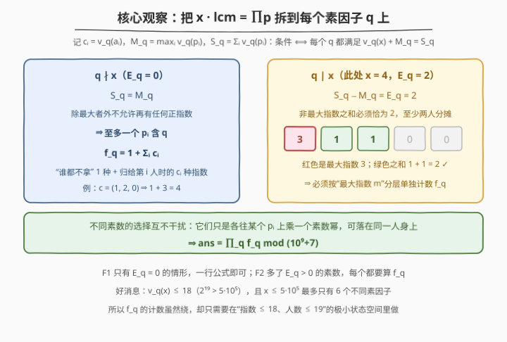
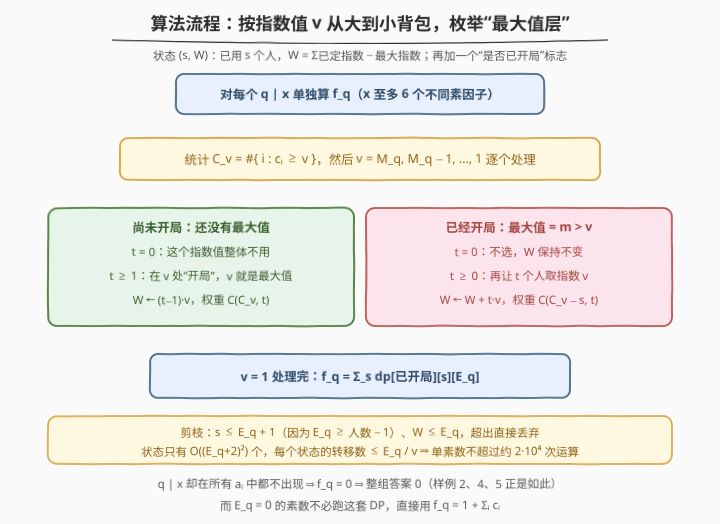
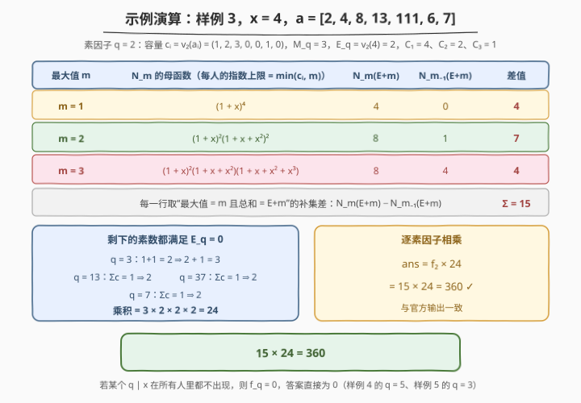

# Codeforces 2236F2 萨兰斯克的选举（困难版） 题解
## 1. 题目概述

- **标题 / 题号**：萨兰斯克的选举（困难版）（Codeforces 2236F2，英文名 Elections in Saransk (hard version)）
- **链接**：https://codeforces.com/problemset/problem/2236/F2
- **来源**：Codeforces Round 1103 (Div. 3) · Problem F2
- **难度**：2200（题面标注 *2200）
- **限制**：时间 3 s / 内存 512 MB
- **标签**：数论、质因数分解、组合计数、动态规划

**题意**：投票站有 $n$ 个人，第 $i$ 个人带着 $a_i$ 进入投票间，从 $a_i$ 的**正因子**里挑一个作为候选人 $p_i$，投完票得到数组 $[p_1,p_2,\dots,p_n]$。Egor 喜欢数字 $x$，称投票**理想**当且仅当

$$x \cdot \operatorname{lcm}(p_1,\dots,p_n) = p_1 \cdot p_2 \cdots p_n .$$

求理想投票数组的个数，对 $10^9+7$ 取模。困难版与同场简单版（2236F1）的**唯一区别**是 $x$ 放开到 $1 \le x \le 5 \times 10^5$；简单版固定 $x = 1$，其题解另成一篇（见文末链接）。

**约束**：

- $1 \le t \le 10^4$ 组测试，$1 \le n \le 10^5$，且 $\sum n \le 10^5$；
- $1 \le x, a_i \le 5 \times 10^5$；两个数组不同当且仅当存在下标 $i$ 使得 $p_i$ 不同（顺序、下标都算区别）；
- $x \le 5 \times 10^5$ 直接推出两个关键上界：$v_q(x) \le 18$（因为 $2^{19} > 5\times 10^5$），且 $x$ 至多只有 $6$ 个不同素因子（$2\cdot3\cdot5\cdot7\cdot11\cdot13 = 30030$，再乘 $17$ 就超过 $5\times10^5$）；
- 答案取模 $10^9+7$，单组 $n = 10^5$ 时指数和可达 $1.8\times 10^6$，乘法中间量必须用 64 位。

## 2. 示例与观察
官方样例（输入 / 输出原样）：

```text
输入：
5
2 2
2 4
1 5
5
7 4
2 4 8 13 111 6 7
3 1000
1 2 3
3 3
4 8 10

输出：
2
0
360
0
0
```

**自造示例**（用于走查困难版的新情形，非官方）：

```text
输入：
5
2 4
4 4
3 6
6 6 6
3 4
4 8 2
3 12
2 4 6
2 8
2 16

输出：
1
9
6
0
0
```

- 第 1 组 $x=4$、$a=[4,4]$：$v_2$ 容量是 $(2,2)$，要 $S-M=2$ 只能两人都取 $2$，得 $(p_1,p_2)=(4,4)$，$4\cdot 4 = 16 = 4\cdot 4$，共 $1$ 种。
- 第 2 组 $x=6$、$a=[6,6,6]$：对 $q=2$ 需两人分别拿指数 $1$（$3$ 种挑法），$q=3$ 同理 $3$ 种，互不干扰，答案 $3\times 3 = 9$。
- 第 3 组 $x=4$、$a=[4,8,2]$：$v_2$ 容量 $(2,3,1)$，$6$ 个指数向量满足 $S-M=2$；对应 $p$ 为 $(2,2,2),(2,4,2),(2,8,2),(4,2,2),(4,4,1),(4,8,1)$。
- 第 4 组 $x=12$、$a=[2,4,6]$：只有第 3 个人含因子 $3$，所以 $S_3 = M_3 = 1$，而 $E_3 = v_3(12) = 1$，无解。
- 第 5 组 $x=8$、$a=[2,16]$：$v_2$ 容量 $(1,4)$，$S-M$ 最多取到 $1$，达不到 $E_2 = 3$，答案 $0$。

## 3. 解题思路

### 3.1 暴力思路

直接枚举所有投票组合：第 $i$ 个人有 $d(a_i)$ 种选择，总组合数 $\prod_i d(a_i)$。$a \le 5\times 10^5$ 时 $d(a)$ 最大为 $200$（$a = 498960$），$n = 10^5$ 时是天文数字。

简单版的公式 $\prod_q\bigl(1+\sum_i v_q(a_i)\bigr)$ 也不能照搬：它本质上依赖"每个素因子至多落在一个 $p_i$ 上"，而困难版里 $x$ 会把某些素因子**强制摊给至少两个人**。必须重新回到逐素因子的条件本身。

### 3.2 核心观察：条件按素因子拆成“非最大指数之和 = $v_q(x)$”



把等式两边同时对素数 $q$ 取指数：左边 $x\cdot\operatorname{lcm}(p_1,\dots,p_n)$ 的 $q$ 指数是 $v_q(x) + \max_i v_q(p_i)$，右边乘积的 $q$ 指数是 $\sum_i v_q(p_i)$，于是

$$v_q(x) + M_q = S_q, \qquad M_q = \max_i v_q(p_i),\quad S_q = \sum_i v_q(p_i).$$

即**对每个素数 $q$ 都要求 $S_q - M_q = E_q$**，其中 $E_q = v_q(x)$。又记第 $i$ 个人在这个素数上的容量 $c_i = v_q(a_i)$，则 $0 \le v_q(p_i) \le c_i$。

$S_q - M_q$ 的几何含义是"除最大指数之外，所有人的指数之和"。分两类：

- $E_q = 0$：要求 $S_q = M_q$，即除最大值外没有任何正指数，等价于**至多一个人**把 $q$ 放进自己的 $p_i$。此人指数可取 $1..c_i$，再加"谁都不拿"这一种，$f_q = 1 + \sum_i c_i$。这正是简单版的答案因子。
- $E_q > 0$：要求"非最大指数之和恰为 $E_q$"。因为至少要有一个人贡献非最大正指数，**至少两个人**沾 $q$；而且非最大的那几个指数之和是固定的 $E_q \le 18$，所以它们至多 $E_q$ 个、每个 $\le E_q$。最大值 $m$ 本身则可以很大（只受某人容量限制），但它只贡献一个"最大值"身份。

不同素数的选择互不干扰：它们只是各自往某个 $p_i$ 上乘一个素数幂，可以落在同一个人身上，因此

$$\text{ans} = \prod_{q} f_q \bmod (10^9+7),$$

其中 $f_q$ 只依赖 $x$ 在 $q$ 上的指数与全体容量 $c_i = v_q(a_i)$。于是问题变成：**给定多重集 $\{c_i\}$ 与 $E$，数出满足 $S - M = E$ 的指数向量个数。**

### 3.3 算法流程：按"最大值"分层做补集差分，再降序背包



**第一步：把"最大值恰为 $m$"写成补集差分。** 定义

$$N_m(s) = \#\bigl\{(e_1,\dots,e_n) : 0 \le e_i \le \min(c_i, m),\ \textstyle\sum_i e_i = s\bigr\},$$

也就是母函数 $\prod_i\bigl(1+x+\dots+x^{\min(c_i,m)}\bigr)$ 的 $x^s$ 次项系数。任取一个合法指数向量，它的最大值 $m$（作为数值）唯一确定，且 $\sum_i e_i = E + m$。于是

$$f_q = \sum_{m=1}^{M_q}\Bigl(N_m(E+m) - N_{m-1}(E+m)\Bigr), \qquad M_q = \max_i c_i \le 18 .$$

因为"所有指数 $\le m$ 且总和为 $E+m$"减去"所有指数 $\le m-1$ 且总和为 $E+m$"，剩下的恰好是"最大值等于 $m$ 且总和 $E+m$"，也就恰好是 $S-M = E$ 的那批向量。

**第二步：不逐个求多项式，而是直接枚举每个指数值被几个人用。** 记 $t_v$ 为指数恰为 $v$ 的人数，$t_v \ge 1$ 的最大 $v$ 就是这个向量的最大值 $m$，约束化为

$$\sum_v v\,t_v - m = E, \qquad m = \max\{\,v : t_v \ge 1\,\}.$$

按 $v$ 从 $M_q$ 降到 $1$ 依次决定 $t_v$，状态只需 $(\text{已用人数 } s,\ W)$，外加一个"是否已经定下最大值 $m$"的标志：

- **尚未开局**（还没定最大值）：$t_v = 0$ 就直接跳过；$t_v \ge 1$ 就在 $v$ 处"开局"，此时 $W \leftarrow (t_v-1)v$，$s \leftarrow t_v$，方案数乘 $C(C_v, t_v)$；
- **已经开局**（最大值 $m > v$）：再让 $t_v \ge 0$ 个人取指数 $v$，$W \leftarrow W + t_v v$，$s \leftarrow s + t_v$，方案数乘 $C(C_v - s, t_v)$。

其中 $C_v = \#\{i : c_i \ge v\}$ 是"容量够得着 $v$ 的人数"。第二个乘子要写成 $C_v - s$：已经用掉的人指数都 $> v$，容量必然 $\ge v+1$，一定被 $C_v$ 统计过，所以必须先扣掉。

两个剪枝让状态空间彻底塌缩：合法向量的总指数和 $= E + m \ge m + (\text{人数} - 1)$，故 $s \le E+1$；同时 $W \le E$。于是每个素数只有 $O\bigl((E+1)^2\bigr)$ 个状态，单次转移数不超过 $E/v$。

最后，$E_q = 0$ 的素数完全不必跑这套 DP，直接用 $f_q = 1 + \sum_i c_i$；而 $x$ 只有至多 $6$ 个素因子，所以重活只发生在极少数素数上。

### 3.4 示例演算



对样例 3：$n = 7$、$x = 4$、$a = [2,4,8,13,111,6,7]$。

$x = 2^2$，只有 $q = 2$ 满足 $E_q > 0$。容量 $c_i = v_2(a_i) = (1,2,3,0,0,1,0)$，于是 $M_q = 3$，$C_1 = 4$、$C_2 = 2$、$C_3 = 1$，$E = 2$。逐层做差分：

| 最大值 $m$ | $N_m$ 的母函数（指数上限 $\min(c_i,m)$） | $N_m(E+m)$ | $N_{m-1}(E+m)$ | 差 |
|---|---|---|---|---|
| 1 | $(1+x)^4$ | 4 | 0 | **4** |
| 2 | $(1+x)^2(1+x+x^2)^2$ | 8 | 1 | **7** |
| 3 | $(1+x)^2(1+x+x^2)(1+x+x^2+x^3)$ | 8 | 4 | **4** |

于是 $f_2 = 4+7+4 = 15$。剩下的素数都满足 $E_q = 0$：$q=3$ 的指数和为 $1+1=2$，系数 $3$；$q = 13, 37, 7$ 各出现一次，系数都是 $2$。故答案 $= 15 \times 3 \times 2 \times 2 \times 2 = 360$，与官方输出一致。作为对照，样例 4 的 $x = 1000 = 2^3\cdot 5^3$ 中 $q = 5$ 在任何 $a_i$ 里都不出现（$f_5 = 0$），样例 5 的 $q = 3$ 同样缺席，所以两组答案都是 $0$。

## 4. 算法细节

1. **只筛一次**：值域上界固定为 $5\times 10^5$，程序开头用埃氏筛求出最小素因子 `spf[]`，此后与 $t$ 无关；分解任何数都靠 `spf` 跳着除，代价 $O(\log a)$（最多 $18$ 次除法）。
2. **两类素数分开算**：分解每个 $a_i$ 时，把指数累加进 `cnt[p]`（供 $E_q=0$ 的素数使用），同时若 $p$ 是 $x$ 的素因子，把指数 $e$ 计入该素数的容量直方图 `capHist[j][e]`。用 `xIdx[p]` 记录 $p$ 在 $x$ 的素因子表里的下标，$O(1)$ 判断"$p$ 是否整除 $x$"。
3. **多测清空要精准**：`cnt` 用 `touched` 列表只清本组真正写过的素数（$t = 10^4$ 时整表 `memset` 是 $5\times10^9$ 次写，稳定超时）；`xIdx` 只对本组 $x$ 的那几个素因子重置；`capHist` 是 $8\times24$ 的小数组，直接整块清零。
4. **累计人数 $C_v$ 用后缀和**：`Cv[mc+1] = 0`，从高到低 `Cv[v] = Cv[v+1] + capHist[j][v]`，其中 `mc` 是本组容量上确界，循环只跑到 `mc` 而不是 $18$。
5. **组合数就地递推**：转移里只需要 $C(a,t)$ 且 $t \le 18$，用 $C(a,t) = C(a,t-1)\cdot(a-t+1)/t$ 配预处理好的逆元 `inv[1..63]` 现场算，$O(1)$ 一次，省掉阶乘表。
6. **"未开局"的状态可以压成一位**：未开局时必然 $s = 0$（还没用过任何人），所以实现里用一维数组 `d0[W]` 表示它；二维数组 `d1[s][W]` 表示已开局状态。这样每轮 $v$ 的拷贝量最小。
7. **开局转移的指数上界是 $E/v + 1$**：因为 $W' = (t-1)v \le E$；已开局转移的上界是 $\min(C_v - s,\ \lfloor (E-W)/v\rfloor,\ S-s)$，三处都要卡，少一处就会数组越界或把非法状态算进去。
8. **答案累加顺序**：$f_q$ 可能在 DP 结束后仍为 $0$（容量够不着 $E$），此时直接让整组答案为 $0$；此外若某个 $q \mid x$ 的容量直方图全空，也可以立刻判 $0$ 跳出，省掉后面的 DP。
9. **只用 64 位取模**：`ans * (cnt[p]+1)` 最坏约 $1.8\times 10^{15}$；DP 里 `cur * comb` 同理，`int` 必爆而 `long long` 安全。

## 5. 正确性证明

**引理 1（逐素因子等价）**：设 $M_q = \max_i v_q(p_i)$、$S_q = \sum_i v_q(p_i)$、$E_q = v_q(x)$，则 $x\cdot\operatorname{lcm}(p) = \prod_i p_i$ 当且仅当对每个素数 $q$ 都有 $E_q + M_q = S_q$。

**证明**：两边都是正整数，由唯一分解定理，等式成立当且仅当每个素因子的指数相同。左边的 $q$ 指数是 $E_q + M_q$（$x$ 贡献 $E_q$，$\operatorname{lcm}$ 贡献最大值），右边是 $S_q$。∎

**引理 2（$E_q = 0$ 的计数）**：若 $E_q = 0$，则 $q$ 的合法选择恰有 $1 + \sum_i c_i$ 种。

**证明**：由引理 1，$S_q = M_q$。若有两个及以上下标满足 $v_q(p_i) > 0$，则除取到最大值的那一项外至少还有一项指数 $\ge 1$，得 $S_q \ge M_q + 1$，矛盾；故至多一个下标被 $q$ 整除。反之，若至多一个下标被 $q$ 整除，则 $S_q$ 与 $M_q$ 就是同一个数。于是合法的局部配置是"谁都不拿"（$1$ 种）加上"归给第 $i$ 个人、指数取 $1..c_i$"（$c_i$ 种），合计 $1 + \sum_i c_i$。∎

**引理 3（素数间独立，答案是乘积）**：理想数组与"对每个素数 $q$ 独立地选择一个局部配置"之间存在一一对应，故理想数组个数 $= \prod_q f_q$。

**证明**：给定理想数组，对每个 $q$ 取出所有 $v_q(p_i)$ 构成局部配置；由唯一分解，各素数的局部配置能唯一还原出全部 $p_i$。反过来，给定各素数的局部配置，令 $p_i = \prod_{q} q^{\,e_{q,i}}$（$e_{q,i}$ 为该局部配置中分给 $i$ 的指数，未分到则为 $0$），则 $e_{q,i} \le v_q(a_i)$ 保证 $p_i \mid a_i$，而每个素数都满足引理 1 的条件，故该数组理想。两个方向互逆，说明是双射；又不同素数的选择彼此不产生任何约束，总数为各 $f_q$ 之积。∎

**引理 4（最大值分层差分）**：设 $E \ge 1$，则 $\#\bigl\{(e_1,\dots,e_n) : 0\le e_i\le c_i,\ \sum_i e_i - \max_i e_i = E\bigr\} = \sum_{m\ge 1}\bigl(N_m(E+m) - N_{m-1}(E+m)\bigr)$。

**证明**：任一合法向量中最大值这个数值 $m = \max_i e_i \ge 1$ 是确定的，且 $\sum_i e_i = E + m$，因此它属于"所有 $e_i \le m$、和为 $E+m$"的集合。反过来，若一个向量的所有分量 $\le m$、和为 $E+m$，则 $\sum_i e_i - \max_i e_i \le E + m - m = E$，等号成立当且仅当最大值恰为 $m$。于是"最大值恰为 $m$ 且合法"$=$ "所有分量 $\le m$、和为 $E+m$" 减去 "所有分量 $\le m-1$、和为 $E+m$"，即 $N_m(E+m) - N_{m-1}(E+m)$。各 $m$ 互斥，求和即得；$m > M_q$ 时两项相等，差为 $0$，故求和上限可写 $M_q$。∎

**引理 5（降序 DP 的权重正确）**：DP 中一条从"未开局"到"已开局且 $W = E$"的路径，与一个合法指数向量一一对应；路径上权重之积恰为满足该指数分布的人数分配方案数。

**证明**：路径确定了每个 $v$ 的 $t_v$（取指数 $v$ 的人数），且首个 $t_m \ge 1$ 的 $m$ 就是最大值，$W = \sum_v v t_v - m$ 正是 $\sum_i e_i - \max_i e_i$，故 $W = E$ 等价于合法性。分配方案数：按 $v$ 从大到小，为第 $v$ 层挑人时，容量 $\ge v$ 的有 $C_v$ 人，已被更高层用掉 $s$ 人（他们的容量都 $\ge v+1$，必在 $C_v$ 中），故可挑人数为 $C_v - s$，选出 $t_v$ 人的方案数是 $C(C_v - s, t_v)$；各层选择互不影响且并起来给出一个唯一的分配，故总方案数为乘积。∎

**定理**：参考代码对每组测试输出的就是理想投票数组个数模 $10^9+7$。

**证明**：代码对 $x$ 的每个素因子按引理 4、5 用降序 DP 求出 $f_q$（$E_q > 0$），对其它出现过的素数按引理 2 取 $1+\sum_i c_i$，两者相乘即引理 3 的乘积；若某个 $q\mid x$ 无人提供则 $f_q = 0$，乘积为 $0$，与"无解"一致。代码中的剪枝 $s \le E+1$、$W \le E$ 只是丢弃不可能补全的状态（合法向量必满足 $E \ge s - 1$ 与 $W \le E$），不影响计数。∎

## 6. 复杂度分析

- **时间**：筛 `spf` 为 $O(A\log\log A)$，$A = 5\times10^5$；分解所有 $a_i$ 共 $O\bigl(\sum n\log A\bigr)$。对 $x$ 的每个素因子，DP 有 $O\bigl((E+1)^2\bigr)$ 个状态、每个状态的转移数不超过 $E/v$，单素数开销 $O\bigl(E^3\log M_q\bigr)$ 但 $E \le 18$、$M_q \le 18$，实测常数极小（约 $10^4$ 次运算量级）；$x$ 至多 $6$ 个素因子，故单组总开销不超过约 $10^5$ 次运算。
- **空间**：`spf`、`cnt`、`xIdx` 各 $O(A)$ 个 `int`（约 $6$ MB），`capHist` 为 $8\times 24$，DP 状态 $2\times 20\times 19$ 个 `long long`（约 $6$ KB）。总计 $O(A)$，远低于 512 MB。
- **对照时限**：3 s 非常宽松。实测（Apple M 系芯片，clang -O2）：$t = 10^4$、每组 $n = 10$、$x = 2^{18}$ 且所有人都是 $262144$（DP 状态取满）用时 $0.14$ s；同样的 $t$ 与 $x$ 但 $a_i$ 随机取 $2^k$ 用时 $0.12$ s；$t = 10^4$ 且 $x = 2^{10}\cdot3^4\cdot5$ 用时 $0.08$ s；单组 $n = 10^5$ 用时 $0.01$ s。余量约 $20$ 倍。
- **Python**：同一批最坏数据在 CPython 下约 $3.4 \sim 5.6$ s（会超过 3 s），**建议用 PyPy 提交（预计 $1$ s 量级）或直接使用 C++**；$n = 10^5$ 的常规数据约 $0.24$ s，仍在限内。

## 7. 参考代码

### C++17

```cpp
#include <bits/stdc++.h>
using namespace std;

static const int MOD = 1000000007;
static const int MAXA = 500000;

static int spf[MAXA + 1];    // smallest prime factor
static int cnt[MAXA + 1];    // cnt[p] = sum of v_p(a_i) over all voters
static int xIdx[MAXA + 1];   // position of p inside the factorisation of x, -1 if absent
static long long invs[64];   // modular inverses of 1..63

static int capHist[8][24];   // capHist[j][e] = #{i : v_{p_j}(a_i) = e}
static int px[8], pe[8];     // primes of x and their exponents (at most 6 primes)

int main() {
    for (int i = 0; i <= MAXA; i++) spf[i] = i;
    for (int i = 2; (long long)i * i <= MAXA; i++)
        if (spf[i] == i)
            for (long long j = (long long)i * i; j <= MAXA; j += i)
                if (spf[j] == j) spf[j] = i;
    for (int i = 0; i <= MAXA; i++) xIdx[i] = -1;
    invs[1] = 1;
    for (int i = 2; i < 64; i++) invs[i] = (MOD - MOD / i) * invs[MOD % i] % MOD;

    int t;
    if (scanf("%d", &t) != 1) return 0;
    vector<int> touched;
    touched.reserve(4096);
    static long long dp[2][24][24], nd[2][24][24];

    while (t--) {
        int n; long long x;
        scanf("%d %lld", &n, &x);

        int k = 0;
        for (long long v = x; v > 1; ) {
            int p = spf[(int)v], e = 0;
            while (v % p == 0) { v /= p; e++; }
            px[k] = p; pe[k] = e; xIdx[p] = k; k++;
        }
        for (int j = 0; j < k; j++)
            for (int c = 0; c < 24; c++) capHist[j][c] = 0;
        touched.clear();

        for (int i = 0; i < n; i++) {
            int a;
            scanf("%d", &a);
            while (a > 1) {
                int p = spf[a], e = 0;
                while (a % p == 0) { a /= p; e++; }
                if (cnt[p] == 0) touched.push_back(p);
                cnt[p] += e;
                int id = xIdx[p];
                if (id >= 0) capHist[id][e]++;
            }
        }

        long long ans = 1;
        for (int p : touched)                       // primes with v_p(x) = 0
            if (xIdx[p] < 0) ans = ans * (cnt[p] + 1) % MOD;

        for (int j = 0; j < k; j++) {               // primes with v_p(x) = E > 0
            int E = pe[j];
            int mc = 0;
            for (int c = 1; c < 24; c++) if (capHist[j][c]) mc = c;
            if (mc == 0) { ans = 0; break; }        // x needs this prime, nobody has it

            int Cv[26];                             // Cv[v] = #{i : v_p(a_i) >= v}
            Cv[mc + 1] = 0;
            for (int v = mc; v >= 1; v--) Cv[v] = Cv[v + 1] + capHist[j][v];

            int S = E + 1;                          // at most E+1 voters take part
            memset(dp, 0, sizeof(dp));
            dp[0][0][0] = 1;
            for (int v = mc; v >= 1; v--) {
                memset(nd, 0, sizeof(nd));
                int cv = Cv[v];
                for (int st = 0; st < 2; st++)
                    for (int s = 0; s <= S; s++)
                        for (int W = 0; W <= E; W++) {
                            long long cur = dp[st][s][W];
                            if (!cur) continue;
                            if (st == 0) {              // none of the maxima fixed yet
                                nd[0][s][W] = (nd[0][s][W] + cur) % MOD;
                                int maxt = min(cv, E / v + 1);
                                long long comb = 1;
                                for (int tt = 1; tt <= maxt && tt <= S; tt++) {
                                    comb = comb * (cv - tt + 1) % MOD * invs[tt] % MOD;
                                    int W2 = (tt - 1) * v;
                                    if (W2 > E) break;
                                    nd[1][tt][W2] = (nd[1][tt][W2] + cur * comb) % MOD;
                                }
                            } else {                    // maximum value already chosen
                                int avail = cv - s;
                                if (avail < 0) continue;
                                int maxt = min(avail, (E - W) / v);
                                long long comb = 1;
                                for (int tt = 0; tt <= maxt && s + tt <= S; tt++) {
                                    if (tt) comb = comb * (avail - tt + 1) % MOD * invs[tt] % MOD;
                                    int W2 = W + tt * v;
                                    nd[1][s + tt][W2] = (nd[1][s + tt][W2] + cur * comb) % MOD;
                                }
                            }
                        }
                memcpy(dp, nd, sizeof(dp));
            }
            long long f = 0;
            for (int s = 1; s <= S; s++) f = (f + dp[1][s][E]) % MOD;
            ans = ans * f % MOD;
        }

        for (int j = 0; j < k; j++) xIdx[px[j]] = -1;
        for (int p : touched) cnt[p] = 0;
        printf("%lld\n", ans);
    }
    return 0;
}
```

### Python3

```python
import sys

MOD = 1000000007
MAXA = 500000


def main() -> None:
    data = list(map(int, sys.stdin.buffer.read().split()))
    if not data:
        return

    # smallest prime factor, sieved once
    spf = list(range(MAXA + 1))
    i = 2
    while i * i <= MAXA:
        if spf[i] == i:
            for j in range(i * i, MAXA + 1, i):
                if spf[j] == j:
                    spf[j] = i
        i += 1

    inv = [0] * 64
    inv[1] = 1
    for i in range(2, 64):
        inv[i] = (MOD - (MOD // i) * inv[MOD % i] % MOD) % MOD

    cnt = [0] * (MAXA + 1)          # cnt[p] = sum of v_p(a_i)
    touched = []
    out = []
    t = data[0]
    pos = 1

    for _ in range(t):
        n = data[pos]; x = data[pos + 1]; pos += 2

        pxp = []; pxe = []          # primes of x and their exponents
        v = x
        while v > 1:
            p = spf[v]; e = 0
            while v % p == 0:
                v //= p; e += 1
            pxp.append(p); pxe.append(e)
        k = len(pxp)
        caps = [[0] * 24 for _ in range(k)]   # caps[j][e] = #{i : v_{p_j}(a_i) = e}
        touched.clear()

        for _ in range(n):
            a = data[pos]; pos += 1
            while a > 1:
                p = spf[a]; e = 0
                while a % p == 0:
                    a //= p; e += 1
                if cnt[p] == 0:
                    touched.append(p)
                cnt[p] += e
                for j in range(k):
                    if pxp[j] == p:
                        caps[j][e] += 1
                        break

        ans = 1
        for p in touched:                     # primes with v_p(x) = 0
            for q in pxp:
                if q == p:
                    break
            else:
                ans = ans * (cnt[p] + 1) % MOD

        for j in range(k):                    # primes with v_p(x) = E > 0
            E = pxe[j]
            cap = caps[j]
            mc = 0
            for c in range(23, 0, -1):
                if cap[c]:
                    mc = c
                    break
            if mc == 0:                       # x needs this prime, nobody has it
                ans = 0
                break

            Cv = [0] * 26                     # Cv[v] = #{i : v_p(a_i) >= v}
            for v in range(mc, 0, -1):
                Cv[v] = Cv[v + 1] + cap[v]

            S = E + 1                         # at most E+1 voters take part
            W1 = E + 1
            zero = [0] * ((S + 1) * W1)
            d1 = [0] * ((S + 1) * W1)         # started: d1[s * W1 + W]
            n1 = [0] * ((S + 1) * W1)
            d0 = [0] * W1                     # not started yet (only s = 0)
            n0 = [0] * W1
            d0[0] = 1

            for v in range(mc, 0, -1):
                n1[:] = zero
                n0[:] = d0
                cv = Cv[v]
                if cv:
                    # option A: v becomes the maximum exponent, t >= 1 voters take it
                    maxt = min(cv, E // v + 1, S)
                    comb = 1
                    for tt in range(1, maxt + 1):
                        comb = comb * (cv - tt + 1) % MOD * inv[tt] % MOD
                        idx = tt * W1 + (tt - 1) * v
                        n1[idx] = (n1[idx] + comb) % MOD
                    # option B: the maximum is already fixed, t >= 0 voters take v
                    for s in range(1, min(cv, S) + 1):
                        avail = cv - s
                        lim = min(avail, S - s)
                        if lim < 0:
                            continue
                        combs = [1] * (lim + 1)
                        cb = 1
                        for tt in range(1, lim + 1):
                            cb = cb * (avail - tt + 1) % MOD * inv[tt] % MOD
                            combs[tt] = cb
                        base = s * W1
                        for W in range(E + 1):
                            cur = d1[base + W]
                            if not cur:
                                continue
                            maxt = (E - W) // v
                            if maxt > lim:
                                maxt = lim
                            idx = base + W
                            for tt in range(maxt + 1):
                                n1[idx] = (n1[idx] + cur * combs[tt]) % MOD
                                idx += W1 + v
                d1, n1 = n1, d1
                d0, n0 = n0, d0

            f = sum(d1[s * W1 + E] for s in range(1, S + 1)) % MOD
            ans = ans * f % MOD

        for p in touched:
            cnt[p] = 0
        out.append(str(ans))

    sys.stdout.write("\n".join(out) + "\n")


main()
```

## 8. 边界情况与易错点

1. **$x = 1$ 必须仍然正确**：此时没有任何素因子满足 $E_q > 0$，全部走 $1+\sum_i c_i$ 分支，答案退化为简单版的 $\prod_q(1+\sum_i v_q(a_i))$，等价于"投票数组两两互素"的计数。
2. **某个 $q \mid x$ 无人提供**：容量直方图全空 ⇒ $f_q = 0$ ⇒ 整组答案 $0$（样例 2、4、5）。不要因为"循环没跑"就默认系数为 $1$。
3. **误以为 $E_q > 0$ 只要"有人拿 $q$"**：$S_q - M_q = E_q > 0$ 需要**至少两个人**沾 $q$。例如 $x = 2$、$a = [2,2]$ 只有 $(2,2)$ 一种（一人拿 $q$ 时 $S = M$）。
4. **把"最大值"当成唯一**：最大指数可以并列，这正是要用 $N_m - N_{m-1}$ 的差分（或 DP 里的 $t_v$ 计数）而不是"唯一最大 + 严格小于"的原因；按"唯一最大"计数会漏掉 $(4,4,1)$ 这类并列情形。
5. **$s$ 的上界写错**：合法向量满足 $E = \sum e_i - \max e_i \ge \text{人数} - 1$，故 $s \le E+1$。写成 $s \le E$ 会漏解（$E=1$ 时 $(1,1)$ 这种两人同取指数 $1$ 的向量就需要 $s = 2$）。
6. **组合数写成 $C(C_v, t_v)$ 而不扣 $s$**：已用的人指数都 $> v$，必然也在 $C_v$ 的统计里，不扣就会把同一个人派两次。
7. **忘了 $t_v = 0$ 这条转移**："这个指数值一个人都不用"是合法选择，漏掉它会从"至少一人拿 $q$"开始数，把所有素因子都算成必须出现。
8. **多测清空不彻底**：`cnt`、`xIdx` 都是跨测试复用的全局数组，`cnt` 要用 `touched` 精确清、`xIdx` 只重置本组 $x$ 的素因子、`capHist` 整块清零；任何一处残留都会让后面的组读到错误的容量。
9. **溢出**：`ans * (cnt[p] + 1)` 最坏 $\approx 1.8\times10^{15}$，`ans * f` 同理；`int` 直接 WA，必须 `long long`（Python 无此问题）。
10. **$a_i = 1$**：分解为空，不产生任何容量，对应 $p_i$ 只能取 $1$；不要特判，`while (a > 1)` 自然跳过。

## 9. 验证记录

- **编译环境与命令**：`clang++ -std=c++17 -O2`（本机无 GNU g++，配 `codeforces/tools/include/bits/stdc++.h` 兼容头；正文代码只用标准库，可原样提交 GNU C++17）；Python 侧为 `Python 3.9.6`。
- **官方样例**：1 / 1 通过（按 Codeforces 标准 checker 的 token 比对，忽略空白与大小写）。
- **复核状态**：audited（2026-11-19 统一回归：编译 + 官方样例；写作期的随机对拍与暴力未重跑）。

## 相关题目与扩展

- [Codeforces 2236F1. Elections in Saransk (easy version)](https://codeforces.com/problemset/problem/2236/F1)：同场简单版，固定 $x = 1$，答案就是 $\prod_q(1+\sum_i v_q(a_i))$，就是本题在“所有 $E_q = 0$”时的特例。
- [Codeforces 615D. Multipliers](https://codeforces.com/problemset/problem/615/D)：把 $n$ 个数的质因数指数相加后统计乘积的因子个数，与本题"先累加指数再按素数分配"的骨架一致，是很好的热身。
- [Codeforces 1444A. Division](https://codeforces.com/problemset/problem/1444/A)：同样是"分解 $p$、$q$ 后按指数取舍"的题型，练习把指数条件翻译成整除约束。
- [Codeforces 1165D. Almost All Divisors](https://codeforces.com/problemset/problem/1165/D)：给出除 $1$ 与自身外的全部因子反推原数，是因子集合与分解的双向练习。
- [Codeforces 1342E. Placing Rooks](https://codeforces.com/problemset/problem/1342/E)：组合计数里"先按层分类、再用组合数分配具体对象"的经典套路，可与本题的 $C(C_v - s, t_v)$ 对照。

**延伸思考**：本题真正的杠杆有两条。其一是**把 $n$ 个数的联合条件拆成每个素数的局部条件**，于是答案成为若干个"只依赖容量直方图"的因子之积；其二是**把"最大值"这一非线性量转成"每层几个人"的分层枚举**，从而让状态里只需要"已用人数 + 指数余量"。顺着第二条可以推几个变体：

- 若要求**恰好 $k$ 个人拿到非平凡因子**（即 $p_i > 1$ 的下标恰为 $k$ 个），只需在 DP 里把 $s$ 换成真正的"非平凡人数"并加一维目标 $k$，或将答案写成 $\prod_q(\cdot)$ 中的 $x^k$ 系数；
- 若 $x$ 的上界放大到 $10^{18}$，则 $E_q$ 可到 $60$，状态 $(s, W)$ 只有 $O(E^2)$ 个，单素数开销升到 $10^6$ 量级，但"至多 6 个素因子"的界会变成"至多 15 个"，需要重新评估总开销；
- 若还要求输出方案本身，引理 3 的逆映射直接给出构造：按素数逐个决定归属与指数即可。
