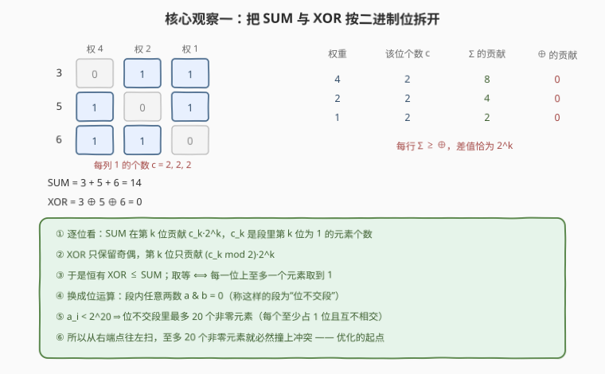
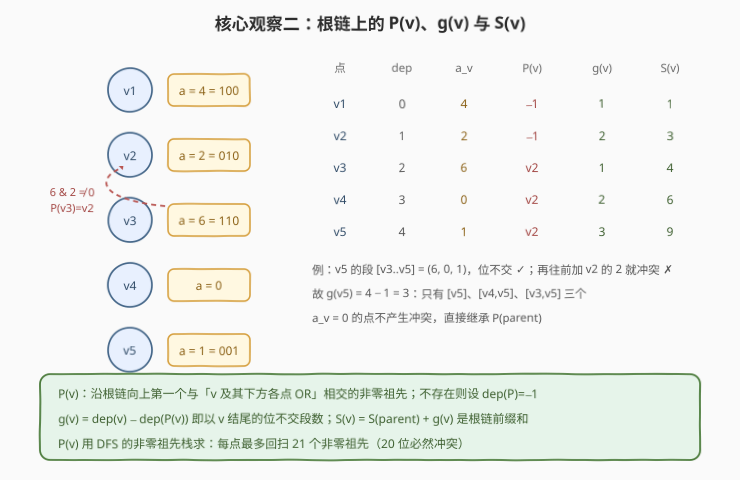
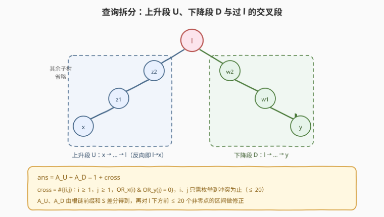
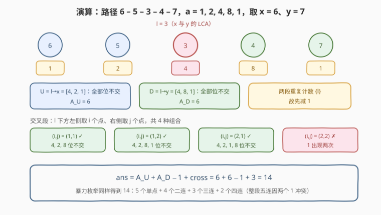

# Codeforces 2236G 布尔兰迪亚的评判标准 题解

## 1. 题目概述

- **标题 / 题号**：布尔兰迪亚的评判标准（Codeforces 2236G，英文名 Criterion in Burlandia）
- **链接**：https://codeforces.com/problemset/problem/2236/G
- **来源**：Codeforces Round 1103 (Div. 3) · Problem G（UTC 2026-06-12）
- **难度**：2600（题面标注 *2600）
- **限制**：时间 3 s / 内存 512 MB
- **标签**：树、最近公共祖先、位运算、前缀和、双指针、倍增

**题意**：布尔兰迪亚有 $n$ 个地区构成一棵树（$n$ 点 $n-1$ 边），第 $i$ 个地区有好客度 $a_i$。$q$ 次询问，每次给出两个不同的点 $x,y$，取它们之间唯一的简单路径，把路径上的点按 $x \to y$ 的顺序写成序列 $v_1,\dots,v_k$（$v_1=x$，$v_k=y$）。问有多少个非空连续子段 $[l,r]$ 满足

$$a_{v_l} \oplus a_{v_{l+1}} \oplus \cdots \oplus a_{v_r} \;\ge\; a_{v_l} + a_{v_{l+1}} + \cdots + a_{v_r}.$$

**约束**：

- $1 \le t \le 10^4$，$\sum n \le 10^5$，$\sum q \le 10^5$；
- $2 \le n \le 10^5$，$1 \le q \le 10^5$，$0 \le a_i < 2^{20}$；
- $x \ne y$，输入保证边确实构成一棵树；
- 单个询问的答案最大约 $k(k+1)/2 \approx 5 \times 10^9$（$k$ 为路径长度），**必须用 64 位整数**。

## 2. 示例与观察
官方样例（输入 / 输出原样）：

```text
输入：
3
4 3
0 0 4 1
1 2
1 3
1 4
1 4
2 3
2 4
4 3
0 4 1 2
1 3
1 4
2 4
1 2
2 3
2 4
4 3
3 2 4 4
1 2
2 4
3 4
1 2
1 3
2 3

输出：
3
6
6
6
10
3
2
5
4
```

题面 Note 分析的是第三组数据的询问 $(2,3)$：路径为 $2,4,3$，值依次为 $2,4,4$，六个子段中只有 $[2]$、$[4]$、$[4]$、$[2,4]$ 满足条件（$4 \oplus 4 = 0 < 8$，$2\oplus4\oplus4 = 2 < 10$），共 $4$ 个。

**自造示例**（用于走查边界，非官方）：

```text
输入：
1
5 2
1 2 4 8 1
1 2
2 3
3 4
4 5
1 4
2 4

输出：
10
6
```

两点间是一条值互不相交的链：$[1,2,4,8]$ 的 10 个子段全合法，$[2,4,8]$ 的 6 个全合法。

## 3. 解题思路

### 3.1 暴力思路

对每个询问沿父指针拉出路径（$O(k)$），再枚举所有子段并边扫边维护异或和与和（$O(k^2)$，用「一冲突就 break」可优化到 $O(20k)$）。单次询问 $k$ 可达 $n$，总复杂度 $O(nq) = 10^{10}$，直接超时。

瓶颈在于：**路径很长，但真正限制答案的只有很少几个非零元素**。必须把「整条路径的计数和」预先压成可差分的量，只对路径两端与拐点处的常数个元素做局部修正。

### 3.2 核心观察一：$\text{XOR} \ge \text{SUM}$ 等价于「位两两不交」



把段内每个数按二进制位拆开。设 $c_k$ 是段内第 $k$ 位为 $1$ 的元素个数：

$$\text{SUM} = \sum_k c_k \cdot 2^k, \qquad \text{XOR} = \sum_k (c_k \bmod 2)\cdot 2^k .$$

因为 $c_k \bmod 2 \le c_k$，所以 **$\text{XOR} \le \text{SUM}$ 恒成立**，并且

$$\text{XOR} \ge \text{SUM} \iff \text{XOR} = \text{SUM} \iff \forall k:\ c_k \le 1 .$$

即：**段内任意两个数的按位与为 $0$**（每个二进制位至多被一个元素占用）。称这样的段为**位不交段**。

由此得到一个关键的「小窗口」性质：$a_i < 2^{20}$，位不交段里每个非零元素至少独占 1 位，所以**任何位不交段最多含 20 个非零元素**。于是从某个右端点往左扫，至多 20 个非零元素就必然撞上冲突——这是全部复杂度的来源。

### 3.3 核心观察二：右端点的合法左端点是一个后缀



固定一条从根往下的链。对每个位置 $r$，若 $[l,r]$ 合法，则 $[l+1,r]$ 也合法（子段继承位不交性），所以**合法的左端点构成一段后缀**。设 $p(r)$ 是「最大的冲突位置」：从 $r$ 往左扫，遇到第一个与右侧 OR 相交的元素就停下，$p(r)$ 就是它。则合法左端点恰为 $p(r)+1,\dots,r$，数量为 $r - p(r)$。

在根链上把 $p(r)$ 记成 $P(v)$（沿根到 $v$ 的链上，第一个与「$v$ 及其下方各点 OR」相交的非零祖先），于是

$$g(v) = dep(v) - dep(P(v)) \quad (\text{无冲突时 } dep(P)=-1), \qquad S(v) = S(parent) + g(v).$$

$g(v)$ 是根链上以 $v$ 结尾的位不交段数，$S(v)$ 是根链前缀和。对「$l$ 为祖先、$v$ 为后代」的竖直查询：

$$A(l,v) = \sum_{r=l}^{v}\Bigl(dep(r) - \max\bigl(depP(r),\, dep(l)-1\bigr)\Bigr)$$

$$= \Bigl(S(v) - S(parent(l))\Bigr) \;+\; \sum_{\substack{l \le r \le v\\ depP(r) < dep(l)-1}}\bigl(depP(r) - dep(l) + 1\bigr).$$

第一项直接用前缀和差分；第二项只修正「阻塞点被抬到 $l$ 之上」的那些 $r$，之所以便宜：$depP(r)$ 沿链单调不减，被修正的 $r$ 是从 $l$ 开始的一段前缀；而「$depP(r) < dep(l)-1$」意味着 $l$ 之下一个冲突都没有，若 $l$ 之下已出现 21 个非零元素，鸽巢原理立刻给出冲突，所以被修正的区域只跨 $\le 20$ 个非零元素，可以把 $depP$ 相同的深度区间合并成 $\le 21$ 段常量累加。

### 3.4 查询拆分：上升段 + 下降段 + 过 $l$ 的交叉段



设 $l=\mathrm{LCA}(x,y)$，$U$ 为序列 $l\to x$（反向即路径的上升段），$D$ 为序列 $l\to y$（下降段）。路径的所有子段分成三类：

1. 完全落在上升段：数量 $= A(l,x)$（子段集合在反向下不变）；
2. 完全落在下降段：数量 $= A(l,y)$；
3. 同时取到两侧：必须包含 $l$，再加上「$l$ 下方 $x$ 侧最近的 $i$ 个点」与「$y$ 侧最近的 $j$ 个点」，$i,j \ge 1$。

前两类把 $l$ 算了两次（各含单点段 $\{l\}$），所以

$$\text{ans} = A(l,x) + A(l,y) - 1 + \text{cross}.$$

$\text{cross}$ 只需枚举 $\le 20$ 个位置：记 $OR_x(i)$ 为 $x$ 侧最近 $i$ 个点的 OR（$OR_x(0)=0$），$OR_y$ 同理。合法性要求三件事：两侧内部各自位不交、都与 $a_l$ 不交、$OR_x(i) \,\&\, OR_y(j) = 0$。随 $i$ 增大 $OR_x(i)$ 单调增，合法 $j$ 的集合是前缀 $[0,J(i)]$ 且 $J(i)$ 单调不增，于是

$$\text{cross} = \sum_{i=1}^{NX}\bigl(\text{合法 } j \text{ 的个数}\bigr),\qquad NX=\text{第一个冲突之前的位置数},$$

用双指针把两侧的 OR 常量段配对，$O(20)$ 完成。

### 3.5 示例演算



路径为 $6,5,3,4,7$，值 $1,2,4,8,1$，取 $x=6,y=7$，则 $l=3$。

| 部分 | 序列 | 计数 |
|------|------|------|
| $U=l\to x$ | $[4,2,1]$ | 全部位不交，$A=6$ |
| $D=l\to y$ | $[4,8,1]$ | 全部位不交，$A=6$ |
| 交叉 | $(i,j)=(1,1),(1,2),(2,1)$ 合法，$(2,2)$ 因两个 $1$ 冲突 | $3$ |

$$\text{ans} = 6 + 6 - 1 + 3 = 14 .$$

暴力核对：$5$ 个单点 $+4$ 个二连 $+3$ 个三连 $+2$ 个四连 $=14$（整段五连因两个 $1$ 冲突），完全一致。

## 4. 算法细节

1. **求 $P(v)$**：DFS 时维护「当前根链上的非零元素栈」，对非零点从栈顶往回扫，累加 OR 直到某祖先与 OR 相交即停。由 20 位上界，每次至多扫 21 个祖先，总 $O(20n)$。$a_v=0$ 时直接令 $depP(v)=depP(parent)$。
2. **一次倍增定位「$l$ 下方第 $M$ 个非零点」**：维护 $cntNz(v)$ = 根到 $v$ 的非零元素个数，倍增跳「$cntNz \ge cntNz(l)+M$ 的最浅祖先」即可，$O(\log n)$。
3. **用 $nzUp$ 指针把「继续往上找第 $i$ 个非零点」变成 $O(1)$**：$nzUp(v)$ 是 $v$ 最近的**非零**祖先。先花一次 $O(\log n)$ 定位最深的那个（第 $M$ 个），再用 $nzUp$ 链倒退 $M-1$ 步就拿到全部 $\le 21$ 个，避免 $21$ 次倍增。
4. **修正区间的合并**：以 $l$ 为起点、非零点为断点把深度切成若干段，每段内 $depP$ 相同，贡献为「点数 $\times (depP-dep(l)+1)$」；一旦 $depP(r) \ge dep(l)-1$ 立即 break（单调性保证后面都不会被修正）。
5. **交叉段的两侧常量段**：$OR_x$ 只在经过非零点时变化，于是 $[1,NX]$ 被切成 $\le 21$ 个 OR 常量段；对 $OR_y$ 同样处理并预处理长度前缀和，双指针从右往左收缩。
6. **取数范围**：每侧只收集 $\min(cntNz(v)-cntNz(l),\,21)$ 个非零点。21 是充分上界（第 21 个必然与前面相交）：取少了会漏算，再多取只是浪费。
7. **多测**：所有数组按当前 $n$ 重新 `assign`，$buf$ 只在栈上开 24 个 int，避免 $10^4$ 组数据下的初始化开销。

## 5. 正确性证明

**引理 1（逐位比较）**：对任意非负整数段，$\text{XOR} \le \text{SUM}$，且等号成立当且仅当每个二进制位上至多一个元素取 $1$。

**证明**：设 $c_k$ 为该位为 $1$ 的元素个数，则 $\text{SUM}=\sum_k c_k2^k$ 而 $\text{XOR}=\sum_k (c_k \bmod 2)2^k$。逐位有 $c_k \bmod 2 \le c_k$，求和即得 $\text{XOR}\le\text{SUM}$。若某位 $c_k\ge2$，则该位贡献差 $c_k-(c_k\bmod 2)\ge 2$，即 $\text{SUM}-\text{XOR}\ge 2^{k+1}>0$，故取等必须每位 $c_k\le1$；反之每位 $c_k\le1$ 时 $c_k\bmod 2=c_k$，两层求和相同。∎

**引理 2（窗口上界）**：位不交段最多含 20 个非零元素。

**证明**：位不交意味着段内非零元素的置位集合两两不交，每个非零元素至少占 1 个不同的位，而 $a_i<2^{20}$ 只有 20 位可用，故非零元素不超过 20 个。∎

**引理 3（后缀性与计数）**：固定序列，对每个 $r$ 令 $p(r)$ 为从 $r$ 往左扫时第一个与右侧 OR 相交的位置（不存在取 $0$）。则 $[l,r]$ 合法 $\iff l>p(r)$，合法左端点恰好 $r-p(r)$ 个；且 $p(r)$ 随 $r$ 单调不减。

**证明**：若 $[l,r]$ 合法，其任意子段 $[l',r]$（$l'\ge l$）也合法，故合法左端点构成后缀。扫描过程中每个被纳入的元素都与「已纳入元素的 OR」不交，归纳可得 $[p(r)+1,r]$ 位不交；而对 $l\le p(r)$，段内包含 $a_{p(r)}$ 与其右侧某元素共享的位，不合法。单调性：$r$ 增大时右侧 OR 只增，任何原本冲突的位置仍然冲突，故第一个冲突位置不会左移。∎

**引理 4（根链差分 + 修正）**：设 $l$ 是 $v$ 的祖先，则
$A(l,v)=S(v)-S(parent(l))+\sum_{l\le r\le v,\ depP(r)<dep(l)-1}\bigl(depP(r)-dep(l)+1\bigr)$，且求和中被修正的 $r$ 只跨至多 20 个非零元素。

**证明**：由引理 3，根链上以 $r$ 结尾的合法左端点深度区间是 $(depP(r),\,dep(r)]$；限定左端点不高于 $l$ 后变为 $(\max(depP(r),dep(l)-1),\,dep(r)]$，元素个数为 $dep(r)-\max(depP(r),dep(l)-1)$，对 $r\in[l,v]$ 求和即为 $A(l,v)$。当 $depP(r)\ge dep(l)-1$ 时该项等于 $g(r)$，故只需对 $depP(r)<dep(l)-1$ 的 $r$ 修正，修正量 $depP(r)-dep(l)+1$；这些 $r$ 满足「$l$ 之下无冲突」，若其中有 21 个非零元素则由引理 2 的鸽巢论证必产生冲突，矛盾，故至多 20 个。∎

**引理 5（交叉段计数）**：设 $NX,NY$ 分别为两侧「第一个冲突之前」的点数，则 $\text{cross}=\#\{(i,j):1\le i\le NX,\,1\le j\le NY,\,OR_x(i)\,\&\,OR_y(j)=0\}$。

**证明**：路径中同时取到两侧的子段必须包含 $l$，且与 $l$ 相邻的部分必是两侧的前缀，故可唯一写成 $(\{l\},\,x$ 侧前 $i$ 个，$y$ 侧前 $j$ 个$)$，$i,j\ge1$。该段位不交当且仅当三部分两两不交；构造 $NX,NY$ 时已保证各侧前缀与 $a_l$ 不交且内部位不交，剩下的唯一条件就是 $OR_x(i)\,\&\,OR_y(j)=0$。又 $OR_x,OR_y$ 单调，故上式可用前缀和 + 双指针精确计数。∎

**定理**：算法对每个询问输出的 $\text{ans}=A(l,x)+A(l,y)-1+\text{cross}$ 恰为路径上位不交子段个数。

**证明**：由引理 1，题目的计数对象正是位不交子段。路径的任一子段要么完全落在上升段（集合与 $U=l\to x$ 的子段一一对应），要么完全落在下降段，要么同时取到两侧；前两类各由引理 4 精确计数，二者交集只有 $\{l\}$（两条链除 $l$ 外不相交），第三类由引理 5 计数，三者相加再减 1 即得答案。∎

## 6. 复杂度分析

- **时间**：预处理 $O(n\log n)$ 建倍增表，$O(20n)$ 求 $depP$；单次询问 $\mathrm{LCA}$ 与「定位第 $M$ 个非零点」各 $O(\log n)$，其余（修正区间、交叉段）$O(20)$。总计 $O\bigl(n\log n + q(\log n + 20)\bigr)$，约为 $10^5 \times 40$ 量级。
- **空间**：倍增表 $O(n\log n)$（约 $18n$ 个 int），其余均为 $O(n)$。
- **可行性**：本机实测最大数据（$t=1$，$n=q=10^5$，路径形态且每 20 个点恰好位不交）C++ 约 $0.12$ s，距 3 s 时限有充足余量；Python3 同数据约 $2.8$ s（CPython），建议提交 PyPy 或直接用 C++。

## 7. 参考代码

### C++17

```cpp
#include <bits/stdc++.h>
using namespace std;
typedef long long ll;

int n, q;
vector<int> a;
vector<vector<int>> adj;
vector<int> par, dep, Pdep, cntNz, nzUp;
vector<ll> S;
vector<vector<int>> up;
int LOG;

// 倍增：cntNz >= target 的最浅祖先
int kthNonzero(int v, int target) {
    int z = v;
    for (int k = LOG - 1; k >= 0; --k) {
        int anc = up[k][z];
        if (anc && cntNz[anc] >= target) z = anc;
    }
    return z;
}

int lca(int u, int v) {
    if (dep[u] < dep[v]) swap(u, v);
    int d = dep[u] - dep[v];
    for (int k = 0; k < LOG; ++k)
        if (d >> k & 1) u = up[k][u];
    if (u == v) return u;
    for (int k = LOG - 1; k >= 0; --k)
        if (up[k][u] != up[k][v]) { u = up[k][u]; v = up[k][v]; }
    return par[u];
}

struct Rng { int lo, hi, orv; };

// l 下方最近的 <=21 个非零点，按深度递增写入 buf
int collectNonzeros(int l, int v, int *buf) {
    int M = min(cntNz[v] - cntNz[l], 21);
    if (M <= 0) return 0;
    int z = kthNonzero(v, cntNz[l] + M);
    for (int i = M - 1; i >= 0; --i) { buf[i] = z; z = nzUp[z]; }
    return M;
}

// 祖先链 l..v 上的合法子段数
ll ansDown(int l, int v, const int *buf, int M) {
    ll res = S[v] - (par[l] ? S[par[l]] : 0);
    int d0 = dep[l] - 1;
    int hcur = Pdep[l], cur = l, i = 0;
    while (hcur < d0) {                       // 只有“阻塞点在 l 之上”的点需要修正
        int nxtDep = (i < M) ? dep[buf[i]] : -1;
        int endDep = (nxtDep == -1) ? dep[v] : nxtDep - 1;
        res += (ll)(endDep - dep[cur] + 1) * (hcur - dep[l] + 1);
        if (nxtDep == -1) break;
        cur = buf[i];
        hcur = Pdep[buf[i]];
        ++i;
    }
    return res;
}

// l->v 一侧的前缀 OR 常量段
void sideRanges(int l, int v, const int *buf, int M, int &NX, vector<Rng> &rngs) {
    rngs.clear();
    int dx = dep[v] - dep[l];
    int OR = 0, ORl = a[l];
    NX = dx;
    int used = 0;
    for (int k = 0; k < M; ++k) {
        int e = buf[k];
        if (a[e] & (OR | ORl)) { NX = dep[e] - dep[l] - 1; break; }
        OR |= a[e];
        ++used;
    }
    if (NX <= 0) return;
    int start = 1, curOR = 0;
    for (int k = 0; k < used; ++k) {
        int p = dep[buf[k]] - dep[l];
        if (p > NX) break;
        if (p > start) rngs.push_back({start, p - 1, curOR});
        start = p;
        curOR |= a[buf[k]];
    }
    if (start <= NX) rngs.push_back({start, NX, curOR});
}

ll crossCount(vector<Rng> &X, vector<Rng> &Y) {
    int mY = (int)Y.size();
    vector<ll> pre(mY + 1, 0);
    for (int i = 0; i < mY; ++i) pre[i + 1] = pre[i] + (Y[i].hi - Y[i].lo + 1);
    int ptr = mY - 1;
    ll res = 0;
    for (auto &xr : X) {                      // OR 递增 ⇒ 合法 y 前缀单调收缩
        while (ptr >= 0 && (Y[ptr].orv & xr.orv)) --ptr;
        if (ptr < 0) break;
        res += (ll)(xr.hi - xr.lo + 1) * pre[ptr + 1];
    }
    return res;
}

int main() {
    int t;
    if (scanf("%d", &t) != 1) return 0;
    int bufx[24], bufy[24];
    while (t--) {
        scanf("%d %d", &n, &q);
        a.assign(n + 1, 0);
        for (int i = 1; i <= n; ++i) scanf("%d", &a[i]);
        adj.assign(n + 1, vector<int>());
        for (int i = 0; i < n - 1; ++i) {
            int u, v;
            scanf("%d %d", &u, &v);
            adj[u].push_back(v);
            adj[v].push_back(u);
        }
        LOG = 1;
        while ((1 << LOG) <= n) ++LOG;
        par.assign(n + 1, 0);
        dep.assign(n + 1, 0);
        Pdep.assign(n + 1, -1);
        cntNz.assign(n + 1, 0);
        nzUp.assign(n + 1, 0);
        S.assign(n + 1, 0);
        up.assign(LOG, vector<int>(n + 1, 0));

        // 迭代 DFS：维护“非零祖先栈”顺便求出 Pdep
        vector<int> it(n + 1, 0), st, nzStk;
        cntNz[1] = (a[1] != 0);
        S[1] = (ll)dep[1] - Pdep[1];
        if (a[1]) nzStk.push_back(1);
        st.push_back(1);
        while (!st.empty()) {
            int v = st.back();
            if (it[v] < (int)adj[v].size()) {
                int u = adj[v][it[v]++];
                if (u == par[v]) continue;
                par[u] = v;
                dep[u] = dep[v] + 1;
                up[0][u] = v;
                for (int k = 1; k < LOG; ++k) up[k][u] = up[k - 1][up[k - 1][u]];
                cntNz[u] = cntNz[v] + (a[u] != 0);
                nzUp[u] = a[v] ? v : nzUp[v];
                if (a[u] == 0) {
                    Pdep[u] = Pdep[v];
                } else {
                    int OR = a[u], res = -1;
                    for (int i = (int)nzStk.size() - 1; i >= 0; --i) {
                        int w = nzStk[i];
                        if (a[w] & OR) { res = dep[w]; break; }
                        OR |= a[w];
                    }
                    Pdep[u] = res;
                }
                S[u] = S[v] + (ll)dep[u] - Pdep[u];
                if (a[u]) nzStk.push_back(u);
                st.push_back(u);
            } else {
                st.pop_back();
                if (a[v]) nzStk.pop_back();
            }
        }

        vector<Rng> X, Y;
        for (int i = 0; i < q; ++i) {
            int x, y;
            scanf("%d %d", &x, &y);
            int l = lca(x, y);
            int mx = collectNonzeros(l, x, bufx);
            int my = collectNonzeros(l, y, bufy);
            ll ans = ansDown(l, x, bufx, mx) + ansDown(l, y, bufy, my) - 1;
            int NX, NY;
            sideRanges(l, x, bufx, mx, NX, X);
            sideRanges(l, y, bufy, my, NY, Y);
            ans += crossCount(X, Y);
            printf("%lld\n", ans);
        }
    }
    return 0;
}
```

### Python3

```python
import sys


def main():
    data = list(map(int, sys.stdin.buffer.read().split()))
    p = 0
    t = data[p]
    p += 1
    out = []
    for _ in range(t):
        n = data[p]
        q = data[p + 1]
        p += 2
        a = [0] * (n + 1)
        for i in range(1, n + 1):
            a[i] = data[p]
            p += 1
        adj = [[] for _ in range(n + 1)]
        for _ in range(n - 1):
            u = data[p]
            v = data[p + 1]
            p += 2
            adj[u].append(v)
            adj[v].append(u)

        LOG = 1
        while (1 << LOG) <= n:
            LOG += 1
        par = [0] * (n + 1)
        dep = [0] * (n + 1)
        Pdep = [-1] * (n + 1)
        cntNz = [0] * (n + 1)
        nzUp = [0] * (n + 1)
        S = [0] * (n + 1)
        up = [[0] * (n + 1) for _ in range(LOG)]

        # 迭代 DFS（维护非零祖先栈）
        it = [0] * (n + 1)
        stack = [1]
        nz = []
        cntNz[1] = 1 if a[1] else 0
        S[1] = dep[1] - Pdep[1]
        if a[1]:
            nz.append(1)
        while stack:
            v = stack[-1]
            if it[v] < len(adj[v]):
                u = adj[v][it[v]]
                it[v] += 1
                if u == par[v]:
                    continue
                par[u] = v
                dep[u] = dep[v] + 1
                up[0][u] = v
                for k in range(1, LOG):
                    up[k][u] = up[k - 1][up[k - 1][u]]
                cntNz[u] = cntNz[v] + (1 if a[u] else 0)
                nzUp[u] = v if a[v] else nzUp[v]
                if a[u] == 0:
                    Pdep[u] = Pdep[v]
                else:
                    orv = a[u]
                    res = -1
                    for i in range(len(nz) - 1, -1, -1):
                        w = nz[i]
                        if a[w] & orv:
                            res = dep[w]
                            break
                        orv |= a[w]
                    Pdep[u] = res
                S[u] = S[v] + dep[u] - Pdep[u]
                if a[u]:
                    nz.append(u)
                stack.append(u)
            else:
                stack.pop()
                if a[v]:
                    nz.pop()

        def lift(u, d):
            k = 0
            while d:
                if d & 1:
                    u = up[k][u]
                d >>= 1
                k += 1
            return u

        def lca(u, v):
            if dep[u] < dep[v]:
                u, v = v, u
            u = lift(u, dep[u] - dep[v])
            if u == v:
                return u
            for k in range(LOG - 1, -1, -1):
                if up[k][u] != up[k][v]:
                    u = up[k][u]
                    v = up[k][v]
            return par[u]

        def collect(l, v):
            # l 下方最近的 <=21 个非零点，深度递增
            M = min(cntNz[v] - cntNz[l], 21)
            if M <= 0:
                return []
            target = cntNz[l] + M
            z = v
            for k in range(LOG - 1, -1, -1):
                anc = up[k][z]
                if anc and cntNz[anc] >= target:
                    z = anc
            res = [0] * M
            for i in range(M - 1, -1, -1):
                res[i] = z
                z = nzUp[z]
            return res

        def ans_down(l, v, buf):
            res = S[v] - (S[par[l]] if par[l] else 0)
            d0 = dep[l] - 1
            hcur = Pdep[l]
            cur = l
            i = 0
            M = len(buf)
            while hcur < d0:
                if i < M:
                    end_dep = dep[buf[i]] - 1
                else:
                    end_dep = dep[v]
                res += (end_dep - dep[cur] + 1) * (hcur - dep[l] + 1)
                if i >= M:
                    break
                cur = buf[i]
                hcur = Pdep[buf[i]]
                i += 1
            return res

        def side_ranges(l, v, buf):
            dx = dep[v] - dep[l]
            orv = 0
            orl = a[l]
            nx = dx
            used = 0
            for e in buf:
                if a[e] & (orv | orl):
                    nx = dep[e] - dep[l] - 1
                    break
                orv |= a[e]
                used += 1
            ranges = []
            if nx <= 0:
                return ranges
            start = 1
            cur = 0
            for k in range(used):
                pk = dep[buf[k]] - dep[l]
                if pk > nx:
                    break
                if pk > start:
                    ranges.append((start, pk - 1, cur))
                start = pk
                cur |= a[buf[k]]
            if start <= nx:
                ranges.append((start, nx, cur))
            return ranges

        for _ in range(q):
            x = data[p]
            y = data[p + 1]
            p += 2
            l = lca(x, y)
            bx = collect(l, x)
            by = collect(l, y)
            ans = ans_down(l, x, bx) + ans_down(l, y, by) - 1
            X = side_ranges(l, x, bx)
            Y = side_ranges(l, y, by)
            mY = len(Y)
            if X and mY:
                pre = [0] * (mY + 1)
                for i in range(mY):
                    pre[i + 1] = pre[i] + (Y[i][1] - Y[i][0] + 1)
                ptr = mY - 1
                for xr in X:
                    while ptr >= 0 and (Y[ptr][2] & xr[2]):
                        ptr -= 1
                    if ptr < 0:
                        break
                    ans += (xr[1] - xr[0] + 1) * pre[ptr + 1]
            out.append(str(ans))
    sys.stdout.write("\n".join(out) + "\n")


main()
```

## 8. 边界情况与易错点

1. **$l$ 恰是 $x$ 或 $y$**：此时一侧的链退化为单点，$A(l,l)=1$、$NX=0$，交叉段为 $0$，公式仍给出 $1+A(l,y)-1$。不要因为「$x=l$ 时 $U$ 为空」而另设分支，反而容易多减一次。
2. **$a_i=0$ 的点**：零不产生任何冲突，$P$ 直接继承父亲，$g$ 与 $S$ 照常增长。一整条零链的答案是 $k(k+1)/2$，$n=10^5$ 时约 $5\times10^9$，`int` 会溢出。
3. **窗口取 21 而不是 20**：若只收集 20 个非零点，遇到「前 20 个恰好位不交、第 21 个才冲突」的路径会算错。21 才是充分上界（第 21 个必与前面相交）。
4. **修正判据不能放宽到 $dep(l)$**：只有 $depP(r) < dep(l)-1$ 时前缀和公式才会高估（修正量 $\le 0$，无害）；一旦把 $depP(r)\ge dep(l)$（阻塞点就是 $l$ 或更低）的点也纳入，就会给本来正确的计数再加 1。另外 $l$ 为根时 $dep(l)-1=-1$，与哨兵 $-1$（表示无冲突，此时 $g=dep+1$）只差在比较方向，务必写清。
5. **$nzUp$ 的哨兵**：$nzUp$ 为 $0$ 表示「上方没有非零祖先」，倒退 $M-1$ 步恰好停在 $u_1$，不要多走一步走到 $0$。
6. **交叉段里 $a_l$ 的位置**：合法段必须同时与 $a_l$ 不交，所以累积两侧块 OR 时不能把 $a_l$ 并进块 OR（否则 $OR_x(i)\,\&\,OR_y(j)$ 会把 $l$ 的位重复判定）。这是最容易写错的一处。
7. **多测清空**：`dep/Pdep/cntNz/nzUp/S/up` 都必须按当前 $n$ 重置；$buf$ 是定长数组，无需清空。
8. **Python 性能**：最坏构造（长链 + 每 20 点位不交）在 CPython 上约 2.8 s，接近 3 s 上限，请用 PyPy 提交或改用 C++。

## 9. 验证记录

- **编译环境与命令**：`clang++ -std=c++17 -O2`（本机无 GNU g++，配 `codeforces/tools/include/bits/stdc++.h` 兼容头；正文代码只用标准库，可原样提交 GNU C++17）；Python 侧为 `Python 3.9.6`。
- **官方样例**：1 / 1 通过（按 Codeforces 标准 checker 的 token 比对，忽略空白与大小写）。
- **复核状态**：audited（2026-11-19 统一回归：编译 + 官方样例；写作期的随机对拍与暴力未重跑）。

## 相关题目与扩展

- [Codeforces 2236F2 萨兰斯克的选举（困难版）](https://codeforces.com/problemset/problem/2236/F2)：同场数论 + 组合计数题，可对照本场整体难度梯度。
- [Codeforces 2236F1 萨兰斯克的选举（简单版）](https://codeforces.com/problemset/problem/2236/F1)：同题弱化版，练习「按素因子独立累加」的拆贡献思路。
- [LeetCode 898. 子数组按位或操作](https://leetcode.cn/problems/bitwise-ors-of-subarrays/)：子数组 OR 的不同取值只有 $O(\log A)$ 个，和本题「OR 常量段只有 ≤20 段」是同一类有界性。
- [LeetCode 201. 数字范围按位与](https://leetcode.cn/problems/bitwise-and-of-numbers-range/)：按位前缀的经典题，适合熟悉「位独立」的分析手法。

**延伸思考**：

- 若把条件换成「$\text{XOR} < \text{SUM}$」，由于 $\text{XOR}\le\text{SUM}$ 恒成立、取等恰好是位不交，答案就是总子段数 $k(k+1)/2$ 减去本题答案，无需任何额外分类。
- 若 $a_i<2^{60}$，窗口上界变成 60，整体结构（前缀和 + 顶部 60 个非零点的修正 + 双指针）完全不变，复杂度 $O\bigl(n\log n + q(\log n + 60)\bigr)$。
- 把「计数」换成「最长的位不交子段」：把每个右端点的「合法左端点个数」换成「最左的合法左端点」，同样用 $P(v)$ 与 $\le 20$ 个非零点的修正，最后取最大值即可。
- 若询问改成数组区间（没有树）且强制在线，可以套用完全一样的 $S$ 差分 + 顶部 ≤20 修正，只是把树链换成序列前缀。
