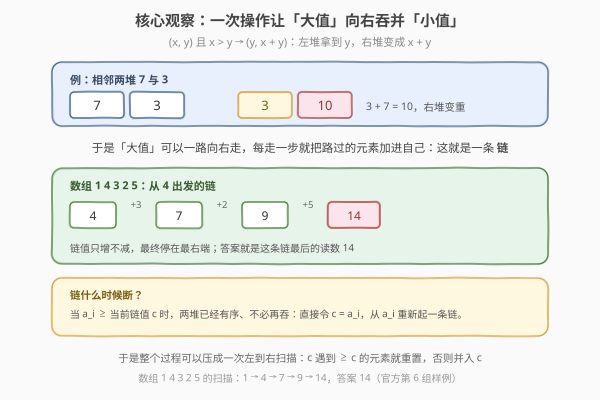
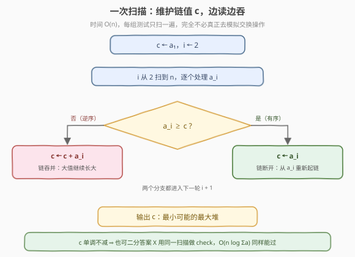
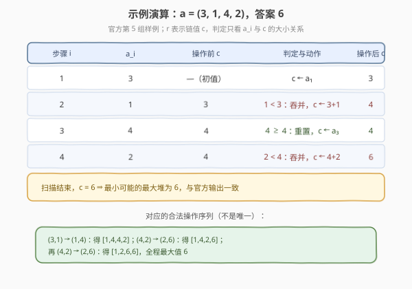
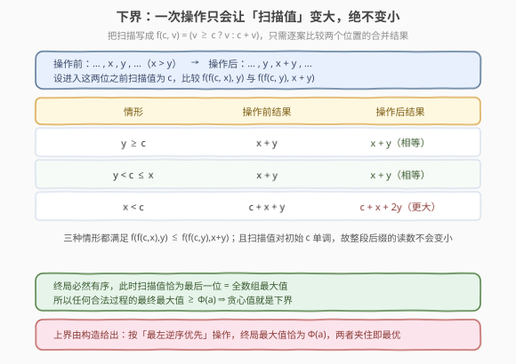

# Codeforces 2237C 鸭子盈余 题解

## 1. 题目概述

- **标题 / 题号**：鸭子盈余（Codeforces 2237C，英文名 Duck Surplus）
- **链接**：https://codeforces.com/problemset/problem/2237/C
- **来源**：Order Capital Round 2 (Codeforces Round 1104, Div. 1 + Div. 2) · Problem C
- **难度**：rating 1000（1250 分）
- **限制**：时间 2 s / 内存 256 MB
- **标签**：二分查找、贪心、线性扫描

**题意**：$n$ 堆橡皮鸭排成一行，第 $i$ 堆有 $a_i$ 只。只要序列还**不是非降序**，Ja 就必须做一次操作：选一个 $i$ 满足 $a_i > a_{i+1}$，把这对相邻堆换成

$$(a_i,\ a_{i+1}) \longrightarrow (a_{i+1},\ a_i + a_{i+1}).$$

也就是说：小的那堆留在左边，大的那堆「搬进」右边并把自身加到右堆上。操作顺序可以任意选择。题目保证无论怎么选，过程总会在有限步后让序列变成非降序。要求**最小化结束时最大那一堆的数量**。

**约束**：

- $1 \le t \le 10^4$，$1 \le n \le 2 \times 10^5$，且 $\sum n \le 2 \times 10^5$；
- $1 \le a_i \le 10^9$；
- 答案最大约 $\sum a_i \le 2 \times 10^{14}$，必须用 64 位整数。

## 2. 示例与观察
官方 10 组样例（输入 / 输出原样）：

```text
输入
10
4
1 2 2 5
2
7 3
3
3 2 1
5
2 2 1 3 3
4
3 1 4 2
5
1 4 3 2 5
6
6 2 5 1 4 3
7
2 7 1 6 3 5 4
8
8 1 7 2 6 3 5 4
5
1000000000 999999999 999999998 999999997 999999996
```

```text
输出
5
10
6
3
6
14
21
26
36
4999999990
```

几组关键样例的解读：

| 组 | 数据 | 说明 |
|----|------|------|
| 1 | $(1,2,2,5)$ | 本来就非降序，一次操作都不用做，答案 $5$ |
| 2 | $(7,3)$ | 唯一操作：$(3,10)$，答案 $10$ |
| 3 | $(3,2,1)$ | 只能整体合并，答案 $6=\sum a_i$ |
| 4 | $(2,2,1,3,3)$ | 两处 $2>1$ 依次合并，得 $(1,3,3,3,3)$，答案 $3$ |
| 9 | $(8,1,7,2,6,3,5,4)$ | 一路「大吞小」，答案 $36=\sum a_i$ |
| 10 | $10^9,10^9-1,\dots$ | 严格递减，全部合并，答案 $4999999990$ |

**自造示例**（用于说明「相等不算逆序」）：

```text
输入
2
2
2 2
3
4 1 2

输出
2
7
```

第 1 组 $2$ 与 $2$ 已有序，不能操作，答案 $2$；第 2 组 $4$ 吞 $1$ 成 $5$，再吞 $2$ 成 $7$。

## 3. 解题思路

### 3.1 暴力思路

最直接的做法是把「操作顺序」全部枚举一遍：每一步从所有逆序位置里挑一个递归下去，取所有终局的最大值的全局最小。状态数随 $n$ 指数爆炸，$n=2\times10^5$ 完全不可能，只能拿来做小数据对拍（本文第 5 节的结论正是靠它对拍验证的）。

另一个「看起来很靠谱」的做法是**直接模拟**一种固定策略，例如「每次选最左的逆序位置操作」。这个策略确实能取到最优（后文证明），但**一次模拟的代价是 $\Theta(n^2)$**：严格递减的数组恰好要做

$$\frac{n(n-1)}{2}$$

次操作；实测 $n=2000$ 的随机数据也要约 $1.97\times10^6$ 次操作。$n=2\times10^5$ 时是 $2\times10^{10}$ 量级，必然超时。

所以真正的任务是：**把最优策略的最终结果，压缩成一个不需要模拟的式子。**

### 3.2 核心观察：一条「向右吞噬」的链



看懂操作的语义是关键。设一对逆序为 $x > y$，操作把它变成 $(y,\ x+y)$：

- 大的 $x$ **搬到右边**，并把自身加到右堆上，右堆从 $y$ 变成 $x+y$；
- 左边留下的是 $y$，也就是刚才那个**较小的值**。

于是「大值」可以一路向右走：每走一步，它就把路过的元素吞进自己，自身单调变大。我们把这条不断长大的值叫做一条**链**，记链值为 $c$。

链什么时候停？当它右边那个元素 $a_i$ 满足 $a_i \ge c$ 时，这两堆已经是「小在左、大在右」的正确顺序，**不需要**再操作；此时 $a_i$ 自己变成新链的起点。所以整条链的行为只取决于「当前链值 $c$」和「下一个元素 $a_i$」：

$$c \leftarrow \begin{cases} a_i, & a_i \ge c \quad(\text{有序，重新起链})\\[2pt] c + a_i, & a_i < c \quad(\text{逆序，链吞并})\end{cases}$$

直觉上，最终数组是非降序、最大值落在最右端，而最右端的值正是最后一条链一路吞并出来的读数。把它写成递推，就得到一次左到右扫描（严格证明见第 5 节，不依赖这个直觉）：

$$c_1 = a_1,\qquad c_i = \begin{cases} a_i, & a_i \ge c_{i-1}\\[2pt] c_{i-1} + a_i, & a_i < c_{i-1}\end{cases}\qquad \Phi(a) = c_n$$

注意 $c$ **单调不减**（要么重置成不小于 $c$ 的 $a_i$，要么加上正数 $a_i$），所以最终读数就是扫描过程中的最大值。

### 3.3 算法流程



1. 读入 $a_1$，令链值 $c = a_1$；
2. 从 $i = 2$ 扫到 $n$：若 $a_i \ge c$ 则 $c \leftarrow a_i$，否则 $c \leftarrow c + a_i$；
3. 输出 $c$。

复杂度 $O(n)$，额外空间 $O(1)$（只需要一个滚动变量）。

> 💡 题目的标签里有 **binary search**：因为 $c$ 单调不减，「终局最大值 $\le X$」关于 $X$ 也单调，所以完全可以二分答案 $X$，用「扫描途中一旦 $c > X$ 就判假」作为 `check`，得到 $O(n\log \sum a)$ 的做法，同样能过。但既然扫描一遍就能直接算出 $\Phi(a)$，二分的 $\approx 48$ 倍常数就是白花的。

### 3.4 示例演算



以官方第 5 组 $a = (3,1,4,2)$ 为例：

| 步骤 $i$ | $a_i$ | 操作前 $c$ | 判定与动作 | 操作后 $c$ |
|----------|-------|-----------|-----------|-----------|
| 1 | $3$ | —（初值） | $c \leftarrow a_1$ | $3$ |
| 2 | $1$ | $3$ | $1 < 3$：吞并，$c \leftarrow 3+1$ | $4$ |
| 3 | $4$ | $4$ | $4 \ge 4$：重置，$c \leftarrow a_3$ | $4$ |
| 4 | $2$ | $4$ | $2 < 4$：吞并，$c \leftarrow 4+2$ | $6$ |

答案 $6$，与官方输出一致。对应的一个合法操作序列是

$$[3,1,4,2] \to [1,4,4,2] \to [1,4,2,6] \to [1,2,6,6],$$

全程最大值始终是 $6$。

再看官方第 9 组 $(8,1,7,2,6,3,5,4)$：扫描值为 $8 \to 9 \to 16 \to 18 \to 24 \to 27 \to 32 \to 36$，一步都没有重置，答案 $36$（官方输出）。

## 4. 算法细节

1. **初值**：$c$ 从 $a_1$ 开始。若从 $0$ 开始也等价（$a_1 \ge 0$ 必然走重置分支），但写 $a_1$ 更直观，也避免 $a_i$ 可能为 $0$ 的变体出错。
2. **必须用 `>=` 而不是 `>`**：$a_i = c$ 时两堆已经有序，不该吞并（吞并会白白变成 $2c$）。见第 8 节第 3 条的反例。
3. **64 位**：$c$ 最大可达 $\sum a_i \le 2\times10^{14}$，超出 `int`。C++ 全程 `long long`，读入用 `%lld`；Python 的整数无上限，无需处理。
4. **空间**：只需要一个 `long long c`。若边读边算，连数组都不必存；本文代码仍存数组，便于阅读。
5. **多测**：每组重新置 $c$，不要保留上一组的状态。$\sum n \le 2\times10^5$ 保证总扫描次数也是 $O(\sum n)$，与 $t$ 无关。
6. **不要真的模拟**：即使只是「每步找最左逆序」也要 $\Theta(n^2)$ 次操作，前文已量化；把策略的**结果**写成递推式才是正解。
7. **不要套前缀和/排序**：答案不是「排序后的前缀和」，第 4 组 $(2,2,1,3,3)$ 的答案是 $3$ 而非 $\sum a_i=11$；扫描值才是唯一正确的口径。

## 5. 正确性证明



先把扫描写成函数形式：$f(c, v) = v$（当 $v \ge c$），否则 $f(c, v) = c + v$；对数组 $a$ 从某个初值 $c_0$ 出发依次作用，结果记为 $\mathrm{scan}(c_0, a)$，并记 $\Phi(a) = \mathrm{scan}(a_1, a_{2..n})$。

**引理 1（单步不降）**：对任意 $c$ 与 $x > y$，有

$$f\bigl(f(c,x),\,y\bigr) \le f\bigl(f(c,y),\,x+y\bigr).$$

**证明**：按 $c$ 与 $x, y$ 的关系分三种情形（注意 $x > y$）。

- $y \ge c$：左边 $f(c,x) = x$（因 $x > y \ge c$），故 $f(x,y) = x+y$；右边 $f(c,y) = y$，故 $f(y, x+y) = x+y$。相等。
- $y < c \le x$：左边 $f(c,x) = x$，故 $f(x,y) = x+y$；右边 $f(c,y) = c+y$，而 $x+y \ge c+y$，故 $f(c+y,x+y) = x+y$。相等。
- $x < c$：左边 $f(c,x) = c+x$，故 $f(c+x,y) = c+x+y$（因 $y < c < c+x$）；右边 $f(c,y) = c+y$，而 $x+y < c+y$，故 $f(c+y,x+y) = c+x+2y$。因为 $y \ge 1 > 0$，有 $c+x+y < c+x+2y$，即右边严格更大。

三种情形都成立，故引理成立。∎

**引理 2（对初值单调）**：若 $c \le c'$，则对任意 $v$ 有 $f(c,v) \le f(c',v)$，从而 $\mathrm{scan}(c, a) \le \mathrm{scan}(c', a)$。

**证明**：对单个元素分三种情形：$v \ge c'$ 时两边都得 $v$；$c \le v < c'$ 时左边得 $v$、右边得 $c'+v > v$；$v < c$ 时左边得 $c+v \le c'+v$。逐个元素归纳即得整段后缀的结论。∎

**引理 3（一次操作后 $\Phi$ 不减小）**：设 $b$ 由 $a$ 经过一次操作得到，则 $\Phi(b) \ge \Phi(a)$。

**证明**：设操作发生在位置 $i$，即 $a_i = x > y = a_{i+1}$，且 $b_i = y,\ b_{i+1} = x+y$，其余位置相同。前 $i-1$ 个元素完全一致，故进入第 $i$ 位时的扫描值 $c$ 相同。由引理 1，处理完这两位后 $b$ 的扫描值不小于 $a$ 的扫描值；再由引理 2，后面第 $i+2..n$ 位（两数组相同）的最终读数也不会更小。∎

**引理 4（终局的 $\Phi$ 就是最大值）**：若数组非降序，则 $\Phi(a) = a_n = \max a$。

**证明**：非降序意味着每一步都有 $a_i \ge c$（$c$ 始终是上一个元素），于是全部走「重置」分支，$c$ 依次等于 $a_1, a_2, \dots, a_n$，最终读数为 $a_n$，也正是最大值。∎

**定理 1（下界）**：任意合法过程结束时，最大堆的数量都 $\ge \Phi(a)$。

**证明**：设终局为 $v$。由引理 3，沿着过程的每一步都有 $\Phi$ 不减小，故 $\Phi(v) \ge \Phi(a)$；而 $v$ 非降序，由引理 4 得 $\Phi(v) = \max v$。所以 $\max v \ge \Phi(a)$。∎

**引理 5（上界构造）**：存在一种操作方式，使终局最大值恰为 $\Phi(a)$，且过程中出现的每个值都不超过 $\Phi(a)$。

**证明**：记 $c_k = \Phi(a[1..k])$（$c_k$ 单调不减）。我们维护如下不变量：处理完前 $k$ 个元素后，

- 位置 $1..k$ 已非降，且位置 $k$ 的值等于 $c_k$；
- 位置 $k+1..n$ 仍是原始值 $a_{k+1}, \dots, a_n$。

$k=1$ 时显然成立。设不变量对 $k$ 成立，考虑 $a_{k+1}$：

- 若 $a_{k+1} \ge c_k$：无需操作，位置 $1..k+1$ 已非降，且位置 $k+1$ 的值就是 $a_{k+1} = c_{k+1}$，不变量保持。
- 若 $a_{k+1} < c_k$：先在位置 $k$ 操作，得到 $(a_{k+1},\ c_k + a_{k+1}) = (a_{k+1},\ c_{k+1})$，于是位置 $k+1$ 已经是 $c_{k+1}$。此时位置 $k$ 变成较小的 $a_{k+1}$，可能破坏前缀的单调性；记前缀为 $s_1 \le s_2 \le \dots \le s_{k-1} \le c_k$。只要 $s_{k-1} > a_{k+1}$，就在位置 $k-1$ 操作，把 $(s_{k-1}, a_{k+1})$ 变成 $(a_{k+1},\ s_{k-1}+a_{k+1})$，即小值继续向左「冒泡」、被它越过的每个值都加上 $a_{k+1}$；如此向左直到左侧元素 $\le a_{k+1}$ 为止。停止后位置 $1..k+1$ 重新非降，位置 $k+1$ 仍为 $c_{k+1}$，不变量保持。

另外，上述每一步新产生的值都形如 $s_j + a_{k+1} \le c_k + a_{k+1} = c_{k+1} \le c_n = \Phi(a)$，所以过程中不会出现比 $\Phi(a)$ 更大的值。对 $k = 1..n-1$ 归纳，终局（$k=n$）非降且最大值 $= c_n = \Phi(a)$。∎

> 💡 注意这个构造每一步都作用在「最左侧的那个逆序位置」上，因此第 3.1 节提到的「最左逆序优先」模拟策略确实取到最优，只是它的操作次数是 $\Theta(n^2)$，所以本文只用它来理解过程，不用它来算答案。

**定理 2（答案）**：$\min\{\max v\} = \Phi(a)$，即答案就是一次扫描的读数。

**证明**：由定理 1 任何过程的最大值 $\ge \Phi(a)$，由引理 5 存在过程达到 $\Phi(a)$，两者夹住。∎

## 6. 复杂度分析

- **时间**：每组 $O(n)$，一次循环、每个元素 $O(1)$ 次比较与加法；$\sum n \le 2\times10^5$，总运算量 $O(\sum n)$，约 $2\times10^5$ 次。多测的读入是主要开销。
- **空间**：存输入数组 $O(n)$；若边读边算可压到 $O(1)$ 个 `long long`。
- **与时限的对照**：$n = 2\times10^5$ 的单组最坏数据（交替大值/小值，链一直吞并）C++ 实测约 $0.01$ s、Python3 约 $0.05$ s；$t=10^4$、$\sum n = 2\times10^5$ 的多测数据 C++ 约 $0.02$ s、Python 约 $0.06$ s。相对 $2$ s 的时限都有两个数量级以上余量，Python3 直接提交即可，无需 PyPy。
- **对照**：若改回「硬模拟最左逆序」，同样数据需要 $\Theta(n^2) \approx 2\times10^{10}$ 次操作，必然 TLE —— 这正是本题 $n\le 2\times10^5$ 想卡掉的写法。

## 7. 参考代码

### C++17

```cpp
#include <bits/stdc++.h>
using namespace std;

int main() {
    int t;
    if (scanf("%d", &t) != 1) return 0;
    while (t--) {
        int n;
        scanf("%d", &n);
        vector<long long> a(n);
        for (int i = 0; i < n; i++) scanf("%lld", &a[i]);

        // 一次扫描：c 是当前“链”的值
        // a[i] >= c 说明两堆已有序，链断开，从 a[i] 重新起链
        // a[i] <  c 说明是逆序，链吞并 a[i]
        long long c = a[0];
        for (int i = 1; i < n; i++) {
            if (a[i] >= c) c = a[i];
            else c += a[i];
        }
        printf("%lld\n", c);
    }
    return 0;
}
```

### Python3

```python
import sys


def main() -> None:
    data = sys.stdin.buffer.read().split()
    if not data:
        return
    t = int(data[0])
    nums = list(map(int, data[1:]))
    pos = 0
    out = []
    for _ in range(t):
        n = nums[pos]
        pos += 1
        c = nums[pos]           # 链值初值 a_1
        pos += 1
        for i in range(pos, pos + n - 1):
            v = nums[i]
            if v >= c:          # 已有序：链断开，重新起链
                c = v
            else:               # 逆序：链吞并
                c += v
        pos += n - 1
        out.append(str(c))
    sys.stdout.write("\n".join(out) + "\n")


if __name__ == "__main__":
    main()
```

## 8. 边界情况与易错点

1. **$n = 1$**：循环一次都不执行，输出 $a_1$，正确。
2. **数组本来就非降序**：每一步都是 $a_i \ge c$，$c$ 最终等于 $a_n$，即最大值，答案就是 $\max a$（官方第 1 组）。
3. **相等不能算逆序**：判定必须写 `a_i >= c` 走重置。若误写成 `a_i > c`，在 $(2,2)$ 上会得到 $4$（正确答案 $2$），在 $(1,1,1)$ 上会得到 $3$（正确答案 $1$）——这是本题最常见的一处 WA。
4. **溢出**：$c$ 可达 $2\times10^{14}$，`int` 必溢出。C++ 用 `long long` 配 `%lld`；`vector<long long>` 读入时别写成 `%d`。
5. **多测清空**：$c$ 必须在每组开头重新赋成该组的 $a_1$，不能跨组复用。
6. **不要硬模拟**：$\Theta(n^2)$ 次的「最左逆序优先」模拟在小样例上看不出问题，但 $n=2\times10^5$ 必然 TLE；应直接用扫描递推。
7. **不要套「排序后前缀和」**：$(2,2,1,3,3)$ 的答案是 $3$，而 $\sum a_i = 11$，两者相差很远；扫描值才是答案。
8. **二分写法的界**：若采用二分答案，下界取 $\max a_i$（更小则 `check` 必假），上界取 $\sum a_i$，注意上界也要用 64 位。

## 9. 验证记录

- **编译环境与命令**：`clang++ -std=c++17 -O2`（本机无 GNU g++，配 `codeforces/tools/include/bits/stdc++.h` 兼容头；正文代码只用标准库，可原样提交 GNU C++17）；Python 侧为 `Python 3.9.6`。
- **官方样例**：1 / 1 通过（按 Codeforces 标准 checker 的 token 比对，忽略空白与大小写）。
- **复核状态**：audited（2026-11-19 统一回归：编译 + 官方样例；写作期的随机对拍与暴力未重跑）。

## 相关题目与扩展

- [Codeforces 2237C. Duck Surplus](https://codeforces.com/problemset/problem/2237/C)：本题。
- [Codeforces 2237B. Annoying the Ghost](https://codeforces.com/problemset/problem/2237/B)：同场 B 题，贪心认领 + 逆序对，可与本题对照「贪心正确性靠什么保证」。
- [Codeforces 1430E. String Reversal](https://codeforces.com/problemset/problem/1430/E)：同样把「相邻交换」的代价折算成可计算量（逆序对），思路是「先找个好刻画，再算它」。
- [Codeforces 2237A. Destroying Towers](https://codeforces.com/problemset/problem/2237/A)：同场 A 题，博弈 + 贪心，适合热身。

**延伸思考**：

1. **改成最大化最大值**：结论会完全不同。例如 $(3,2,1)$ 可以走到 $(1,3,7)$，最大值 $7$ 已经超过 $\sum a_i = 6$ —— 因为操作会「复制」小值，总和并不是不变量。而且「最右逆序优先」并不最优：$(3,3,2,1)$ 的最好终局是 $(1,3,6,13)$（最大值 $13$），而最右优先只走到 $(1,3,7,7)$。最大化版本需要另找口径，可以用第 3.1 节的暴力对拍来找规律。
2. **必须输出操作序列**：第 5 节的构造性证明直接给出了做法（每步处理一个前缀，必要时让小值向左冒泡），操作数最坏仍是 $\Theta(n^2)$，所以一般只能输出压缩形式（例如「每条链吞并了哪些下标」）。
3. **如果一次操作可以把左堆的任意一部分转移给右堆**，那么链值就不再由单一递推决定，问题会退化成带决策的 DP 或贪心 + 二分，难度大幅上升。
4. **可迁移的套路**：遇到「相邻元素满足某条件就合并 / 交换」的题，先问两个问题——(a) 合并后的量能不能用一个「链值」概括？(b) 这个链值关于操作顺序是否单调？本题正是 (a)(b) 都成立，才把 $\Theta(n^2)$ 的模拟压成了 $O(n)$ 的扫描。
