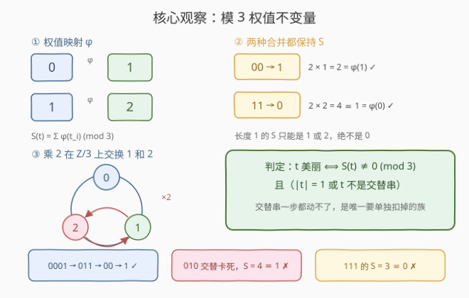
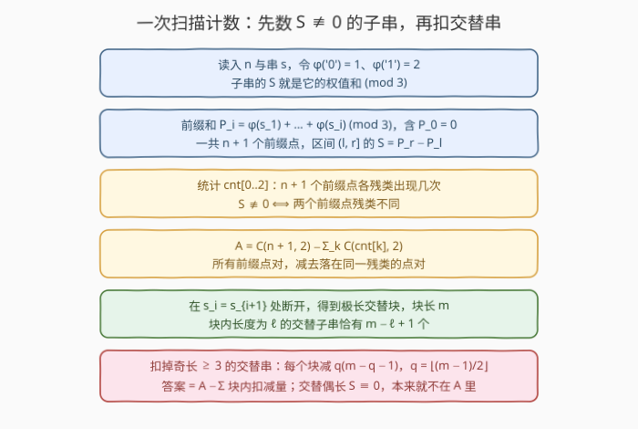
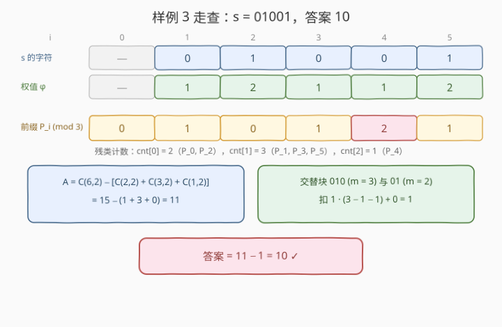

# Codeforces 2237D 钢之比特炼金术师 题解

## 1. 题目概述

- **标题 / 题号**：钢之比特炼金术师（Codeforces 2237D，英文名 Fullmetal Bitchemist）
- **链接**：https://codeforces.com/problemset/problem/2237/D
- **来源**：Order Capital Round 2 (Codeforces Round 1104, Div. 1 + Div. 2) · Problem D
- **难度**：1600（1750 分，题面标注 *1600）
- **限制**：时间 2 s / 内存 256 MB
- **标签**：构造、贪心、数学

**题意**：二进制串 $t$ 称为**美丽**，如果可以用任意多次（含 $0$ 次）操作把它变成**长度恰为 $1$** 的串。一次操作是：选一对**相邻且相等**的字符，删掉这两个字符，并在原位置放入**一个相反**的字符，即 `00` $\to$ `1`、`11` $\to$ `0`。给定二进制串 $s$，求 $s$ 有多少个**非空美丽子串**。多测。

**约束**：

- $1 \le t \le 10^4$，$1 \le n \le 10^6$，且 $\sum n \le 10^6$；
- 子串总数 $\frac{n(n+1)}{2}$ 可达 $5\times 10^{11}$，答案必须用 64 位整数；
- 每次操作把长度减 $1$，所以长度 $1$ 的串必须用 $0$ 次操作判定为美丽；
- 需要每组 $O(n)$（总 $O(\sum n)$），"枚举子串再逐个判定"无论判定多快都不可行。

## 2. 示例

官方样例（输入 / 输出原样，共 10 组）：

```text
输入
10
1
0
2
01
5
01001
3
001
6
011110
9
010110110
12
010000101001
16
1010011010010110
20
11110101101101001110
30
000101100011111001111100000010
```

```text
输出
1
2
10
5
15
30
47
81
139
316
```

逐组对照：

| # | $n$ | $s$ | 答案 |
|---|-----|-----|------|
| 1 | 1 | `0` | 1 |
| 2 | 2 | `01` | 2 |
| 3 | 5 | `01001` | 10 |
| 4 | 3 | `001` | 5 |
| 5 | 6 | `011110` | 15 |
| 6 | 9 | `010110110` | 30 |
| 7 | 12 | `010000101001` | 47 |
| 8 | 16 | `1010011010010110` | 81 |
| 9 | 20 | `11110101101101001110` | 139 |
| 10 | 30 | `000101100011111001111100000010` | 316 |

第 4 组可以手验：`001` 的 $6$ 个子串里只有 `01` 不美丽（两个字符不相等，动不了），故答案 $6-1=5$。第 3 组的完整走查见 §3.4。

## 3. 解题思路

### 3.1 暴力思路

先解决"单个串是否美丽"：直接搜索所有合并顺序，状态数随长度指数增长，即使只判长度 $20$ 的串也要枚举上千条路径；再乘上 $O(n^2)$ 个子串，$n=10^6$ 时子串就有 $5\times 10^{11}$ 个，连"每个 $O(1)$"都不可能。

所以本题的关口不在实现，而在**把"能一路合并到长度 1"变成一个可以直接数出来的充要条件**。

### 3.2 核心观察：模 3 权值不变量 + 交替串例外



给字符赋权 $\varphi(\texttt{0})=1$、$\varphi(\texttt{1})=2$，定义

$$S(t)=\sum_{i=1}^{|t|}\varphi(t_i) \pmod 3 .$$

一次操作把 $xx$ 换成 $\bar x$（相反字符），权值和的变化是 $2\varphi(x) \to \varphi(\bar x)$，而

$$2\varphi(\texttt{0})=2=\varphi(\texttt{1}),\qquad 2\varphi(\texttt{1})=4\equiv 1=\varphi(\texttt{0}) \pmod 3,$$

所以 **$S(t)$ 在每次操作下都不变**。

- 长度 $1$ 的串只有 $S=1$ 或 $S=2$，**绝不可能 $S\equiv 0$**。因此 $S(t)\equiv 0$ 的串一定不美丽：`01`、`000`、`111` 都栽在这一条上；
- 但 $S\not\equiv 0$ 还不够。`010` 是交替串，根本没有相邻相等对，一步都动不了，而它 $S=1+2+1=4\equiv 1$。

补上"必须是交替串"这个唯一漏洞，就得到本题的判定定理：

$$t \text{ 美丽}\iff S(t)\not\equiv 0 \pmod 3 \ \text{且}\ \bigl(|t|=1 \text{ 或 } t \text{ 不是交替串}\bigr).$$

直觉：交替串是唯一"卡死"的形态；只要存在一处相邻相等，就能在模 $3$ 不变量允许的范围内一路合并到底（§5 按相同字符段长度分类给出严格证明）。

### 3.3 算法流程：两段相减



判定把答案拆成两个都能 $O(n)$ 数清的集合：

**第一段 $A$：$S\not\equiv 0$ 的子串数。** 令 $P_0=0$，$P_i=(P_{i-1}+\varphi(s_i)) \bmod 3$，下标从 $1$ 开始。子串 $s[l..r]$ 的权值和是 $P_r-P_{l-1}\bmod 3$，于是

$$S(s[l..r])\not\equiv 0 \iff P_{l-1}\ne P_r,\qquad 0\le l-1<r\le n .$$

设残类 $k$ 在 $P_0,\dots,P_n$ 中出现 $c_k$ 次，则

$$A=\binom{n+1}{2}-\sum_{k=0}^{2}\binom{c_k}{2}.$$

**第二段 $B$：扣掉混进 $A$ 的"假成员"。** 它们只能是 $S\not\equiv 0$ 却又卡死的交替串。交替子串必然整段躺在某个**极长交替块**里——在 $s_i=s_{i+1}$ 处切开即可，设块长 $m$。块内长度 $\ell$ 的交替子串恰有 $m-\ell+1$ 个，取 $\ell=2t+1\ge 3$：

$$B_m=\sum_{t=1}^{q}(m-2t)=qm-q(q+1)=q\,(m-q-1),\qquad q=\left\lfloor\frac{m-1}{2}\right\rfloor .$$

**答案** $=A-\sum_{\text{块}} B_m$。两个容易踩的边界：交替**偶**长串的 $S\equiv 0$，本来就不在 $A$ 里，不能再扣；长度 $1$ 的串既在 $A$ 里又确实美丽，也不能扣。

### 3.4 示例演算



对 $s=\texttt{01001}$：权值 $1,2,1,1,2$，前缀残类 $P=0,1,0,1,2,1$，故 $c_0=2$（$P_0,P_2$）、$c_1=3$（$P_1,P_3,P_5$）、$c_2=1$（$P_4$）。

- $A=\binom{6}{2}-\bigl[\binom{2}{2}+\binom{3}{2}+\binom{1}{2}\bigr]=15-(1+3+0)=11$；
- 交替块为 `010`（$m=3$）与 `01`（$m=2$），扣减 $1\cdot(3-1-1)+0=1$，扣掉的正是 `010`；
- 答案 $11-1=10$，与官方输出一致。

## 4. 算法细节

1. **取模只减一次 $3$**：`p` 恒在 $[0,2]$，加 $2$ 后最大 $4$，写 `p += (ch=='0'?1:2); if (p>=3) p-=3;` 即可，不必用 `%`。若写成 `if (p>3) p-=3` 就会在 `p==3` 时留下残类 $3$，全盘皆错。
2. **`cnt[0]` 的初值必须是 $1$**：一共有 $n+1$ 个前缀点，$P_0=0$ 也算一个；漏掉它会把所有"以第 $1$ 个字符开头"的子串统计错，样例 1（$n=1$）直接输出 $0$。
3. **$A$ 用"总数减同残类"**：$\binom{n+1}{2}-\sum_k\binom{c_k}{2}$，$O(1)$ 算完，避免再枚举点对。
4. **交替块切分**：`i` 从 $0$ 起，尽量把 `j` 推到 $s_{j+1}\ne s_j$ 的最后一格，块长 `m=j-i+1`，然后 `i=j+1`。每格只被访问常数次，总 $O(n)$。
5. **扣减公式**：`q=(m-1)/2`，扣 `q*(m-q-1)`；$m=1,2$ 时 $q=0$，自动不扣，不需要特判。
6. **64 位整数**：$A\le 5\times 10^{11}$，C++ 必须 `long long`（`int` 会溢出成负数）；Python 无此问题。
7. **快速读入**：$t$ 可达 $10^4$、总长 $10^6$，用 `scanf` 或关闭同步的 `cin`；Python 用 `sys.stdin.buffer.read().split()` 一次读完。
8. **不要真的去模拟合并**：贪心归约是有坑的——`0001` 若从左端先合 `00` 会得到 `101` 并卡死，但走另一条路 `0001 → 011 → 00 → 1` 就成功。本题只需要权值和交替块，模拟反而容易写错。

## 5. 正确性证明

**引理 1（不变量）**：任意一次操作都不改变 $S(t)$。

**证明**：操作把相邻的 $xx$ 换成 $\bar x$，权值和由 $S$ 变为 $S-2\varphi(x)+\varphi(\bar x)$。由 $2\varphi(\texttt{0})=\varphi(\texttt{1})$、$2\varphi(\texttt{1})\equiv\varphi(\texttt{0})\pmod 3$ 两种情形都相等，故差为 $0$。∎

**引理 2（必要条件）**：若 $t$ 美丽，则 $S(t)\not\equiv 0$，且 $|t|=1$ 或 $t$ 非交替。

**证明**：美丽意味着存在操作序列到达某个长度为 $1$ 的串 $u$，由引理 1，$S(t)=S(u)\in\{1,2\}$，故 $S(t)\not\equiv 0$。若 $|t|\ge 2$ 且 $t$ 交替，则 $t$ 不含相邻相等对，任何一步操作都不合法，长度恒为 $|t|\ge 2$，矛盾。∎

**引理 3（关键一步：总能保住"非交替"）**：设 $t$ 非交替、$|t|\ge 2$ 且 $t\notin\{\texttt{000},\texttt{111}\}$，则存在一次合法操作，使结果 $t'$ 满足 $|t'|=|t|-1$，且 $|t'|=1$ 或 $t'$ 非交替。

**证明**：把 $t$ 分解为极长的相同字符段（run）。若存在两条长度 $\ge 2$ 的 run，在其中一条内合并，另一条原样保留，结果仍含相邻相等对。否则只有一条 run 长为 $k\ge 2$，其余 run 长均为 $1$（左右各是一段交替的前缀/后缀）。在这条 run 内合并等价于保留 $d$ 个 $c$、把其余部分替换成一个 $\bar c$，其中 $0\le d\le k-2$。分情形：

- $k=2$：合并后 $\bar c$ 直接紧贴 run 外的字符，而 run 极大保证外侧字符就是 $\bar c$，形成相邻相等对；若 run 外没有任何字符，则 $|t|=2$，合并后长度为 $1$。
- $k\ge 4$：取 $d=0$，结果里保留 $c^{k-2}$，而 $k-2\ge 2$，自带相邻相等对。
- $k=3$：取 $d=0$ 得 $\bar c\,c$；若 run 左侧有字符（必为 $\bar c$）就与 $\bar c$ 相等。取 $d=1$ 得 $c\,\bar c$；若 run 右侧有字符（同理必为 $\bar c$）就与 $\bar c$ 相等。两条都不能用的唯一情形是左右都空，即 $t=ccc$，正是被排除的 `000`/`111`。

三种情形都给出了长度恰减 $1$、且结果非交替（或长度为 $1$）的合法操作。∎

**引理 4（充分性）**：若 $S(t)\not\equiv 0$ 且（$|t|=1$ 或 $t$ 非交替），则 $t$ 美丽。

**证明**：对 $|t|$ 归纳。$|t|=1$ 时用 $0$ 次操作即可。$|t|\ge 2$ 时 $t$ 非交替，且 $S(t)\not\equiv 0$ 排除 `000`、`111`，故引理 3 给出一次操作得到 $t'$，满足 $|t'|=|t|-1$、$S(t')=S(t)\not\equiv 0$（引理 1）、且 $t'$ 长度为 $1$ 或非交替。由归纳假设 $t'$ 美丽，于是 $t$ 美丽。∎

**定理 1（判定）**：$t$ 美丽 $\iff$ $S(t)\not\equiv 0$ 且（$|t|=1$ 或 $t$ 非交替）。

**证明**：两个方向分别是引理 2 与引理 4。∎

**引理 5（$A$ 的数法）**：第一段统计的恰是 $S\not\equiv 0$ 的子串个数。

**证明**：子串 $s[l..r]$（$1\le l\le r\le n$）与点对 $(l-1,r)$（$0\le l-1<r\le n$）一一对应，共 $\binom{n+1}{2}$ 个；由 $S(s[l..r])\equiv P_r-P_{l-1}$，有 $S\not\equiv 0\iff P_{l-1}\ne P_r$。故只需从总数中减去同残类的点对数 $\sum_k\binom{c_k}{2}$。∎

**引理 6（$B$ 的数法）**：长 $m$ 的极长交替块内，交替且长度为奇数 $\ge 3$ 的子串数为 $q(m-q-1)$，$q=\lfloor (m-1)/2\rfloor$。

**证明**：块内任意子串都交替；固定长度 $\ell$，这样的子串有 $m-\ell+1$ 个。取 $\ell=2t+1$（$1\le t\le q$）求和得 $\sum_{t=1}^{q}(m-2t)=qm-q(q+1)=q(m-q-1)$。∎

**定理 2（算法正确）**：输出 $A-\sum_{\text{块}}B_m$ 恰为美丽子串数。

**证明**：由定理 1，在所有 $S\not\equiv 0$ 的子串中，唯一的非美丽成员是「交替且长度为奇数 $\ge 3$」的串（偶数长的交替串 $S\equiv 0$，本就不在这个集合里）。前者大小为 $A$（引理 5）。后者：一个交替子串必整段落在唯一的极长交替块内，跨块的子串必含相邻相等对因而不交替，各块之间不重不漏，故总数为 $\sum B_m$（引理 6）。两者相减即答案。∎

## 6. 复杂度分析

- **时间**：每组一次扫描求前缀残类 $O(n)$，再一次扫描切交替块 $O(n)$，合计 $O(n)$；总计 $O(\sum n)\le 10^6$ 次基本运算。
- **空间**：除输入的串外只用 `cnt[3]` 与几个整数，额外空间 $O(1)$；若按需存串则 $O(n)$，远低于 256 MB。
- **实测**（Apple clang `-O2`，限时 2 s）：$n=10^6$ 全交替、$n=10^6$ 全 `0`、$n=10^6$ 随机、$t=10^4$ 组每组 $n=100$ 四种极端，CPU 时间均为 0.07–0.09 s；同一份程序只读入不计算也要 0.06–0.08 s，即**计数本身只占 0.01–0.02 s**。墙钟 0.1–0.2 s（随机器负载波动），余量 10 倍以上。
- **Python3** 同规模 CPU 约 0.24–0.37 s、墙钟 0.3–0.6 s（含解释器启动），2 s 内可过；若担心机器较慢，建议 PyPy 或直接交 C++。

## 7. 参考代码

### C++17

```cpp
#include <bits/stdc++.h>
using namespace std;
typedef long long ll;

int main() {
    ios::sync_with_stdio(false);
    cin.tie(nullptr);
    int T;
    if (!(cin >> T)) return 0;
    while (T--) {
        int n;
        string s;
        cin >> n >> s;
        // 前缀残类：P_0 = 0，phi('0') = 1，phi('1') = 2
        int cnt[3] = {1, 0, 0};
        int p = 0;
        for (char ch : s) {
            p += (ch == '0' ? 1 : 2);
            if (p >= 3) p -= 3;
            cnt[p]++;
        }
        ll total = (ll)n * (n + 1) / 2;      // 所有前缀点对
        ll same = 0;
        for (int k = 0; k < 3; k++) same += (ll)cnt[k] * (cnt[k] - 1) / 2;
        ll ans = total - same;              // S != 0 (mod 3) 的子串数

        // 扣掉交替且长度奇数 >= 3 的子串
        int i = 0;
        while (i < n) {
            int j = i;
            while (j + 1 < n && s[j + 1] != s[j]) j++;
            int m = j - i + 1;
            ll q = (m - 1) / 2;
            ans -= q * ((ll)m - q - 1);
            i = j + 1;
        }
        cout << ans << "\n";
    }
    return 0;
}
```

### Python3

```python
import sys


def main() -> None:
    data = sys.stdin.buffer.read().split()
    t = int(data[0])
    pos = 1
    out = []
    for _ in range(t):
        n = int(data[pos]); pos += 1
        s = data[pos].decode(); pos += 1

        cnt = [1, 0, 0]                     # P_0 = 0
        p = 0
        for ch in s:
            p += 1 if ch == '0' else 2
            if p >= 3:
                p -= 3
            cnt[p] += 1

        ans = n * (n + 1) // 2
        for c in cnt:
            ans -= c * (c - 1) // 2

        i = 0
        while i < n:
            j = i
            while j + 1 < n and s[j + 1] != s[j]:
                j += 1
            m = j - i + 1
            q = (m - 1) // 2
            ans -= q * (m - q - 1)
            i = j + 1

        out.append(str(ans))
    sys.stdout.write("\n".join(out) + "\n")


main()
```

## 8. 边界情况与易错点

1. **$n=1$**：只有一个长度 $1$ 的子串，$A=\binom{2}{2}-0=1$，块长 $1$ 扣 $0$，输出 $1$；若 `cnt[0]` 初值写 $0$，这里会输出 $0$。
2. **全部字符相同**（如 `000000`）：交替块全是长度 $1$，$B=0$，答案就是 $S\not\equiv 0$ 的子串数；不要误以为"全同的串一定都能合并成功"，`000`、`111` 就长这样。
3. **全交替串**（如 `0101…`）：整串是一个块，扣减量最大；$n=10^6$ 时答案恰为 $n$——只剩长度 $1$ 的子串美丽，其余要么 $S\equiv 0$（偶长）要么卡死（奇长 $\ge 3$）。
4. **交替偶长不能扣**：`01`、`0101` 的 $S\equiv 0$，本来就不在 $A$ 中；若把"所有交替长 $\ge 2$"统一扣掉就会少算。反之交替奇长 $\ge 3$ 必须扣，`010` 是标准反例。
5. **`p` 的更新**：`p+2` 最大为 $4$，写 `if (p>=3) p-=3` 恰好归一；写成 `if (p>3)` 会留下残类 $3$，`cnt[3]` 越界。
6. **溢出**：$A$ 最大约 $5\times 10^{11}$，`int` 必然溢出；`total`、`same`、`ans` 都用 `long long`。
7. **多测重置**：`cnt` 每组都必须是 `{1,0,0}`，不能沿用上一组；块的扫描下标 `i` 也要从 $0$ 重新开始。
8. **点对总数是 $\binom{n+1}{2}$ 而不是 $\binom{n}{2}$**：前缀点有 $n+1$ 个，写成 `n*(n-1)/2` 会漏掉所有从第 $1$ 个字符开始的子串；样例 2（`01`）会因此输出 $0$ 而不是 $2$。

## 相关题目与扩展

- [LeetCode 974. 和可被 K 整除的子数组](https://leetcode.cn/problems/subarray-sums-divisible-by-k/)：同款"前缀和取模 + 组合计数"，本题的 $A$ 就是它取补集。
- [Codeforces 1333C. Eugene and an array](https://codeforces.com/problemset/problem/1333/C)：用"前缀和两两不同"刻画好子段，双指针计数，思想与 $A$ 的推导同源。
- [Codeforces 1398C. Good Subarrays](https://codeforces.com/problemset/problem/1398/C)：$a_i\to a_i-1$ 后数零和子段，本质还是前缀和点对计数。

**延伸思考**：

- 把字符表扩到 $k$ 种、规则改为 $xx\to (x+1)\bmod k$，不变量会变成 $\varphi(x)=2^{x}\bmod (2^{k}-1)$，"门槛"从模 $3$ 升为模 $2^{k}-1$；卡死形态也从交替串变成"相邻必不同"的 $k$ 染色串，扣减项需要重新推。
- 若只问"最长美丽子串"，交替串那一段可以用滑动窗口处理：区间要么 $S\not\equiv 0$，要么长度 $\ge 2$ 且含相邻相等对。
- 若改问"美丽子序列"的个数，判定条件里的"交替"就不再适用（子序列可以把中间字符挑走），需要重新刻画可达长度集合，难度会上一个台阶。
